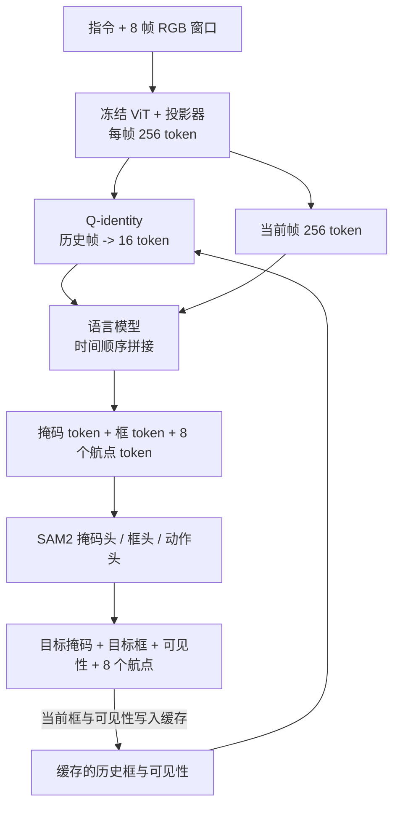

# DobotTrack（Target-Grounded VLA 行人跟踪 · arXiv:2611.09041）

**DobotTrack**（*DobotTrack: Target-Grounded Vision-Language-Action Learning for Embodied Person Tracking*，[arXiv:2611.09041](https://arxiv.org/abs/2611.09041)，[代码仓](https://github.com/Dobot-Team/dobot_track)，[项目页](https://dobot-team.github.io/dobottrack-web/)）由佛山大学、清华大学、Dobot Robotics（越疆）、香港大学作者完成（论文首页）。本页依据论文 v1 全文通读写成，数字均带章节 / 表号。

## 一句话定义

**一个 0.8B 的语言指定行人跟随 VLA：训练时用「人物掩码 + 边界框」逼模型显式表示目标，推理时再用上一步预测的目标框去引导历史帧压缩（Q-identity，每历史帧 16 token），一次前向输出掩码、框和 8 个未来航点。**

## 英文缩写速查

| 缩写 | 英文全称 | 简要说明 |
|------|----------|----------|
| VLA | Vision-Language-Action | 视觉–语言–动作策略；此处输出自身坐标系航点 |
| EVT | Embodied Visual Tracking | 具身视觉跟踪：移动体按语言描述持续跟随目标 |
| EVT-Bench | — | TrackVLA 提出、基于 Habitat 3.0 的仿真评测集 |
| STT / DT / AT | Single-Target / Distracted / Ambiguous Tracking | EVT-Bench 三个设定：单目标 / 有干扰 / 目标歧义 |
| SR / TR / CR | Success / Tracking / Collision Rate | 成功率 / 跟踪率 / 与目标人碰撞而终止的回合比例 |
| VSC | Visual-Spatial Classification | 视觉空间分类：由掩码派生的左中右、大小（仿真另有远近）类别 |
| Q-identity | — | 本文的目标条件历史压缩模块（命名为作者所取） |
| SAM2 | Segment Anything Model 2 | 本文掩码头所用的预训练解码器 |
| DINO | self-DIstillation with NO labels | 用作「未来特征预测」消融的冻结视觉特征 |
| ReID | Re-Identification | 行人重识别，论文用其说明遮挡后重新关联的难点 |

## 为什么重要

- **提出一个具体问题：** 行人跟随里「轨迹看着合理但跟错了人」比轨迹略偏更糟（§I）；论文把「是否真的表示了目标」作为监督对象，而不是只做轨迹模仿。
- **小模型 + 低延迟：** 8 帧窗口的视觉 token 从 2048 降到 368（§III-C），Orin Nano 上 P95 延迟 93.4 ms，约为 256-token 池化（203.9 ms）的 1/2.18（表 IV）。这是对「VLA 能否上端侧」的一个数据点。
- **数据贡献：** 126 episode、约 10.2 小时、596,323 掩码帧的四足真实跟随数据，附半自动标注流程（Qwen3.5 出框 → SAM3 出掩码 → 人工复核，§IV-B）。但 README 标注数据集与权重「Coming soon」，尚不可用。
- **本文不是强化学习工作：** 训练是对专家 / 遥操作轨迹的监督回归（§III-D、表 I 的 RL 列为 ✗）。把它放进「机器人强化学习」叙事里需要注意这一点。

## 核心机制

作者自述的三个贡献（§I）：目标监督的系统比较、Q-identity、真实数据与标注流程。

### 输入输出与骨干（§III-A、§V-A）

- 输入：外观描述指令 + 8 帧 RGB（5 Hz，间隔 0.2 s，448×448）；每帧 256 个视觉 token。
- 输出：8 个未来自身系航点 (x, y, θ)，10 Hz，对应 0.8 s 预测视野。
- 骨干 InternVL3，视觉编码器冻结，投影器 / 语言模型 / Q-identity / 掩码头 / 框头 / 动作头联合训练。

### 辅助监督（§III-B、表 II）

序列中，**掩码 token 与框 token 排在航点 token 之前**，航点因果地看到它们。掩码头 = 投影 + 预训练 SAM2 解码器（读当前帧稠密特征）；框头回归归一化 (cx, cy, w, h) 与可见性。五种辅助任务（分割、框、VSC、未来 DINO 特征、未来帧）在 DT 上对比，终版取「框 + 掩码」。

### Q-identity（§III-C）

1. 每个历史帧：全图特征 Fτ，加二维位置嵌入。
2. 取目标区域：训练时用被扰动的真值框，推理时用此前决策缓存的框与可见性（<0.5 或无缓存则用「无目标」token）。
3. 16 个可学习查询与目标区域 token 拼接做目标条件自注意力，再对全图特征做交叉注意力，共 3 块，dc=512，8 头。
4. 输出 16 个 token / 历史帧，与当前帧 256 token 按时间顺序拼接送入语言模型。

### 流程总览

### 损失（§III-D）

L = L_traj + 0.001·L_seg + 0.01·L_box。轨迹 MSE 对 (x, y, θ) 加权 (1, 3, 2)；分割为 BCE + Dice + IoU 分数 + 存在性；框为 5·SmoothL1 + 2·GIoU + 1·可见性 BCE。

## 数据

| 来源 | 内容（出处） |
|------|------|
| 仿真 | EVT-Bench / Habitat 3.0，约 180 万序列样本，STT:DT:AT = 1:2:1；掩码取自模拟器全景观测，框为最紧外接矩形（§IV-A） |
| 真实 | 四足机器人，约 10.2 h，126 episode，596,669 原始帧 → 565,994 训练样本，596,323 掩码，33 个目标外观档案；室内 5.68 h、室外 4.53 h，约 1 h 含相似干扰（§IV-B） |
| 真实动作来源 | 人类遥操作与一个专家模型（§IV-B）；论文未给出二者占比 |

## 实验与评测

**EVT-Bench 单视角主结果（表 I，SR / TR / CR）：**

| 方法 | 规模 | STT | DT | AT |
|------|------|-----|----|----|
| OmTrackVLA | 1B | 81.4 / 82.8 / 5.1 | 41.5 / 58.8 / 11.3 | 60.0 / 73.9 / 7.6 |
| TrackVLA++ | 7B | 86.0 / 81.0 / 2.1 | 66.5 / 68.8 / 4.7 | 51.2 / 63.4 / 15.9 |
| ReferTrack | 4B | 89.4 / 92.5 / 1.6 | 73.3 / 81.8 / 7.6 | 74.1 / 85.7 / 7.7 |
| LightNav-0（RL 后训练） | 4B | 91.7 / 87.7 / 1.9 | 82.6 / 80.1 / 4.6 | 未报告 |
| 轨迹基线（本文，同 0.8B） | 0.8B | 79.2 / 91.4 / 9.5 | 55.9 / 83.6 / 16.5 | 52.4 / 83.6 / 15.5 |
| **DobotTrack** | **0.8B** | **90.2 / 92.3 / 3.6** | **72.5 / 83.3 / 8.3** | **70.9 / 85.5 / 6.6** |

- 平均 SR 77.9%，比 OmTrackVLA 高 16.9 个点（摘要）。
- 对 TrackVLA++：SR 高 4.2 / 6.0 / 19.7，但 STT、DT 碰撞率更高（§V-B）。对 ReferTrack 与 LightNav-0 在多项上仍落后（§V-B）。
- 多相机方法（CoMaTrack、ABot-N0 等）表内单列，作者称其「提供背景而非受控评估」。

**消融（均为 DT 或三设定 SR，含数字出处）：**

| 对照 | 结果 |
|------|------|
| 辅助任务（表 II，DT SR） | 仅轨迹 55.9；+框 59.6；+VSC 59.6；+掩码 61.3；+框&掩码 63.7；+未来帧 60.9；+DINO 未来特征 58.9 |
| 目标条件（表 III，掩码监督） | 无条件 79.2 / 55.3 / 57.7 → 有条件 84.8 / 67.6 / 65.6（STT / DT / AT SR）；再加框 87.6 / 69.0 / 67.8 |
| 压缩方式（表 IV） | 256-token 池化 平均 SR 69.3、P95 203.9 ms；16-token 池化 67.6、91.0 ms；16-token Q-identity 72.7、93.4 ms |
| 真实数据（表 V，仍在仿真上评测） | 仅仿真 87.6 / 69.0 / 67.8 → 仿真 + 真实 90.2 / 72.5 / 70.9 |

**真机（§V-D）：** 四足机器人在室外步行街的叠加可视化（图 6）与两段对基线的定性对比（图 7）；无成功率等量化指标。

## 工程实践

- **README（静态读取，未运行）：** 训练与 Habitat 评测代码已发布（news 2026-10-30）；训练入口 `scripts/train.py` + `configs/dobottrack_internvl3_1b_q_identity_box_mask.yaml`；评测脚本 `scripts/run_trackvla_habitat_eval.sh`。环境要求 Habitat-Sim 0.3.1（Bullet）、Python 3.10、固定 commit 的 SAM2 与 SAM2.1 Base+ 权重；需外部准备 TrackVLA / EVT-Bench 资产，并另从 gitee 拉取一个 `embodvla` 分支安装。
- **未发布：** 真实数据集与 Hugging Face 权重标 Coming soon；README 明说表内结果尚未绑定公开 checkpoint 与冻结评测配置，复现数字暂无官方依据。
- **部署：** README 称有 Jetson Orin 的 INT8 / W8A8 部署指南（`deploy/dobottrack/README.md`），本页未读该文档，论文只说「优化部署」（表 IV 的延迟）。
- **硬件与训练预算：** 8 张 B300、约 28,000 步、全局 batch 256（§V-A）。
- **使用提示（本页判断）：** 推理依赖上一步缓存的框，部署时必须保留「无目标」回退路径与可见性阈值 0.5（§III-D）。

## 局限与未验证之处

**论文自述（§VI）：** 依赖缓存定位预测的质量与有限的观测窗口；对错误目标关联和长时遮挡的鲁棒性、更广真实场景与目标身份上的闭环表现，留作未来工作。

**本页观察（均为判断，非论文结论）：**

- **真机无量化：** 真机只有定性图（§V-D），「真机可用」缺少成功率、碰撞率与回合数。
- **真实数据的收益只在仿真上验证：** 表 V 在 EVT-Bench 评测，且「仿真 + 真实」相比「仅仿真」同时改变了数据量与分布，无法分离原因。
- **碰撞率并不占优：** STT / DT 的 CR 高于 TrackVLA++（3.6 对 2.1，8.3 对 4.7，表 I）；加框监督后 DT / AT 的 CR 也比仅掩码有条件变体高（表 III）。
- **与更强方法的差距：** DT / AT 的 SR 低于 ReferTrack，STT / DT 低于 RL 后训练的 LightNav-0（§V-B）。
- **对比口径：** 表 I 的他方数字取自引用论文或 ReferTrack / CoMaTrack 的对比，协议与训练数据各异；作者本人也说是「背景而非受控评估」。
- **表 III 无条件行低于池化：** 无目标条件的 Q-identity（DT 55.3）比 16-token 池化（DT 61.3，表 IV）还差，说明增益来自目标条件而非查询结构本身（本页读法）。
- **表 II 的压缩设置未写明：** 掩码行数字与表 IV 的 16-token 池化行相同，推测表 II 用的是池化。
- **延迟口径不一致：** 图 1 图注写「中位延迟」，图中标注 93.4 ms，表 IV 的 93.4 ms 为 P95；两者是否同一量待核实。
- **仿真评测是 EVT-Bench 的 Habitat 虚拟人**，与真实行人外观和行为的差距，论文以定性图回应。
- **数据集与权重未放出**，真实数据的标注质量（人工复核比例）论文未量化。
- **性质：** 这是一篇带数据集的方法技术报告，单一骨干、单一仿真基准；未见多随机种子或置信区间。

## 与其他工作对比

| 对照 | 差异读法 |
|------|----------|
| [TrackVLA](./paper-trackvla.md) | EVT-Bench 的提出者与基线；本文沿用其评测，并增加掩码 / 框监督与历史压缩 |
| [ReferTrack](./paper-refertrack.md) | 用外部检测框做索引式 referring，DT / AT SR 更高（表 I）；DobotTrack 无外部检测器，而由模型自己预测框和掩码 |
| [Qwen-RobotNav](./qwen-robot-nav.md) | 通才导航模型同样报 EVT-Bench 数字（表 I），模型尺寸与协议不同 |
| LightNav-0 | 使用 RVQ 动作 token 与 RL 后训练，STT / DT SR 更高（§V-B）；本文为纯监督 |

## 关联页面

- [视觉–语言导航](../tasks/vision-language-navigation.md) — 语言条件导航与跟踪任务入口
- [TrackVLA](./paper-trackvla.md) — EVT-Bench 与基线
- [ReferTrack](./paper-refertrack.md) — 同基准的 referring 路线对照
- [Qwen-RobotNav](./qwen-robot-nav.md) — 通才导航模型对照
- [VLA](../methods/vla.md) — 视觉–语言–动作方法纵览
- [模仿学习](../methods/imitation-learning.md) — 本文的监督式训练范式
- [Sim2Real](../concepts/sim2real.md) — 仿真数据与真实数据混训的背景

## 参考来源

- [dobottrack_arxiv_2611_09041.md](../../sources/papers/dobottrack_arxiv_2611_09041.md) — 全文通读摘录、开源核查与小站说法核对
- [arXiv:2611.09041](https://arxiv.org/abs/2611.09041) — 原文（v1，2026-11-06）
- [GitHub：Dobot-Team/dobot_track](https://github.com/Dobot-Team/dobot_track)
- [项目页](https://dobot-team.github.io/dobottrack-web/)（本次未能核实页面内容）

## 推荐继续阅读

- [TrackVLA（arXiv:2505.23189）](https://arxiv.org/abs/2505.23189) — EVT-Bench 出处
- [TrackVLA++（arXiv:2510.07134）](https://arxiv.org/abs/2510.07134) — 空间推理与目标记忆对照
- [ReferTrack（arXiv:2607.20061）](https://arxiv.org/abs/2607.20061)
- [BLIP-2（arXiv:2301.12597）](https://arxiv.org/abs/2301.12597) — Q-Former 查询式压缩的来源
