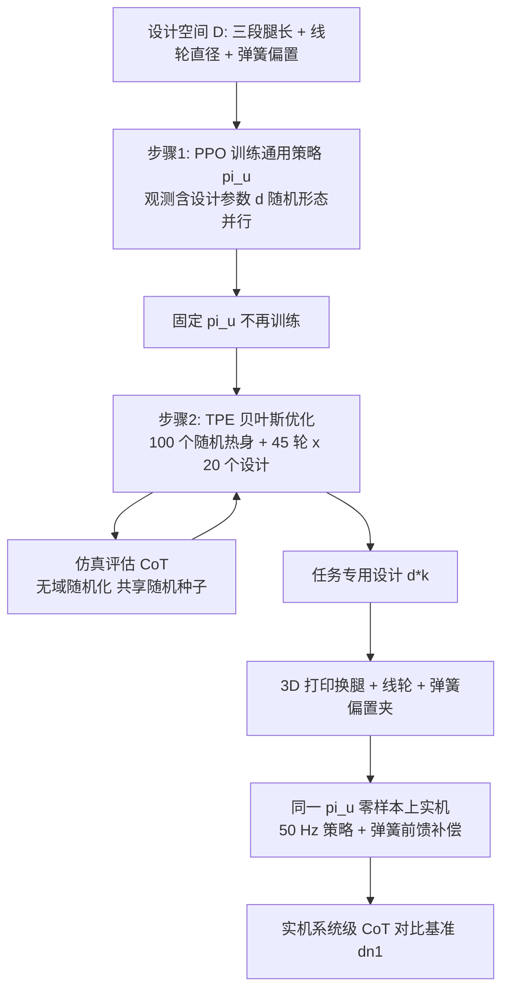

# Dogger：学习面向任务的仿生四足协同设计（arXiv:2611.02462）

**Dogger**（*Learning Purposeful Co-designs of Bio-inspired Quadrupedal Robots*，[arXiv:2611.02462](https://arxiv.org/abs/2611.02462)，v1 于 2026-11-02 发布）作者为 Fabio Boekel、Jiatao Ding（通讯）、Cosimo Della Santina，机构为代尔夫特理工大学、北京中关村学院、德国航空航天中心（DLR）。本页依据论文全文（含附录）整理，核对范围见 [来源归档](../../sources/papers/dogger-purposeful-codesign-quadruped_arxiv_2611_02462.md)；该论文曾出现在「具身运控lab」周报（人形 / 四足）条目中，周报说法的核对结果也记在归档里。

## 一句话定义

**一个可 3D 打印换腿的仿生四足平台，加一套「RL 训练形态条件通用策略、固定后用贝叶斯优化挑任务专用腿长与膝弹簧」的两步协同设计流程，并在实机上零样本验证能耗收益。**

## 英文缩写速查

| 缩写 | 英文全称 | 简要说明 |
|------|----------|----------|
| CoT | Cost of Transport | 运输成本，总能耗除以移动距离（论文式 1）；本文实机为含电子设备静态功耗的系统级测量 |
| PEA | Parallel Elastic Actuator | 并联弹性执行器，这里是膝关节的线轮加弹簧机构 |
| RL | Reinforcement Learning | 强化学习 |
| PPO | Proximal Policy Optimization | 近端策略优化，训练通用策略用 |
| BO | Bayesian Optimization | 贝叶斯优化，论文用于选择设计 |
| TPE | Tree-structured Parzen Estimator | 树结构 Parzen 估计，Optuna 提供的 BO 求解器 |
| CPG | Central Pattern Generator | 中枢模式发生器，对比基线的控制器 |
| CMA-ES | Covariance Matrix Adaptation Evolution Strategy | 协方差矩阵自适应进化策略，对比基线的优化器 |
| PD | Proportional-Derivative | 比例微分控制，电机内部跟踪关节目标 |

## 为什么重要

- **作者自述的动机（摘要、I）：** 形态与控制分开设计限制四足的效率与适应性；已有协同设计多受限于设计空间，且算法层面的方案不决定哪些机械量真能在实机上改、改后增益是否保留（I）。
- **与最相近工作的差别（I，作者自述）：** Bjelonic 等 [8]（ANYmal）只搜索被动膝弹性、腿几何固定，且用教师策略搜索、蒸馏学生策略上机。本文同时改腿长与弹簧参数，搜索和上机用同一个策略，无需蒸馏。
- **我的判断：** 价值主要在硬件层证据：同一机身、电机、传感与计算，仅换 3D 打印腿和线轮，就做出了仿真与实机方向一致的收益。但只有两个任务、四次重复，见局限。

## 核心机制

设计向量 d = [λ1, λ2, λ3, φ, o]（II.A）：

| 参数 | 含义 | 范围 |
|------|------|------|
| λ1, λ2, λ3 | 大腿 / 小腿 / 足段长度缩放 | 0.70–1.30（名义 1.00），上下限由机身可容纳尺寸决定 |
| φ | 线轮直径，决定膝关节等效转动刚度 | 0–50 mm |
| o | 弹簧偏置，决定弹簧开始受力的腿角 | 0–10 mm |

弹簧刚度固定 cs = 4180 N/m，对应关节刚度 0.03–2.62 Nm/rad、站立初始膝力矩 0–5.62 Nm。

### 流程总览

### 步骤 1：形态条件通用策略（II.B.1）

- 观测：设计参数 d，加指令速度（前 / 侧）、指令偏航率、重力向量、实际偏航率、关节位置、上一步动作。
- 动作：在站立姿态上叠加的期望关节角，由电机内部 PD 跟踪；弹簧力矩用式 (2) 做前馈补偿，让策略学步态而不是抵消弹簧。
- 奖励：速度跟踪加平滑 / 稳定 / 能耗正则；刻意不含机身高度、足端轨迹基元等会偏向某种形态的项；奖励里并入了设计选择用的 CoT 代价，使训练与选择目标一致（II.B.1）。
- 训练：PPO，Brax 平地最多 8192 环境，Isaac Lab 复杂地形 4096 环境；附录表 I 给出 1.5 亿步、学习率 3e-4、折扣 0.97、策略四层 128 单元。

### 步骤 2：BO 选形态（II.B.2）

- 目标：最小化 CoT，因其可在不同速度指令与跟踪质量的设计间公平比较，但对 d 不可微，所以用无导数优化；作者选 BO 而非进化算法，理由是样本效率（II.B.2）。
- 附录：每个设计在任务 1 评估 6000 环境步、任务 2 评估 15000 步；45 轮、每轮 20 个设计，约 45 分钟。

### 仿真到实机（II.C）

- 域随机化（体重、惯量、PD 增益、摩擦等，附录表 VI）、观测噪声、弹簧偏置噪声、速度扰动；设计选择阶段关闭域随机化以排除随机性对形态比较的影响。
- 能耗模型：12 个电机的绕组损耗加机械功率（式 4）加定值的电子设备功率（式 3，含 Jetson），实机在系统级测量能耗。

## 关键实验结果

| 实验 | 设置 | 结果（论文章节） |
|------|------|------------------|
| 任务 1 巡检 | 平地直线走停交替，每设计 4 次实机重复 | d*1 相对 dn1：仿真 CoT −12.6% ± 0.4%，实机 −18.6% ± 1.7%（III.B.1） |
| 任务 2 载重 | 2 kg（约占总质量 30%）、2 分钟 16 条全向指令，每设计 4 次 | d*2 相对 dn1：仿真 −34.0% ± 0.3%，实机 −35.7% ± 3.1%（III.B.2） |
| 跨任务 | d*2 用于任务 1，d*1 用于任务 2 | d*2 在任务 1：仿真 −7.0%、实机 −13.5% ± 3.3%；d*1 在任务 2：仿真 −14.4%、实机 −23.7% ± 2.3%；均不及专用设计（III.C） |
| 设计空间消融（仅仿真） | 固定 / 仅连杆 / 仅弹簧 / 全部 | 任务 1：−1.1% ± 2.5% / −7.3% ± 1.3% / −12.6%；任务 2：−24.0% ± 0.9% / −16.3% ± 0.8% / −34.0%（III.D） |
| 基线对比（仿真） | CPG+CMA-ES、特权 RL+BO | 以本方法为 100%：任务 1 为 96.0% / 112.8%，任务 2 为 103.2% / 103.7%（III.E） |
| 户外 | 两种构型：碎石、高草、不平土、林间杂物 | 定性演示；一次连续 17 分钟无摔倒、复位、微调（III.F） |

选出的设计（III.B）：d*1 = λ(0.86, 1.02, 1.28)、φ = 33 mm、o = 6 mm；d*2 = λ(1.30, 0.70, 1.30)、φ = 38 mm、o = 2 mm。基准 dn1 为名义（中值）连杆长度且弹簧脱开，dn2 为名义连杆长度且弹簧参数取中值。

- **作者的解读（III.B–D）：** 任务 1 弹簧贡献大于连杆，任务 2 反过来；两者互补，故全设计空间最优。图 4(C) 显示弹簧接入后膝电机力矩峰值降低、分布更靠近零线。
- **我的读法：** 18.6% 与 35.7% 是对 dn1 的系统级 CoT 降幅，实机 CoT 含约 50% 静态电子功耗（III.B.1，作者自述）。因此它不是对「手工调好的设计」或其他机器人的对比。

## 工程实践

- **硬件（附录）：** 整机约 6.5 kg，机身 37 cm × 27 cm，Xiaomi Cybergear 24 V 电机（峰值 12 Nm / 关节），2 Ah 锂电池，Jetson Orin Nano，每条腿独立 CAN 总线，MPU-6050 IMU；材料为 PLA、PETG、TPU，普通 FDM 打印机可制造。改 λ 需重打印零件，改 φ 换线轮，改 o 移动线上夹子。
- **实机数据（附录）：** 速度指令经 TCP 按预定时间表下发，机上 25 Hz 记录本体感知与能耗。
- **复现注意：** 设计选择需要仿真中 CoT 与实机能耗模型对得上；论文给了能耗公式与超参表（表 I–VI），但正文与附录未列代码或项目页链接（入库日核对），完整复现依赖作者后续发布，推测。

## 局限与风险

- **作者承认（IV）：** 形态选择依赖已训练的固定策略，选出的形态受该控制器能力限制；策略与形态不能共同适应；设计变量和工程约束仍有限。
- **统计与范围（我的观察）：** 只有两个任务，每个设计实机仅 4 次重复；任务 1「巡检」是平地直线走停的代理任务，任务 2 是室内带 2 kg 负载行走；消融（III.D）与基线对比（III.E）只在仿真里做，没有硬件对照。
- **基线口径（我的观察）：** 对比基准为弹簧脱开的 dn1，作者没有报告对「专家手调」形态的对比。基线对比中任务 1 上 CPG+CMA-ES 的 CoT 比本方法低 4.0%，任务 2 上优势仅 3.2% 到 3.7%，且文中未给出显著性检验，所以不宜写成全面优于基线。
- **仿真到实机差距：** 仿真与实机的绝对 CoT 不同（III.B.2，作者自述），选形态的有效性依赖二者排序一致；仿真降幅（12.6%）与实机降幅（18.6%）相差较多，论文用静态功耗占比解释，未做其他归因。
- **户外鲁棒性：** 仅定性视频，无成功率或能耗数字（III.F）。
- **开源：** 正文未见代码链接，入库日未另查项目页。

## 与其他工作对比

| 对照 | 差异读法 |
|------|----------|
| Bjelonic 等 [8]（ANYmal 被动膝弹性协同设计，见 [ANYmal](../entities/anymal.md)） | 作者称其只搜索膝弹性，且教师策略搜索、学生策略部署；本文搜索几何加弹性，用单一设计感知策略（I，II.B.1） |
| [RAIBO2 马拉松四足](../entities/paper-raibo2-marathon-energy-efficient-quadruped.md) | 同属提高四足系统级能效的硬件加学习路线；RAIBO2 面向单次电量跑完马拉松，本文面向可换腿的任务专用优化 |
| [月球单足双层协同设计](../entities/paper-lunar-monoped-bilevel-codesign.md) | 同为协同设计；该页外层用差分进化加轨迹优化 / 任务空间控制评估，本文用 RL 策略评估，并上了实机 |

## 关联页面

- [运动控制任务](../tasks/locomotion.md)
- [PPO](../methods/ppo.md)
- [奖励设计](../concepts/reward-design.md)
- [域随机化](../concepts/domain-randomization.md)
- [Sim2Real](../concepts/sim2real.md)
- [Brax](../entities/brax.md)
- [Isaac Lab](../entities/isaac-lab.md)
- [ANYmal](../entities/anymal.md)
- [四足机器人](../entities/quadruped-robot.md)
- [RAIBO2 马拉松四足](../entities/paper-raibo2-marathon-energy-efficient-quadruped.md)
- [月球单足双层协同设计](../entities/paper-lunar-monoped-bilevel-codesign.md)
- [仿生四足步态自适应](../entities/paper-learning-to-adapt-bio-inspired-quadruped-gait.md)

## 参考来源

- [dogger-purposeful-codesign-quadruped_arxiv_2611_02462.md](../../sources/papers/dogger-purposeful-codesign-quadruped_arxiv_2611_02462.md)
- [arXiv:2611.02462](https://arxiv.org/abs/2611.02462)

## 推荐继续阅读

- [arXiv PDF](https://arxiv.org/pdf/2611.02462)
- [PPO](../methods/ppo.md)
- [域随机化](../concepts/domain-randomization.md)
- [RAIBO2 马拉松四足](../entities/paper-raibo2-marathon-energy-efficient-quadruped.md)
