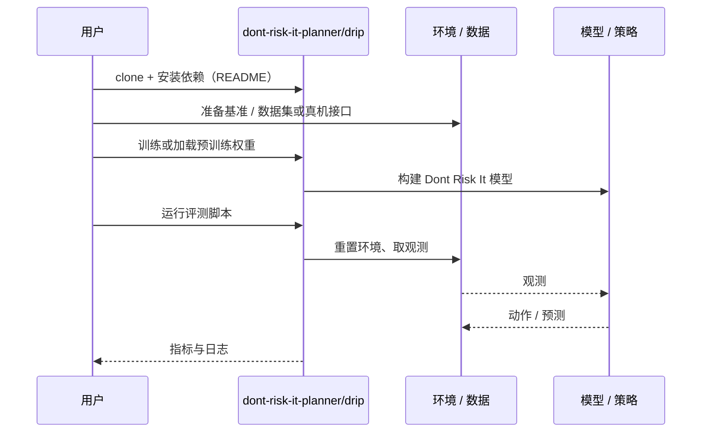

# Dont Risk It（arXiv:2610.40050）

**Dont Risk It**（*Don’t Risk It!: Trajectory-Conditioned Distributional Risk for LiDAR-Only Crowd Navigation*，[arXiv:2610.40050](https://arxiv.org/abs/2610.40050)，[项目页](https://dont-risk-it-planner.github.io/)，[代码](https://github.com/dont-risk-it-planner/drip)）来自 [具身智能小站 2026-11-03 盘点](../../sources/blogs/wechat_embodied_station_49_papers_sacq_action_aware_quantization_2026-11-03.md)，属「四足与导航」组。

## 一句话定义

**DRIP 直接使用激光雷达占据历史，预测候选动作序列对应的最小间距分布，并以碰撞结果约束风险学习，减少对易失效目标跟踪的依赖。**

## 英文缩写速查

| 缩写 | 英文全称 | 简要说明 |
|------|----------|----------|
| Dont Risk It | Don’t Risk It!: Trajectory-Conditioned Distributional Risk for LiDAR-Only Crowd Navigation | 本文方法 / 基准的简称 |

## 为什么重要

- 在人群中按轨迹预测碰撞风险。
- 开源结论：**已开源**（步骤 2.5，2026-11-03）。仓库可达（git ls-remote）。项目页 HTTP 200。
- 同期同组工作见 [动作感知量化、失败定位与可验证自主：具身智能小站 11-03 期 49 篇阅读坐标](../overview/embodied-station-2026-11-03-49-papers-technology-map.md)。

## 核心机制

| 项 | 内容 |
|----|------|
| **arXiv** | [2610.40050](https://arxiv.org/abs/2610.40050) |
| **开源** | **已开源** |
| **要点** | DRIP 直接使用激光雷达占据历史，预测候选动作序列对应的最小间距分布，并以碰撞结果约束风险学习，减少对易失效目标跟踪的依赖。 |
| **文内指标** | 公众号未给具体数字，本页不引用。 |

## 源码运行时序图

以下为按仓库入口（`dont-risk-it-planner/drip`）推断的通用运行链路；入库日仅核实仓库可达，未逐文件阅读，具体脚本名以 README 为准。

## 实验与评测

- 公众号未给具体数字，本页不引用。
- **读法：** 本页为索引级摘要，依据公众号转述的官方摘要与仓库信息整理；逐项数字与 baseline 以原文 PDF 为准。

## 与其他工作对比

- 横向索引见 [动作感知量化、失败定位与可验证自主：具身智能小站 11-03 期 49 篇阅读坐标](../overview/embodied-station-2026-11-03-49-papers-technology-map.md)；同 arXiv 不重复造页。

## 结论

**在人群中按轨迹预测碰撞风险：DRIP 直接使用激光雷达占据历史，预测候选动作序列对应的最小间距分布，并以碰撞结果约束风险学习，减少对易失效目标跟踪的依赖。**

1. 开源边界：**已开源** — 仓库可达（git ls-remote）。项目页 HTTP 200。
2. 核心机制：DRIP 直接使用激光雷达占据历史，预测候选动作序列对应的最小间距分布，并以碰撞结果约束风险学习，减少对易失效目标跟踪的依赖。
3. 复现与选型前核对任务协议、硬件与基准口径，勿直接横比公众号摘录数字。

## 关联页面

- [locomotion](../tasks/locomotion.md)
- [vision-language-navigation](../tasks/vision-language-navigation.md)
- [reinforcement-learning](../methods/reinforcement-learning.md)
- [embodied-station-2026-11-03-49-papers-technology-map](../overview/embodied-station-2026-11-03-49-papers-technology-map.md)

## 参考来源

- [dont_risk_it_crowd_navigation_arxiv_2610_40050.md](../../sources/papers/dont_risk_it_crowd_navigation_arxiv_2610_40050.md)
- [wechat_embodied_station_49_papers_sacq_action_aware_quantization_2026-11-03.md](../../sources/blogs/wechat_embodied_station_49_papers_sacq_action_aware_quantization_2026-11-03.md)
- [arXiv:2610.40050](https://arxiv.org/abs/2610.40050)

## 推荐继续阅读

- [arXiv PDF](https://arxiv.org/pdf/2610.40050)
- [项目页](https://dont-risk-it-planner.github.io/)
- [https://github.com/dont-risk-it-planner/drip](https://github.com/dont-risk-it-planner/drip)
