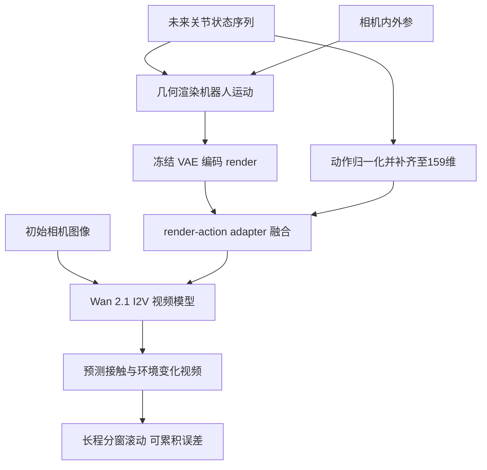
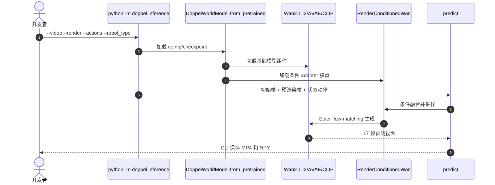
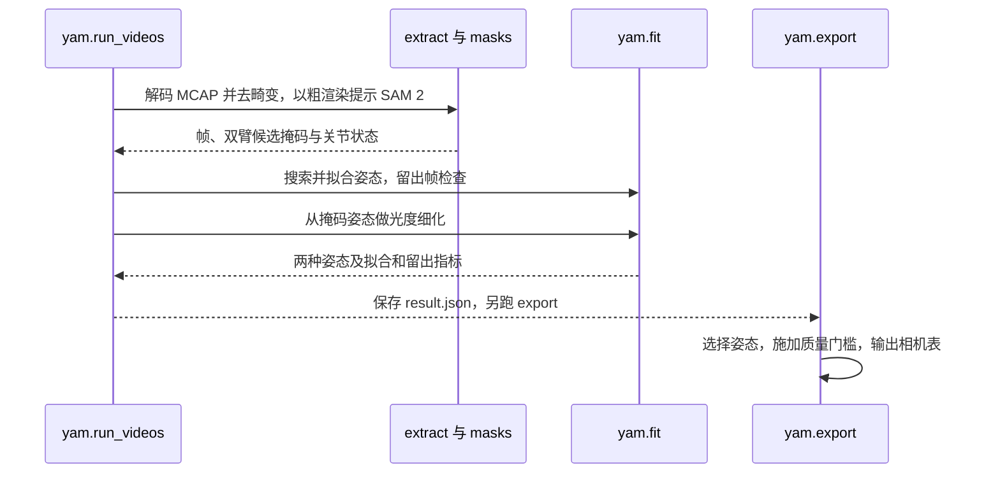

# Doppel：先渲染机器人，再生成环境未来（Render the Robot, Generate the World: One Video World Model Across Embodiments）

## 一句话定义

以相机视角渲染规划轨迹中的机器人形态，联合数值动作向视频世界模型提供运动条件，让生成器专注物体与环境响应。

## 英文缩写速查

| 缩写 | 英文全称 | 简要说明 |
|---|---|---|
| WM | World Model | 世界演化预测模型 |
| PSNR | Peak Signal-to-Noise Ratio | 视频像素保真指标 |
| VAE | Variational Autoencoder | 视频与渲染的潜空间编码器 |
| OOD | Out-of-Distribution | 训练分布外的场景/轨迹 |

## 为什么重要

动作数值不足以直接指定图像中机器人会移动到哪里。显式渲染已知本体几何，把几何运动交给渲染器，使视频模型把容量用于接触后环境与物体变化。

## 核心原理

从相机标定恢复外参，利用动作轨迹与机器人几何产生未来本体渲染；用 Wan 2.1 I2V 的 VAE 编码渲染，和逐帧 159 维零填充动作嵌入经 adapter 融合，作为每个视频 token 的 timestep modulation。8 个本体数据集共享骨干与适配器，**骨干不接本体标签**；软件仍需用 `robot_type` 选择该本体的动作归一化和布局。159 维只是共同宽度，不表示同一槽位在不同机器人上有相同关节语义。测试本体均在训练集中。

### 流程总览

## 源码运行时序图

依据官方 README 的真实入口及其代码目录绘制**运行路径示意**；未在本环境实际训练或部署。

另外，公开标定入口分为固定相机的 session 级管线和 ABC 的逐视频管线，不是在视频模型的 `predict` 中在线求位姿。ABC 的可核验入口：

## 实验与评测（作者报告，未独立复现）

| 评测场景 | 相比仅动作基线的 PSNR 增量 |
|---|---:|
| 三机械臂数据集的 held-out 轨迹 | **+1.00 dB** |
| 分布外场景/轨迹 | **+1.20 dB** |

表中的 **+1.00 / +1.20 dB** 是表 2 的 Doppel-8 相对各数据集 action-only 专家的平均整帧差值，每个 split 各 200 个 clip，排除输入帧。不能当成固定训练语料下仅加入 render 的消融；后者应看同表的单集 Doppel 对照。

- **增加本体不保证每组都涨。** 最终检查点里，Doppel-8 相比 Doppel-3 在 6 组中有 4 组整帧 PSNR 提升，Bridge OOD 为 22.474 → 22.238 dB；在近似匹配每个机械臂语料约 51 遍的附录表 12 中，Bridge OOD 仍低约 0.05 dB。
- **整帧与物体区是不同问题。** Bridge OOD 的运动物体区，相对对应 action-only 专家，Doppel-8 PSNR 21.50 → 24.85 dB，分割轨迹一致性 SCS 0.778 → 0.831。这不是抓取成功率。
- **滚动预测与策略闭环也不同。** 论文的 25.6 秒是给定配置轨迹的八窗串接；项目页另有微调后双臂 YAM 的 MolmoAct2 成功/失败演示，未报告策略排序或真机成功率的统计验证。

## 与其他工作对比

- 与 action-only WM 相比，显式几何提供机器人像素位置先验。
- 与 [HINT-WAM](./paper-hint-wam.md) 的动作专家后训练不同，Doppel 本身输出**未来视频**，不是运动执行策略。
- 与通用 Sim2Real 工具不同，它不负责仿真动力学稳定性或控制器安全。

## 工程实践

`pip install -e .` 后加载 Wan 2.1 I2V 14B 基座与公开 Doppel-8 checkpoint；需相机对齐的 `render.mp4`、17 帧 `actions.npz` 和起始图像。官方 `python -m doppel.inference` 示例用 80 GB GPU、bf16；`python -m doppel.rollout` 将上一窗预测尾帧作下一窗起点，并去掉重复起始帧。公开权重是 Wan2.1 I2V 基座上的 7 分片覆盖权重，不替代基座。

### 相机接入检查

| 来源 | 公开 CSV 行数 | 不重复 pose ID |
|---|---:|---:|
| Bridge | 14,824 | 56 |
| RoboMIND | 17,588 | 49 |
| ABC | 12,933 | 12,933 |

- 以上为实际解析数据；三张表都有 640×480 拟合分辨率、有限的外参和正焦距。旋转正交残差绝对最大值约 4.5×10⁻⁵，表示数值接近刚体变换，**不**证明投影与真实画面的对齐精度。
- 外参覆盖数不是训练示范数。ABC 有 12,933 个通过标定的视频，其中 9,115 行标为 `train`，1,610 行为 val/test，2,208 行未纳入模型语料；按 `split` 筛选。Bridge/RoboMIND 的 motion recall 与 ABC 的 held-out mask IoU 也都不是厘米级外参误差。
- `T_base_cam` 按 OpenCV 相机轴以米计，为 camera→base；投影 base 点时取逆。ABC 的 base 是双臂 station，不是左臂基座；使用去畸变图及随表内参，不要套用原始镜头畸变或把 640×480 的 K 直接用于 240×432。
- Bridge/RoboMIND 对 session 拟合；ABC 逐视频拟合并用留出掩码 IoU 和位姿门槛筛选。先检查叠加图及 RGB、动作、渲染的采样帧索引，再启动 GPU 推理。

## 局限与风险

在本体已知、可准确渲染与相机对齐时效果最直接；long-horizon 误差积累，25.6 s 只是作者的滚动定性展示。**根目录代码 MIT、模型权重 CC BY-NC 4.0**，标定中的第三方文件、基础 Wan 权重和各来源相机表另按各自条款。官方另外链接的 Dr.Robot 几何资产本次匿名访问为 401，不将其描述为已验证可下载。尚未运行 GPU 推理、重新拟合相机或评测真机。

## 结论

**几何已知的运动不必再要求世界模型从动作标量反推一遍。**

1. 优先验证相机外参/渲染对齐，否则渲染条件本身会引入误差。
2. 分别报告视频 PSNR/LPIPS 与接触对象时序质量，勿把视觉改进当策略成功率。
3. 评估新机器人前确认是否属于已训练本体；复现先检查权重的非商业授权。

## 关联页面

- [paper-hint-wam ](./paper-hint-wam.md)
- [具身评测基准选型闭环](../overview/hub-embodied-eval-benchmark.md)：区分视频/物体指标、学习模拟器闭环结果和真机任务成功率。
- [generative-world-models ](../methods/generative-world-models.md)
- [manipulation ](../tasks/manipulation.md)
- [action-chunking ](../methods/action-chunking.md)

## 参考来源

- [论文原文摘录与验证范围](../../sources/papers/doppel_arxiv_2611_24925.md)
- [源码与运行入口](../../sources/repos/doppel.md)
- [官方项目页归档](../../sources/sites/doppel.md)

## 推荐继续阅读

- [论文 HTML](https://arxiv.org/html/2611.24925)
- [官方项目主页](https://doppelwm.github.io/)
- [官方源码](https://github.com/DoppelWM/Doppel)
