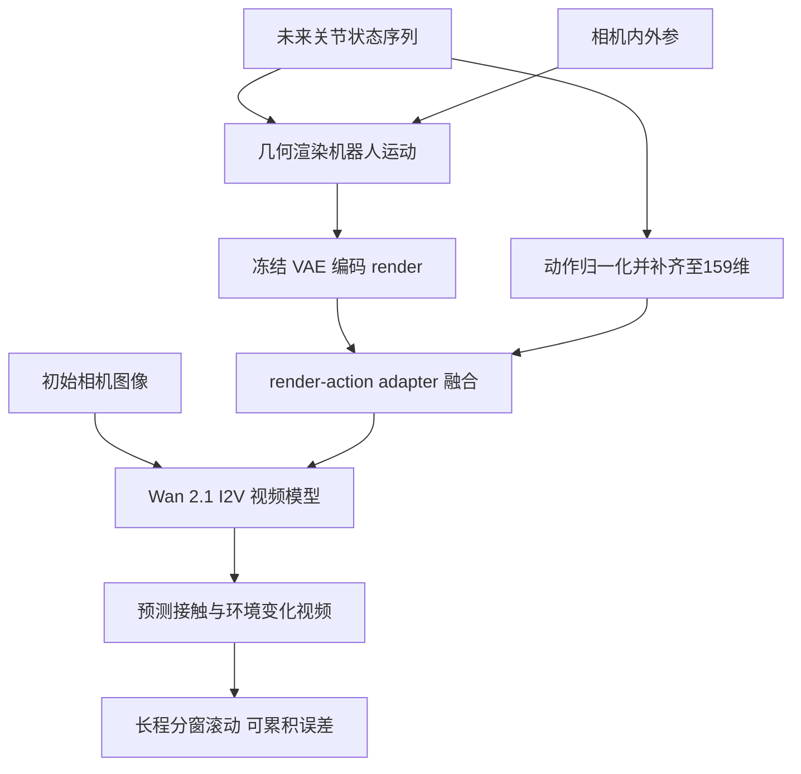

# Doppel：先渲染机器人，再生成环境未来（Render the Robot, Generate the World: One Video World Model Across Embodiments）

## 一句话定义

以相机视角渲染规划轨迹中的机器人形态，联合数值动作向视频世界模型提供运动条件，让生成器专注物体与环境响应。

## 英文缩写速查

| 缩写 | 英文全称 | 简要说明 |
|---|---|---|
| WM | World Model | 世界演化预测模型 |
| PSNR | Peak Signal-to-Noise Ratio | 视频像素保真指标 |
| VAE | Variational Autoencoder | 视频与渲染的潜空间编码器 |
| OOD | Out-of-Distribution | 训练分布外的场景/轨迹 |

## 为什么重要

动作数值不足以直接指定图像中机器人会移动到哪里。显式渲染已知本体几何，把几何运动交给渲染器，使视频模型把容量用于接触后环境与物体变化。

## 核心原理

从相机标定恢复外参，利用动作轨迹与机器人几何产生未来本体渲染；用 Wan 2.1 I2V 的 VAE 编码渲染，和逐帧 159 维零填充动作嵌入经 adapter 融合，作为每个视频 token 的 timestep modulation。8 个 embodiment 数据集共享骨干与适配器，**不提供本体标签**，但测试机型均在训练集中。

### 流程总览

## 源码运行时序图

依据官方 README 的真实入口及其代码目录绘制**运行路径示意**；未在本环境实际训练或部署。

## 实验与评测（作者报告，未独立复现）

| 评测场景 | 相比仅动作基线的 PSNR 增量 |
|---|---:|
| 三机械臂数据集的 held-out 轨迹 | **+1.00 dB** |
| 分布外场景/轨迹 | **+1.20 dB** |

作者报告训练使用 8 个数据集约 **600 小时**、8 种本体。Doppel-8 相比 3 个独立本体 action-only 专家有更高平均视频质量；跨 8 类本体不等于零样本迁移到全新构型。

## 与其他工作对比

- 与 action-only WM 相比，显式几何提供机器人像素位置先验。
- 与 [HINT-WAM](./paper-hint-wam.md) 的动作专家后训练不同，Doppel 本身输出**未来视频**，不是运动执行策略。
- 与通用 Sim2Real 工具不同，它不负责仿真动力学稳定性或控制器安全。

## 工程实践

`pip install -e .` 后加载 Wan 2.1 I2V 14B 基座与公开 Doppel-8 checkpoint；需相机对齐的 `render.mp4`、17 帧 `actions.npz` 和起始图像。官方 `python -m doppel.inference` 推理要求作者示例为 80 GB GPU/bf16；`python -m doppel.rollout` 用上一段预测的尾帧作为下一段起点。模型在 Hugging Face，**相机外参数据**独立发布（45,345 条 demo）。

## 局限与风险

在本体已知、可准确渲染与相机对齐时效果最直接；long-horizon 误差积累，25.6 s 只是作者的滚动定性展示。**代码 MIT、模型权重 CC BY-NC 4.0**，基础 Wan 权重另有许可；不应将 MIT 直接理解为模型可商用。论文附录仍待完整核对。

## 结论

**几何已知的运动不必再要求世界模型从动作标量反推一遍。**

1. 优先验证相机外参/渲染对齐，否则渲染条件本身会引入误差。
2. 分别报告视频 PSNR/LPIPS 与接触对象时序质量，勿把视觉改进当策略成功率。
3. 评估新机器人前确认是否属于已训练本体；复现先检查权重的非商业授权。

## 关联页面

- [paper-hint-wam ](./paper-hint-wam.md)
- [lyapunov-vorynel ](./lyapunov-vorynel.md)
- [generative-world-models ](../methods/generative-world-models.md)
- [manipulation ](../tasks/manipulation.md)
- [action-chunking ](../methods/action-chunking.md)

## 参考来源

- [论文原文摘录与验证范围](../../sources/papers/doppel_arxiv_2611_24925.md)
- [源码与运行入口](../../sources/repos/doppel.md)
- [官方项目页归档](../../sources/sites/doppel.md)

## 推荐继续阅读

- [论文 HTML](https://arxiv.org/html/2611.24925)
- [官方项目主页](https://doppelwm.github.io/)
- [官方源码](https://github.com/DoppelWM/Doppel)
