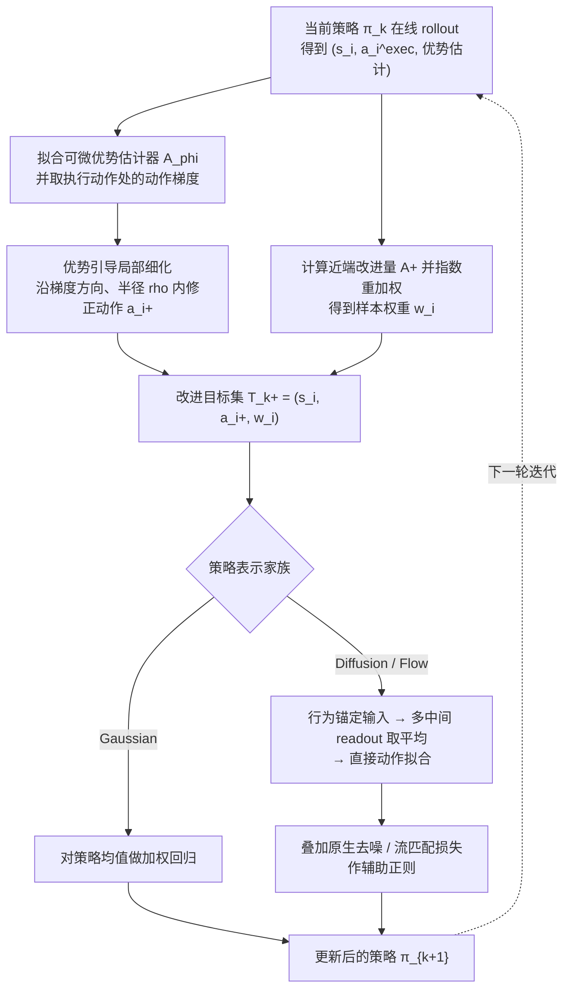

# DR-APO（arXiv:2610.16618）

**DR-APO**（*DR-APO: Decoupled-Representation Advantage-Guided Policy Optimization from Continuous Control to Embodied Navigation*，[arXiv:2610.16618](https://arxiv.org/abs/2610.16618)，Runhua Zhang、Yingjie Niu、Chao Li；DEEP Robotics、浙江大学；[官方项目页](https://developer.deeprobotics.cn/research/articles/dr-apo/index.html)）提出了一种策略表示无关的强化学习优化框架，用统一的靶向动作改进与直接拟合机制同时支持高斯、扩散与流匹配策略，既可用于从零连续控制，也可直接用于具身扩散导航策略（NavDP）的 RL 后训练。

## 一句话定义

**DR-APO 是一种把「动作如何改进」与「策略如何参数化」解耦的强化学习更新算法：先依据优势梯度与指数重加权构造改进后的目标动作集，再用各策略族的直接动作读取与原生辅助损失去拟合，从而避免对多步扩散/流采样链做似然比反向传播，也无需推理期多候选 critic 筛选。**

## 英文缩写速查

| 缩写 | 英文全称 | 简要说明 |
|------|----------|----------|
| DR-APO | Decoupled-Representation Advantage-Guided Policy Optimization | 本文提出的表示解耦强化学习优化算法 |
| SAC | Soft Actor-Critic | 高斯策略连续控制强对比基线 |
| NavDP | Navigation Diffusion Policy | 本文在仿真与 M20 真机上做 RL 后训练的扩散导航基座策略 |
| SR | Success Rate | 导航成功率（InternScenes 与真机核心指标） |
| SPL | Success weighted by Path Length | 路径长度加权成功率，用于衡量导航路径效率 |
| AUC@1M | Area Under the Curve at 1M steps | 20k–1M 训练步学习曲线下面积（衡量样本效率与稳态收益） |

## 为什么重要

- **打通多步生成策略的 RL 后训练瓶颈：** 扩散与流匹配策略表达多模态行为能力强，但多步积分导致动作对数似然难以精确求解或累积方差过大；而依赖推理期采样 32/64 条轨迹再用 critic 选优（Best-of-N）的做法不仅增加部署算力开销，也难以真正提升单次前向的策略本体性能。
- **用一个接口覆盖三大策略族：** 基于 $\beta D_{\mathrm{KL}} + \frac{1}{2\eta} W_2^2$ 近端推导出的「先梯度修正动作、再按近端优势赋权」目标分布 $p_k^+$ 完全不依赖策略参数化形式，使得同一超参思路即可从高斯延续到扩散与流匹配策略。
- **直接验证具身导航真机增益：** 不改动 NavDP 底层执行控制器，仅用 DR-APO 后训练即把仿真导航成功率从 70.33% 推升至 **89.55%**，并在 **DEEP Robotics M20** 真机 20 个场景中把成功率从 25% 提至 **65%**。

## 流程总览

图依据：论文 §III-A/B/C 与 Fig. 2（推理期直接前向执行单条动作输出，不做多候选 critic 选择）。

## 核心原理

1. **表示解耦目标构造（§III-A–III-B）：** 在标准策略改进代理目标下加入辅助分布 $q$ 与 $\beta D_{\mathrm{KL}}(q\|\pi_k)+\frac{1}{2\eta}W_2^2(q,p)$ 约束，推导出最优改进目标 $p_k^+$ 分两步形成：先通过可微优势估计器 $A_\phi(s,a)$ 的动作梯度在半径 $\rho$ 内构造局部改进动作 $a_i^+ = \Phi_{k,\eta}(s_i, a_i)$，再按减去位移代价后的近端优势 $A_{k,\eta}^+$ 计算指数权重 $\omega_i$。
2. **表示兼容直接拟合（§III-C）：** 对高斯策略执行均值加权回归；对扩散和流策略，将采样路径锚定在当前行为样本附近，对多个中间去噪/积分步的直接动作读取（readout）求平均拟合 $a_i^+$，并保留原生扩散去噪或流匹配速度场损失作为正则，防止表示退化。
3. **免似然比与免推理期筛选：** 所有改进都已吸收进策略参数 $\theta_{k+1}$；部署时只需单次推理采样，不再需要 critic 参与线上打分（Best-of-N）。

## 源码运行时序图

**不适用**：截至 2026-11-21 复核，官方项目页（仅提供 Paper 与 7 分 17 秒演示视频）及论文均未公开代码仓库与模型权重，无法对齐实际训练/部署入口。

## 工程实践

| 项 | 建议 / 核查结果 |
|----|-----------------|
| **开源状态** | **未开源**（截至 2026-11-21）：项目页仅列 Paper 与 Video，无 GitHub / Hugging Face 链接 |
| **自研复现关键消融（Table III）** | 扩散与流策略拟合不可只用原生去噪/流损失（`Native Only` 在 HalfCheetah 上仅 ~973，远低于 `Direct Only` 2878 与 `Full` 的 4299+）；且「动作局部细化」与「优势重加权」二者缺一不可 |
| **导航后训练对接** | 对预训练扩散策略（如 NavDP）做 RL 后训练时，可保持底层运动控制器不变，仅更新规划层轨迹输出分布，并在部署期关闭多候选 critic 选择以节省时延 |

## 评测要点（论文 §IV）

| 评测 | 报告 |
|------|------|
| MuJoCo-v5 五任务（1M 步、5 seeds，Table I） | Gaussian：AUC@1M 平均排名 **1.40**（SAC 1.80、PPO 2.80）；Diffusion：9/10 项（5 项 AUC + 4 项 Final）最优，平均排名 1.20/1.00；Flow：10/10 项全最优（平均排名 **1.00/1.00**） |
| InternScenes 轮式仿真（Table IV） | NavDP 后训练：整体 SR 从 **70.33%** 升至 **89.55%**（超 X-NavDP 的 88.63%）；SPL 为 **74.55**（低于 X-NavDP 的 77.67） |
| **DEEP Robotics M20** 四足真机（Table V，20 个场景） | 预训练 NavDP SR **25%** → DR-APO 后训练 **65%**（+40 个百分点） |

## 与其他工作对比

- **相对 SAC（高斯策略）：** MuJoCo-v5 上高斯版 DR-APO 与 SAC 相当（Final Return 略逊于 SAC 的 HalfCheetah/Humanoid，但 Swimmer 显著领先且平均 AUC@1M 排名更优），说明该方法不以牺牲经典连续控制效率为代价。
- **相对似然比类方法（FPO、Flow-SDE、ReinFlow）：** 多步扩散/流采样链的似然比估计耦合了内部生成过程；DR-APO 直接拟合目标动作避开似然比衰减，在 Flow 五任务上全胜这些基线。
- **相对 Best-of-N（QVPO/LSEVPO Best-of-64、RFM Best-of-32）：** 推理期多候选 critic 选择需额外算力且策略本体提升有限；DR-APO 仅靠单次 policy-only 执行即取得更优策略质量。
- **与 [Diffusion Policy](./paper-diffusion-policy.md) 关系：** 后者提供模仿学习的扩散动作表示，DR-APO 为此类生成策略提供可微的 RL 改进与后训练接口。

## 结论

**一句话总判：** DR-APO 的核心贡献是用「优势梯度修正目标动作 + 近端重加权 + 直接动作读取配合原生辅助正则」把 RL 优化从高斯/扩散/流各自的参数化细节中解耦出来，但工程落地需自行复现且导航实验中存在成功率提升伴随 SPL 略降的权衡。

1. **直接动作读取 + 原生辅助损失必须同时保留：** 消融证明单靠原生去噪/流匹配损失去拟合加权目标无法有效传导改进信号，而去掉原生正则也会导致表示漂移。
2. **局部动作细化与优势重加权互补：** 两者均独立贡献性能增益，仅靠其中之一会明显削弱连续控制最终回报。
3. **警惕导航 SR 与 SPL 的权衡：** InternScenes 仿真中 DR-APO 的 SR 高于 X-NavDP（89.55% vs 88.63%），但 SPL 更低（74.55 vs 77.67），表明策略为追求避障成功率可能走了更绕的路径。
4. **真机与仿真平台存在跨度：** 仿真 NavDP 后训练基于 InternScenes 轮式机器人，真机测试在 DEEP Robotics M20 轮足/四足平台上完成（20 场景），不可直接将仿真 SPL/SR 等同于真机通用能力。

## 局限与风险

- **算法未开源，复现门槛在超参耦合：** 论文未公开源码与权重，实际复现需自行调试优势估计器 $A_\phi$ 的梯度稳定性、局部半径 $\rho$ 以及 $\beta/\eta$ 权衡。
- **导航路径效率权衡：** 仿真中整体 SR 领先但 SPL 低于 X-NavDP，对路径最短性敏感的导航任务需在奖励函数中额外约束绕行代价。
- **真机评测规模有限：** M20 真机测试仅覆盖 20 个场景的二元 SR 对比（25% → 65%），未报告多样天气/地形或长时运行统计。

## 关联页面

- [Policy Optimization](../methods/policy-optimization.md) — 策略梯度、近端更新与正则化基础
- [Diffusion Policy](./paper-diffusion-policy.md) — 扩散策略表示基础
- [DR-WM](./paper-dr-wm.md) · [DR-VLA](./paper-dr-vla.md) — 云深处同批具身导航研究
- [云深处 rl_training](./deeprobotics-rl-training.md) — 同公司强化学习训练工程栈
- [轮足四足机器人](../concepts/wheel-legged-quadruped.md) — 真机测试平台 M20 所属形态
- [Robot Navigation Workflow · 机器人导航与路径执行](../methods/robot-navigation-workflow.md)：对照其后训练扩散导航策略（NavDP）在仿真与四足真机导航闭环中的应用。

## 参考来源

- [dr_apo_arxiv_2610_16618.md](../../sources/papers/dr_apo_arxiv_2610_16618.md) — arXiv:2610.16618v1 全文通读归档
- [项目页归档](../../sources/sites/deeprobotics-dr-apo.md) — 官方项目页归档

## 推荐继续阅读

- [arXiv 全文 HTML](https://arxiv.org/html/2610.16618)
- [arXiv PDF](https://arxiv.org/pdf/2610.16618)
- [官方项目页](https://developer.deeprobotics.cn/research/articles/dr-apo/index.html)
