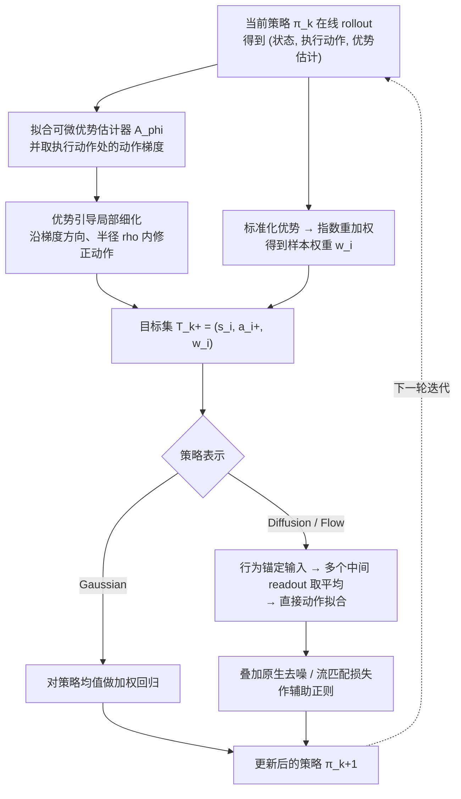

# DR-APO（arXiv:2610.16618）

**DR-APO**（*DR-APO: Decoupled-Representation Advantage-Guided Policy Optimization from Continuous Control to Embodied Navigation*，[arXiv:2610.16618](https://arxiv.org/abs/2610.16618)，Runhua Zhang、Yingjie Niu、Chao Li；DEEP Robotics、浙江大学；[官方项目页](https://developer.deeprobotics.cn/research/articles/dr-apo/index.html)）。

## 流程总览

图依据：论文 §III-A/B/C 与 Fig. 2（推理期不做多候选 critic 选择，见 §III 与 Fig. 2 标注）。

## 一句话定义

**DR-APO 是一种与策略表示无关的 RL 更新：先用优势信息构造局部改进的目标动作，再用各策略族自带的读出方式直接拟合这些目标，避免似然比 actor 更新与推理期多候选 critic 选择。**

## 英文缩写速查

| 缩写 | 英文全称 | 简要说明 |
|------|----------|----------|
| DR-APO | Decoupled-Representation Advantage-Guided Policy Optimization | 本文方法 |
| SAC | Soft Actor-Critic | Gaussian 策略对比基线 |
| NavDP | Navigation Diffusion Policy | 本文用于后训练的导航扩散策略（项目页称 NavDP post-training） |
| SR | Success Rate | 导航成功率 |
| AUC | Area Under the Curve | 学习曲线下面积，项目页记为 AUC@1M |

## 核心方法

1. **优势引导目标改进**：用优势信息构造局部改进的动作目标；局部动作细化与优势重加权提供互补信号。
2. **表示兼容的直接动作拟合**：Gaussian 策略用均值回归；扩散 / 流策略把直接动作拟合与各自原生辅助训练结合。
3. 不做似然比 actor 更新，也不在推理期做多候选 critic 选择（项目页表述）。

## 评测要点（项目页 / 论文摘要自报）

| 评测 | 报告 |
|------|------|
| MuJoCo-v5 五任务（1M 步、5 seeds） | Gaussian 与 SAC 相当；扩散、流策略的 policy-only 综合表现最好 |
| NavDP 后训练 | 仿真 SR 70.33%→89.55%；真机 25%→65% |

## 与其他工作对比

- **相对 SAC（Gaussian 策略）：** MuJoCo-v5 上 Gaussian 版 DR-APO 与 SAC 相当，说明其收益主要不在高斯策略，而在让扩散 / 流策略也能用同一改进接口。
- **相对似然比 actor 更新（PPO 类）：** 扩散 / 流策略的动作似然难以精确计算；DR-APO 改为对优势改进后的目标动作做直接拟合，绕开似然比。
- **相对推理期多候选 critic 选择：** 这类方法需在部署时采样多个候选并用 critic 打分；DR-APO 把改进写回策略本身，推理期不额外选择。
- 与 [Diffusion Policy](./paper-diffusion-policy.md) 的关系：后者是模仿学习的策略表示，DR-APO 是可作用于此类表示的 RL 后训练更新。

## 开源状态

截至 2026-10-24，项目页只提供论文与视频，**未见代码、权重链接**（本页依据项目页核查，非逐仓搜索）。

## 结论

**DR-APO 的贡献在于统一的策略改进接口；导航真机结果样本与场景由论文给定，不外推为通用导航能力。**

## 关联页面

- [DR-WM](./paper-dr-wm.md) — 云深处同批研究
- [云深处 rl_training](./deeprobotics-rl-training.md) — 同公司 RL 训练工程
- [policy-optimization](../methods/policy-optimization.md)
- [wheel-legged-quadruped](../concepts/wheel-legged-quadruped.md)

## 参考来源

- [项目页归档](../../sources/sites/deeprobotics-dr-apo.md)
- [arXiv 原文](https://arxiv.org/abs/2610.16618)
- [官方项目页](https://developer.deeprobotics.cn/research/articles/dr-apo/index.html)
- [云深处前沿探索](https://developer.deeprobotics.cn/research/)
- [arXiv PDF](https://arxiv.org/pdf/2610.16618)：已通读方法部分（实验与附录以略读为准）：§III Method（A–C）、§IV 实验设定
