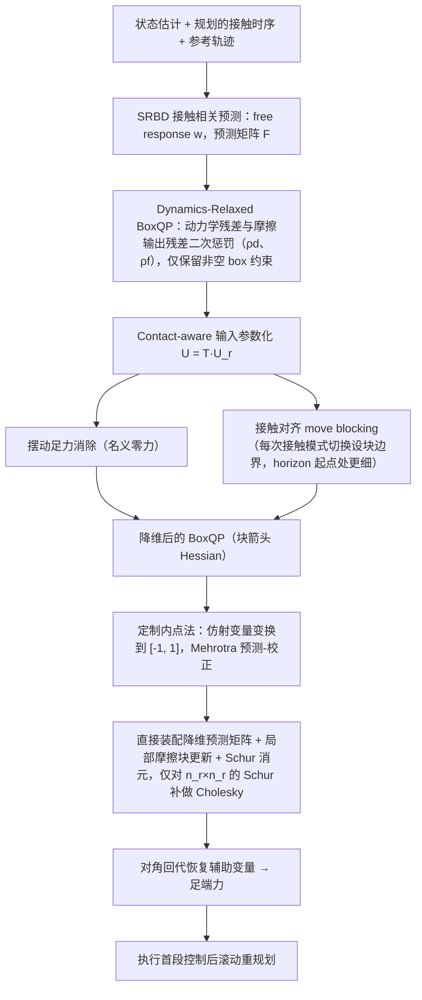

# DR-MPC（arXiv:2609.20035）

**DR-MPC**（*DR-MPC: Fast and Feasible Dynamics-Relaxed Model-Predictive Control for Legged Locomotion*，[arXiv:2609.20035](https://arxiv.org/abs/2609.20035)）来自 [senlanke 具身运控lab 周更盘点](../../sources/blogs/wechat_senlanke_weekly_humanoid_quadruped_2026-09-14_18.md)（2026-09-14–18）。

## 一句话定义

**动力学等式与仿射输入约束转二次惩罚，保留盒约束；专用内点法；Go1 中位求解 4.4 ms。**

## 英文缩写速查

| 缩写 | 英文全称 | 简要说明 |
|------|----------|----------|
| MPC | Model Predictive Control | 模型预测控制 |
| QP | Quadratic Program | 二次规划 |
| IPM | Interior Point Method | 内点法 |

## 为什么重要

- 腿式 MPC 常因硬动力学约束导致不可行或慢；松弛保可行且实时。

## 流程总览

图依据：论文 §III-A / §III-B、§IV-A，Fig. 2 概述；§I-B 贡献概述。

## 核心机制

| 项 | 内容 |
|----|------|
| **arXiv** | [2609.20035](https://arxiv.org/abs/2609.20035) |
| **开源** | **待发布**（步骤 2.5，2026-09-20） |
| **方法摘要** | Dynamics-relaxed QP + block-arrow Hessian + contact-aligned control partitioning. |

## 源码运行时序图

**不适用**（截至 2026-09-20 未发布可运行官方代码或待核实）。

## 实验与评测

- Unitree Go1 median solve 4.4 ms（作者报告）。
- 读法：先对齐任务设定、传感器与成功定义，再解读 headline 数字。

## 与其他工作对比

| 维度 | 读法 |
|------|------|
| **同周对照** | 见对应 [周更盘点](../../sources/blogs/wechat_senlanke_weekly_humanoid_quadruped_2026-09-14_18.md) 映射表，勿跨任务直接比 SR |
| **开源状态** | **待发布** — 部署前以项目页/arXiv 为准 |

## 结论

**DR-MPC 在可行性与速度间为腿式 locomotion 提供可部署 MPC 路线。**

1. 开源：**待发布**；勿凭公众号摘要臆断可复现性。
2. 指标须连同实验条件解读（仿真/真机、平台、成功阈值）。
3. 关注 arXiv 版本更新与代码发布。

## 关联页面

- [model-predictive-control](../methods/model-predictive-control.md)
- [locomotion](../tasks/locomotion.md)
- [autonomy-stack-go2](../entities/autonomy-stack-go2.md)

## 参考来源

- [dr-mpc_arxiv_2609_20035.md](../../sources/papers/dr-mpc_arxiv_2609_20035.md)
- [wechat_senlanke_weekly_humanoid_quadruped_2026-09-14_18.md](../../sources/blogs/wechat_senlanke_weekly_humanoid_quadruped_2026-09-14_18.md)
- [arXiv:2609.20035](https://arxiv.org/abs/2609.20035)
- [arXiv PDF](https://arxiv.org/pdf/2609.20035)：已通读方法部分（实验与附录以略读为准）：§I-B/C 方法概述与贡献、§III-A/B 松弛 BoxQP 与输入参数化、§IV 内点求解器（至 §IV-A）

## 推荐继续阅读

- [arXiv PDF](https://arxiv.org/pdf/2609.20035)
