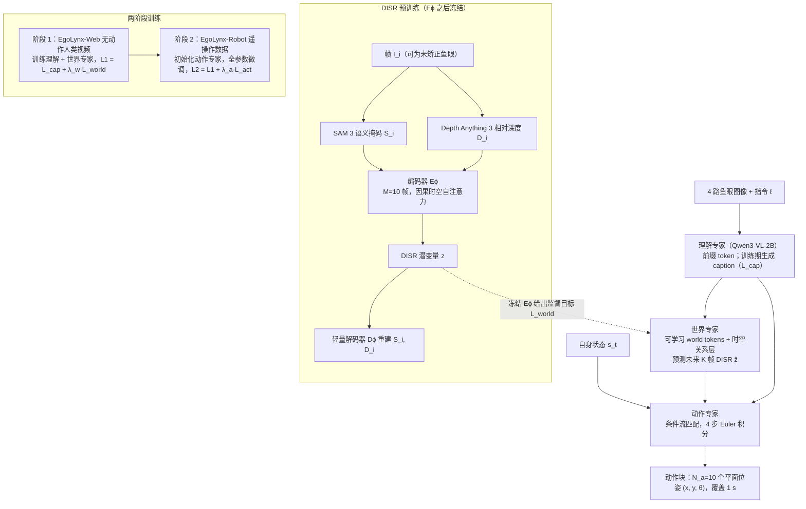

# DR-VLA（arXiv:2610.18373）

**DR-VLA**（*DR-VLA: Learning Human-Like Quadruped Navigation from Egocentric Web Videos via Domain-Invariant Scene Representations*，[arXiv:2610.18373](https://arxiv.org/abs/2610.18373)，Jun Tian、Yingjie Niu、Ruo Chen、Hongyi Lin、Chao Li；Deep Robotics、UIUC、浙江大学、清华大学、MIT；[官方项目页](https://developer.deeprobotics.cn/research/articles/dr-vla/index.html)）。

## 流程总览

图依据：论文 §3 任务建模、§4.1 DISR、§4.2 Mixture-of-Transformers 架构 / Fig.2、§4.3 两阶段训练。

## 一句话定义

**DR-VLA 用分割 + 相对深度 + 因果时空注意力构成的域不变场景表示（DISR）作为人类视频与机器人轨迹之间的接口：先用无动作标签的人类视频学场景理解与未来预测，再用遥操作数据学动作。**

## 英文缩写速查

| 缩写 | 英文全称 | 简要说明 |
|------|----------|----------|
| DR-VLA | DEEP Robotics Vision-Language-Action | 本文框架 |
| DISR | Domain-Invariant Scene Representation | 域不变场景表示 |
| PDMS | PDM Score | NAVSIM 规划评分，项目页记为 PDM score |
| EgoLynx | — | 论文构建的第一视角人类视频数据（项目页命名） |

## 核心方法

- **三个专家**：理解专家推理场景；世界专家预测未来场景结构；流匹配动作专家生成机器人轨迹。
- **DISR**：编码器输入分割与深度而非 RGB，以跨相机高度 / 视角更稳的几何与语义结构作为共享接口。
- **两阶段**：先用 EgoLynx 的 10,000 小时无动作标签人类视频学习，再适配 2,000 条遥操作机器人训练片段。

## 评测要点（项目页 / 摘要自报）

| 评测 | 报告 |
|------|------|
| 留出机器人测试集 | Quadruped Navigation Score 0.884；相对最强竞争结果约 +5%，最终朝向误差 −14.6% |
| NAVSIM v1 | 另训模型（无网络视频预训练）PDMS 92.1 |

## 与其他工作对比

- **相对 RGB 直接输入的视频预训练：** DR-VLA 以分割 + 相对深度作为共享接口，目的是降低人类第一视角与机器人相机在高度、视角上的域差；这是其能利用无动作标签人类视频的前提。
- **相对留出测试集上的竞争方法：** 项目页报告 Quadruped Navigation Score 相对最强竞争结果约 +5%、最终朝向误差 −14.6%；具体基线清单以论文为准。
- **相对 [DR-WM](./paper-dr-wm.md)：** 同批云深处导航研究；DR-WM 用校准地形物理的世界模型比较候选动作，DR-VLA 则在策略内部设世界专家预测未来场景结构，并由流匹配动作专家直接输出轨迹。

## 开源状态

项目页 Code 为 **Coming soon**（2026-10-24 核查）。

## 结论

**DR-VLA 证据覆盖轮足 / 四足室外导航与 NAVSIM；NAVSIM 模型没有使用网络视频预训练，两组数字不可混读。**

## 关联页面

- [DR-WM](./paper-dr-wm.md) — 云深处同批研究
- [云深处 rl_training](./deeprobotics-rl-training.md) — 同公司 RL 训练工程
- [vla](../methods/vla.md)
- [wheel-legged-quadruped](../concepts/wheel-legged-quadruped.md)
- [world-action-models](../concepts/world-action-models.md)

## 参考来源

- [项目页归档](../../sources/sites/deeprobotics-dr-vla.md)
- [arXiv 原文](https://arxiv.org/abs/2610.18373)
- [官方项目页](https://developer.deeprobotics.cn/research/articles/dr-vla/index.html)
- [云深处前沿探索](https://developer.deeprobotics.cn/research/)
- [arXiv PDF](https://arxiv.org/pdf/2610.18373)：已通读方法部分（实验与附录以略读为准）：§3 任务建模、§4.1–4.3 方法、§5.1 实验设定；§5.2 起结果与附录略读
