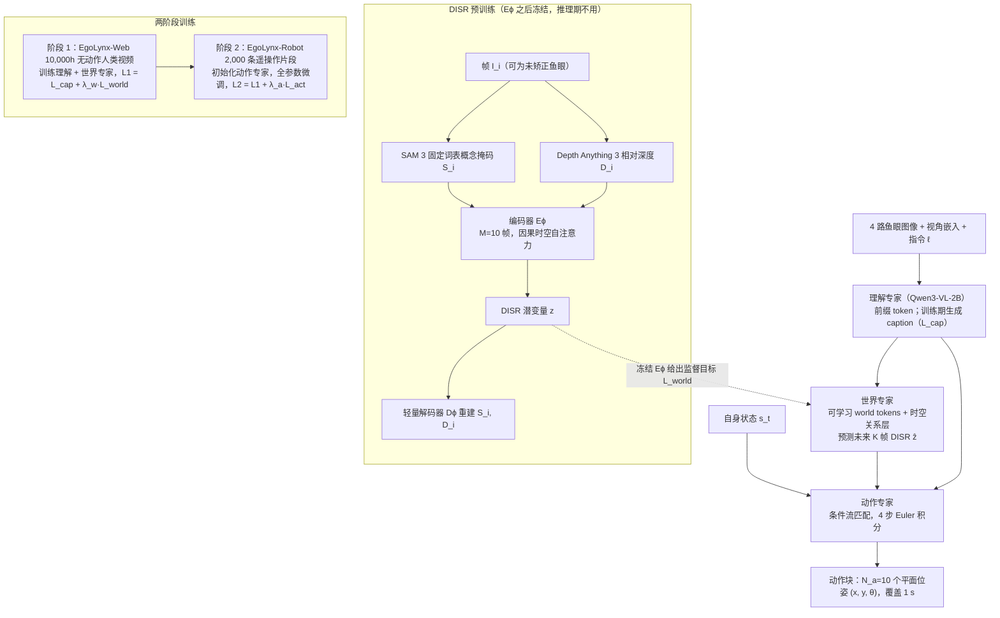

# DR-VLA（arXiv:2610.18373）

**DR-VLA**（*DR-VLA: Learning Human-Like Quadruped Navigation from Egocentric Web Videos via Domain-Invariant Scene Representations*，[arXiv:2610.18373](https://arxiv.org/abs/2610.18373)，Jun Tian、Yingjie Niu、Ruo Chen、Hongyi Lin、Chao Li；DEEP Robotics、UIUC、浙江大学、清华大学、MIT；[官方项目页](https://developer.deeprobotics.cn/research/articles/dr-vla/index.html)）面向室外配送场景的轮足/四足社会合规导航，提出以结构与语义剥离外观的 **域不变场景表示（DISR）** 作为人类第一视角网络视频与机器人动作学习之间的桥梁。

## 一句话定义

**DR-VLA 用「概念分割 + 相对深度 + 因果时空自注意力」构成的域不变场景表示（DISR）作为人类视频与机器人轨迹之间的统一世界预测目标：先在 1 万小时无动作标签的人类视频上预训练理解与世界专家，再用 2,000 条真机遥操作数据联合微调流匹配动作专家。**

## 英文缩写速查

| 缩写 | 英文全称 | 简要说明 |
|------|----------|----------|
| DR-VLA | DEEP Robotics Vision-Language-Action | 本文提出的理解/世界/动作三专家 MoT 导航框架 |
| DISR | Domain-Invariant Scene Representation | 由 SAM 3 掩码与 Depth Anything 3 相对深度编码的时空场景潜变量 |
| MoT | Mixture-of-Transformers | 理解、世界、动作三专家各自独立投影且共享注意力的骨干架构 |
| QNS | Quadruped Navigation Score | 结合安全性、指令遵从、舒适度与进度的伪闭环导航综合评分 |
| PDMS | PDM Score | NAVSIM v1 规划综合评分（另训驾驶变体达到 92.1） |
| EgoLynx | EgoLynx-Web & EgoLynx-Robot | 本文构建的 10,000 小时网络第一视角视频 + 2,000 条配送遥操数据集 |

## 为什么重要

- **用「场景结构预测」替代像素或动作迁移：** 人类头戴视角与机器狗低位 4 路鱼眼存在巨大视角和尺度差，且网络视频没有动作标签；DISR 舍弃 RGB 纹理与绝对尺度，使世界专家只需在人类视频上学会预测未来场景的语义-相对深度演化。
- **推理零外部教师开销：** DISR 的 SAM 3、Depth Anything 3 与编码器 $E_\phi$ 在标准设置下**只充当训练监督目标**；部署推理时模型仅需原生 RGB 与自身状态，避开了在线 3D 感知（如 OCC+BEV）的时延负担。
- **验证无动作网络视频的显著增益：** 相同架构下，去掉 EgoLynx-Web 预训练会让 QNS 从 **0.884** 跌回 **0.823**（甚至低于部分强 VLN 基线），证明大规模第一视角人类视频切实提升了稀疏数据下的导航泛化。

## 流程总览

图依据：论文 §3 任务建模、§4.1 DISR、§4.2 Mixture-of-Transformers 架构 / Fig. 2、§4.3 两阶段训练。

## 核心原理

- **域不变场景表示 DISR（§4.1）：** 使用冻结的 SAM 3（固定语义类别词表）与 Depth Anything 3（相对深度，不保留绝对尺度）直接处理未矫正鱼眼帧，由 $E_\phi$ 在 $M=10$ 帧窗口内做因果时空自注意力压缩为连续潜变量 $\mathbf{z}_i$，捕获实体跨帧对应与前后遮挡关系。
- **Mixture-of-Transformers 与分块掩码（§4.2）：** 理解专家（`Qwen3-VL-2B`）、世界专家与条件流匹配动作专家各自拥有独立的注意力投影权重并在主干层共享注意力。分块掩码阻止世界/动作 token 窥视训练期 caption，并使动作 token 对前缀/世界 token 不可见，从而在推理时仅需计算一次 $\mathbf{h}^u, \mathbf{h}^w$ 即可复用完成 4 步 Euler 积分。
- **两阶段数据协同（§4.3）：** EgoLynx-Web（10,000 小时人类第一视角视频）驱动 Stage 1 学场景理解与未来 DISR 演化（20k 步，32×H800）；EgoLynx-Robot（2,000 条真实配送遥操片段，约 17 小时）驱动 Stage 2 适配机器人低位鱼眼视角与动力学轨迹输出（5k 步）。

## 源码运行时序图

**不适用**：截至 2026-11-21 复核，官方项目页 Code 按钮仍标注 `Coming soon`（HTML 注释亦注明代码尚未公开），未公开可运行的训练或推理仓库入口。

## 工程实践

| 项 | 建议 / 核查结果 |
|----|-----------------|
| **开源状态** | **待开源**（截至 2026-11-21）：项目页 Code 标注 `Coming soon`，EgoLynx 数据集与模型权重均未发布 |
| **世界表征选型参考（§5.4）** | 若传感器不带激光雷达或不希望在线跑 3D 感知（OCC+BEV 需点云与 3D 标注且在线推理想必增延迟），把 DISR 当作**仅训练期使用的世界预测目标**可在纯相机推理下逼近 OCC+BEV 精度（QNS 0.884 vs 0.906） |
| **鱼眼直喂与尺度对齐** | DISR 教师可直接处理未矫正鱼眼图像并丢弃绝对深度尺度，工程上免去多路鱼眼在线去畸变；但仅靠人类视频（用 DPVO 伪轨迹）会出现机器人尺度漂移，仍需真实机器人遥操段做尺度接地 |

## 评测要点（论文 §5）

| 评测 | 报告 |
|------|------|
| EgoLynx-Robot 留出测试集（Table 1） | **QNS 0.884**（超最强基线 NaVILA 的 0.843 约 +4.9%，StreamVLN 0.833，π₀.₅ 0.819）；**FHE 0.041**（较 NaVILA 0.048 降 **−14.6%**）；**ADE 0.027 / FDE 0.052** |
| EgoLynx-Web 预训练消融（Table 1） | 去掉网络视频预训练（仅 EgoLynx-Robot）QNS 降至 **0.823**、FHE 升至 0.052 |
| 预测目标消融（Table 2a） | No world expert QNS 0.841；Cosmos latent 0.845；DINOv3 0.856；**DISR 0.884** |
| NAVSIM v1 `navtest`（Table 4） | 另训 64 候选提议-选择变体（**无网络视频预训练**，纯相机）达 **92.1 PDMS**（去世界专家降至 89.5，TTC 从 96.9 降至 94.8） |

## 与其他工作对比

- **相对 RGB / 通用视觉表征世界模型：** Cosmos 像素潜变量与 DINOv3 特征在相同两阶段训练下提升有限（QNS 0.845 / 0.856 vs 无世界专家 0.841），说明在人类-机器人视角差异下，显式抽取语义+相对深度的结构化 DISR 比通用视觉特征更抗域偏移。
- **相对 [DR-WM](./paper-dr-wm.md)：** 同批云深处导航研究；DR-WM 用校准地形物理的世界模型比较候选动作（偏向可通行性与动力学 rollouts），DR-VLA 则在策略内部设世界专家预测未来场景结构，并由流匹配动作专家直接输出 1 s 平面轨迹。
- **相对 [LynxScenes](./paper-lynxscenes.md)：** 同团队工作；LynxScenes 提供 833.6 小时的 M20 多任务基准与 QNS 评测协议，DR-VLA 是基于 EgoLynx 构建的跨视频预训练导航 VLA 方法。

## 结论

**一句话总判：** DR-VLA 证明了「以语义掩码 + 相对深度构建仅用于训练期的域不变预测目标」，能让 1 万小时无动作人类第一视角视频有效反哺四足室外导航（QNS 0.823→0.884），但目前仍属开环/伪闭环验证且代码数据待公开。

1. **世界模型不一定非得在像素空间重建，也不一定非要部署期在线运行：** 把 DISR 放在训练期作为世界专家的监督目标，推理时只用纯相机即可享受未来演化的表征收益。
2. **网络视频预训练与真机小样本微调缺一不可：** 仅靠 Web 视频伪轨迹会出现机器人尺度失配（Fig. 3），仅靠 2,000 条机器人数据则 QNS 掉至 0.823。
3. **NAVSIM 与四足结果不可混读：** NAVSIM v1 的 92.1 PDMS 来自**未用网络视频预训练**且带 64 候选评分器的驾驶专用模型，验证的是 DISR+MoT 架构本身的跨平台适用性。
4. **注意评测边界：** 四足主表依赖回放与伪闭环指标 QNS，尚未报告大规模真机闭环接管率与长程统计。

## 局限与风险

- **仍受限于二维图像平面视角差（§6）：** DISR 在图像平面定义，仍残留头戴与低位鱼眼的几何视角差异，不能实现零样本跨本体迁移，必须用机器人数据微调。
- **伪标签与固定词表上限（§6）：** DISR 依赖 SAM 3 与 Depth Anything 3 在固定类别词表上的伪标签，长尾物体或恶劣光照下的模型噪声会传递到世界专家监督中。
- **闭环真机验证尚不充分：** 论文主要报告留出集的开环误差、伪闭环 QNS 与录制回放，大规模真机闭环部署与代码/数据集开放仍有待后续发布。

## 关联页面

- [DR-WM](./paper-dr-wm.md) · [LynxScenes](./paper-lynxscenes.md) — 云深处同批导航与基准研究
- [云深处 rl_training](./deeprobotics-rl-training.md) — 同公司 RL 训练工程
- [VLA（Vision-Language-Action）](../methods/vla.md) — 视觉-语言-动作策略基础
- [轮足四足机器人](../concepts/wheel-legged-quadruped.md) — 轮足导航硬件平台形态
- [World-Action Models（世界-动作模型）](../concepts/world-action-models.md) — 世界模型与动作专家协同范式

## 参考来源

- [dr_vla_arxiv_2610_18373.md](../../sources/papers/dr_vla_arxiv_2610_18373.md) — arXiv:2610.18373v1 全文通读归档
- [项目页归档](../../sources/sites/deeprobotics-dr-vla.md) — 官方项目页归档

## 推荐继续阅读

- [arXiv 全文 HTML](https://arxiv.org/html/2610.18373)
- [arXiv PDF](https://arxiv.org/pdf/2610.18373)
- [官方项目页](https://developer.deeprobotics.cn/research/articles/dr-vla/index.html)
