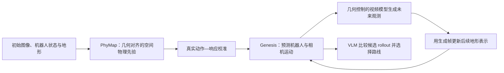

# DR-WM（From Pixels to Executable Physics · arXiv:2610.17630）

**DR-WM**（*From Pixels to Executable Physics: Behavior-Grounded World Models for Embodied Action Consequence Prediction*，[arXiv:2610.17630](https://arxiv.org/abs/2610.17630)，云深处科技、浙江大学、北京理工大学、麻省理工学院、清华大学、伊利诺伊大学厄巴纳—香槟分校；[官方项目页](https://developer.deeprobotics.cn/research/articles/dr-wm/index.html)）将视觉重建的地形物理先验校准为可执行的仿真参数，使动作后果预测从像素生成连接到机器人运动与环境接触。

## 一句话定义

**DR-WM 是面向机器人导航的物理—视觉世界模型：给定初始观测、机器人状态和候选动作，它以行为校准的空间地形物理预测运动，再生成未来观测，为外部决策器比较动作后果。**

## 英文缩写速查

| 缩写 | 英文全称 | 简要说明 |
|------|----------|----------|
| DR-WM | DEEP Robotics World Model | 本文系统，将地形物理仿真与动作条件未来观测结合 |
| PhyMap | Physical Map | 与几何对齐、包含空间变化接触属性的地形表示 |
| VLM | Vision-Language Model | 读取当前图像、目标与候选 rollout 并选择路线 |
| ATE | Absolute Trajectory Error | 衡量预测与记录轨迹偏差的指标 |
| RMSE | Root Mean Squared Error | 衡量位移、姿态或速度预测误差的指标 |

## 核心思路

视觉世界模型可生成连贯视频，但画面合理本身不能保证运动符合真实动作与接触物理。DR-WM 将问题拆成三部分：

1. **重建地形及空间物理属性**：PhyMap 建立几何对齐的物理场，表示摩擦、粗糙度、刚度等属性。
2. **从行为校准可执行参数**：使用训练数据中的机器人动作与响应，将物理属性映射到 Genesis 可执行的接触参数；校准映射在测试时固定。
3. **以物理运动条件生成视觉未来**：对候选动作先在 Genesis 预测机器人和相机运动，再用轨迹和粗几何约束视频模型生成未来观测。生成帧用于更新后续区域的地形表示，支持较长 rollout。

## 流程总览

## 评测要点

| 评测 | 论文报告 |
|------|----------|
| 视频世界模型比较 | 在 50 个 Physcene–Robot 场景上，DR-WM 六项 VLM 自动评价指标均优于所比较基线；100 人盲评的四项均分指标亦领先 |
| 留出场景物理先验消融 | 22 个留出场景；Full PhyMap 相对 Geometry Only 将 base ATE 降低 18.0%、垂直位移 RMSE 降低 54.5%、roll/pitch RMSE 降低 58.2%、速度 RMSE 降低 16.3% |
| VLM 动作选择 | 90 个场景；DR-WM rollout 使 Qwen3-VL-8B 的 goal progress / path efficiency 从 0.7492 / 0.7912 提升至 0.8754 / 0.8980；论文称其在六项指标中五项优于无未来上下文的 Qwen3-VL-32B |

## 结论

**DR-WM 的贡献是用真实行为校准的空间物理作为视频预测的因果骨架；其证据支持特定导航场景中的动作比较，不等于已验证的通用自主导航系统。**

1. **评价物理先验时看运动误差** — 22 个留出场景中，保留空间变化的 Full PhyMap 在四个运动指标都优于几何-only 和均匀物理参数基线。
2. **视频指标来自不同评测** — 50 个场景的自动视频评价、100 人盲评和 22 场景物理消融不可混成同一 benchmark 分数。
3. **动作选择结果是闭环 rollout 辅助** — 世界模型接收候选动作进行 rollout；外部 Qwen3-VL 比较候选分支。系统并非世界模型自行规划或控制机器人。
4. **训练数据规模大，但资源尚未发布** — 论文介绍 258 万张 Physcene–Image 图像和 10 万余段 Physcene–Robot 片段；项目页截至 2026-10-18 将代码和数据标为 coming soon。
5. **复现边界明确** — 目前项目页只发布论文和演示；没有可运行公开实现、权重或数据下载，复现与工程评估需等待后续发布。

## 开源状态与复现边界

**截至 2026-10-18：代码、权重、补充材料与数据集均未通过官方项目页开放。** 项目页的 Code 与 Dataset 按钮均标注 “Coming soon”，因此目前没有可写入的源码运行时序图。论文描述 Genesis、PhyMap 和视频生成模型的研究流程，不能据此假设仓库与运行脚本已经公开。

## 源码运行时序图

**不适用（截至 2026-10-18，官方项目页未开放代码、权重或数据；没有可核验的可运行入口）。**

## 与其他工作对比

| 工作 | 预测与决策分工 |
|------|----------------|
| [DSWAM](./paper-dswam-dual-system-wam.md) | 操纵执行器视频协同训练，默认推理直出动作块；DR-WM 聚焦地形导航，显式运行物理仿真与视频生成 |
| [GigaWorld-1](./paper-gigaworld-1-policy-evaluation.md) | 面向离线机器人策略评估；DR-WM 评估候选导航动作的物理后果以辅助路线选择 |
| 通用动作条件视频 WM | 直接生成可能合理的未来观测；DR-WM 用仿真运动与空间接触先验约束相机轨迹和生成未来 |

## 关联页面

- 云深处同批研究：[DR-APO](./paper-dr-apo.md)、[DR-VLA](./paper-dr-vla.md)、[AMC](./paper-amc.md)、[EvolvingNav](./paper-evolvingnav.md)、[LynxScenes](./paper-lynxscenes.md)
- [WAM 动作后果预测分类](../overview/wm-action-consequence-category-01-wam-action-prediction.md) — DR-WM 作为物理 rollout 辅助候选动作选择的案例
- [机器人世界模型动作后果技术地图](../overview/robot-world-models-action-consequence-technology-map.md) — 动作前预测物理变化的整体坐标
- [World Action Models](../concepts/world-action-models.md) — WAM 与世界模型的概念关系
- [Generative World Models](../methods/generative-world-models.md) — 物理先验与视频预测的交界
- [VLA](../methods/vla.md) — 外部视觉语言决策器语境

## 参考来源

- [论文归档（arXiv:2610.17630）](../../sources/papers/dr_wm_arxiv_2610_17630.md)
- [DR-WM 官方项目页归档](../../sources/sites/dr-wm-deeprobotics.md)
- [arXiv 原文](https://arxiv.org/abs/2610.17630)
- [DR-WM 项目页](https://developer.deeprobotics.cn/research/articles/dr-wm/index.html)

## 推荐继续阅读

- [动作后果分类 01：WAM 动作后果预测](../overview/wm-action-consequence-category-01-wam-action-prediction.md)
- [DR-WM 论文](https://arxiv.org/abs/2610.17630)
- [DR-WM 官方演示与项目页](https://developer.deeprobotics.cn/research/articles/dr-wm/index.html)
