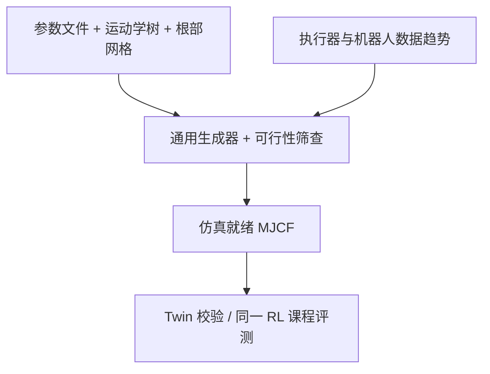
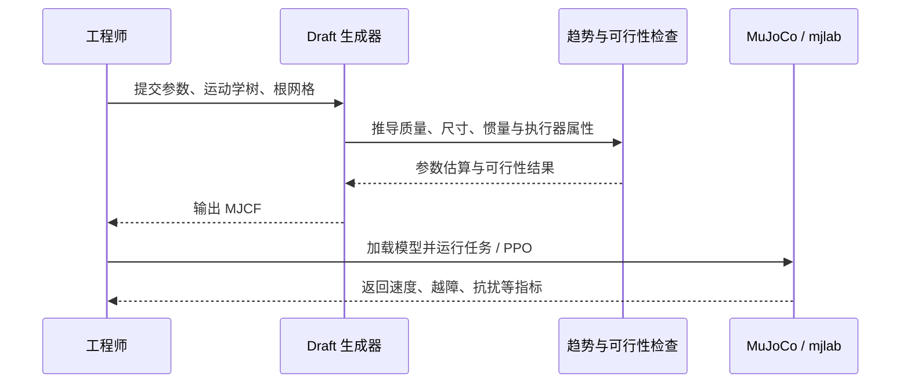

---

type: entity
tags: [paper, software, robot-design, morphology, mujoco, mjcf, reinforcement-learning, quadruped, mit]
institutions: [mit]
status: complete
updated: 2026-10-12
arxiv: "2609.38405"
project_id: draft-parametric-robot-design
project: https://github.com/davidhnguyen2000/draft
code: https://github.com/davidhnguyen2000/draft
related:
  - ./mujoco.md
  - ./paper-shape-your-body-value-gradient-design.md
  - ../methods/reinforcement-learning.md
sources:
  - ../../sources/papers/draft_arxiv_2609_38405.md
  - ../../sources/repos/draft.md
summary: "Draft 将参数文件、运动学树和根部网格编译为中等保真、可直接仿真的 MuJoCo MJCF；结合 114 个集成执行器与 49 个机器人描述拟合出的趋势检查设计可行性，再以一致的 RL 课程比较不同四足设计，而不内置自动设计优化器。"
---

# Draft：参数化机器人设计探索工具

**Draft: A Parametric Tool for Robot Design Exploration**（David Nguyen、Marcelo Coelho、Sangbae Kim，MIT；[论文](https://arxiv.org/abs/2609.38405)；[官方代码](https://github.com/davidhnguyen2000/draft)）是一个生成器加评估流程：工程师用参数文件、运动学树和根部网格描述机器人，Draft 将其编译成中等保真、可直接运行的 MuJoCo MJCF 模型，并将尺寸和执行器参数传播到视觉、碰撞、惯性和驱动属性。它旨在让早期设计迭代摆脱反复 CAD 导出和控制器训练交接。

## 一句话定义

> Draft 把机器人结构与执行器规格编译为具备数据驱动质量/电机属性、可经可行性筛查的 MJCF；设计者随后用一致的仿真/RL 任务衡量形态取舍。它是参数化建模与评估工具，**不包含自动共设计优化器**。

## 英文缩写速查

| 缩写 | 英文全称 | 简要说明 |
|---|---|---|
| CAD | Computer-Aided Design | 传统机械设计与装配建模工具 |
| MJCF | MuJoCo XML Format | MuJoCo 的机器人和场景描述格式 |
| RL | Reinforcement Learning | 以交互回报训练闭环控制策略 |
| PPO | Proximal Policy Optimization | 论文中用于训练四足 locomotion 策略的算法 |
| QDD | Quasi-Direct Drive | 低减速比执行器类别 |
| GR | Gear Ratio | 减速比；影响输出速度与关节等效惯量 |
| LOO | Leave-One-Out | 留一交叉验证，用于评估趋势拟合误差 |

## 问题与定位

CAD 到仿真器机器人描述之间缺少快速、通用的中间层：每次改腿长、尺寸或电机都可能要重导模型、重新配置控制器并重训，导致设计取舍在控制性能可见之前就被锁定。已有共设计方法常为特定平台或优化器定制生成器，也未必对硬件可行性提供充分约束。

Draft 将重点放在生成和评估，而不是替工程师做优化决策。它没有外层搜索器；设计参数、制造约束与需要比较的方案仍由工程师选择。这使它与 [Shape Your Body](./paper-shape-your-body-value-gradient-design.md) 这类基于已训练价值函数做梯度设计搜索的方法互补，而非同一类自动优化器。

## 模型生成链

每个机器人由三类输入构成：参数文件（例如连杆长度、材料密度、电机类别）、字段可包含算术表达式的运动学树，以及描述根部形状的网格定义。通用生成器据此构建串联链与根部几何，无需为 humanoid/quadruped 分别写一套编译器。改动参数会同步影响外观、碰撞几何、质量/惯量与执行器设置。

基本连杆、球形末端、支撑脚板和根部连杆是主要构件。MJCF 而非 URDF 被选作输出，因为它能直接表达 MuJoCo 的关节 armature、gear ratio 与惯性属性。论文报告：笔记本 CPU 上，29 关节 humanoid 的验证 MJCF 编译约 202 ms，12 关节 quadruped 约 50 ms；时间取决于硬件和模型。

## 数据拟合与工程可行性

趋势来自 114 个集成执行器（33 个 QDD、33 个中减速比、48 个高减速比）及 49 个保留的公开机器人描述（29 humanoid、20 quadruped）。执行器模型以峰值扭矩、空载速度和长径比推导质量、体积、尺寸、减速比和转子惯量；结构连杆按类别和长度估计质量，躯干则使用体积密度。组合规则可用于筛查给定方案是否落在可行设计范围内。

论文以四种现成机器人构建 twin 验证生成管线，整体质量预测几何平均 fold error 为 **1.10×**。这一结果验证的是所建模型和数据拟合对样本平台的复现程度，不等价于制造认证或真机动力学完全匹配。论文特别指出，拟合执行器数据不含裸电机/定制极限方案；连杆质量预测还受材料差异、执行器归属假设和机器人描述质量影响。

## 四足设计评估

作者构建三种不同尺度、站姿、腿长及电机选择的四足方案，并使用同一 mjlab/PPO 两阶段 locomotion 课程、每种设计十个独立随机种子来比较，以减少训练环境差异。

| 设计 | 质量 | 腿长 | 执行器/主要取舍 | 最高速度 | 台阶高度 | 抗推速度 |
|---|---:|---:|---|---:|---:|---:|
| Cheetah | 33 kg | 0.48 m | 轻型 QDD，6:1 | 3.63 m/s | 0.12 m | 7.9 m/s |
| Bear | 110 kg | 0.74 m | 中减速比，20:1；关节扭矩超过 Cheetah 六倍 | 4.33 m/s | 0.12 m | 8.6 m/s |
| Giraffe | 91 kg | 1.30 m | 长腿、高减速比，80:1 | 2.17 m/s | 0.20 m | 5.3 m/s |

不存在全面胜出的设计：Bear 的绝对速度和抗推能力最高，Giraffe 能跨越最高台阶；按腿长归一化后，Cheetah 的步高和抗推表现反而突出。此处的价值是显露设计变量与任务能力之间的可测取舍，不是证明某个设计全局最优。

## 项目结构与复现

仓库主要模块包括 `src/draft/generation`（参数/运动学树到 MJCF）、`trends`（拟合关系和可行性检查）、`robots`（机器人规格）、`twins`（四种平台）、`tasks` 与训练/评测脚本，以及可选浏览器编辑器。建议先按官方说明创建环境、以 editable 模式安装，再运行 `python scripts/generate_robot.py --robot quadruped`；浏览器编辑器入口是 `python scripts/robot_tuner.py`。

PPO 训练依赖 `[rl]` 可选项及 CUDA GPU；基础生成器不要求 GPU。README 说明厂商机器人模型未随仓库直接分发，`python scripts/setup_data.py` 会获取它们，使用时需遵守各模型自身许可。源代码采用 MIT License（2026，David Nguyen）；这不改变外部模型资产各自的许可。

## 局限与误读防护

- **不是自然语言一键生成或自动找最优形态。** 输入是显式参数化规格；优化/制造约束仍由工程师把关。
- **不是 CAD 级制造模型。** 输出是便于仿真迭代的中等保真模型，不能代替结构、材料、电气、散热或安全校核。
- **趋势是经验基线。** 数据覆盖和结构类别有限；论文也讨论了留出误差及结构质量估计的不确定性。
- **实验范围有限。** 演示聚焦三个 quadruped 与特定速度/越障/抗推课程；尚不能推出所有任务或形态上的性能排序。
- **代码开源不代表所有模型资产同许可。** 下载的厂商模型需要分别核查其许可证。

## 结论

Draft 把可参数化、带初步工程约束的机器人规格连接到可运行的 MJCF 与控制能力评估，缩短早期设计探索的生成—仿真循环；它提供证据和取舍，不替代工程决策或自动共设计。

- 适合比较连杆尺寸、尺度与执行器方案，并在统一任务下检查能力差异。
- 应把趋势拟合视作数据支持的估算与筛查，而非结构/电机定型依据。
- 若要自动搜索形态，需在 Draft 之上另接优化器，并明确制造与控制目标。
- 想做 RL 复现需准备 CUDA 环境、训练算力和可选依赖；仅读取/生成 MJCF 可从基础安装开始。

## 关联页面

- [MuJoCo（物理引擎）](./mujoco.md) — Draft 的 MJCF 输出与仿真环境。
- [Shape Your Body](./paper-shape-your-body-value-gradient-design.md) — 与自动形态搜索路线对照。
- [强化学习](../methods/reinforcement-learning.md) — Draft 论文中的 PPO 评估流程。

## 流程图

## 运行时序

## 参考来源

- [论文摘录：Draft (arXiv:2609.38405)](../../sources/papers/draft_arxiv_2609_38405.md)
- [官方 GitHub 仓库归档](../../sources/repos/draft.md)
- [MuJoCo 实体](./mujoco.md) — MJCF 执行与仿真语境
- [Shape Your Body](./paper-shape-your-body-value-gradient-design.md) — 自动价值梯度设计搜索的相邻路线

## 推荐继续阅读

- [arXiv HTML](https://arxiv.org/html/2609.38405v1) — 参数化建模、数据趋势、twin 验证和 RL 实验细节
- [官方 GitHub](https://github.com/davidhnguyen2000/draft) — 安装、参数格式、编辑器和运行脚本
- [MuJoCo](./mujoco.md) — MJCF 和物理仿真引擎
