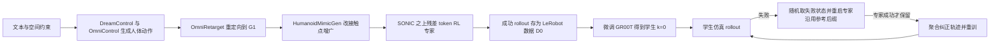

# DreamVLA（arXiv:2611.10872）

**DreamVLA**（*DreamVLA: From Generated Human Motions to Humanoid Vision-Language-Action Policies*，[arXiv:2611.10872](https://arxiv.org/abs/2611.10872)，Princeton University / UC Berkeley，CoRL 2026）。论文全文已通读（无附录），项目页见 [ember-center-berkeley.github.io/DreamVLA](https://ember-center-berkeley.github.io/DreamVLA/)，**未提供代码仓库**。

## 一句话定义

**用生成的人体动作作参考，在 SONIC 之上训练残差 RL 专家自动产出仿真示教，微调 GR00T 后再用「从学生失败状态重启专家」的 DAgger 补采纠正轨迹，得到只看第一视角图像和语言的人形 VLA；全部结果在四个 Unitree G1 仿真任务上。**

## 英文缩写速查

| 缩写 | 英文全称 | 简要说明 |
|------|----------|----------|
| VLA | Vision-Language-Action | 视觉–语言–动作策略，本文微调 GR00T |
| RL | Reinforcement Learning | 强化学习，本文用于训练残差专家 |
| DAgger | Dataset Aggregation | 在学习者访问的状态上让专家标注并聚合数据（Ross 等 2011，§3.4） |
| SONIC | Supersizing Motion Tracking for Natural Humanoid Whole-Body Control | 动作 token 接口的全身运动跟踪控制器，作底层骨干（§3.2） |
| MPJPE | Mean Per-Joint Position Error | 平均关节位置误差，表 3 单位 mm |
| G1 | Unitree G1 | 本文仿真所用人形机器人 |
| GR00T | Generalist Robot 00 Technology | NVIDIA 人形基础模型，作被微调的 VLA 骨干 |
| LeRobot | LeRobot dataset format | 示教数据落盘格式（§3.3） |

## 为什么重要

- 瓶颈：全身人形示教靠遥操作，成本高；纯 RL 的稀疏奖励对高维人形缺乏引导（§1，作者自述）。
- 作者的思路：生成人体动作给出「意图」，RL 补足接触与物理，二者合成自动示教，再把专家蒸馏进只看图像的 VLA（§1）。
- 作者强调的方法贡献只有蒸馏这一步：学生失败后，从失败轨迹随机状态重启专家、沿用同一条参考的后缀，只保留成功的恢复段（§3.4）。
- 我的判断：表 2 把「等量 800 条离线数据」作对照，Pick 与 Walk and Pick 仍为 0% 而 DAgger 到 54% / 18%，这是本文最有说服力的证据；但只在仿真、单一本体、四个任务上成立。

## 核心原理与流程总览

1. **参考生成（§3.1）：** OmniControl 以指令 ℓ 与关节-位置-时间约束 G 采样人体动作（式 1），OmniRetarget 重定向到 G1，HumanoidMimicGen 改接触点增广。
2. **残差专家（§3.2）：** 专家观测关节、根速度、重力投影、上一指令、物体状态与未来参考窗口；SONIC 编码器给出名义 token，策略输出残差 Δz，解码得到身体命令；手部为二值开合（式 5–6）。奖励 = 人体参考跟踪 + 稀疏任务奖励 − 控制正则（式 7），奖励结构沿用 DreamControl；训练含物理域随机化，VLA 无视觉域随机化。
3. **示教数据（§3.3）：** 仅成功判据 S(τ)=1 的 episode 入库，存图像、本体、动作、时间戳、指令；学生观测只含第一视角相机和本体感觉。
4. **GR00T 蒸馏（§3.4）：** 先在 D0 上用 GR00T 原生动作损失微调（式 9），之后每轮：学生 rollout → 失败则取随机时刻状态 → 专家用同一参考从该相位续跑 → 成功才并入数据（式 11）→ 重训。动作块在每个接受段内部构造，不跨段。

## 实验结果

- **评测设置（§4.1）：** 四任务判据见表 1；每个成功率 100 次 rollout；目标位置分布与生成参考时的分布相同（即评测不含分布外位置，我的补充观察）。
- **DAgger 配置（§4.1）：** 初始 200 条，每轮加 200 条成功纠正轨迹，最多 3 轮共 800 条；对照为基础专家直接再采 800 条成功轨迹。
- **残差 RL 消融（§4.2，表 3）：** 3000 RL 迭代预算下比较；名义 SONIC 在 Pick 为 0%，绝对 token RL 全 0%，残差 token RL 为 88.6 / 74.0 / 81.0 / 75.95%（Pick / Drawer / Button / Walk and Pick），MPJPE 24.84 → 25.51 mm（残差略增）。作者用图 3 的芥末瓶案例说明名义 SONIC 会把瓶子碰下台面。
- **DAgger 消融（表 2，k=0/1/2/3 的成功率）：**

| 任务 | k=0（200 条） | k=1 | k=2 | k=3（800 条） | 等量 800 条离线对照 |
|------|---------------|-----|-----|---------------|---------------------|
| Pick | 0% | 17% | 30% | 54% | 0% |
| Drawer | 51% | 55% | 54% | 60% | 54% |
| Button | 59% | 58% | 62% | 69% | 57% |
| Walk and Pick | 0% | 1% | 7% | 18% | 0% |

- **数据规模（表 4，参考数 10 / 50 / 200，无 DAgger）：** Pick 与 Walk and Pick 始终 0%；Drawer 13.0 / 51.0 / 51.0%，Button 0 / 14.0 / 59.0%。
- 全部为 G1 仿真结果，无真机实验。

## 与其他工作对比

| 工作 | 关注点 | 与 DreamVLA 的区别 |
|------|--------|--------------------|
| [VIRAL](./paper-viral-humanoid-visual-sim2real.md) | 特权 PPO 教师驱动 WBC，DAgger + BC 蒸馏 RGB 学生，G1 零样本真机 | 教师不靠生成人体动作引导；有真机部署。DreamVLA 的学生是微调 GR00T 的 VLA，DAgger 从失败状态沿用参考后缀重启专家，仅仿真 |
| [DoorMan](./paper-doorman-opening-sim2real-door.md) | 单任务人形纯 RGB 开门，教师 DAgger 蒸馏 + GRPO 微调 | 单任务、有真机；DreamVLA 是多任务语言条件 VLA |
| [HumanoidMimicGen](./paper-humanoidmimicgen.md) | 从单条 VR 示范合成大量 G1 仿真数据，训练 GR00T | 数据靠 IK / 规划改写示范；DreamVLA 只把它当接触点增广，示教主要来自 RL 专家 |
| [DreamControl](./paper-loco-manip-161-093-dreamcontrol.md) | 生成人体动作引导 RL 全身控制 | 是本文上游，提供参考与奖励结构；DreamVLA 新增 VLA 蒸馏与恢复式 DAgger |

## 结论

**DreamVLA 证明在仿真中可以不用遥操作，靠「生成人体动作 → 残差 RL 专家 → GR00T 蒸馏 → 恢复式 DAgger」得到只看第一视角的人形 VLA，而 DAgger 是难任务能否学会的关键。**

1. Pick 与 Walk and Pick 用等量 800 条离线数据仍为 0%，恢复式 DAgger 到 54% / 18%（表 2）。
2. 残差 token RL 是专家可用的前提：绝对 token RL 全 0%，残差版 74.0%–88.6%（表 3）。
3. 学生与专家仍有明显差距（Walk and Pick 18% 对 75.95%），Drawer / Button 上 DAgger 相对等量离线数据优势有限。
4. 局限：仅四个 G1 仿真任务、评测分布与训练相同、单次 100 rollout 无置信区间，奖励与过滤仍是任务相关设计，无代码、无真机。

## 工程实践

- **复现性：** 论文与项目页均无代码 / 数据链接；依赖 DreamControl、OmniControl、OmniRetarget、HumanoidMimicGen、SONIC、GR00T 等多个上游组件（§3，图 1）。项目页的视频截至 2026-11-11 为 "coming soon"。
- **项目页数值抄写不一致：** 项目页结果小表与论文表 2 / 表 4 对不上（见下节），引用时以论文为准。

## 与文章说法的核对

被核对段落来自公众号文章《机器人动作块太长，什么时候该重新规划？》（2026-11-11，53 篇论文速览）第 48 条：「用生成动作引导强化学习专家，再从学生失败状态补采纠正轨迹，训练人形视觉动作策略。评估集中在仿真任务，专家奖励与轨迹筛选仍包含任务相关设计。」

| 文章说法 | 论文核对 | 结论 |
|----------|----------|------|
| 用生成动作引导强化学习专家 | §3.1–3.2：DreamControl 生成人体动作经重定向引导 SONIC 残差 RL 专家 | 一致 |
| 从学生失败状态补采纠正轨迹 | §3.4：对失败 rollout 随机取状态、同一参考后缀重启专家、仅留成功段 | 一致 |
| 训练人形视觉动作策略 | §3.3：学生仅用第一视角图像 + 本体感觉 + 语言，微调 GR00T | 一致 |
| 评估集中在仿真任务 | §4、§5、§6：四个仿真任务，硬件部署「outside its scope」 | 一致，且论文是「仅仿真」而非「集中」 |
| 专家奖励与轨迹筛选仍含任务相关设计 | §5 局限原文：task-specific guidance, filtering, object references, and reward weights remain necessary | 一致；另有物体参考与奖励权重 |

- 文章未给任何数字，故无数字可核；其摘要没有说明的限定是：单一本体（G1）、四个任务、无真机、无代码。
- 需要注意的措辞：论文的「无需新的任务专用遥操作」仅指仿真任务数据，上游的人体动作先验与 SONIC / GR00T 预训练仍依赖人类数据（§1 作者自述），不应读成「完全不需要人类数据」。
- 文章只写了「训练」。表 2 显示 Walk and Pick 最终仅 18%、Pick 54%，学生与专家（表 3：75.95%、88.6%）仍有明显差距，这是我的补充，不是文章错误。

## 局限

论文自述（§5）：

- 仅四个仿真交互任务、单一人形本体；
- 生成动作可能与机器人运动学或接触要求不相容；
- 任务相关的引导、过滤、物体参考与奖励权重仍是管线的必要部分；
- 成功过滤可能低估困难配置；参考条件专家在学习者访问状态、尤其是精细交互时，可能给出不可靠或突兀的纠正；
- 硬件部署与 sim-to-real 留作未来工作（§6）。

我看到的未验证之处：

- 表 4 中 Pick 与 Walk and Pick 在 10 / 50 / 200 条参考下全为 0%（该实验未含 DAgger），数据规模结论只对 Drawer 与 Button 成立。
- 表 2 中 Drawer 与 Button 的提升较小（+9 与 +10 个百分点，k=0 到 3），且单次 100 rollout 无置信区间或多种子；小幅差异能否复现未知。
- 表 2 的 k=0（200 条）与对照（800 条）在 Drawer / Button 上相差不大（51→54%、59→57%），说明这两项上 DAgger 相对等量离线数据的优势有限（我的读法）。
- 评测目标分布与训练参考分布相同（§4.1），泛化到新位置、新物体未测。
- 项目页数值与论文表格不一致（见上节与来源归档），未知哪一个是最终版本；无代码，无法独立核对。
- 性质：方法 + 仿真实验论文，非数据集或硬件论文；本页基于 arXiv v1。

## 关联页面

- [DreamControl（人体动作引导的全身控制，本文上游）](../entities/paper-loco-manip-161-093-dreamcontrol.md)
- [VIRAL（视觉 sim-to-real 的人形教师–学生 DAgger）](../entities/paper-viral-humanoid-visual-sim2real.md)
- [DoorMan（人形像素到动作的开门迁移）](../entities/paper-doorman-opening-sim2real-door.md)
- [HumanoidMimicGen（接触点增广所用）](../entities/paper-humanoidmimicgen.md)
- [OmniRetarget 数据集（重定向所用）](../entities/omniretarget-dataset.md)
- [NVIDIA SONIC](../entities/nvidia-sonic.md)
- [Isaac-GR00T](../entities/isaac-gr00t.md)
- [DAgger](../methods/dagger.md)
- [教师–学生 DAgger 训练](../methods/teacher-student-dagger-training.md)
- [残差策略学习](../methods/residual-policy-learning.md)
- [VLA 方法页](../methods/vla.md)
- [LeRobotDataset v3](../concepts/lerobot-dataset-v3.md)
- [奖励设计](../concepts/reward-design.md)
- [全身控制](../concepts/whole-body-control.md)

## 参考来源

- [dreamvla_arxiv_2611_10872.md](../../sources/papers/dreamvla_arxiv_2611_10872.md)
- [arXiv:2611.10872](https://arxiv.org/abs/2611.10872)
- [项目页](https://ember-center-berkeley.github.io/DreamVLA/)（静态读取 HTML 文本，未运行代码）

## 继续阅读

- [DAgger 方法页](../methods/dagger.md)
- [残差策略学习](../methods/residual-policy-learning.md)
- [arXiv PDF v1](https://arxiv.org/pdf/2611.10872v1)
