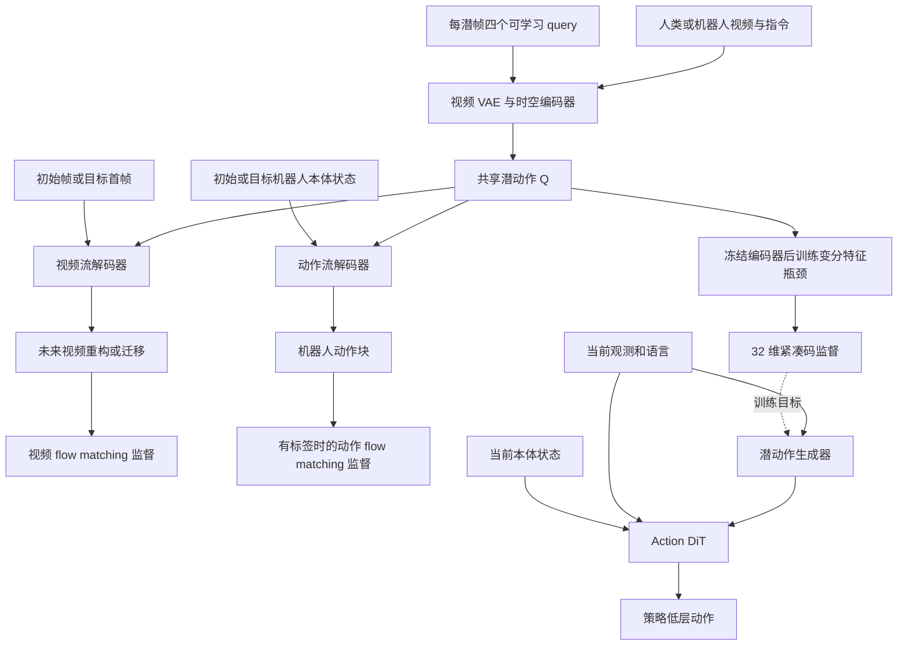

# DreamX：视频扩散模型作为通用潜动作学习器（Video Diffusion Model is a Universal Latent Action Learner）

## 一句话定义

DreamX 从人类和机器人视频中提取共享潜动作，利用首帧条件的生成式重构减少外观信息混入，再将潜动作解码成目标视频或机器人控制指令。

## 英文缩写速查

| 缩写 | 英文全称 | 简要说明 |
|---|---|---|
| LAM | Latent Action Model | 从观测变化学习潜动作 |
| VAE | Variational Autoencoder | 视频潜空间编码 |
| DiT | Diffusion Transformer | 去噪及动作生成骨干 |
| LoRA | Low-Rank Adaptation | 低秩参数适配 |
| FAE | Feature Autoencoder | 潜动作特征压缩 |
| FVD | Fréchet Video Distance | 视频分布差异指标 |
| MSE | Mean Squared Error | 动作回归均方误差 |

## 为什么重要

人手与机器人关节控制空间不同，但抓取、推动等运动可在视频中观测。直接回归机器人控制量难以利用无动作标签的人类视频。DreamX 将共享运动表征与目标本体控制解码分开，为跨本体学习提供一条不同于显式运动学重定向的路线。

| 项 | 内容 |
|---|---|
| 机构 | 韩国科学技术院（KAIST）、英伟达（NVIDIA） |
| 作者 | Jisoo Kim、Chaehyun Kim 等（共同一作） |
| 论文 | [arXiv:2611.05377v1](https://arxiv.org/abs/2611.05377v1)，2026-11-03 |
| 项目页 | [DreamX](https://cvlab-kaist.github.io/DreamX/) |
| 开源状态 | 待发布；2026-11-24 项目页仍显示 Code soon |

## 核心机制

### 1. 从视频读取运动

使用 Cosmos-Predict2.5 2B。因果视频自编码器将片段转为潜帧；每个潜帧配置四个可学习 query，通过时空注意力读取视频特征，单次前向形成潜动作序列 Q。每潜帧 token 数由 1200 降到 4（300 倍），不是每个原始 RGB 帧四个 token，也不是 300 倍端到端加速。query 对视频的直接注意力为帧因果，query 之间可自由注意，因此不可直接视作严格在线因果编码器。

### 2. 用生成式解码分离外观与动作

解码器由同一预训练骨干初始化，不输入语言条件，而使用首帧及 Q 重构未来潜帧。首帧提供场景外观，生成先验补足视觉细节；紧凑 Q 被鼓励保留运动。视频与动作 token 均读取 Q，但两者不互相注意。有动作标签时，从初始本体状态和 Q 预测动作块。编码器与解码器分别使用 rank-16 LoRA，原骨干冻结，联合训练；目标为视频 flow matching 损失加权动作 flow matching 损失，无动作标签的视频仅使用视频项。

### 3. 三种下游使用方式

- 视频迁移：冻结编码器读取源视频与指令，固定 Q，换目标首帧后解码视频。
- 动作迁移：固定 Q，输入目标机器人的初始本体状态，生成可执行动作；不需要配对的人机示范，但动作解码器训练使用有标签机器人数据。
- 策略学习：冻结编码器训练变分特征瓶颈，将每 token 宽度 2048 压为 32，保留 token 布局；以其后验均值作为监督目标。策略从当前观测与语言预测紧凑码，Action DiT 读取生成器的潜动作特征、观测、语言和本体状态，预测低层动作；推理时不生成未来视频。

## 流程总览

图中视频和动作解码为论文图 2 的两个流；策略分支对应图 3，训练监督与部署数据流分开。

## 源码运行时序图

**不适用（待发布）**：截至 2026-11-24 官方项目页 Code soon，未提供可核实的 DreamX 运行入口。不将论文架构冒充源码调用时序。

## 工程实践

- 数据：六个公开数据集约 2190 小时，其中 EgoDex、EgoVerse 人类视频合计 469 小时；机器人数据来自 Bridge、DROID、AgiBot、MolmoAct2-BimanualYAM。
- 预训练：480×640，5–29 个 RGB 帧对应 2–8 个 VAE 潜帧，最多 32 个 query；训练 78k steps。特征瓶颈训练 50k steps，KL 权重 0.01；潜动作生成器以 rank-128 LoRA 训练 100k steps，使用两张 H200。
- 真机：双臂 YAM，每臂六关节位置与一个夹爪指令，共 14 维绝对动作；俯视 D405 相机用于策略观测。迁移动作实验为开环轨迹执行，策略实验则使用当前观测。
- 工程验收建议：分别测视觉迁移、轨迹可达性、关节限位与碰撞、闭环任务完成及推理延迟；将高层动作块生成和底层实时控制区分开。

## 实验与评测

| 实验（原文） | DreamX | 对照及含义 |
|---|---:|---|
| LARYBench 回归 MSE（表 1） | 0.17 | DiLA 0.38，统一冻结表征探针 |
| LARYBench 分类准确率（表 1） | 69.67% | DiLA 62.25% |
| H&R 视频迁移 FVD（表 2） | 57.44 | AdaWorld 170.19，VideoWorld2 241.92 |
| H&R LPIPS / PSNR / SSIM | 0.179 / 26.52 / 0.917 | 1008 段、21 任务；配对机器人视频仅用于评测 |
| 关抽屉子目标平均成功率（表 3） | 96.7% | Mimic-Video 50.0% |
| 单次策略推理（表 3） | 1474 ms | Mimic-Video 28226 ms，约 19.1 倍加速 |
| CALVIN 平均完成任务长度（表 7） | 2.643 | 去掉潜动作条件为 2.378 |

关抽屉策略使用 45 条训练轨迹，每种配置 10 次测试；96.7% 对接近和推闭两个子目标及三种配置等权平均，上层抽屉推闭完成率实际为 80%，其余两种为 100%。不能将子目标平均值当成通用机器人整任务成功率。人类示范专项消融中只替换上层抽屉配置的人类数据，其他配置仍保留机器人示范（附录 C.1）。

辅助动作监督消融中，纯 RGB 与 RGB 加动作的回归 MSE 分别为 0.24、0.23，分类为 65.3%、64.8%。零化 Q 后运动比降为 0.456，静态区域 RGB 变化较小（表 8）；注意力集中于运动的手或夹爪，但这些并非严格数学意义上的完全解耦证明。

## 与其他工作对比

| 方法 | 原文评测对比 | 工程读法 |
|---|---|---|
| DiLA | LARYBench 回归 MSE 0.38、分类准确率 62.25%；DreamX 分别为 0.17、69.67% | 冻结表征探针衡量潜动作信息，不直接衡量闭环控制 |
| AdaWorld / VideoWorld2 | H&R 视频迁移 FVD 分别为 170.19、241.92；DreamX 为 57.44 | 视频生成质量与实际动作可执行性需分开验证 |
| Mimic-Video | 关抽屉子目标平均成功率 50.0%、单次推理 28226 ms；DreamX 为 96.7%、1474 ms | 不生成未来视频的潜动作策略降低本实验推理成本，不能外推至其他硬件或任务 |

以上数据对应论文表 1–3，比较限于原文各自的实验协议。

## 结论

DreamX 的价值在于复用视频生成模型已经学到的时空结构，并将共享潜动作转成可监督、可迁移的中间接口。

1. 使用预训练时空特征与生成先验，不必从零训练独立动作 tokenizer。
2. 将 300 倍 token 数压缩与 2048 到 32 的通道压缩分开理解。
3. 用配对视频仅做评测，训练不要求配对人机数据；低层动作解码仍需机器人动作监督。
4. 不生成未来视频的策略可减少推理开销，但 1.47 秒单次调用仍需独立评估实时性。
5. 使用轨迹、任务、碰撞等控制侧指标验证潜动作迁移，不以视觉质量替代真机安全验收。

## 局限与风险

- 跨本体、跨环境证据来自指定基准及示例；不能推广为任意本体的无条件动作可执行性。
- 开环人机动作迁移未验证扰动恢复；真机关抽屉任务规模有限。
- 项目页暂无代码、DreamX 权重及完整训练流程的下载入口，公开原始数据集不等于 DreamX 已开源。
- 视频生成结果为合成内容，不提供物理可行性或安全保证；部署前需额外验证。

## 关联页面

- [模仿学习](../methods/imitation-learning.md)
- [操作任务](../tasks/manipulation.md)
- [灵巧运动学](../concepts/dexterous-kinematics.md)
- [Latent Actions Matter](paper-latent-actions-matter.md)
- [EgoJEPA](paper-egojepa-egocentric-latent-action.md)
- [跨本体迁移纵深路线](../../roadmap/depth-cross-embodiment.md)
- [2026-11-05 技术地图](../overview/embodied-station-2026-11-05-43-papers-technology-map.md)

## 参考来源

- [DreamX 论文原文归档](../../sources/papers/dreamx_arxiv_2611_05377.md)
- [官方项目页归档](../../sources/sites/dreamx.md)
- [历史入库线索](../../sources/blogs/wechat_embodied_station_43_papers_grasp_mesa_airoa_2026-11-05.md)

## 推荐继续阅读

- [论文 HTML v1](https://arxiv.org/html/2611.05377v1)
- [论文 PDF v1](https://arxiv.org/pdf/2611.05377v1)
- [官方项目页](https://cvlab-kaist.github.io/DreamX/)
