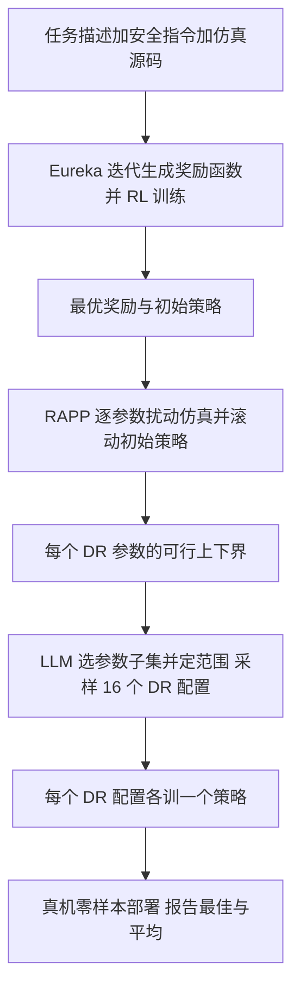

# DrEureka（arXiv:2406.01967）

**DrEureka**（*DrEureka: Language Model Guided Sim-To-Real Transfer*，Ma、Liang 等，宾夕法尼亚大学 / NVIDIA / UT Austin，[arXiv:2406.01967](https://arxiv.org/abs/2406.01967)，2024）。以下事实均取自论文全文，括号为章节 / 表号；读取范围见 [来源归档](../../sources/papers/dreureka-sim-to-real_arxiv_2406_01967.md)。

## 一句话定义

**让 LLM 同时自动设计「奖励函数」与「域随机化（DR）配置」的 sim-to-real 流程：只需目标任务的物理仿真，不需人工反复调奖励和仿真参数（摘要，I）。**

## 英文缩写速查

| 缩写 | 英文全称 | 简要说明 |
|------|----------|----------|
| DR | Domain Randomization | 域随机化：训练时扰动仿真物理参数（摩擦、恢复系数等）以增强鲁棒性（II） |
| RAPP | Reward-Aware Physics Prior | 奖励感知物理先验：用初始策略测出每个 DR 参数「仍能完成任务」的取值上下界（IV-C） |
| LLM | Large Language Model | 论文骨干为 GPT-4（V） |
| MDP | Markov Decision Process | 论文把仿真环境写成 M=(S, A, T)（III） |
| PPO | Proximal Policy Optimization | 两个任务的 RL 算法；行走用 teacher-student 变体（V） |
| CEM | Cross Entropy Method | 基线：靠真机评估迭代更新 DR 分布（V，附录 F） |
| BayRn | Bayesian Randomization（贝叶斯优化 DR） | 基线：以代理模型选下一组 DR（V，附录 F） |

## 为什么重要

- 论文指出此前 LLM 写奖励的工作多只在仿真里验证，迁移到真机仍需大量手调仿真器（I）；DrEureka 把奖励与 DR 两个人工瓶颈一起自动化（II，作者自称是首个研究 LLM 自动合成 DR 配置的工作）。
- 与 Eureka 对照的关键证据：只做奖励设计的 Eureka 策略真机 0.0 m/s、0.00 m，完全不能走（表 I，VI-A）。
- 与反复真机评估的 CEM、BayRn 相比，作者报告 DrEureka 墙钟约 3 小时（对 10 与 20 小时），且不必测试可能不安全的中间策略（VI-B）。

## 核心机制

论文不是联合搜索奖励与 DR，而是把它拆成串行三阶段，理由是联合搜索处于「无限维函数空间」，对 LLM 太贵（I）。

- **阶段一：安全指令奖励（IV-B，式 6）。** 在 Eureka 的任务描述后加入对稳定、平滑、特定属性的安全要求（如躯干高度 0.34、动作平滑、避开关节限位，附录 A）。动机：不加安全项时仿真分数可通过过度发力或不自然步态获得（IV-B）。
- **阶段二：RAPP（IV-C，Algorithm 2）。** 逐个参数设置候选值、其余取默认，滚动初始策略，满足成功判据（表 IV：前进为 exp(−(vx−vx_target)²/0.25) 逐步累加）的值为可行，取最小与最大。
- **阶段三：LLM 生成 DR（IV-D，式 7）。** LLM 在 RAPP 范围内选参数并定子范围；不同 DR 的策略不能在仿真中互比，因此保留全部 m 个策略，真机报告最佳与平均。DR 配置生成后训练期间固定（VIII）。

## 实验设置与结果

| 项 | 内容（章节 / 表） |
|----|-------------------|
| 平台 | Unitree Go1 前进 2 m/s、5 米轨道；LEAP Hand 方块旋转 20 秒（V） |
| 仿真 | Isaac Gym；行走代码沿用 Margolis 等，方块旋转沿用 Shaw 等（V） |
| 采样 | 16 个 DR 配置，各 3 个种子，全部上真机（V） |
| 行走（表 I） | Human-Designed 1.32±0.44 m/s、4.17 m；DrEureka 最佳 1.83±0.07、5.00 m；平均 1.66±0.25、4.64 m |
| 方块旋转（表 II） | Human-Designed 3.24 rad；DrEureka 最佳 9.39±4.15，平均 4.67±3.55；平均跌落时间 16.29±6.28 s |
| 鲁棒性（图 4、图 5） | Default / Grass / Sidewalk / Socks 四种真机条件，作者称 DrEureka 持平或优于人工设计；正文未给逐项数字 |
| Walking Globe（表 III） | 仿真 10.7±5.20 s；实验室真机 15.4±4.17 s（有人作支撑）；室外多地面累计 4 分钟以上（限速、有人牵引） |

**图 4 / 图 5 的四种地面：** Default 为实验室默认环境；Grass 为实验室内的人造草皮；Sidewalk 为室外空行人道；Socks 为给机器狗腿套袜子（VI-A）。这些是 DrEureka（Best）与 Human-Designed 的对比评测，不是训练时的地形。

**消融要点（表 I、XV、XVI）：** 去掉 RAPP（无先验、无信息先验）后 16 个策略中 15 个动作剧烈危险，记为 0；随机采样 0.98 m/s 低于 LLM 采样；CEM Random 0.00、CEM RAPP 1.46、BayRn RAPP 1.28；去掉安全指令后仿真 1.83 m/s 但真机 0.0 且摔倒（附录 E）。作者据此认为奖励感知先验与 LLM 采样两者都需要（VI-B）。

## 与其他工作对比

DrEureka 与论文中各对照的差别都落在「奖励与 DR 谁来设计、要不要真机迭代」上（数字均取自上文表格与消融）。

| 对照 | 差异 | 论文结果/说明 |
|------|------|---------------|
| [Eureka](./paper-eureka-llm-reward-design.md) | Eureka 只用 LLM 写奖励、不做 DR，也无安全指令；DrEureka 在其上加安全指令与 RAPP 约束的 LLM DR 生成 | 行走真机 Eureka 0.0 m/s、0.00 m，DrEureka 最佳 1.83 m/s（表 I） |
| Human-Designed（人工奖励 + 人工 DR） | 人工对照每任务只有一个配置，奖励依赖速度课程 | 行走 1.32 对最佳 1.83 / 平均 1.66 m/s；方块旋转 3.24 对最佳 9.39 / 平均 4.67 rad（表 I、II） |
| CEM、BayRn | 两者靠反复真机评估迭代更新 DR 分布；DrEureka 只在仿真内生成 DR，不测试可能不安全的中间策略 | CEM RAPP 1.46、BayRn RAPP 1.28 m/s；墙钟约 3 小时对 10 与 20 小时（VI-B） |
| 无先验 / 随机采样 DR | 去掉 RAPP 或去掉 LLM 采样 | 无先验 16 个策略中 15 个危险记 0；随机采样 0.98 m/s（表 I、XV） |
| [系统辨识](../concepts/system-identification.md) | 论文把它列为与 DR 互补、但需真机数据的路线（II） | 论文未做实验对比 |

## 结论

DrEureka 把奖励设计和域随机化配置这两个人工瓶颈串成「安全指令奖励、RAPP 可行范围、LLM 生成 DR」三阶段，只用目标任务的仿真就在 Go1 行走和 LEAP Hand 方块旋转上做到零样本 sim-to-real，并在速度与转角上超过论文的人工对照。消融显示 RAPP 与安全指令缺一不可：去掉任一个，真机策略基本失效。但不同 DR 下的策略无法在仿真中互比，仍要 16 个全部上真机挑选，且人工对照只有一个配置，结论强度应按此口径理解。

## 工程实践

- 需要：目标任务的仿真源码（作为程序输入 LLM）、可并行训练的 Isaac Gym 环境、成功判据函数、一台可跑真机评估的机器人（III，V，附录 A）。
- 论文在行走任务上给仿真补充了关节刚度、阻尼、摩擦、电枢等 DR 参数（附录 D1）；Walking Globe 使用 Ji 等的预训练执行器网络（附录 D3），与 [执行器建模](../concepts/implicit-explicit-actuator-modeling.md) 相关。
- Walking Globe 的安全措施：实验室里用人作中心支撑，室外用人拿牵引绳并保持水平，作者称不提供向上助力（附录 D3）。
- 代码在项目页链接的 GitHub 仓库（本归档未运行，仅按项目页记录）。

## 局限

- **论文自述（VIII）：** 无视觉输入；DR 参数训练中不随策略能力动态调整；没有从仿真表现预测真机表现的策略选择机制。
- **作者在正文承认的相关点：** 不同 DR 下的策略无法在仿真中互比，所以要 16 个全部上真机（IV-D）；仿真不能忠实建模瑜伽球的形变与弹性（VI-C）。
- **本页看到的未验证之处（判断，非论文结论）：** 人工对照只有每任务一个配置，且其奖励依赖速度课程（V，附录 E）；表 I 中人工 DR 的距离 4.83 m 高于 DrEureka 平均 4.64 m，优势主要体现在速度；方块旋转最佳与平均差距大、标准差大（表 II）；鲁棒性对比只有两种方法、四种条件且正文无逐项数字；Walking Globe 无人工基线对比，且真机试验有人支撑。

## 关联页面

- [Domain Randomization](../concepts/domain-randomization.md)：DrEureka 自动化的对象之一
- [Sim2Real](../concepts/sim2real.md)：整体问题框架
- [奖励设计](../concepts/reward-design.md)：奖励阶段（Eureka）的背景
- [PPO](../methods/ppo.md)：论文使用的 RL 算法
- [Safe RL](../methods/safe-rl.md)、[特权训练](../concepts/privileged-training.md)、[系统辨识](../concepts/system-identification.md)：邻近概念（论文把系统辨识列为与 DR 互补的需真机数据的方法，II）
- [Isaac Gym](../entities/isaac-gym.md)、[legged_gym](../entities/legged-gym.md)、[Walk These Ways](../entities/paper-walk-these-ways-quadruped-mob.md)：仿真与四足训练背景

## 参考来源

- [dreureka-sim-to-real_arxiv_2406_01967.md](../../sources/papers/dreureka-sim-to-real_arxiv_2406_01967.md)
- [arXiv:2406.01967](https://arxiv.org/abs/2406.01967)

## 推荐继续阅读

- [arXiv PDF](https://arxiv.org/pdf/2406.01967)
- [项目页](https://eureka-research.github.io/dr-eureka)
- [Domain Randomization](../concepts/domain-randomization.md)
- [Sim2Real](../concepts/sim2real.md)
