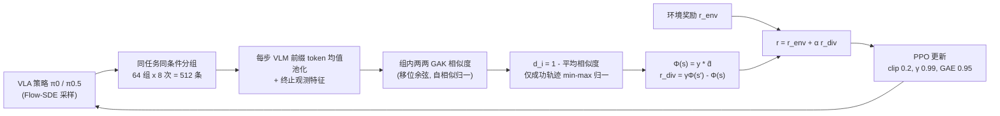

# DRIVE（多样性驱动的 VLA 强化微调）

**DRIVE**（*Diversity-driven RL fIne-tuning for VLA gEneralization*，论文 *Many Ways to Succeed*，arXiv:2610.09943，2026-10-07）认为 VLA 的 RL 微调虽提高训练分布内成功率，却把策略挤向少数成功动作模式，环境一变就没有替代方案；它把 **“成功 rollout 之间的行为多样性”** 作为显式 RL 目标，以势函数塑形的内在奖励加到 PPO 上，提升 OOD 泛化。

## 英文缩写速查

| 缩写 | 英文全称 | 简要说明 |
|------|----------|----------|
| RFT | RL Fine-Tuning | 用强化学习在闭环经验上微调 VLA |
| OOD / IND | Out-of-Distribution / In-Distribution | 微调分布外 / 内的评测条件 |
| GAK | Global Alignment Kernel | 对所有单调对齐路径求和的序列核，容忍执行快慢差异 |
| PPO | Proximal Policy Optimization | 带截断重要性比的策略梯度算法 |
| SFT | Supervised Fine-Tuning | 监督微调，RFT 的起点 checkpoint |
| VLA | Vision-Language-Action | 视觉语言动作模型，此处为 π0 / π0.5 |

## 为什么重要

- **指出 RFT 的泛化副作用：** 作者观察到 RFT 期间全部 rollout 的相似度上升（行为收窄），成功 rollout 之间相似度却下降；成功率 π0 41%→75%、π0.5 52%→77%。
- **不奖励失败的多样性：** 多样性奖励只在成功轨迹上生效，并用势函数塑形保证不改变最优策略集合，避免“为多样而乱动”。
- **与速度无关：** 用 GAK 做时间对齐，区分“路径不同”与“只是快慢不同”。

## 方法栈与流程总览

## 方法

- **RL 基座：** Flow-SDE 采样的 PPO；π0 与 π0.5 在每个基准内都从同一 SFT checkpoint 起步。
- **分组与特征：** 每轮 64 组×8 次随机 rollout，同组共享任务与环境条件，相似度只在组内计算；轨迹特征取每个决策步 VLM 前缀 token 的均值池化，并追加终止观测特征。
- **时间对齐：** 用 GAK 而非 DTW，对所有单调对齐路径加权求和，局部相似度为移位余弦映射到 [0,1]，按各轨迹自相似度归一化。
- **多样性与奖励：** d_i=1−该轨迹与组内其余轨迹的平均相似度；只在成功 rollout 内做 min-max 并截断到 [0,1]，失败为 0。势函数 Φ(s)=y·d̂，r_div=γΦ(s′)−Φ(s)，沿轨迹求和等价于终止块上的 γ^L·y·d̂；附录按 Ng et al. 1999 证明不改变最优策略集合。
- **超参：** α 约 0.02–0.10（π0：LIBERO-Plus Spatial/Object 0.10、Goal/Long 0.05、ManiSkill3 0.10；π0.5 多为 0.10），恒定不衰减；actor lr 约 5e-6、critic 约 1e-4；PPO 3–5 轮；全局 batch 2048 或 5120；Flow-SDE 3–5 步、σ 0.3–0.5；视野 80–480。GPU 型号与耗时在已读部分未报告。

## 实验与评测

基准：LIBERO-Plus 四套件、ManiSkill3（PutOnPlateInScene25Main-v3，OOD 13 种设置）、RoboTwin 2.0（Click Bell、Press Stapler）。基线：SFT、Vanilla RFT、Higher Noise（σ=0.7）、KL 正则（β=0.5）、Clip-Higher（上界 0.28）。

| 骨干 | 方法 | 平均 IND | 平均 OOD |
|------|------|------|------|
| π0 | SFT | 36.6 | 29.2 |
| π0 | Vanilla RFT | 66.6 | 48.1 |
| π0 | DRIVE | 69.3 | 53.4（+5.3） |
| π0.5 | SFT | 66.6 | 57.9 |
| π0.5 | Vanilla RFT | 85.9 | 71.1 |
| π0.5 | Higher Noise / Clip-Higher / KL | 85.2 / 85.3 / 87.1 | 70.1 / 72.6 / 71.4 |
| π0.5 | DRIVE | 88.2 | 73.1（+2.0） |

- **逐项：** π0 的 RoboTwin OOD 62.1→71.4、ManiSkill3 OOD 35.5→40.3、LIBERO-Long OOD 46.1→50.8；论文称 DRIVE 在两个骨干上均于 12 个基准划分中的 11 个提升。
- **真机（双臂 AgileX PiPER-X，每条件 20 次）：** Click Bell 的 OOD 平均 65.0→71.7，Press Stapler 63.3→75.0；两任务平均 OOD 64.1%→73.3%（+9.2），Clean 77.5%→82.5%。
- **分析：** Pass@K / Coverage@K（对 K=256 的 SFT 成功做参照）显示 RFT 以更少 rollout 覆盖更多可行解。
- **消融：** 成功条件化与 α=0.1/0.2 的比较只以图给出，正文无数值。

## 源码运行时序图

不适用：论文未给出官方仓库或项目页（arXiv 页面无链接，已读正文也无代码声明，末段约 10K 字符未读），无可对齐的目录与脚本。

## 工程实践

- 需要一个可按“相同任务条件”批量重复 rollout 的并行仿真环境（64×8 分组）；相似度计算是组内 8×8 的 GAK，成本随组大小平方增长。
- 多样性依赖 VLM 前缀特征是否能刻画行为差异；若特征对动作细节不敏感，奖励会退化为噪声（作者列为局限）。
- α 需按基准与骨干调（0.02–0.10），论文不含衰减策略。

## 结论

**DRIVE 说明 VLA 强化微调的泛化损失部分来自成功行为模式的塌缩，用成功条件化的多样性塑形可在不改最优策略集合的前提下换取一定 OOD 收益，但幅度因骨干而异。**

1. **π0 收益大、π0.5 收益小** — OOD +5.3 对 +2.0；强基座的 RFT 已更稳。
2. **只奖励成功样本** — 失败 rollout 的多样性不计入，防止鼓励随机动作。
3. **GAK 对齐是关键设计** — 避免把单纯快慢差异当成行为多样。
4. **别忽略便宜基线** — π0.5 上 Clip-Higher 的 OOD 72.6 仅比 DRIVE 低 0.5。
5. **真机证据有限** — 两任务、每格 20 次，+9.2 点需更多试验才稳。
6. **复现需自建实现** — 无公开代码，细节以论文附录为准。

## 与其他工作对比

| 对照 | 差异读法 |
|------|----------|
| [RLinf-VLA](./paper-rlinf-vla.md) | 提供 VLA RL 训练框架；DRIVE 是在此类 PPO 流程上叠加的奖励设计 |
| [flow 策略在线 RL 微调（RL 25889 页）](./paper-rcl-2510-25889-rl-online-rl-fine-tuning-for-flow-based-vision-l.md) | 同属 flow VLA 在线 RL；DRIVE 关注泛化与多样性而非样本效率 |
| [LIBERO-Plus 稳健性分析](./paper-rcl-2510-13626-libero-plus-in-depth-robustness-analysis-of-visi.md) | 提供 DRIVE 采用的扰动式 OOD 评测基准 |
| Higher Noise / KL / Clip-Higher | 论文内的“增加探索或约束”类对照，未显式针对成功模式覆盖 |

## 局限与风险

- **开源状态：** 无项目页、无代码（截至 2026-10-12 未核实到）。
- **计算：** 组内两两 GAK 开销；依赖 VLM 表征质量。
- **评测边界：** 仅 π0 / π0.5、两三个仿真基准、一个真机平台；作者将可学习多样性度量、更长视野、更多本体与在线真机微调列为未来工作。
- 单位取自 HTML 正文：南京大学、哈尔滨工业大学（深圳）、澳大利亚国立大学、悉尼科技大学。

## 关联页面

- [周报汇总：Manipulation 2026-10-05 至 10-09](../overview/frontier-manipulation-2026-10-05-10-09.md)
- [VLA](../methods/vla.md)、[PPO](../methods/ppo.md)、[强化学习](../methods/reinforcement-learning.md)
- [机器人通用后训练](../concepts/universal-post-training-robotics.md)
- [π0](./paper-pi0.md)、[π0.5](./paper-pi05-open-world-vla.md)
- [RoboTwin](./robotwin.md)

## 参考来源

- [drive_arxiv_2610_09943.md](../../sources/papers/drive_arxiv_2610_09943.md) — 论文归档
- [frontier_manipulation_2026_10_05_10_09.md](../../sources/blogs/frontier_manipulation_2026_10_05_10_09.md) — 周报线索
- 论文：<https://arxiv.org/abs/2610.09943>

## 推荐继续阅读

- [arXiv HTML 全文](https://arxiv.org/html/2610.09943v1)
- [Global Alignment Kernel（Cuturi 2011）](https://arxiv.org/abs/1101.2429)
- [势函数奖励塑形（Ng et al. 1999）](https://people.eecs.berkeley.edu/~pabbeel/cs287-fa09/readings/NgHaradaRussell-shaping-ICML1999.pdf)
