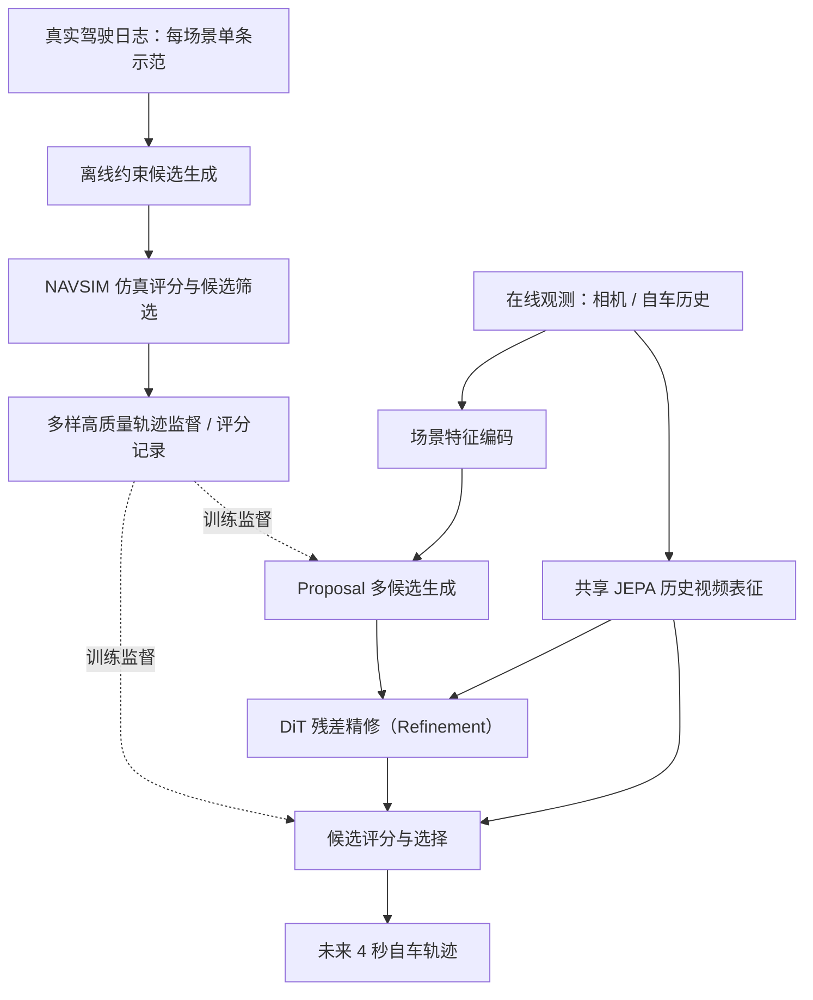
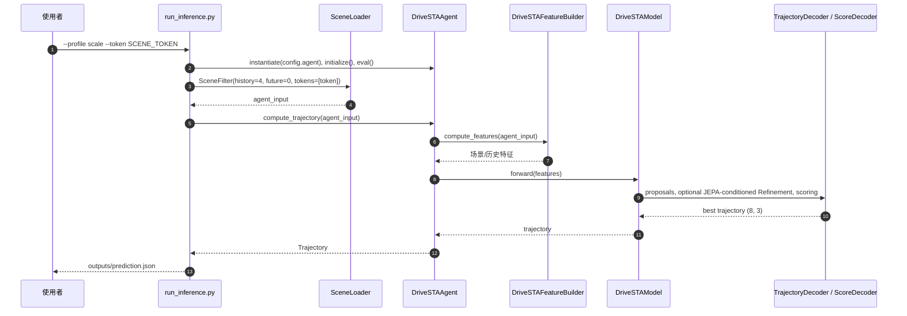

# DriveSTA：从带评分的备选轨迹学习端到端驾驶 / Learning from Scored Trajectory Alternatives for End-to-End Driving

## 一句话定义

**DriveSTA** 将单场景的单条真实驾驶示范扩展为**带仿真评分的多样轨迹目标**，训练模型先生成候选并评分，再结合共享 JEPA 视频历史特征进行轨迹残差精修；本文研究的是**规划输出**，并非已经证明端到端车载执行器部署。

## 英文缩写速查

| 缩写 | 英文全称 | 简要说明 |
|---|---|---|
| STA | Scored Trajectory Alternatives | 多条经评分的轨迹备选，用作离线监督 |
| JEPA | Joint-Embedding Predictive Architecture | 提取历史视频的时序信息，辅助轨迹精修 |
| NAVSIM | Non-Reactive Autonomous Vehicle Simulation | 使用非反应式仿真评分的驾驶基准 |
| PDMS | Predictive Driver Model Score | NAVSIM v1 评估指标 |
| EPDMS | Extended Predictive Driver Model Score | NAVSIM v2 扩展评估口径，不能与 PDMS 混用 |
| DiT | Diffusion Transformer | 官方代码中的候选残差去噪解码路径 |
| RC | Route Completion | HUGSIM 闭环路线完成率 |
| HD-Score | HUGSIM Driving Score | HUGSIM 闭环驾驶分数 |

## 为什么重要

- **一对多监督：** 一条已记录轨迹不能覆盖礼让、变道等多个同样合理的驾驶选择。离线挖掘避免将日志中的唯一动作误认为唯一正确动作。
- **候选质量可学习：** 不只学如何生成，还对成功与失败候选回放学习评分，形成候选筛选能力。
- **将时序证据注入精修：** 项目页与公开模型路径均显示 JEPA 视频特征用于 Refinement，而不是把模型描述为单帧决策。
- **重要的跨域对照：** 与机器人操作的多模态动作生成和轨迹筛选类似，但交通场景、安全指标与数据接口不同。

## 核心信息与证据状态

| 属性 | 已核实内容 |
|---|---|
| 用户提供的论文 | [arXiv:2611.27515](https://arxiv.org/abs/2611.27515)；当前无法打开全文，作者、机构、版本待核 |
| 官方项目 | [DriveSTA](https://rtwotwo.github.io/DriveSTA/)；已读取项目说明和实验表 |
| 官方代码 | [Rtwotwo/DriveSTA](https://github.com/Rtwotwo/DriveSTA)；可运行训练、单场景推理和 NAVSIM v1 评测入口 |
| 训练规模 | Base 103,263 真实场景；Scale 232,672 真实+合成场景（仓库 README） |
| 输出 | 未来 4 s，每 0.5 s 一帧，共 8 个自车系 (x,y,heading) 位姿 |
| 核查性质 | 官方网站/README/关键源文件核对；论文全文**尚未通读**，实验未独立复现 |

## 核心原理与方法栈

1. **离线候选生成与评分。** 通过约束轨迹构造、物理/驾驶规则过滤和仿真评分，在已录制场景上保留高质量且多样的轨迹银行。项目页称从约 103.3k 真实场景构造 2.61M 高质量目标；仓库 MINING.md 给出了官方 NAVSIM v1 PDMS 挖掘入口。
2. **Proposal：多候选生成与排序。** `DriveSTAModel` 的 `trajectory_decoder` 基于场景编码特征产生 proposals，`ScoreDecoder` 给候选分数，输出所选轨迹。模型同时学习评价失败候选，不能把得分监督等同于只有专家行为克隆。
3. **Refinement：历史视频条件残差修正。** `use_diffusion_decoder=true` 时共享模型创建 `TrainableJEPA`、`VideoCondition` 和 DiT 相关残差路径；先得到初始候选，再精修、重评分并选择。公开实现的 `forward_joint` 显示 JEPA 历史编码、残差候选和最终 `pdm_score.argmax`。
4. **训练与推理解耦。** 真实未来轨迹、离线评分与未来视频目标用于训练；公开单场景推理 `SceneFilter(num_future_frames=0)`，不读取未来监督标签。

## 流程总览

> 该图仅表示官方项目页及可读源码已核实的模块关系，不等价于论文全文中的完整推导；训练分支用虚线区分推理通路。

## 源码运行时序图

以官方 `docs/INFERENCE.md` 和实际 `run_inference.py`、`drivesta_agent.py`、`drivesta_model.py` 的单场景推理入口为准：

**源码定位：** `navsim/planning/script/run_inference.py` → `DriveSTAAgent.compute_trajectory` → `DriveSTAFeatureBuilder` → `DriveSTAModel.forward`；模型内 `forward_proposals` 与 `forward_joint` 分别处理 Proposal / Refinement。该图是源码静态审读，不代表本机实际运行过。

## 实验与评测（官方项目页报告，未独立复现）

| 版本 / 阶段 | NAVTEST PDMS ↑ | NAVTEST EPDMS ↑ | NAVHARD EPDMS ↑ | HUGSIM RC ↑ | HUGSIM HD-Score ↑ |
|---|---:|---:|---:|---:|---:|
| DriveSTA Proposal | 94.76 | 91.15 | 50.80 | 51.88 | 36.88 |
| DriveSTA Refinement | 95.14 | — | — | 55.22 | 44.05 |
| DriveSTA-Scale Proposal | 95.09 | 91.32 | 56.13 | 54.05 | 43.97 |
| DriveSTA-Scale Refinement | **95.55** | — | — | **56.09** | **46.69** |

**比较边界：** 主页复现的 NAVTEST PDMS 表同时列出 FPD-Drive-Pro **95.69**、ChainFlow-VLA **94.85**、DrivoR **94.58**。因此 95.55 ≈ 95.6 不等于该榜绝对第一。HUGSIM 汇总为 345 个场景。用户分享的 **73% 平均规划前向时延改善** 尚缺本次可读取一手资料中的对齐测速表，暂作**待验证主张**。

## 结论

**DriveSTA 的可迁移思路是“离线多解监督 + 候选可评分 + 时序残差精修”，而不是把单条人类日志当唯一最优解。**

1. **数据先于架构：** 从每场景单条示范扩展到高质量候选，能让学习目标覆盖不同可行驾驶选择。
2. **生成和评分都要学：** 仅生成多个轨迹不能保证最终选择安全或高质量，评分器是规划链的一部分。
3. **先对齐指标：** PDMS、EPDMS 和 HUGSIM HD-Score 不可横向等号；评测环境和候选筛选协议也要明确。
4. **部署需验证：** 单次推理接口输出 8 个 2 Hz 位姿，不等同于真实车辆执行环的闭环安全验证。
5. **复现应锁定数据：** Base/Scale 的训练场景混合不同；全归档 308,119 场景不等于 Scale 实际训练集。
6. **论文级结论仍待核：** 论文原文、公式、附录和 73% 速度对比不可仅靠项目宣传代替。

## 工程实践与开源状态

- **已开源：** Apache-2.0 主仓含数据挖掘、四种 profile、训练/推理、NAVSIM v1 PDMS 评测脚本；模型权重与数据通过外部资产入口列出，实际下载需自查。
- **单场景推理：** `python -m navsim.planning.script.run_inference --profile base --token SCENE_TOKEN --split test --device cuda --output outputs/prediction.json`；需要原始传感器日志与对应 checkpoint。
- **训练入口：** `bash scripts/training/train_drivesta.sh base_proposal`，再用 Proposal checkpoint 初始化 `base` Refinement；Scale 使用 mixed 数据。
- **评测入口：** `bash scripts/evaluation/run_drivesta_pdm_score_evaluation.sh base`；PDMS 需要官方地图与缓存，HUGSIM 和 EPDMS 需使用各自评测环境。
- **源码验证范围：** 阅读了关键脚本和模块；**未**在此环境运行模型、全量 benchmark、`make ci-preflight` 或真实道路测试。

## 与其他工作对比

| 对比 | 关键分工 |
|---|---|
| [AutoVLA-D](./paper-autovla-d.md) | 通过离散 TrajCond 形成语义→几何条件；DriveSTA 更强调多样候选监督、评分与精修 |
| [DriveTeach-VLA](./paper-driveteach-vla.md) | DVD + TGP 解决驾驶视觉关注与空间 prompt；DriveSTA 侧重单条示范扩展为多条可评分轨迹 |
| [自动驾驶核心算法栈](../overview/autonomous-driving-core-algorithms-series.md) | 传统模块化规控的规划/预测分工，与学习型多候选规划接口可作对照 |
| ChainFlow-VLA（官方 README 致谢） | 工程布局沿用 NAVSIM 社区实现；前向时延的 73% 比较条件待原文核对 |

## 局限与风险

- **论文全文阻塞：** 2026-11-23 尝试 arXiv HTML / PDF / abs 未成功；未核实作者、方法细节与全部实验，当前 `status: draft`。
- **评测协议敏感：** 论文数字来自官方主页，尚未独立复测；主页精选的 41 段视频不代表随机抽样。
- **评分反馈可能导致指标专用性：** 使用 NAVSIM PDMS 离线评分形成训练标签，跨现实道路及不同闭环仿真环境的泛化须额外测量（这是工程风险分析，非已证实的实验结论）。
- **开源复现依赖外部资产：** 官方脚本和网络权重入口存在，但完整数据、地图、缓存、HUGSIM 运行环境不随源码仓库直接提供。
- **安全部署未证明：** 此项公开 benchmark 不能推断具备实车道路使用认证或实时控制链路的功能安全保证。

## 关联页面

- [AutoVLA-D](./paper-autovla-d.md)
- [DriveTeach-VLA](./paper-driveteach-vla.md)
- [自动驾驶核心算法技术地图](../overview/autonomous-driving-core-algorithms-series.md)
- [视觉语言动作模型 VLA](../methods/vla.md)
- [模仿学习](../methods/imitation-learning.md) — 单示范监督与多模态监督扩展的共同基础
- [Diffusion Policy](../methods/diffusion-policy.md) — 多峰轨迹生成和去噪解码的跨领域方法对照
- [导航纵深路线（Stage 3 学习型导航）](../../roadmap/depth-navigation.md)

## 参考来源

- [DriveSTA 论文来源归档（全文待核）](../../sources/papers/drivesta_arxiv_2611_27515.md)
- [DriveSTA 官方项目页归档](../../sources/sites/drivesta.md)
- [DriveSTA 官方代码归档](../../sources/repos/drivesta.md)
- [官方项目主页与实验表](https://rtwotwo.github.io/DriveSTA/)
- [公开代码与说明](https://github.com/Rtwotwo/DriveSTA)

## 推荐继续阅读

- [官方论文入口（暂无法访问）](https://arxiv.org/abs/2611.27515)
- [官方 MINING.md：轨迹挖掘和评分入口](https://github.com/Rtwotwo/DriveSTA/blob/main/docs/MINING.md)
- [官方 INFERENCE.md：单场景与 NAVTEST 复现](https://github.com/Rtwotwo/DriveSTA/blob/main/docs/INFERENCE.md)
