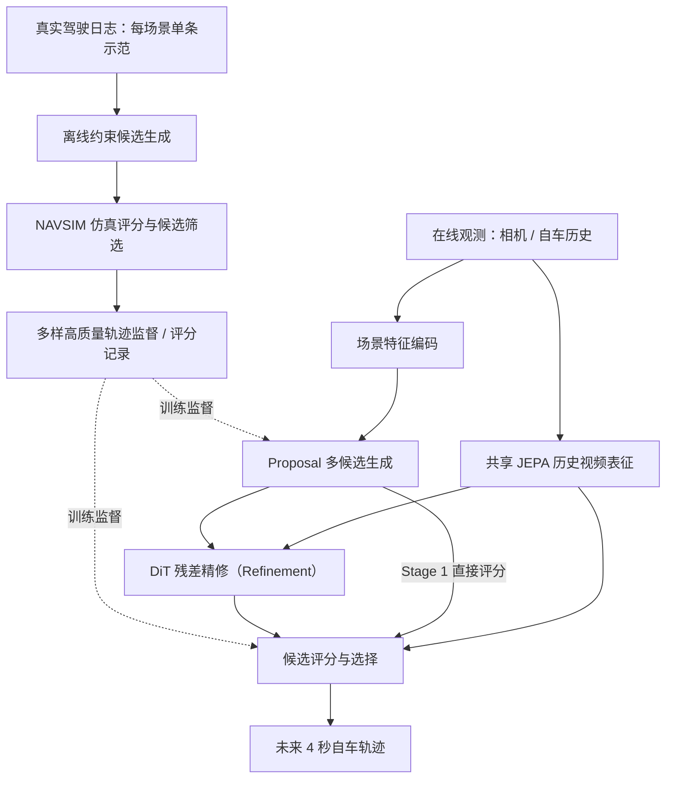
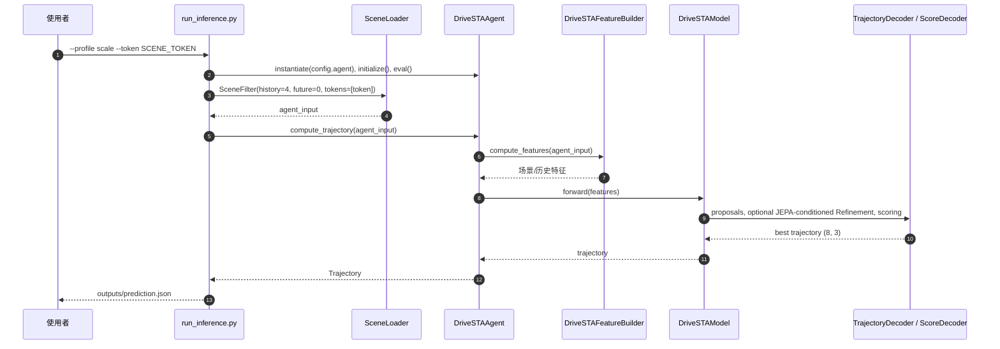

# DriveSTA：从带评分的备选轨迹学习端到端驾驶 / Learning from Scored Trajectory Alternatives for End-to-End Driving

## 一句话定义

**DriveSTA** 将单场景的单条真实驾驶示范扩展为**带仿真评分的多样轨迹目标**，训练模型先生成候选并评分，再结合共享 JEPA 视频历史特征进行轨迹残差精修；本文研究的是**规划输出**，并非已经证明端到端车载执行器部署。

## 英文缩写速查

| 缩写 | 英文全称 | 简要说明 |
|---|---|---|
| STA | Scored Trajectory Alternatives | 多条经评分的轨迹备选，用作离线监督 |
| JEPA | Joint-Embedding Predictive Architecture | 提取历史视频的时序信息，辅助轨迹精修 |
| NAVSIM | Non-Reactive Autonomous Vehicle Simulation | 使用非反应式仿真评分的驾驶基准 |
| PDMS | Predictive Driver Model Score | NAVSIM v1 评估指标 |
| EPDMS | Extended Predictive Driver Model Score | NAVSIM v2 扩展评估口径，不能与 PDMS 混用 |
| DiT | Diffusion Transformer | 官方代码中的候选残差去噪解码路径 |
| RC | Route Completion | HUGSIM 闭环路线完成率 |
| HD-Score | HUGSIM Driving Score | HUGSIM 闭环驾驶分数 |

## 为什么重要

- **一对多监督：** 一条已记录轨迹不能覆盖礼让、变道等多个同样合理的驾驶选择。离线挖掘避免将日志中的唯一动作误认为唯一正确动作。
- **候选质量可学习：** 不只学如何生成，还对成功与失败候选回放学习评分，形成候选筛选能力。
- **将时序证据注入精修：** 项目页与公开模型路径均显示 JEPA 视频特征用于 Refinement，而不是把模型描述为单帧决策。
- **重要的跨域对照：** 与机器人操作的多模态动作生成和轨迹筛选类似，但交通场景、安全指标与数据接口不同。

## 核心信息与证据状态

| 属性 | 已核实内容 |
|---|---|
| 论文 | [arXiv:2611.27515v1](https://arxiv.org/abs/2611.27515)（[原文 HTML](https://arxiv.org/html/2611.27515v1)、[alphaXiv 阅读页](https://www.alphaxiv.org/abs/2611.27515)）；2026-11-20，21 页、含 Appendix A–C；论文为预印本 |
| 作者 | Xinyao Rao、Zecheng Tang、Liuxuan Sun、Zheyuan Lai、Minjun Yu、Xun Cao、Wei Li（通讯） |
| 机构 | 南京大学、北京大学、EABOT.AI |
| 官方项目 | [DriveSTA](https://rtwotwo.github.io/DriveSTA/)；已读取项目说明和实验表 |
| 官方代码 | [Rtwotwo/DriveSTA](https://github.com/Rtwotwo/DriveSTA)；可运行训练、单场景推理和 NAVSIM v1 评测入口 |
| 发布资产 | [Hugging Face 模型和轨迹库](../../sources/models/drivesta-release-assets.md)：4 个 checkpoint、48 个轨迹分片和 1 个元数据包；全库 308,119 场景，并非训练集大小 |
| 训练规模 | Base 103,263 真实场景；Scale 232,672 真实+合成场景（仓库 README） |
| 输出 | 未来 4 s，每 0.5 s 一帧，共 8 个自车系 (x,y,heading) 位姿 |
| 核查性质 | 官方 arXiv v1 PDF **21 页正文、实验及补充材料已通读**；图像按图注和正文核对；官方源码静态阅读，实验未独立复现 |

## 核心原理与方法栈

1. **离线候选生成与评分（论文 §3.2）。** 对每条专家轨迹做五次 smoothstep 纵横偏移，跟踪仿真并用 NAVSIM v1 PDMS 评分；每批 64 次查询（25% 广泛探索），按 3,072→8,192→32,768 预算恢复，保留各质量区间的 3,072 路径以训练 Scorer。通过物理约束/跟踪/安全及 0.25 m 多样性筛选的 2.61M 目标分布于 **95,998** 真实场景；另有 7,265 场景没有筛选目标，仍用于专家和评分监督。
2. **Proposal（论文 §3.3）：** 四个相机视角的 DINOv2 ViT-S/14 + LoRA rank32 编码场景，AR 生成 64 条轨迹。每轮轮换至多 8 个高质量目标，用 Hungarian 一对一匹配监督不同 Proposal；6 个评分分头预测质量指标，配合跨成功/失败标签的 Replay，训练评价而不只拟合专家。
3. **Refinement（论文 §3.4）：** 对每条 detached Proposal，匹配至多 4 条局部兼容目标（ADE≤3 m、末点≤6 m、平均航向≤0.5 rad），监督 DiT 的 v-prediction 残差去噪；无匹配者用弱零残差目标。官方模型在 12 个 DDIM 步中精修全部 64 条候选，**必须重评分**，不能直接沿用 AR 阶段最佳索引。
4. **训练与推理解耦（论文 Eq.6–8）：** 共享 JEPA ViT-L 用 8 帧视频的 masked feature prediction 适配；独立的 DiT/Scorer 适配器复用两帧**已观测**前视视频特征，规划梯度不回传 JEPA；训练可使用录制的未来特征目标。公开单场景推理 `SceneFilter(num_future_frames=0)`，不读取未来监督标签，也不运行额外 VLM。

## 原文公式、训练与可复现协议

- **轨迹形变（Eq.1）：** 令 `r_t=(t−1)/(H−1)`、`b(r)=6r^5−15r^4+10r^3`，用 `x_t(u)=x_t^expert+b(r_t)u` 产生自车纵横偏移平滑备选。起点保持、末端偏移到位，并在两端有零斜率；该搜索仍受参考动作邻域限制。
- **Dense matching（Eq.2）：** 匹配成本为沿轨迹的 `|dx|+|dy|+0.25|wrapped Δheading|` 平均，采用 Hungarian injective assignment，使不同优质目标分配给不同 Proposal。
- **Residual（Eq.4–5）：** `δ_ij=h_j⊖stopgrad(p_i)`；`z=αδ+σε`，DiT 预测速度参数 `v=αε−σδ`，再重建并挑选每条 parent 误差最小的目标；未匹配路径设为零残差弱监督。
- **评分（Eq.3/7）：** 六个 component head 经 BCE + 聚合评分平方误差标定；可选 pairwise Rank 用 0.005 的质量差阈值。v1 真实数据不启 Rank、mixed 开启，v2 实验另用 S1+Rank。
- **JEPA（Eq.6 / Appendix B.3）：** 当前+上一帧的前视观测为推理编码来源；8 帧 masked clip（含训练时未来帧）仅服务表征适配；DiT 和 Scorer 共享一次观察编码，但各有 ego history adapter。预训练 Drive-JEPA checkpoint 的完整训练配方未公开。
- **模型（Table S2）：** 4 个当前相机、64 场景 token×256，64×8×3 候选，DINOv2 ViT-S/14 LoRA32、JEPA ViT-L、DiT 12 blocks/8 heads/width256、12 DDIM steps。
- **训练（Table S3）：** Stage 1 25 epochs，Stage 2 40 epochs；8×H20、batch6/GPU，AdamW；每配置一组 seed，报告选定 checkpoint 的最佳完整评测（不等于跨随机种子均值）。
- **物理筛选（Appendix B.1）：** 轨迹最高速度 25 m/s、加速度 6 m/s²、jerk 10 m/s³、侧向加速度 4 m/s²，tracking ADE≤1 m、最大位置偏差≤2 m；和 PDMS、车身足迹及交通规则检查共同使用。

## 流程总览

> 该图仅表示官方项目页及可读源码已核实的模块关系，不等价于论文全文中的完整推导；训练分支用虚线区分推理通路。

## 源码运行时序图

以官方 `docs/INFERENCE.md` 和实际 `run_inference.py`、`drivesta_agent.py`、`drivesta_model.py` 的单场景推理入口为准：

**源码定位：** `navsim/planning/script/run_inference.py` → `DriveSTAAgent.compute_trajectory` → `DriveSTAFeatureBuilder` → `DriveSTAModel.forward`；模型内 `forward_proposals` 与 `forward_joint` 分别处理 Proposal / Refinement。该图是源码静态审读，不代表本机实际运行过。

## 实验与评测（官方项目页报告，未独立复现）

| 版本 / 阶段 | NAVTEST PDMS ↑ | NAVTEST EPDMS ↑ | NAVHARD EPDMS ↑ | HUGSIM RC ↑ | HUGSIM HD-Score ↑ |
|---|---:|---:|---:|---:|---:|
| DriveSTA Proposal | 94.76 | 91.15 | 50.80 | 51.88 | 36.88 |
| DriveSTA Refinement | 95.14 | — | — | 55.22 | 44.05 |
| DriveSTA-Scale Proposal | 95.09 | 91.32 | 56.13 | 54.05 | 43.97 |
| DriveSTA-Scale Refinement | **95.55** | — | — | **56.09** | **46.69** |

**演示不等于全量结果：** [官方 HUGSIM 演示](https://rtwotwo.github.io/DriveSTA/#hugsim) 选取 51 个高分闭环片段，11 月 24 日更新为叠加逐帧记录的 8 点预测。它们是 345 个评测场景的子集；按公开逐场分数重算，整体 RC 56.09、HD-Score 46.69，并未重跑仿真。

**比较边界：** 论文 Table 1 将 DriveSTA 的 95.14 PDMS 标为 **约 103k NAVSIM 训练 regime 中第一**，Scale 95.55 的领先结论受可比训练数据规模约束；项目页另列 FPD-Drive-Pro **95.69**（更多训练数据），不能称对所有模型无条件第一。HUGSIM 汇总为 345 个场景。**73% 时延优势已由论文 Table 3 / Appendix B.7 验证为作者报告**，具体量测边界见下表。

### 原文时间、消融及风险校核

| 证据锚 | 原文结果 | 合理读法 |
|---|---|---|
| Table 3 / Appendix B.7 | H20、batch1、12,146 场景、64候选、S2 12 DDIM：ChainFlow-VLA **1294.68±4.47 ms**，DriveSTA S2 **349.30±5.21 ms**，S1 **148.99±0.85 ms** | S2 比 ChainFlow-VLA **约快 73%**；只计 GPU-resident 输入到最终轨迹选择，**不含**预处理、I/O、仿真和控制回路。ChainFlow-VLA 的 BF16 InternVL 用 eager attention 且未用 FlashAttention2 |
| Table 4（Stage1） | 不用 Dense/Replay/Rank **93.92 PDMS**；仅加 Dense **94.53**，最后 real Dense+Replay 且无 Rank **94.76** | 高质几何目标提升候选 Oracle；Replay/Rank 不保证每次正贡献 |
| Table 5/6（Stage2） | Expert residual 控制 **93.24**；screen+视频适配器+4目标 **94.87**，JEPA adaptation **94.93**；恢复 S2 scorer 视频提高精修池选择 PDMS **3.20** | 训练目标和重新评分都重要；该消融使用与主表不同的控制 checkpoint |
| Table 7/8 | NAVSIM v2 Scale S1 Navtest **91.32 EPDMS**（WA-JEPA 91.7）；Navhard **56.13**（DriveZero-Scale 57.1） | v2 只评 S1+Rank，不把 PDMS S2 误认为 v2 成绩；连续舒适度仍有明显不足 |
| Table 2 | Scale S2 HUGSIM RC/HD-Score **56.1/46.7**；Extreme HD-Score S1→S2 **30.3→27.3** | 闭环整体收益不代表全部难度和舒适指标改善 |

## 结论

**DriveSTA 的可迁移思路是“离线多解监督 + 候选可评分 + 时序残差精修”，而不是把单条人类日志当唯一最优解。**

1. **数据先于架构：** 从每场景单条示范扩展到高质量候选，能让学习目标覆盖不同可行驾驶选择。
2. **生成和评分都要学：** 仅生成多个轨迹不能保证最终选择安全或高质量，评分器是规划链的一部分。
3. **先对齐指标：** PDMS、EPDMS 和 HUGSIM HD-Score 不可横向等号；评测环境和候选筛选协议也要明确。
4. **部署需验证：** 单次推理接口输出 8 个 2 Hz 位姿，不等同于真实车辆执行环的闭环安全验证。
5. **复现应锁定数据：** Base/Scale 的训练场景混合不同；全归档 308,119 场景不等于 Scale 实际训练集。
6. **原文测速已核：** H20 上的 73% 为严格给定 batch1、64 候选与 12 DDIM 的作者实测，不含预处理、外部执行与仿真；不能推断量产车控延时。
7. **关注失败模式：** 参考轨迹形变覆盖有限，v2 extended comfort 与 HUGSIM Extreme 工况出现退化，说明需要跨重规划周期的监督。

## 工程实践与开源状态

- **已开源：** Apache-2.0 主仓含数据挖掘、四种 profile、训练/推理、NAVSIM v1 PDMS 评测脚本；[模型与轨迹发布清单](../../sources/models/drivesta-release-assets.md) 已按固定版本与 Hub LFS 元数据比对，未下载大文件。
- **下载与版本：** 先用 `python scripts/download_assets.py --profiles base --plan` 查看所需文件。Hub 上的 `base_s2.ckpt` 经官方脚本校验后保存为本地 `base.ckpt`；训练用的原始传感器、地图和缓存不随轨迹库发布。
- **单场景推理：** `python -m navsim.planning.script.run_inference --profile base --token SCENE_TOKEN --split test --device cuda --output outputs/prediction.json`；需要原始传感器日志与对应 checkpoint。
- **训练入口：** `bash scripts/training/train_drivesta.sh base_proposal`，再用 Proposal checkpoint 初始化 `base` Refinement；Scale 使用 mixed 数据。
- **评测入口：** `bash scripts/evaluation/run_drivesta_pdm_score_evaluation.sh base`；PDMS 需要官方地图与缓存，HUGSIM 和 EPDMS 需使用各自评测环境。
- **验证范围：** 已取得 arXiv v1 官方 PDF 并通读 21 页正文、实验和 Appendix A–C；静态审读关键脚本；**未**在此环境运行模型、全量 benchmark 或真实道路测试。

## 与其他工作对比

| 对比 | 关键分工 |
|---|---|
| [AutoVLA-D](./paper-autovla-d.md) | 通过离散 TrajCond 形成语义→几何条件；DriveSTA 更强调多样候选监督、评分与精修 |
| [DriveTeach-VLA](./paper-driveteach-vla.md) | DVD + TGP 解决驾驶视觉关注与空间 prompt；DriveSTA 侧重单条示范扩展为多条可评分轨迹 |
| [自动驾驶核心算法栈](../overview/autonomous-driving-core-algorithms-series.md) | 传统模块化规控的规划/预测分工，与学习型多候选规划接口可作对照 |
| ChainFlow-VLA（论文 §1/Table 3） | 延续 AR+Residual Diffusion 架构，DriveSTA 用高分多目标与共享 JEPA 取代在线 VLM 条件；作者在匹配 H20 前向计时中报告 −73%，不覆盖所有部署开销 |

## 局限与风险

- **预印本/可视化边界：** 已核对 arXiv:2611.27515v1 PDF 21 页文字内容及附录图注；图像细节依赖官方图注与项目展示，未逐像素复核；论文未经同行评审。
- **评测协议敏感：** 数字已与论文 §4/Table1–8、Appendix A/B 实验表交叉核对，但未独立复测；主页精选的 41 段视频不代表随机抽样，注意力热图不等于因果解释。
- **训练–评测指标耦合：** 高分备选的监督来自 NAVSIM PDMS evaluator，可能偏向该度量；论文 §5 明确指出非反应式日志无法模拟他车对新路径的反馈，且跨周期间一致性缺少直接约束。
- **开源复现依赖外部资产：** 官方脚本和网络权重入口存在，但完整数据、地图、缓存、HUGSIM 运行环境不随源码仓库直接提供。
- **闭环退化与选模偏差：** HUGSIM Extreme 子集、NAVSIM v2 extended comfort 均出现退化；每配置仅一训练 seed，选择最好完整评测 checkpoint，不能保证跨 seed 稳健。
- **安全部署未证明：** 作者 H20 规划前向仍约 349 ms，HUGSIM 控制器 50 ms wall-clock 预算并不意味着网络单次 forward 小于 50 ms；公开 benchmark 不能推断具备真实道路功能安全保证。

## 关联页面

- [AutoVLA-D](./paper-autovla-d.md)
- [DriveTeach-VLA](./paper-driveteach-vla.md)
- [自动驾驶核心算法技术地图](../overview/autonomous-driving-core-algorithms-series.md)
- [视觉语言动作模型 VLA](../methods/vla.md)
- [模仿学习](../methods/imitation-learning.md) — 单示范监督与多模态监督扩展的共同基础
- [Diffusion Policy](../methods/diffusion-policy.md) — 多峰轨迹生成和去噪解码的跨领域方法对照
- [导航纵深路线（Stage 3 学习型导航）](../../roadmap/depth-navigation.md)

## 参考来源

- [DriveSTA 论文 v1 全文核对归档（含公式、表格、附录）](../../sources/papers/drivesta_arxiv_2611_27515.md)
- [DriveSTA 官方项目页归档](../../sources/sites/drivesta.md)
- [DriveSTA 官方代码归档](../../sources/repos/drivesta.md)
- [官方项目主页与实验表](https://rtwotwo.github.io/DriveSTA/)
- [公开代码与说明](https://github.com/Rtwotwo/DriveSTA)

## 推荐继续阅读

- [官方 arXiv v1 PDF（21 页含补充材料）](https://arxiv.org/pdf/2611.27515v1)
- [官方 MINING.md：轨迹挖掘和评分入口](https://github.com/Rtwotwo/DriveSTA/blob/main/docs/MINING.md)
- [官方 INFERENCE.md：单场景与 NAVTEST 复现](https://github.com/Rtwotwo/DriveSTA/blob/main/docs/INFERENCE.md)
