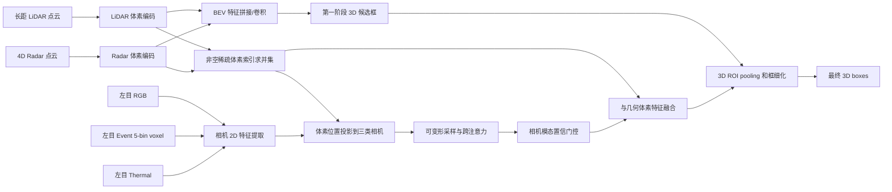
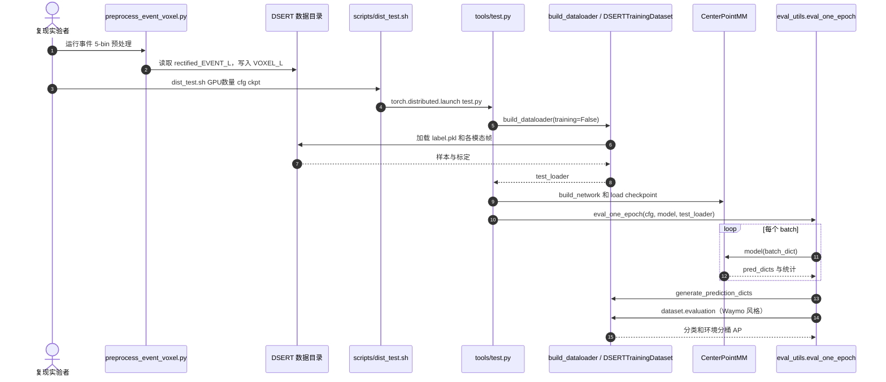

# DSERT-RoLL：多天气驾驶的双目事件/RGB/热成像、4D 雷达与双 LiDAR 鲁棒感知

## 一句话定义

**DSERT-RoLL（Driving with Stereo Event-RGB-Thermal Cameras, 4D Radar, and DuaL LiDAR）** 是 KAIST VILAB 在 CVPR 2026 发布的同步多传感器驾驶数据集与 2D/3D 检测 benchmark，并提供一套基于 LiDAR、4D Radar、RGB、事件和热成像的自适应 3D 融合检测方法（[论文](https://arxiv.org/abs/2604.03685)；[项目页](https://jeongyh98.github.io/dsert-roll/)）。

## 英文缩写速查

| 缩写 | 英文全称 | 简要说明 |
|---|---|---|
| DSERT-RoLL | Driving with Stereo Event-RGB-Thermal Cameras, 4D Radar, and DuaL LiDAR | 论文提出的驾驶数据集/多模态基线 |
| RGB | Red, Green, Blue | 可见光双目相机，提供语义与纹理 |
| LiDAR | Light Detection and Ranging | 长距/短距激光雷达，提供几何点云 |
| 4D Radar | Four-Dimensional Radar | 量测距离、方位、俯仰及径向速度的雷达 |
| BEV | Bird's-Eye View | 点云投影的鸟瞰平面特征，用于候选框 |
| HDR | High Dynamic Range | 高动态范围光照条件 |
| AP | Average Precision | 检测精度指标，论文按天气/光照报告 |
| ROI | Region of Interest | 候选区域池化，用于二阶段框细化 |

## 为什么重要

RGB 在暗光/过曝条件下可能退化，LiDAR 会因浓雾/降雪点云衰减，雷达具有天气穿透和速度观测优势，热成像与事件相机可补充夜间、高动态范围和快速运动线索。过去这些模态的数据集与评测协议常不一致，难以判断**同一驾驶场景**内不同传感器真正贡献多少。DSERT-RoLL 同步采集并统一标注，允许对单模态及融合策略做控制变量比较。

## 核心信息：数据、设备与标注

| 维度 | 论文/官方数据仓库公布的信息 |
|---|---|
| 机构与作者 | 韩国科学技术院（KAIST）Visual Intelligence Lab；Hoonhee Cho、Jae-Young Kang、Yuhwan Jeong 等七人 |
| 发表 | CVPR 2026，pp. 33022–33035；arXiv:2604.03685 |
| 规模 | 约 **22K 帧**同步传感测量；数据仓库 **190 条序列**（train 132 / val 58），完整数据约 **269 GB** |
| 6 类天气 | 晴、雾、轻雨、大雨、轻雪、大雪 |
| 4 类光照 | 正常、弱光、过曝、HDR |
| 标签 | 2D/3D bounding boxes、track ID、自车里程计与传感器标定；车辆、行人、自行车三类 |
| 双目 RGB | 2 × BFS-U3-51S5C，2448×2048，10 FPS |
| 双目事件 | 2 × Prophesee EVK4，1280×720；事件流异步（规格标注 >10k） |
| 双目热成像 | 2 × FLIR A65，640×512，30 FPS |
| 4D Radar | RETINA-4FN，最大 100 m，20 FPS |
| 长距 LiDAR | Livox HAP，最大 150 m，10 FPS |
| 短距 LiDAR | Ouster OS0-128，最大 100 m，20 FPS |
| 自车运动 | Microstrain 3DM-GX5-45 GPS/IMU |

**硬件能力 ≠ 主算法的实际输入。** 论文 §5.1 的多模态 3D 基线使用 **长距 LiDAR**、4D Radar 与 **各相机左目**；双 LiDAR/双目的全部传感器流主要体现数据集覆盖能力。论文评测聚焦车辆 AP，其他类别补充于附录。

## 流程总览

以下将论文 Fig. 4 的主融合检测计算图改写为模块级数据流，区分候选框与细化路径：

## 核心原理：从几何候选框到置信度门控

1. **几何先行。** 独立的 LiDAR / 4D Radar 体素编码提取 3D 特征，压缩到 BEV 后拼接与卷积，检测器生成初始 3D proposals；这一步不需要相机先生成深度。
2. **稀疏体素融合。** 对两路非空 voxel 索引取并集：单模态 voxel 保留原特征；重叠 voxel 的两路特征沿通道连接后，经线性投影回目标维度。
3. **Voxel-centric sampling。** 对融合 voxel 用标定内/外参分别投影到 RGB、Thermal、Event 图像坐标；可学习偏移与权重驱动可变形采样，跨注意力让几何 query 从不同成像模态吸收语义/运动信息。
4. **Confidence-based voxel fusion。** 对三路相机增强体素按模态维度计算全局摘要与 sigmoid 门控，重新加权，再与几何体素拼接并降维。这是学习到的**相机分支全局门控**，不是逐像素置信度真值或无条件的传感器失效检测。
5. **二阶段 3D box refinement。** 对初始框划分规则子体素，ROI pooling 聚合候选框对应的特征，MLP 输出 refined boxes；损失为 RPN + confidence + regression，论文权重均取 1。

## 实验与评测

**口径：** 论文表 3–5，车辆 3D 检测采用 Waymo-style AP、3D IoU=0.5；以下数值是**不同环境子集的 AP**，不是整体 AP，也不能彼此直接平均作官方总分。

| 模态组合 / 方法 | 晴天 AP | 雾天 AP | 重雪 AP | 弱光 AP |
|---|---:|---:|---:|---:|
| LiDAR 单独（表 3） | 82.90 | 65.67 | 54.14 | 86.10 |
| RGB + LiDAR（表 3） | 84.67 | 66.14 | 59.43 | 87.41 |
| LiDAR + 4D Radar（表 3） | 88.26 | 67.41 | 69.96 | 88.73 |
| SAMFusion，RGB+Thermal+4R+L（表 4） | 87.03 | 65.13 | 70.59 | 89.93 |
| **本文 RGB+Event+Thermal+4R+L** | **90.30** | **71.42** | **72.94** | **92.65** |

- 对照 LiDAR-only，**重雪 AP 从 54.14 提升至 72.94**，但仍低于晴天的 90.30；不能解释成恶劣天气问题已经解决。
- 论文也提供 2D 评测：YOLOv10、RT-DETR、DEIM 及 GM-DETR 等，使用相机左目；2D 与 3D 指标不可混为一谈。
- 训练硬件为 4 × Quadro RTX 8000；论文设置可变形采样点数 4、3D box refinement 子网格边长 6；复现需遵循原仓库配置及环境。

## 结论

**DSERT-RoLL 的核心价值是同一场景跨五类感知模态的公平对比，以及用稀疏体素融合和相机门控提升恶劣环境下 3D 检测稳定性。**

1. 研究鲁棒自动驾驶感知可直接把 DSERT-RoLL 用于天气/光照分桶评测，但应报告每桶 AP，而非只报晴天数值。
2. 区分**双目双 LiDAR 数据采集**与论文**左目+长距 LiDAR 融合基线**，避免夸大模型输入。
3. Event、Thermal 与 4D Radar 是互补证据；表 3 的增量提升不证明任意新模态在所有天气下必有收益。
4. 复现主模型优先使用 3DOD 官方 config/checkpoint；LIGA-Stereo 是独立的 RGB/Thermal/Event 双目基线。
5. 非商业许可、269 GB 数据、旧 CUDA/Python 依赖与标定一致性是落地前的硬性检查项。

## 与其他工作对比

| 工作/路线 | 传感器组合与关注点 | DSERT-RoLL 的区别 |
|---|---|---|
| KITTI、Waymo、nuScenes 等经典驾驶集 | RGB + LiDAR 等常见传感器 | DSERT-RoLL 同场景增加双目 Event/Thermal、4D Radar，扩展极端天气/光照对比 |
| DSEC | 双目 Event + RGB 等，以事件视觉任务为主 | DSERT-RoLL 再提供 4D Radar、双 LiDAR 与 3D 检测标注 |
| K-Radar | 4D Radar + LiDAR + RGB 与恶劣天气 | DSERT-RoLL 补充双目 Event/Thermal，并提供统一多模态检测协议 |
| 本文 modality-adaptive baseline | 量程传感器提供 3D proposal，相机分支门控细化 | 不仅是简单 early-fusion 拼接；与双目 LIGA benchmark 也不是一个算法 |

## 源码运行时序图

下面依据 [3DOD 仓库](https://github.com/Chohoonhee/DSERT-RoLL-3DOD) README、`detection/tools/scripts/dist_test.sh`、`detection/tools/test.py`、`detection/tools/eval_utils.py` 和 `dsert_dataset.py` 的**评测代码调用关系**绘制（不代表已实跑 GPU 复现）：

**源码入口边界：** 3DOD 的 event voxel 默认是 **5 temporal bins**；另一套 `LIGA-DSERT-RoLL` 双目工程使用 **16 bins**，训练入口为 `scripts/dist_train.sh`，不可混用 preprocessing/config/checkpoint。

## 工程实践

1. 从 [数据仓库](https://github.com/jeongyh98/DSERT-RoLL-Dataset) 取得数据（约 269 GB）并核对 `label.pkl`、标定、天气/光照标签和 132/58 sequence 划分。
2. 按 [3DOD README](https://github.com/Chohoonhee/DSERT-RoLL-3DOD) 安装 CUDA 11.1、PyTorch 1.10 等指定依赖，数据软链到 `detection/data/dsert-roll`；先运行 `detection/tools/preprocess_event_voxel.py --data-root detection/data/dsert-roll/processed_data --side L --workers 8`。
3. 下载作者发布的 `checkpoint_epoch_20.pth`；在 `detection/tools/` 使用 `bash scripts/dist_test.sh 0,1 2 --cfg_file cfgs/det_model_cfgs/dsert/ours.yaml --batch_size 4 --ckpt ../checkpoints/checkpoint_epoch_20.pth --extra_tag eval` 评测。
4. 分别核验各天气/光照 AP、三类别表现、原始事件与 voxel 的时间窗口、雷达/LiDAR 到相机的外参；实际环境和分布式测试尚未在本次 ingest 中执行。
5. 若研究双目基线，请单独采用 [LIGA-DSERT-RoLL](https://github.com/mickeykang16/LIGA-DSERT-RoLL)：先训练 LiDAR-only 教师，再按 RGB/Thermal/Event 配置训练双目学生，注意其评测使用独立的 TensorFlow/Waymo 环境。

## 局限与风险

- **开源/许可：** 数据集、3D 检测代码（含 checkpoint 下载链接）、双目基线已公开；但论文补充材料 §1 指定 **CC BY-NC 4.0 研究用途、非商业许可**。商业使用须确认授权，不能因 GitHub 可见而默认可商用。
- **成本：** 多种传感器增加采购、同步、标定与存储成本，3DOD 依赖旧软件栈且数据下载规模大；公开代码/权重并不等于开箱即用部署栈。
- **性能边界：** 当前主表突出 vehicle AP；重雪、雾等桶仍有明显精度下降，短距 LiDAR 与相机右目对主模型的增益未由该组主 baseline 直接证明。
- **可靠性：** 外参误差、同步误差、故障缺模态、跨域城市和车规实时性仍需独立验证；论文的检测 AP 不等于端到端自动驾驶安全性。

## 关联页面

- [传感器融合（Sensor Fusion）](../concepts/sensor-fusion.md) — 区分定位状态融合与此处的目标检测任务融合。
- [目标检测（Object Detection）](../methods/object-detection.md) — 2D/3D 目标检测与 AP 基础。
- [MSFP Survey](./paper-msfp-embodied-ai-survey.md) — 具身多传感器融合感知的跨方法分类。

## 参考来源

- [CVPR 2026 论文全文与结果归档](../../sources/papers/dsert_roll_arxiv_2604_03685.md)
- [作者官方项目主页与开放状态](../../sources/sites/dsert-roll-project.md)
- [数据集格式、规模与可视化](../../sources/repos/dsert-roll-dataset.md)
- [官方 3D 多模态检测实现与入口](../../sources/repos/dsert-roll-3dod.md)
- [LIGA-Stereo 官方双目基线](../../sources/repos/dsert-roll-liga-stereo.md)

## 推荐继续阅读

- [论文官方 PDF（含图 4 流程与表 3–5）](https://jeongyh98.github.io/dsert-roll/static/pdfs/paper.pdf)
- [CVPR 2026 补充材料（许可、标定、更多类别与实验）](https://openaccess.thecvf.com/content/CVPR2026/supplemental/Cho_DSERT-RoLL_Robust_Multi-Modal_CVPR_2026_supplemental.pdf)
- [作者 3DOD 官方 README / 复现命令](https://github.com/Chohoonhee/DSERT-RoLL-3DOD)
