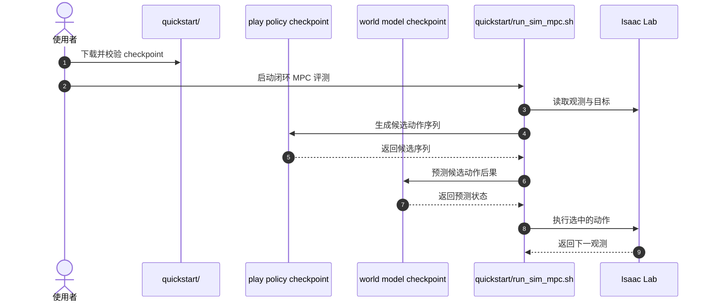

# DSP：从有监督玩耍中学习灵巧操作

## 一句话定义

**DSP 将机器人灵巧操作的数据获取本身变成可学习的玩耍策略：人类短时示范启动策略，机器人再自主收集数据并用世界模型规划。**

## 英文缩写速查

| 缩写 | 英文全称 | 简要说明 |
|------|----------|----------|
| DSP | Dexterity from Supervised Play | 从有监督玩耍中学习操作的方法 |
| MPC | Model Predictive Control | 用模型评估候选动作并滚动执行 |
| BC | Behavior Cloning | 从示范中监督学习策略 |
| WM | World Model | 预测动作后果的模型 |

## 为什么重要

灵巧操作通常依赖大量接触反馈数据，逐任务采集示范成本高。DSP 的关键设计是先学一个不依赖具体目标的 play policy，让它在真实或模拟环境中持续产生有用的交互轨迹，再把这些数据用于世界模型和策略学习。

## 核心原理

1. 用几分钟人类自由玩耍/遥操作轨迹行为克隆 play policy。
2. play policy 在机器人上自主交互数小时，积累接触丰富的数据。
3. 从自采轨迹学习动作条件世界模型。
4. MPC 以 play policy 提议的动作序列为候选，由世界模型预测结果并选择更接近目标的动作。
5. 可在学得的世界模型中自博弈，蒸馏闭环目标条件策略。

## 源码运行时序图

官方仿真仓库给出 `quickstart/`、`scripts/pipeline.sh` 和 `quickstart/run_sim_mpc.sh` 等入口：

## 实验与评测

- 论文评测包含欠驱动推物和多指手手内姿态重定向。
- 手内姿态重定向以朝向角误差 ≤ 0.6 rad（约 34.4°）为成功；真机 play policy 单独执行为 38.3%，加入规划后为 90.0%。
- 「490 倍」仅指仿真交互帧数比较，不是真机交互数据量差异；摘要中与 hindsight behavior cloning 的提升是另一项比较口径。
- 官方仓库当前公开完整仿真管线与 5 小时自主玩耍数据；README 指定 Isaac Sim 5.1、Isaac Lab 2.3.2，长评测耗时较高。

演示视频中的朝向球、日历和点阵是示意或类比元素，视频已标注；不应当作方法中的独立模块或实际测量工具。

## 局限与风险

- 公开仓库重点是模拟手内方块重定向，不应把仿真代码覆盖范围等同于所有论文真实机器人设置。
- 世界模型预测质量决定 MPC 候选排序；分布外接触或长时预测误差可能让计划偏离。
- 公开结果来自特定手型、仿真器与任务定义，跨硬件和接触动力学需重新验证。

## 与其他工作对比

| 路线 | 数据来源 | 决策方式 | 与 DSP 的差异 |
|------|----------|----------|---------------|
| Hindsight BC（论文基线） | 同类玩耍/示范轨迹，按事后到达状态重标目标 | 直接回归动作 | 不显式预测动作后果；论文报告 DSP 真实成功率高 69.6% |
| RL 基线（论文对照） | 大量在线试错 | 奖励驱动策略优化 | 摘要称 DSP 以约 1/490 交互数据达到相近成功率；需核对任务与预算是否匹配 |
| [T2-z](./paper-t2-z-environment-latents.md) | 测试时交互 | 优化环境潜变量适配冻结世界模型 | 关注世界模型对未观测物理属性的适配；DSP 关注世界模型训练数据从哪来 |
| [VaM](./paper-vam-value-as-memory.md) | 示范 + 人工干预 + 在线 rollout | 价值历史条件化策略 | 同为在线数据闭环，但 VaM 依赖价值记忆与干预，DSP 依赖 play policy 自主采集 |

DSP 的独特处在于 play policy 同时承担“采数据”和“给 MPC 提候选动作”两个角色；比较时应区分收益来自世界模型规划，还是来自自主玩耍数据本身。

## 结论

**DSP 的贡献是把“会玩”用作数据采集与动作提议机制，再由世界模型和 MPC 把自由交互转成目标操作能力。**

1. 复现先验证 play policy + world model + MPC 的闭环，再扩展到采集或训练。
2. 人类示范的作用是启动探索策略，不是直接覆盖每个目标任务。
3. 阅读数据效率数字时，确认 RL 基线、任务与交互预算是否匹配。
4. 目前应把官方公开实现理解为仿真复现入口；真实机器人结果仍需按论文协议评估。

## 关联页面

- [T2-z：测试时优化环境潜变量](./paper-t2-z-environment-latents.md)
- [VaM：用价值预测追踪任务进度](./paper-vam-value-as-memory.md)
- [生成式世界模型](../methods/generative-world-models.md)
- [接触丰富操作](../concepts/contact-rich-manipulation.md)

## 参考来源

- [DSP 论文归档](../../sources/papers/dsp_arxiv_2610_22340.md)
- [项目页与开源状态](../../sources/sites/dsp-play-policy.md)
- [官方仓库与复现入口](../../sources/repos/dsp-play-policy.md)

## 推荐继续阅读

- [DSP 项目页](https://play-policy.github.io/)
- [DSP 仿真代码与数据](https://github.com/FAR-hands/play_policy)
