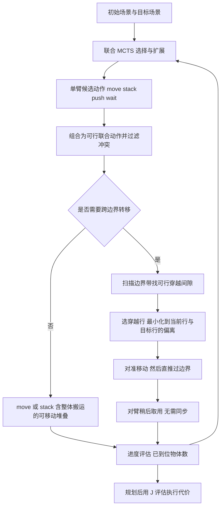

# Dual-Arm Tabletop Rearrangement with Movable Stacking and Gap-Aware Push Transfers（arXiv:2611.07726）

## 一句话定义

**一个双臂桌面物体重排的任务规划框架：沿共享边界扫描无碰撞「间隙」，把物体放到选定穿越点后直推进对臂工作空间（异步转移），并与可移动堆叠一起放进同一个联合 MCTS 搜索中。** 来源：[论文](https://arxiv.org/abs/2611.07726)摘要与 §II。属于经典搜索式规划，**不是强化学习**，论文也没有训练环节。

## 英文缩写速查

| 缩写 / 术语 | 英文全称 | 简要说明 |
|-------------|----------|----------|
| MCTS | Monte Carlo Tree Search | 蒙特卡洛树搜索；本文用 UCB 选择、扩展、评估、回传四步（§II-B） |
| UCB | Upper Confidence Bound | 选择子节点时平衡探索与利用的准则（§II-B） |
| Fixed Handoff | 固定交接 | 基线：跨边界交换只能在单一预设转移位姿进行，来自 Gao & Yu [7]（§III） |
| Gap-Aware Push Transfer | 间隙感知推动转移 | 本文方法：在边界带上找可行穿越区间，选穿越行后直推（§II-B） |
| Movable Stacking | 可移动堆叠 | 临时堆叠可整体搬运，来自 Barghi 等 [4]（§II-A） |
| Joint Steps | 联合步数 | 完成重排所需的协调执行步数（§III） |
| Execution Cost | 执行代价 | 计划中各动作代价之和 J(Π)，规划后评估（§II-B） |
| TAMP | Task and Motion Planning | 任务与运动规划；论文把相关双臂工作归为此类（Table I） |

## 为什么重要

- **问题（作者自述，摘要 / §I）：** 密集桌面里空位少，需要缓冲；双臂在共享可达区交换物体时，传统做法依赖固定交接位姿，限制交换位置与方式、强制两臂时空同步，在密集布局下缺乏灵活性。
- **思路：** 把共享边界当成「穿越位置可在线选择的区域」，推动物体越界，对臂可稍后再取，不必同时到位（§I，Fig. 3）。
- **机构（以论文首页为准）：** 德黑兰大学（University of Tehran）电气与计算机工程学院 Human and Robot Interaction Laboratory (TaarLab)；作者 Firoozalizadeh、Rostamirad、Barghi、Kalhor、Nayeri、Tale Masouleh。
- **发表：** 首页脚注标明为 ICEE 2026（第 34 届国际电气工程会议）接收的作者稿，DOI 10.1109/ICEE70628.2026.11710769。

## 核心机制

### 流程总览

### 要点（均见 §II）

1. **状态与动作：** 状态含物体足迹位置、堆叠关系矩阵 R_t 与两臂末端位置；原语动作 {move, stack, push, wait}，联合动作为双臂各一个原语，同一源物体不得被两臂同时操作，并发 stack 不得指向同一支撑物。
2. **可移动堆叠：** 搬基座物体时，其上稳定承载物整体随行；12 类物体按支撑能力分四级（主基座 / 次基座 / 轻物 / 重物）保证堆叠合理。
3. **穿越行选择：** r_cross = argmin_ρ∈G(o_i) (|ρ−r_i| + |ρ−r_i*|)；仅保留对物体足迹和推前对准动作有足够间隙的区间。
4. **推动三阶段：** 对准移动 → 直推越界 → 接收臂可取用；作者强调以「功能阶段」而非刚性动作序列描述，保留调度灵活性。
5. **搜索目标与评估分离：** MCTS 按「到位物体数 / 目标支撑关系」的进度打分，并略偏好暴露更多直接动作的状态；执行代价 J 仅在规划后用来比较方法。

## 实验结果（§III，Table II）

设置：1×2 m 桌面，N∈{5..12} 个异质尺寸物体，每个 N 20 对随机初末场景，每方法每对跑 3 次；基线是同一 MCTS 骨架下的 Fixed Handoff。

| N | Joint Steps（基线→本文） | Execution Cost（基线→本文） |
|---|--------------------------|------------------------------|
| 5 | 6.67 → 6.60 | 9.63 → 9.96 |
| 6 | 8.00 → 7.98 | 11.73 → 12.47 |
| 7 | 10.58 → 9.93 | 16.15 → 15.96 |
| 8 | 12.26 → 11.38 | 20.25 → 18.99 |
| 9 | 12.90 → 12.48 | 20.63 → 20.02 |
| 10 | 13.77 → 12.40 | 22.14 → 21.30 |
| 11 | 16.11 → 14.83 | 26.90 → 25.64 |
| 12 | 17.52 → 15.72 | 29.48 → 27.99 |

- **作者自述：** N=5、6 时两者接近（N=5 代价升约 3.4%，N=6 基线代价仍更低）；N=7 起两项指标都更低；N=12 步数降约 10.3%、代价降约 5.1%（§III）。
- **判断：** 绝对差距不大（N=12 代价差 1.49）；Fig. 7 画了置信区间但正文没有给区间数值或显著性检验，本页未从图中读数。

## 工程实践

- 论文没有给出代码、项目页、规划耗时、MCTS 迭代次数 / UCB 常数，**无法据此复现**；以下为读法建议（判断，非论文内容）。
- 若要借鉴：穿越行选择公式很轻量（一维候选行上取最小和），可单独移植到其他网格化重排规划器；其价值取决于是否真能在实机上稳定完成「推过边界」。
- 对照阅读：基线 [7] Gao & Yu（IROS 2022）与堆叠来源 [4] Barghi 等（arXiv:2509.22828）；本 wiki 中相邻的重排搜索工作见 [Distilled Tree Search](./paper-distilled-tree-search-multi-object-rearrangement.md)。

## 局限

**论文自己写出的：** 结论只说明 Fixed Handoff 在轻场景仍有竞争力、优势随密度增大；N=5、6 时本文方法的执行代价更高（§III）。论文没有设单独的「局限」小节。

**我看到的未验证之处（判断）：**

- 只有一个仿真 / 抽象基准（网格行列坐标、矩形足迹），未见真机实验，也未建模推动的接触物理（推动是否会让物体滑出、翻倒、碰撞邻物）。
- 只与一个基线比较，且基线是作者用同一 MCTS 骨架「实现的」固定交接版本（§III），并非 [7] 原系统；与 Li 等 [16]、Gao 等 [17] 等未做数值对比（Table I 仅定性）。
- 未报告规划耗时、成功率 / 失败率、搜索预算；评估指标只有 Joint Steps 与 Execution Cost，没有单独量化「异步」带来的等待减少。
- Execution Cost 的各分量权重未在文中给出具体数值（§II-B 仅描述构成）。

## 关联页面

- [双臂操作](../tasks/bimanual-manipulation.md)
- [操作任务总览](../tasks/manipulation.md)
- [Distilled Tree Search：多物体重排](./paper-distilled-tree-search-multi-object-rearrangement.md)
- [AutoTAMP](./paper-autotamp.md)
- [VAP-TAMP](./paper-vap-tamp.md)

## 参考来源

- [原文通读归档](../../sources/papers/dual-arm-movable-stacking-gap-aware-push_arxiv_2611_07726.md)
- [arXiv:2611.07726](https://arxiv.org/abs/2611.07726)
- 周报转述（具身运控lab，Manipulation 栏）：机构标「待核实」，已按论文首页补全；其「创新点」与论文相符，但未提及基准规模与仅有仿真

## 继续阅读

- [arXiv PDF（v1）](https://arxiv.org/pdf/2611.07726v1)
- Barghi 等，Dynamic Buffers（arXiv:2509.22828）：可移动堆叠的来源 [4]
- Gao & Yu，Toward efficient task planning for dual-arm tabletop object rearrangement（IROS 2022）：固定交接基线 [7]
