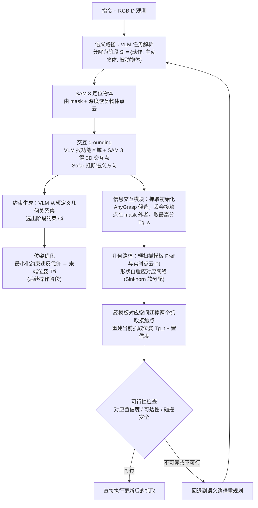

# DualManip: Agentic Dynamic Manipulation via Dual-Path Semantic Reasoning and Geometric Adaptation

DualManip面向动态物体操作，以双路径语义推理和几何适配协调任务理解与动作。

## 英文缩写速查

| 缩写 | 英文全称 | 简要说明 |
|---|---|---|
| VLA | Vision-Language-Action | 视觉与指令条件化的机器人动作策略。 |
| WM | World Model | 预测行动后的环境变化。 |
| WAM | World Action Model | 联合建模未来视觉和动作。 |

## 为什么重要

DualManip面向动态物体操作，以双路径语义推理和几何适配协调任务理解与动作。 评读时应将问题、观测条件与执行接口一并记录，避免从单个演示或指标外推能力。

## 流程总览

图依据：论文 §III-A 至 §III-D / Fig.2、Fig.3

## 方法栈

语义路径解析任务目标，几何路径适应物体与机器人状态，两条信息共同约束动态目标下的动作选择。

## 实验与评测

原文章将其作为动态操作方法介绍；精确任务配置、成功率和数据划分需要按论文正文复核。

## 与其他工作对比

相对纯视觉语言规划，显式加入几何适配；需分别评估目标理解、轨迹可达性和接触执行。

## 工程实践

项目页可访问性与代码入口尚未独立确认；当前不据此断言开源。

## 源码运行时序图

**不适用**：当前没有核实到该论文的可运行官方训练、推理或部署入口。

## 结论

**一句话总判：** DualManip面向动态物体操作，以双路径语义推理和几何适配协调任务理解与动作。

1. 核对方法实际改变的是数据、表征、规划、控制还是评测。
2. 只把论文覆盖的任务、平台与扰动范围当作证据。
3. 复现前确认代码、权重、数据许可和硬件依赖状态。

## 局限与风险

相对纯视觉语言规划，显式加入几何适配；需分别评估目标理解、轨迹可达性和接触执行。 当前导读以用户提供的文章和预印本题录为索引；详细配置与结果应核对论文全文。

## 关联页面

- [Day 5 导读](../overview/humanoid-motion-intelligence-day5-world-models-decision.md)
- [生成式世界模型](../methods/generative-world-models.md)

## 参考来源

- [Day 5 原文归档](../../sources/blogs/humanoid_motion_intelligence_day5_world_models_decision_2026_10_06.md)
- [项目页](https://lichengxi1.github.io/Dualmanip)
- [arXiv PDF](https://arxiv.org/pdf/2609.31112)：已通读方法部分（实验与附录以略读为准）：§III Method（A 至 D）、§IV-A 实验设置

## 推荐继续阅读

- [Day 5 导读](../overview/humanoid-motion-intelligence-day5-world-models-decision.md)
