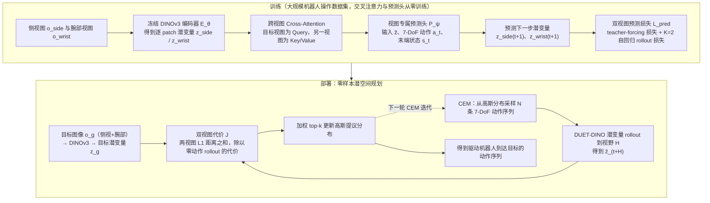

# DUET-DINO（arXiv:2609.10506）

**DUET-DINO**（[DUET-DINO: Simultaneous Cross-View World Modeling for Latent Planning in Robot Manipulation](https://arxiv.org/abs/2609.10506)）来自 [具身智能小站 11 篇盘点](../../sources/blogs/wechat_embodied_station_11_papers_vlm_manipulation_2026-09-10.md)。静态侧视+腕部相机联合预测动作条件未来表征，CEM 在 7-DoF 空间做 latent planning；RoboLab reach 92%、angled-reach 72.5%、grasp-and-lift 60%。

## 一句话定义

**RoboLab 三任务成功率 92% / 72.5% / 60.0%；CEM 每步大量候选，作者指出限制实时性。**

## 英文缩写速查

| 缩写 | 英文全称 | 简要说明 |
|------|----------|----------|
| IL | Imitation Learning | 从专家示范学习策略 |
| VLM | Vision-Language Model | 视觉-语言多模态模型 |
| WM | World Model | 预测未来观测或表征的动力学模型 |
| RL | Reinforcement Learning | 强化学习 |
| CEM | Cross-Entropy Method | 采样优化动作/轨迹的规划器 |
| DoF | Degrees of Freedom | 自由度 |

## 为什么重要

- 纳入本期 **VLM 控制 / 世界模型 / 灵巧操作 / 规划 / 评测** 主线之一。
- 开源状态：**待发布**（步骤 2.5 核查，2026-09-10）。
- 与 [11 篇技术地图](../overview/vlm-manipulation-11-papers-technology-map.md) 中同类工作可横向对照。

## 流程总览

图依据：论文 §III-B / §III-C、Fig.2、Fig.3（式 1–7）

## 核心机制

| 项 | 内容 |
|----|------|
| **arXiv** | [2609.10506](https://arxiv.org/abs/2609.10506) |
| **项目页** | https://utn-air.github.io/DUET-DINO |
| **代码** | https://github.com/utn-air/DUET-DINO |
| **开源** | **待发布** |
| **文内指标** | RoboLab 三任务成功率 92% / 72.5% / 60.0%；CEM 每步大量候选，作者指出限制实时性。 |

## 源码运行时序图

**不适用**：截至 2026-11-08 [官方公开仓库](https://github.com/nisarganc/DUET-DINO) 仅有 README，标记 `Code coming soon`。论文的双视角/CEM 结构已见方法流程图，但无法可靠绘制源码模块调用时序。

## 实验与评测

| 任务（RoboLab） | 成功率 |
|------|--------|
| reach | **92%** |
| angled-reach | **72.5%** |
| grasp-and-lift | **60.0%** |

- **规划开销：** CEM 每步需评估大量候选，**作者自陈限制实时性** —— 引用本文时不要把它当低延迟策略。
- **读法：** 本页为清单摘要，上表取自 [公众号盘点](../../sources/blogs/wechat_embodied_station_11_papers_vlm_manipulation_2026-09-10.md) 与项目页；7-DoF 动作空间设定、消融与真机细节以 **原文 PDF** 为准（[参考来源](#参考来源)）。
- **难度梯度：** 三任务 92% → 72.5% → 60.0% 单调下降，说明瓶颈在 **接触与抓取阶段**，而非到达精度。

## 与其他工作对比

| 对照路线 | 差异 |
|----------|------|
| [JEPA Policy](./paper-jepa-policy.md) | 同期同样做「动作 + 未来表征」联合建模，但直接回归动作块（**+0.29 ms**）；DUET-DINO 走 **CEM latent planning**，换来可规划性、付出实时性。 |
| 单视角世界模型 | 只用腕部或只用第三人称；本文 **静态侧视 + 腕部相机联合** 预测动作条件未来表征，跨视角一致性是核心变量。 |
| 像素级生成世界模型 | 重建像素再规划；本文在 **DINO 表征空间** 上 rollout，回避像素重建成本。 |
| [Semigroup-JEPA](./paper-semigroup-jepa.md) | 同属 latent 动力学一线，但目标是 **零样本物理泛化**，不做 CEM 操作规划。 |

## 结论

**DUET-DINO 值得按「待发布」边界阅读：先核对仓库是否可跑，再引用文内成功率数字。**

1. 索引来源为公众号导读，实验细节以 arXiv PDF 为准。
2. 开源结论：**待发布** — 截至入库日 GitHub 仓仅为学术主页模板，无可运行训练/规划代码。。
3. 选型时对照 [11 篇地图](../overview/vlm-manipulation-11-papers-technology-map.md) 中相邻节点，避免重复造页。

## 工程实践

[作者项目主页](https://utn-air.github.io/DUET-DINO/) 的 Code 指向 `nisarganc/DUET-DINO`；截至 2026-11-08 该仓仅 README，明确 `Code coming soon`，不是已公开的可运行实现。

## 局限与风险

- 尚未完成主论文与附录逐段通读，不作为完整复现指南；数值比较须保持同任务、同评测协议。
- 代码可见不代表依赖、权重、训练实现全部公开，也不代表已执行。

## DINOv3 世界模型一手资料复核（2026-11-08）

DUET-DINO 同时利用静态外部视角与手腕视角的 DINOv3 表征，学习动作条件跨视角未来特征预测，并使用 CEM 搜索机器人动作序列。

[作者项目主页](https://utn-air.github.io/DUET-DINO/) 的 Code 指向 `nisarganc/DUET-DINO`；截至 2026-11-08 该仓仅 README，明确 `Code coming soon`，不是已公开的可运行实现。

- [作者论文](https://arxiv.org/abs/2609.10506) · [原文归档](../../sources/papers/duet-dino_arxiv_2609_10506.md) · [代码核验记录](../../sources/repos/dinov3-wm-duet-dino.md)
- 本次阅读并未覆盖论文所有章节/附录，也没有完成所有核心源码调用链审计；节点标为 **draft**，来源标为 **通读：未完成**。

## 关联页面

- [VLM 与操作 11 篇技术地图](../overview/vlm-manipulation-11-papers-technology-map.md)
- [模仿学习 (Imitation Learning)](../methods/imitation-learning.md)
- [Generative World Models](../methods/generative-world-models.md)
- [Manipulation](../tasks/manipulation.md)

## 参考来源

- [duet-dino_arxiv_2609_10506.md](../../sources/papers/duet-dino_arxiv_2609_10506.md)
- [wechat 11篇盘点](../../sources/blogs/wechat_embodied_station_11_papers_vlm_manipulation_2026-09-10.md)
- [arXiv:2609.10506](https://arxiv.org/abs/2609.10506)
- [arXiv PDF](https://arxiv.org/pdf/2609.10506)：已通读方法部分（实验与附录以略读为准）：摘要、§I、§III（问题定义、跨视图世界模型、视觉规划）、§IV-A/B 训练与实验设定；§IV-C 起结果略读

## 推荐继续阅读

- [arXiv PDF](https://arxiv.org/pdf/2609.10506)
- [项目页](https://utn-air.github.io/DUET-DINO)
- [GitHub](https://github.com/utn-air/DUET-DINO)
