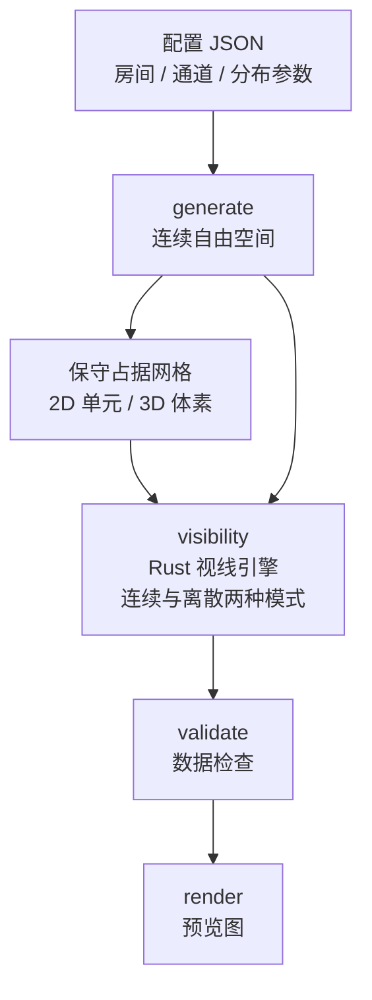
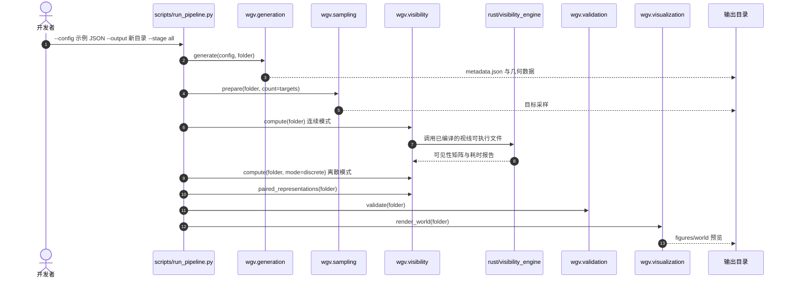

# 地牢与可见性世界生成器：可复现的探索实验环境

**一句话定义：** 一个可配置的 2D / 3D 地牢环境生成器，同时给出连续自由空间、离散占据网格与视线可见性数据，用于可复现的探索、覆盖与观测部署实验。

## 英文缩写速查

| 缩写 | 英文全称 | 简要说明 |
|------|----------|----------|
| LOS | Line of Sight | 观察者到目标的直线段是否被墙体或占据单元遮挡，是本页可见性计算的基本判定 |
| OG | Occupancy Grid | 离散占据网格，True 表示自由空间，与连续几何配对用于比较可见性 |
| CLI | Command-Line Interface | `scripts/run_pipeline.py` 的 `--stage` 参数可分阶段运行生成、可见性、验证与渲染 |

## 为什么重要

- 探索与覆盖算法需要大量可控、可复现的环境，而手工搭建的场景难以系统变化几何与分辨率。
- 同一环境同时提供连续几何与离散网格，便于研究网格分辨率对可见性的影响，这是常被忽略的误差来源。
- 开源代码与固定配置使实验可以被他人重跑，这对算法比较尤其重要。

## 核心信息

| 项目 | 内容 |
|------|------|
| 论文 | Dungeon and Visibility World Generator |
| arXiv | 2610.19523（v1，2026-10-14） |
| 作者 | Edwin Mériaux、Antonio Loría、Gregory Dudek |
| 机构 | 未核实（arXiv 摘要页未列出） |
| 数据 / 平台 | 六类几何（2D 正交 / 多边形 / 曲线；3D 正交 / 多面体 / 曲线）；Python 3.11 + Rust 视线引擎 |
| 开源 status | **已开源**：公开仓库含生成器、Rust 引擎、配置与入口脚本（2026-10-15 核查）；仓库根目录未见 LICENSE，许可证未核实 |
| 来源 | [sources/papers/dungeon_visibility_arxiv_2610_19523.md](../../sources/papers/dungeon_visibility_arxiv_2610_19523.md) |

## 核心原理

生成器先构造连续自由空间，再保守地推导离散占据网格。可见性计算对每对观察者与目标检查线段是否与连续墙体或被占据单元相交；离散版本的目标为所有自由单元或体素中心，因此连续与离散结果可以配对比较。

## 源码运行时序图

仓库以 `scripts/run_pipeline.py` 为唯一入口，依次调用 `python/wgv` 包的生成、采样、可见性、验证与渲染模块。下图对齐仓库 README 的运行步骤与入口代码：

复现要点：先执行 `cargo build --locked --release`，再使用**新的输出目录**运行；已有感知结果会被保护，重跑需更换目录或使用 `--stage validate`。

## 工程实践

- **环境搭建：** Python 3.11 虚拟环境，`pip install -r requirements-lock.txt`；Rust 工具链用于视线引擎。
- **运行示例：** 使用 `configs/showcase/` 下的 2D 配置或 `configs/distributions/` 下的 3D 配置，分阶段运行。
- **参数写法：** 数值控件支持固定值、均匀范围与多种分布（如高斯、泊松、混合分布），具体见仓库参数目录。
- **调试指标：** 关注各阶段输出的覆盖率（union sample coverage 与 grid-center coverage）以及连续与离散查询的匹配目标数。
- **分辨率选择：** 网格分辨率会改变保守占据网格的可见性结果，比较算法时应固定分辨率并在报告中注明。

## 实验与评测

- 论文展示了六类几何的环境样例，并分析几何类别与分辨率对可见性及生成时间的影响（摘要所述，具体数字未核实）。
- 仓库给出分阶段运行与验证输出，可作为评测流水线的参考。
- 本页未对探索或覆盖算法本身做评测，只记录环境生成与可见性计算的能力。

## 结论

**一句话总判：它的价值是把环境变化与可见性误差变成可控、可复现的实验变量，而不是提供新的探索算法。**

1. **环境参数可控** — 六类构造族与分布参数使实验设计可以系统化，而不是依赖手工场景。
2. **连续与离散必须一起看** — 同一观测在两种表示下可能得到不同可见性，分辨率是实验变量。
3. **固定输出目录保证复现** — 仓库拒绝覆盖已有感知结果，减少误用旧数据。
4. **适合探索与覆盖基准** — 特别适合比较信息获取策略，而非直接验证控制器。
5. **许可证需先确认** — 仓库根目录未见 LICENSE，用于二次分发前需核实。

## 与其他工作对比

- 与 [程序化地形生成](../concepts/procedural-terrain-generation.md) 相比，本文聚焦室内式地牢结构与视线数据，而非户外地形。
- 与 [自主探索](../tasks/autonomous-exploration.md) 任务页中的仿真环境相比，本文把可见性作为一等输出，便于直接评估观测。
- 与通用机器人仿真三层结构（见 [机器人仿真三层](../concepts/robot-simulation-three-layers.md)）相比，本文只覆盖几何与可见性层，不含动力学与传感器模型。

## 局限与风险

- **非动力学仿真：** 生成器输出几何与可见性，不包含物理接触或传感器噪声，不能直接替代机器人仿真。
- **分辨率敏感：** 保守网格可能遮挡连续几何中实际畅通的线段，结论需标注分辨率。
- **许可证未核实：** 仓库根目录未见 LICENSE 文件。
- **依赖：** 需要 Rust 工具链与 Python 3.11；论文环境与最新仓库的差异未核实。

## 关联页面

- [程序化地形生成](../concepts/procedural-terrain-generation.md) — 相邻的程序化环境生成方法
- [自主探索](../tasks/autonomous-exploration.md) — 本环境的主要应用任务
- [机器人仿真三层](../concepts/robot-simulation-three-layers.md) — 本生成器在仿真栈中的位置
- [位形空间](../concepts/configuration-space.md) — 几何与自由空间表示的基础概念

## 参考来源

- [Dungeon and Visibility World Generator 来源归档](../../sources/papers/dungeon_visibility_arxiv_2610_19523.md)
- 微信「具身站 31 篇论文」摘要：[sources/raw/wechat_embodied_station_robot_31_papers_2026-10-15.md](../../sources/raw/wechat_embodied_station_robot_31_papers_2026-10-15.md)

## 推荐继续阅读

- [arXiv:2610.19523 — Dungeon and Visibility World Generator](https://arxiv.org/abs/2610.19523)
- [官方代码仓库](https://github.com/EdwinMeriaux/Dungeon_and_Visibility_World_Generator)
