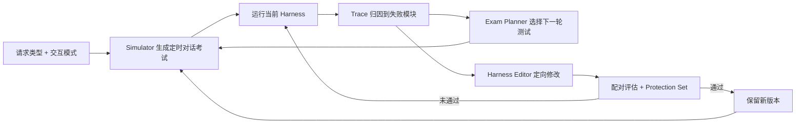

# DuplexAgent-RSI：面向全双工语音协作的递归 Harness 改进

## 一句话定义

**DuplexAgent-RSI 将全双工语音代理的协作逻辑拆成六个可编辑 harness 模块，再用定时对话、失败归因和保护集逐轮筛选改动；实验中交互模型权重保持固定。**

## 英文缩写速查

| 缩写 | 英文全称 | 简要说明 |
|------|----------|----------|
| RSI | Recursive Self-Improvement | 本文指从交互失败中持续改进代理 harness 的受限闭环 |
| LLM | Large Language Model | 推理委派池和考试规划器使用的大语言模型 |
| TOR | Turn-Taking Overlap Ratio | 用于评估全双工交互时序的重叠率指标 |
| BFCL | Berkeley Function-Calling Leaderboard | 测量函数调用选择与参数传递的基准 |
| MMSU | Massive Multitask Spoken Understanding | 测量语音多学科知识理解的基准 |

## 核心信息

| 项 | 内容 |
|----|------|
| 机构 | 香港中文大学（深圳）（CUHK-Shenzhen）；Amphion Technology（据官方项目页） |
| 论文 | [DuplexAgent-RSI（arXiv:2610.11299）](https://arxiv.org/abs/2610.11299)，2026-10-08 提交 |
| 项目页 | [DuplexAgent-RSI Demo](https://amphionteam.github.io/DuplexAgent-RSI-Demo/) |
| 代码状态 | 官方页面标注 Code coming soon；截至 2026-10-22 未给出代码仓库链接 |
| 方法边界 | 改进对象是 harness；附件交互模型权重在 RSI 活动中固定 |

## 为什么重要

- **处理实时交互与长任务之间的冲突：** 全双工模型保持实时听说，委派池承担搜索、推理和编码。用户可以在后台工作进行时继续澄清、取消或替换任务。
- **明确协调逻辑的责任边界：** 任务解析、委派、等待时反馈、结果返回、共享记忆被拆成独立模块，失败 trace 可以指向具体修改对象。
- **提供有证据的 harness 改进范例：** 研究把时序测试、失败归因、定向编辑、配对评估和保护集串成闭环。这属于[递归自改进](../concepts/recursive-self-improvement.md)中的 harness 层持久改进，不能直接推论为权重级自我训练或 RSI ignition。

## 核心机制

### DuplexAgent 的六个 harness 模块

| 模块 | 负责的决定 |
|------|------------|
| Policy | 当前发言应直接回答、委派，还是解释为任务控制 |
| Intake | 解析请求，并确定它关联哪个正在运行的任务 |
| Hold | 任务等待期间如何确认请求、报告进度并保持对话 |
| Worker | 选择委派代理、传递上下文并约定返回格式 |
| Deliver | 判断当前结果何时、以何种方式返回对话 |
| Memory | 维护实时会话和后台工作共享的上下文 |

### Duplex-Harness-RSI 闭环

Exam Planner 读取模块归因失败与 repair archive，选择后续测试；Harness Editor 据此提出修改。候选与现有版本进行配对运行，并经过开发集和独立 protection set 检查后才保留。改进环复用服务用户的委派池，但论文实验固定附件交互模型的权重。

## 实验与评测

论文分别在 VoiceChat 和 Qwen-Realtime 附件上开展 harness 改进；两者有独立的初始 harness 和考试序列。VoiceChat 十轮 RSI 的固定核心评分为 85.3，初始版本 g0 为 54.6；相同考试材料的一次性编辑得 57.4，按顺序重放十轮但没有逐轮诊断与修复档案得 61.9。对应地，漏委派率由 30.3% 降至 1.3%，额外委派由 3.9% 升至 6.6%。

Qwen-Realtime 的初始版本 g0 为 47.1，经过八个保留版本升至 84.8（+37.7 分）。此结果显示经过筛选的改动能累积，但不同活动的结果不应合并成同一条统计曲线。

DuplexAgent 主系统评测还报告语音知识、函数调用和交互时序指标。以 MMSU 为例，系统在 VoiceChat 上从 36.1 升至 80.5，在 Qwen-Realtime 上从 64.8 升至 82.7；这些增益结合了委派模型能力与 harness 的路由、上下文打包和结果返回机制，不能全部归因于 RSI 优化。

## 与其他工作对比

| 维度 | DuplexAgent-RSI | Harness² |
|------|-----------------|----------|
| 使用场景 | 全双工语音实时协作与异步任务委派 | 开放世界 agent 的任务执行 |
| 可编辑对象 | Policy、Intake、Hold、Worker、Deliver、Memory 六模块 | prompt、guardrails、memory、tools 等八类 harness 文件 |
| 改进信号 | 定时对话考试、模块失败归因、配对评估与保护集 | 同任务参考/候选执行轨迹及跨任务经验库 |
| 代码状态 | 官方项目页标注即将发布，当前无代码链接 | 官方仓库已公开 |

两者都将持续改进落在模型外部的 harness 层；DuplexAgent-RSI 的独特重点是全双工对话中任务状态、取消替换和发言时机的协调。

## 结论

**论文展示了在模型权重固定时，通过模块化 harness 与可归因的交互评测改善实时语音代理协调的路径。**

1. 先把“答复、委派、取消、替换、播报”定义为可观测的任务状态，再按失败责任模块调整规则。
2. 单独报告配对核心评测、保护集和局部考试结果；局部错误率下降不能代替独立泛化验证。
3. 收益存在代价：漏委派显著下降的同时，VoiceChat 额外委派率从 3.9% 升至 6.6%，需要同时监测不必要调用和任务控制错误。
4. 主系统指标提升包含委派模型与 harness 的共同作用，不能解释为单一 harness 更新的因果效应。
5. 项目页目前未公开代码，外部研究者尚不能复现其完整 simulator、诊断和版本筛选流程。

## 工程实践

- 若将思路迁移到机器人语音操作，可以把“当前任务 ID、取消/替换语义、后台执行状态、允许播报窗口”作为显式 harness 状态，并在仿真中重放用户中断、迟到结果和上下文缺失等时序用例。
- 自动保留变更前，需使用与候选搜索隔离的保护测试；否则 harness 可能只适应改进环刚见过的对话模式。
- **源码运行时序图：不适用。** 官方项目页展示演示视频与方法说明，但截至 2026-10-22 代码标注为 coming soon，尚无可核验的运行入口。

## 局限与风险

- **模型能力边界仍在：** harness 编辑不能直接补足交互模型自身的语音感知或响应时序；论文把交互模型的后续训练列为下一步。
- **评测覆盖范围有限：** 固定核心和 protection set 支持对照，但真实开放环境中的口语变化、网络延迟、多委派失败与长时记忆仍需独立验证。
- **资源与延迟：** 额外委派和多轮候选评估会增加模型调用、响应延迟与服务成本，论文改善协作分数不代表这些成本为零。
- **开源边界：** 项目页所给的是 demo 和报告预告，当前没有公开实现；论文结果尚不能作为可直接复用的机器人软件栈。

## 关联页面

- [递归自改进](../concepts/recursive-self-improvement.md) — 区分持久改进、有限闭环与完整递归自我加速
- [Harness²](./paper-harness2.md) — 面向通用 agent harness 的证据化递归修改

## 参考来源

- [DuplexAgent-RSI 论文归档](../../sources/papers/duplexagent_rsi_arxiv_2610_11299.md)
- [DuplexAgent-RSI 官方项目页归档](../../sources/sites/duplexagent-rsi.md)

## 推荐继续阅读

- [arXiv HTML 全文](https://arxiv.org/html/2610.11299v1)
- [官方项目页与演示视频](https://amphionteam.github.io/DuplexAgent-RSI-Demo/)
