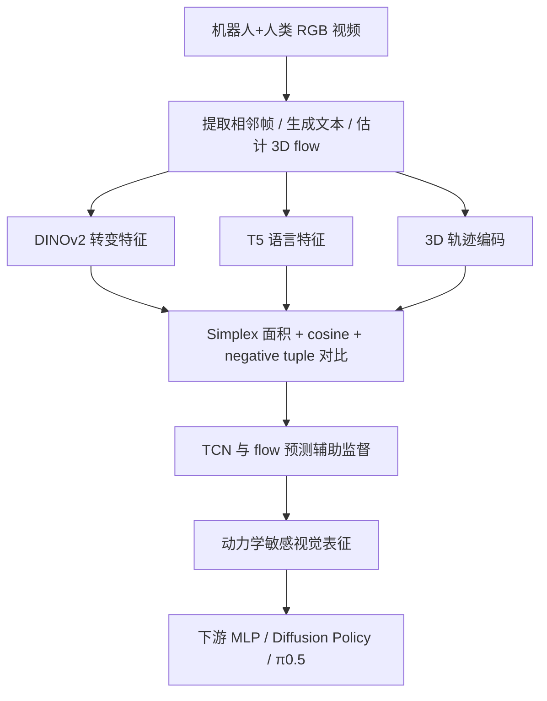
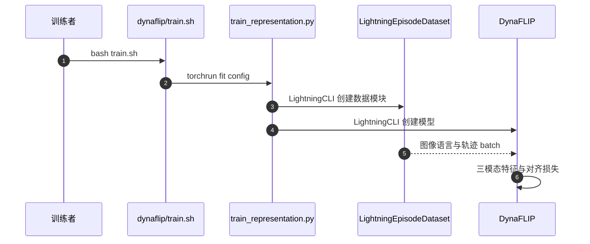

# DynaFLIP：三模态动力学引导的视觉表征

**英文题名：** DynaFLIP: Rethinking Robotics Perception via Tri-Modal-Dynamics Guided Representation。官方原文：[arXiv:2605.30350v2](https://arxiv.org/abs/2605.30350v2)。已核对 v2 正文与必要附录，**未独立复现训练/真机**。

## 一句话定义
DynaFLIP 将视频中的**图像转变、语言与三维运动轨迹**对齐，用三点 simplex 面积的几何损失、负例对比及余弦约束避免退化，再训练可迁移到动作控制的视觉表征。

## 英文缩写速查
| 缩写 | 英文全称 | 简要说明 |
|---|---|---|
| VLA | Vision-Language-Action | 视觉语言动作策略 |
| TCN | Temporal Contrastive Network | 时序对比辅助学习 |
| DINOv2 | DINO version 2 | 图像视觉骨干 |
| T5 | Text-to-Text Transfer Transformer | 语言编码器 |

## 为什么重要
视觉语义相似不等于动作后果相同，单帧图像特征对操作动态变化的区分可能不足。 论文的价值在于将这一失败模式单独建模，而非依靠笼统的端到端指标解释。

## 核心机制
1. **数据（§2.3、附录 B）**：26 万条人类/机器人视频轨迹（约 7 万人类、19 万机器人）；图像序列、由 VLM 生成语言、3D 跟踪与相机补偿生成的运动流**都能从视频提取**，不强制具备真机动作记录。
2. **三模态编码**：DINOv2-B/14 处理相邻图像，T5-Base（冻结加 adapter）处理指令，轨迹编码器处理 3D flow，产生三路潜在向量。
3. **Simplex-Guided 对齐（§2.1、附录 A）**：以三路 embedding 构成三角形面积衡量多模态关系；仅最小化面积有共线歧义、梯度抵消和坍塌风险，因此加入余弦拉近**与负样本对比能量**。
4. **辅助（§2.2）**：TCN 时序一致性与预测单步 3D flow 的动作式监督，合计 L_align + λ_tcn L_tcn + λ_act L_act。
5. **下游**：冻结视觉编码器 + MLP 做 MetaWorld/RLBench 状态控制；冻结/LoRA 图像语言编码器 + Diffusion Policy 做 LIBERO；真机借 π0.5 插入视觉特征。

## 流程总览
以下为论文原文中的数据/控制流程，不表示本站运行了代码。

## 工程实践
- **开源源码**：[DynaFLIP](https://github.com/JU-SUK/DynaFLIP) 目录实际有 `dynaflip/train.sh`，用 `torchrun train_representation.py fit --config config/dynaflip.yaml` 启动；`LightningCLI(DynaFLIP, LightningEpisodeDataset)` 构建模型和数据。
- **训练**：论文附录 C：4×NVIDIA L40S 约 4 天，图片 224×224，batch 32，三模态对比温度 0.07。已静态核验主要源码训练入口，**尚未运行 GPU 复现**。

## 源码运行时序图

根据[官方仓库](../../sources/repos/dynaflip-2605-30350.md)可见入口的静态调用关系整理，并未运行训练或推理。

## 实验与评测
- **LIBERO Table 2（五组平均）**：冻结编码器 DynaFLIP 41.5% vs DINOv2 37.2%；LoRA 端到端微调 DynaFLIP 81.0% vs SigLIP 79.1%。LIBERO-90、Goal、Object、Spatial、Long 五组各自训练，不能混同单一统一策略。
- **Table 3 消融（只取 Goal/Object/Spatial/Long 四组）**：完整 44.0%，去掉 3D flow 37.1%、语言 35.4%、negative tuples 18.1%、cosine regularizer 39.8%、TCN 39.6%。**44.0 与 Table 2 的 41.5 不可视为同一平均口径**。
- **真机（附录 C.4）**：UR3 固定机械臂、第三人称+腕摄像头、7D 机器人状态；3 个任务各自微调 π0.5，20 次 rollout/设定，其中两任务设视觉与语义 OOD 干扰，第三任务仅 ID。
- **控制相关度 S_m**：冻结编码器特征后训练轻量探测器，预测物体位姿/形状与机器人关节/末端状态；是表示质量代理指标，不能替代控制回路稳定性测试。

**证据边界：** 指标均来自指定版本论文/官方材料，并非本站独立复现；具体基线、统计区间与硬件已按表号区分。

## 局限与风险
构造训练三元组依赖可靠视觉追踪/深度/相机补偿及自动文本，可能受人视频分布和物体遮挡影响；冻结视觉表征不等于机器人获得新的运动规划器。LIBERO 指标按 frozen/LoRA、四组/五组不同协议必须分别引用；真机仅 UR3 与作者三类任务。

## 与其他工作对比
- 在[九篇研究趋势地图](../overview/embodied-trends-2026-11-h1.md)中按“技术介入层”定位，不能比较跨论文不同任务、机器人和数据集的绝对指标。
- 相关基础：[VLA](../methods/vla.md)、[机器人操作](../tasks/manipulation.md)。

## 结论
**DynaFLIP 证明动作相关信息可借视频三模态对齐注入视觉表征。**
- 不是直接的端到端 VLA 动作头：预训练得到表征，再接 MLP、Diffusion Policy 或 π0.5。
- Simplex 面积配合 cosine 和 negative tuples 防止几何退化，辅助 TCN/flow 提供时序监督。
- 真机验证范围是一种 UR3 机械臂、三个特定操作任务，每设定 20 次 rollouts。
- 对比数字必须区分 LIBERO 五套平均（41.5）与四套消融平均（44.0）。

## 关联页面
- [VLA](../methods/vla.md)
- [机器人操作](../tasks/manipulation.md)
- [2026.11 上半月九篇论文技术图](../overview/embodied-trends-2026-11-h1.md)
- [VLA 纵深路线](../../roadmap/depth-vla.md)

## 参考来源
- [论文来源核对](../../sources/papers/dynaflip-2605-30350.md)
- [代码来源](../../sources/repos/dynaflip-2605-30350.md)
- [官方项目主页](../../sources/sites/dynaflip-2605-30350.md)
- [策展资料](../../sources/blogs/duomo_embodied_2026_11_first_half.md)
- [arXiv 指定版本](https://arxiv.org/abs/2605.30350v2)

## 推荐继续阅读
- [指定版本 arXiv HTML](https://arxiv.org/html/2605.30350v2)
- [VLA 纵深路线](../../roadmap/depth-vla.md)
