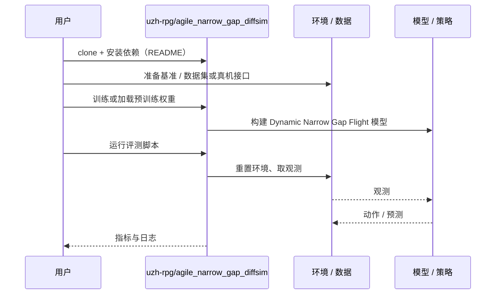

# Dynamic Narrow Gap Flight（arXiv:2610.37557）

**Dynamic Narrow Gap Flight**（*Learning Visuomotor Quadrotor Flight Through Dynamic Narrow Gaps via Differentiable Simulation*，[arXiv:2610.37557](https://arxiv.org/abs/2610.37557)，[代码](https://github.com/uzh-rpg/agile_narrow_gap_diffsim)）来自 [具身智能小站 2026-10-28 盘点](../../sources/blogs/wechat_embodied_station_59_papers_human_video_to_robot_experience_2026-10-28.md)，属「导航、无人机与群体」组。

## 一句话定义

**将穿缝时机、对齐与碰撞写成可微目标，从随机初始化直接学习视觉惯性控制。**

## 英文缩写速查

| 缩写 | 英文全称 | 简要说明 |
|------|----------|----------|
| Dynamic Narrow Gap Flight | Learning Visuomotor Quadrotor Flight Through Dynamic Narrow Gaps via Differentiable Simulation | 本文方法 / 基准的简称 |

## 为什么重要

- 无人机穿越移动窄缝。作者报告真机十次试飞成功八次，适用范围仍受测试场景与样本量限制。
- 开源结论：**已开源**（步骤 2.5，2026-10-28）。仓库可达（git ls-remote）。
- 同期同组工作见 [潜在动作、免渲染事件仿真与机器人评测：具身智能小站 10-28 期 59 篇阅读坐标](../overview/embodied-station-2026-10-28-59-papers-technology-map.md)。

## 核心机制

| 项 | 内容 |
|----|------|
| **arXiv** | [2610.37557](https://arxiv.org/abs/2610.37557) |
| **开源** | **已开源** |
| **要点** | 将穿缝时机、对齐与碰撞写成可微目标，从随机初始化直接学习视觉惯性控制。 |
| **文内指标** | 公众号转述：作者报告真机十次试飞成功八次，适用范围仍受测试场景与样本量限制。 |

## 源码运行时序图

以下为按仓库入口（`uzh-rpg/agile_narrow_gap_diffsim`）推断的通用运行链路；入库日仅核实仓库可达，未逐文件阅读，具体脚本名以 README 为准。

## 实验与评测

- 公众号转述：作者报告真机十次试飞成功八次，适用范围仍受测试场景与样本量限制。
- **读法：** 本页为索引级摘要，依据公众号转述的官方摘要与仓库信息整理；逐项数字与 baseline 以原文 PDF 为准。

## 与其他工作对比

- 横向索引见 [潜在动作、免渲染事件仿真与机器人评测：具身智能小站 10-28 期 59 篇阅读坐标](../overview/embodied-station-2026-10-28-59-papers-technology-map.md)；同 arXiv 不重复造页。

## 结论

**无人机穿越移动窄缝：作者报告真机十次试飞成功八次，适用范围仍受测试场景与样本量限制。**

1. 开源边界：**已开源** — 仓库可达（git ls-remote）。
2. 核心机制：将穿缝时机、对齐与碰撞写成可微目标，从随机初始化直接学习视觉惯性控制。
3. 复现与选型前核对任务协议、硬件与基准口径，勿直接横比公众号摘录数字。

## 关联页面

- [locomotion](../tasks/locomotion.md)
- [sim2real](../concepts/sim2real.md)
- [reinforcement-learning](../methods/reinforcement-learning.md)
- [embodied-station-2026-10-28-59-papers-technology-map](../overview/embodied-station-2026-10-28-59-papers-technology-map.md)

## 参考来源

- [dynamic_narrow_gap_flight_arxiv_2610_37557.md](../../sources/papers/dynamic_narrow_gap_flight_arxiv_2610_37557.md)
- [wechat_embodied_station_59_papers_human_video_to_robot_experience_2026-10-28.md](../../sources/blogs/wechat_embodied_station_59_papers_human_video_to_robot_experience_2026-10-28.md)
- [arXiv:2610.37557](https://arxiv.org/abs/2610.37557)

## 推荐继续阅读

- [arXiv PDF](https://arxiv.org/pdf/2610.37557)
- [https://github.com/uzh-rpg/agile_narrow_gap_diffsim](https://github.com/uzh-rpg/agile_narrow_gap_diffsim)
