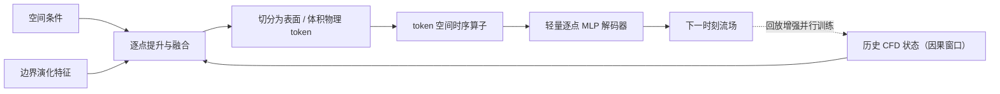

# DynaSolver（arXiv:2611.03595）

**DynaSolver**（*DynaSolver: A Neural Operator for Autoregressive 4D Flow Prediction with Dynamic Boundaries*，[arXiv:2611.03595](https://arxiv.org/abs/2611.03595)，[项目页](https://made-gpt.github.io/DynaSolver-ProjectPage/)）来自 [具身智能小站 2026-11-04 盘点](../../sources/blogs/wechat_embodied_station_57_papers_da_reward_model_failure_2026-11-04.md)，属「世界模型与感知」组。

## 一句话定义

**面向关节运动引起的动态边界，建立机器人四维流场基准；结合物理token与回放增强训练，研究长时自回归误差，主要价值在流体仿真代理。**

## 英文缩写速查

| 缩写 | 英文全称 | 简要说明 |
|------|----------|----------|
| DynaSolver | DynaSolver: A Neural Operator for Autoregressive 4D Flow Prediction with Dynamic Boundaries | 本文方法 / 基准的简称 |

## 为什么重要

- 动态机器人边界下的流场预测。
- 开源结论：**代码已公开**（步骤 2.5，2026-11-04）。[官方代码仓库](https://github.com/Made-Gpt/DynaSolver)已公开训练与评估代码；轨迹数据及预训练权重尚未随仓库发布（2026-11-06 核对 README）。
- 同期同组工作见 [VLM 奖励评估、动作动力学与开放权重机器人智能体：具身智能小站 11-04 期 57 篇阅读坐标](../overview/embodied-station-2026-11-04-57-papers-technology-map.md)。

## 更新状态

论文全文已依据 arXiv HTML 版（[2611.03595](https://arxiv.org/abs/2611.03595)）核对实验与局限；源码运行时序图仍待补（需阅读 [官方代码仓库](https://github.com/Made-Gpt/DynaSolver) 的训练与评估入口）。下方流程图依据论文 §3 方法描述绘制，属于对论文结构的概括。

## 核心机制

| 项 | 内容 |
|----|------|
| **arXiv** | [2611.03595](https://arxiv.org/abs/2611.03595) |
| **开源** | **代码已公开** |
| **要点** | 面向关节运动引起的动态边界，建立机器人四维流场基准；结合物理token与回放增强训练，研究长时自回归误差，主要价值在流体仿真代理。 |
| **文内指标** | 公众号未给具体数字，本页不引用。 |

## 项目流程图

## 源码运行时序图

**待补充** — [官方代码仓库](https://github.com/Made-Gpt/DynaSolver)已公开训练与评估代码；轨迹数据及预训练权重尚未随仓库发布（2026-11-06 核对 README）。 尚需阅读训练与评估源码并绘制运行时序图。

## 实验与评测

- **数据集：** RoboCFD-4D，基于关节机器人在规定运动下的三维 CFD 时序基准（论文 §4.1）。
- **对比：** 与多种学习型 CFD 代理模型比较，最强学习基线为 Transolver（论文原文）。
- **主要结果（论文原文）：** 全程 rollout 精度最好，且优势随 rollout 推进而扩大，论文据此称自回归误差累积明显降低。
- **消融（论文 Table 3–5 附近的设计消融段落，原文数字；具体表格口径为 Base / Mini 之一，未逐表核对）：** 逐点 MLP 解码器将总误差从 18.98% 降至 16.14%；去掉边界演化条件后误差为 16.54%，仍优于同等输入下的 Transolver，说明收益不只来自额外边界信息。
- **局限（论文附录 D，原文）：** 数据完全来自仿真，运动为规定运动学轨迹而非动力学模拟；对未见几何与流动条件仍敏感；长时自回归误差累积仍是挑战。
- **读法：** 以上数字取自论文 HTML 版，复现前仍需核对任务协议、硬件与基准口径。

## 与其他工作对比

- 横向索引见 [VLM 奖励评估、动作动力学与开放权重机器人智能体：具身智能小站 11-04 期 57 篇阅读坐标](../overview/embodied-station-2026-11-04-57-papers-technology-map.md)；同 arXiv 不重复造页。

## 结论

**动态机器人边界下的流场预测：面向关节运动引起的动态边界，建立机器人四维流场基准；结合物理token与回放增强训练，研究长时自回归误差，主要价值在流体仿真代理。**

1. 开源边界：**代码已公开** — [官方代码仓库](https://github.com/Made-Gpt/DynaSolver)已公开训练与评估代码；轨迹数据及预训练权重尚未随仓库发布（2026-11-06 核对 README）。
2. 核心机制：面向关节运动引起的动态边界，建立机器人四维流场基准；结合物理token与回放增强训练，研究长时自回归误差，主要价值在流体仿真代理。
3. 复现与选型前核对任务协议、硬件与基准口径，勿直接横比公众号摘录数字。

## 关联页面

- [world-action-models](../concepts/world-action-models.md)
- [generative-world-models](../methods/generative-world-models.md)
- [vla](../methods/vla.md)
- [embodied-station-2026-11-04-57-papers-technology-map](../overview/embodied-station-2026-11-04-57-papers-technology-map.md)
- [机器人视觉感知栈选型闭环（知识链）](../queries/robot-perception-stack-selection-loop.md)

## 参考来源

- [dynasolver_arxiv_2611_03595.md](../../sources/papers/dynasolver_arxiv_2611_03595.md)
- [wechat_embodied_station_57_papers_da_reward_model_failure_2026-11-04.md](../../sources/blogs/wechat_embodied_station_57_papers_da_reward_model_failure_2026-11-04.md)
- [arXiv:2611.03595](https://arxiv.org/abs/2611.03595)

## 推荐继续阅读

- [arXiv PDF](https://arxiv.org/pdf/2611.03595)
- [项目页](https://made-gpt.github.io/DynaSolver-ProjectPage/)
