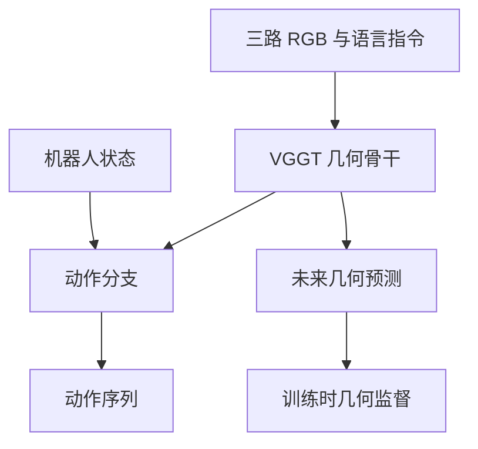
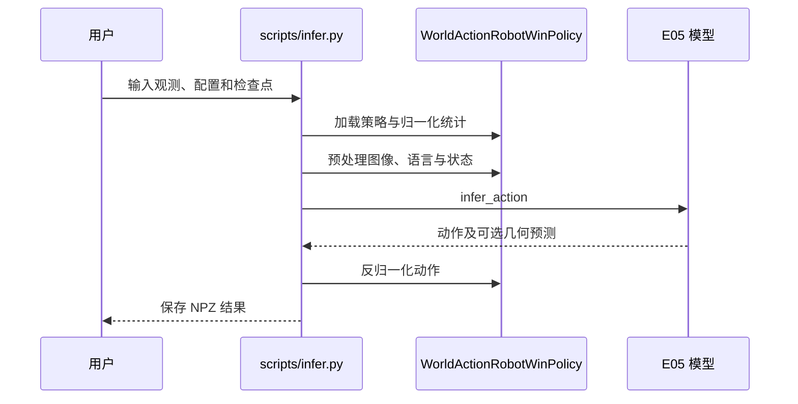

# E0.5：几何原生世界动作模型

## 一句话定义

E0.5 以三维基础模型为主干，联合预测未来三维状态与机器人动作。

## 英文缩写速查

| 缩写 | 英文全称 | 简要说明 |
|------|----------|----------|
| WAM | World-Action Model | 联合建模未来世界状态与动作的模型族，本文的归属类别 |
| VLM | Vision-Language Model | 视觉语言模型；论文指出多数 WAM 以其或视频模型为主干 |
| VLA | Vision-Language-Action | 视觉-语言-动作模型，表 1 中的一类基线 |
| VGGT | Visual Geometry Grounded Transformer | 三维几何基础模型，E0.5 的主干（采用 VGGT-Omega 实现） |
| DiT | Diffusion Transformer | 扩散 Transformer；动作专家沿用 WAN2.2 的 DiT 结构 |
| CFG | Classifier-Free Guidance | 无分类器引导；推理时 CFG scale 设为 1.0 |
| ID / OOD | In-Distribution / Out-of-Distribution | 训练分布内 / 分布外；真机实验的两类设置 |
| SR / CS | Success Rate / Completion Score | 成功率 / 完成度得分；真机评测的两个指标 |
| AbsRel | Absolute Relative Error | 绝对相对误差；用于评估未来深度预测质量 |

## 为什么重要

几何直接参与世界状态与动作预测，有别于把三维特征仅作为视频模型或 VLM 的辅助输入。论文的核心论点是：现有 WAM 多以视频基础模型或 VLM 为主干，即使接入 VGGT 等几何模型的特征，几何仍是辅助输入或辅助预测目标，而不是世界建模的原生表征。E0.5 把可训练的三维基础模型作为主干，并让它预测未来几何，以检验"几何原生"路线能否在仿真与真机上提供竞争力。

## 核心原理

**输入**：当前时刻的三路 RGB 观测（默认 RoboTwin 为 head、左腕、右腕三个相机）、语言指令和机器人状态 $s_t$。

**关键机制**：

1. **几何主干**。论文用 VGGT-Omega 作为 $B_\theta$，其 24 层全局/帧注意力被语言条件化：语言 token 只在全局注意力中与图像 token 交换信息，帧内注意力不接触语言 token（式 2）。
2. **动作专家**。动作分支为一个 30 层的 ActionDiT（沿用 WAN2.2 DiT，隐藏维 1024），与几何主干之间有 24 组层间注意力桥接；首尾各 3 层为只做动作处理、不与几何主干交互的 adapter。动作使用连续流匹配（flow matching）生成。
3. **未来几何预测**。几何输出不是当前帧的几何，而是动作块最后一步对应的未来帧 $t_f$ 的深度、点图与相机参数（式 3）。该预测只在训练时需要监督，推理时不需要未来观测。
4. **全参数联合优化**。除冻结的 T5 语言编码器（RoboTwin 实验）外，几何主干、条件模块、几何头和动作专家全部参与训练，几何损失与动作损失共同回传到主干。

**输出**：32 步动作块（RoboTwin 为 32 × 14 的关节类动作，预训练阶段为 32 × 16 的绝对未来关节位置与夹爪值）；训练时另有未来深度、点图与相机参数用于监督。

**训练目标**。论文式 (5) 为 $\mathcal{L} = \mathcal{L}_{action} + \lambda_{rec}\mathcal{L}_{rec}$，RoboTwin 消融中最优 $\lambda_{rec}=0.01$。几何损失对未来帧的深度、点和相机各自分量求和：

$$\ell_{geo} = \lambda_D \ell_D + \lambda_P \ell_P + \lambda_C \ell_C$$

其中各分量沿用 VGGT-Omega 的损失定义；附录 A.2 给出预训练阶段几何总权重为 0.01（各分量内部权重 5.0）。

直觉上，动作专家读取的是"能预见接下来空间如何变化"的几何特征，而不是只对当前帧做重建。

## 流程总览

以下根据官方 README 的发布实现整理：

## 源码运行时序图

对应独立推理入口；RoboTwin 评测从 `scripts/evaluate.sh` 启动。训练入口为 `scripts/train.sh`。以上入口名称已对照官方 README 核实（2026-11-06）；`WorldActionRobotWinPolicy` 等内部类名未在本次逐行核对源码。

## 实验与评测

**仿真（RoboTwin 2.0）**。采用 clean-to-random 协议：每个任务仅用 50 条 clean 演示训练，在 clean 与 randomized 场景各评测 100 次。

- E0.5 在 clean / randomized 下分别为 **89.90% / 50.09%**，平均 70.00%（表 1）。主力参数量为 2.32B 的策略核心，且未使用具身数据预训练（仅初始化自几何预训练权重）。
- 消融（均在 RoboTwin 上）：预测未来 3D 状态相对"无几何重建"平均提升 **9.43 个百分点**，相对"重建当前几何"平均提升 **7.93 个百分点**（由表 6 的 clean / random 差值平均得到）。
- 表 4：动作 adapter 深度取 3 层（共 30 层动作层）时效果最好（73.22% / 19.84%，此为未加几何重建的设置）；加深到 6 层反而下降。
- 表 5：$\lambda_{rec}$ 在 $\{0.005, 0.01, 0.05, 0.1, 0.3\}$ 间呈非单调变化，0.01 的 randomized 最高（29.20%）。
- 表 7：用辅助 DepthDiT 生成未来深度（类似 X-WAM 的做法）在本设置下使成功率下降（72.60% / 17.20%）；原生几何头则为 82.72% / 29.20%。论文将其解释为本框架内的系统级结论，并未证明专用 DiT 深度分支在其他模型中无效。

**未来几何诊断**。在 RoboTwin 训练集上取 50 个任务、200 个样本（600 个视角）、预测 32 帧（2.13 秒）：整体深度 AbsRel 为 0.0232，$\delta_1$ 为 97.95%，相机旋转误差 0.683°。这是训练集诊断，不是闭环成功率。论文也指出夹爪与物体边界处仍有局部偏差。

**真机（AgileX Piper 双臂与 Zerith H1 人形）**。三个任务：鼠标放置、充电器与线缆收纳、垃圾分拣。每个任务在 ID（EASY）与 OOD（HARD）设置下评测，每个策略、任务、设置、平台各 10 次试验，每平台共 60 次，两平台合计 120 次。

- 具身预训练（AgiBotWorld-Beta，160,010 条轨迹，177 个任务，约 2,645.64 小时）后，两平台平均成功率（ID 与 OOD 平均）分别从 70.0% 提升到 85.0%（Piper）、从约 81.7% 提升到 88.3%（H1）。摘要与结论中称为约 15 和 7 个百分点（结论给出 15.0 与 6.7）。
- 以成功率（SR）与完成度得分（CS）双指标评测；预训练 E0.5 的 OOD 平均 SR：Piper 为 73.3%，H1 为 76.7%；对照 $\pi_{0.5}$-base 分别为 63.3% 与 46.7%。
- 上述数字均为小样本（每格 10 次），且 Piper 与 H1 各自独立训练，不宜外推为绝对成功率。

## 结论

**一句话总判**：几何原生主干加未来几何监督在 RoboTwin 上有竞争力，且在小样本真机上显示出预训练增益，但论文自身的基线表显示它并非全面领先。

1. **仿真上以小模型取得有竞争力的成绩**：2.32B 策略核心、无具身预训练，clean 89.90% 高于多数列出基线，但 randomized 与平均指标并非第一（见下表对比）。
2. **未来几何监督是主要增益来源之一**：相对无重建与当前几何重建，平均分别提升约 9.4 与 7.9 个百分点；辅助 DepthDiT 方案则没有带来增益。
3. **预训练增益需与同平台未预训练基线对照**：Piper 与 H1 上的提升是相对同一方法不做预训练的结果，不是相对外部 VLA 的绝对优势。
4. **OOD 数字需谨慎读取**：每格仅 10 次试验，且引言中的"约 30 倍于视频预测类 WAM"（未核实，正文未找到对应表格）不应当作稳定结论。
5. **复现时注意检查点口径**：论文表 8 的 109,000 步检查点为 89.90% / 50.09%，而仓库模型卡对同名中间检查点报告 89.48% / 49.43%，两者须分开记录（见下文局限）。

## 与其他工作对比

**与 WAM 与 VLA 基线（论文表 1）**。论文表 1 中，E0.5 的 clean 89.90% 高于 4D-WAM（81.50%）、FastWAM（77.76%）等多数列出方法，randomized 50.09% 高于 FastWAM（1.92%）、Abot-M0 等，并明显高于 Spatial Forcing（26.74%）与 X-WAM（25.84%）。但同表中 PatchWAM（clean 91.56%，randomized 66.72%）、MWA-Phoenix（86.54%，72.42%）与 UniWAM（75.12%，67.56%）在 randomized 或平均分上更高；E0.5 平均 70.00%，低于 PatchWAM（79.14%）与 MWA-Phoenix（79.48%）。这些基线的预训练数据量与参数规模各不相同，表中的对比应按参数与具身预训练列分别阅读。

**与视频 / VLM 主干路线**。论文将 E0.5 与 X-WAM、Spatial Forcing 比较：二者在论文表中都引入了几何信息，但主干仍是非几何模型，E0.5 在两种设置下均显著领先。论文还将 VGA 视为最接近的工作，区别在于 E0.5 解冻主干并预测未来状态，而 VGA 使用 LoRA 且重建当前场景。

[Rollback](./paper-rollback-world-model.md) 以世界模型反事实分支改进策略，E0.5 则关注未来几何和动作的联合预测；两者评测协议不同，不能直接比较数字。

## 工程实践

截至 2026-11-06，官方仓库提供训练、推理和 RoboTwin 评测代码，并列出策略权重、具身预训练 VGGT 和处理后数据的下载地址；下载未实测。代码为 MIT，第三方模型、数据与资产有各自条款，VGGT-Omega 含非商业研究条款。

**项目页核查（步骤 2.5）**：2026-11-06 打开官方项目页 `x-era.ai/e05/index.html`，页面仅链接 arXiv 论文与技术报告，未列出 GitHub 或权重链接；代码与权重的开放状态以官方仓库 README 为准（见 [仓库记录](../../sources/repos/e05.md)）。开源状态判定：**已开源**（训练、推理与评测代码可公开获取）。

**复现要点**：

- 默认 RoboTwin 输入为三路 RGB、语言和 14 维状态，输出 32 × 14 动作块；推理只需三路图像、语言与状态，未来几何监督只在训练时使用。
- 论文设置：动作块长 $H_a=32$，10 步去噪，CFG scale 1.0；AdamW 学习率 $1\times10^{-4}$，权重衰减 0.01，余弦退火。
- RoboTwin 训练为 70 个 epoch（约 150,360 次优化器更新），论文表 8 报告 109,000 步的结果。
- 独立推理使用单 GPU；README 默认训练配置为 8 GPU，原始 RoboTwin 训练为 32 GPU、全局 batch 256，论文具身预训练为 56 块 GPU、两个 epoch。
- 预训练数据的深度为 Depth Anything 3 生成的伪标签（DA3-METRIC-LARGE），不是传感器真值；原始 AgiBot 数据中腕部相机没有深度。
- 预测深度是场景归一化尺度，不能直接视为米制深度。真机适配需自行准备任务配置与数据，具身预训练 VGGT 不是完整真机策略。

## 局限与风险

- **仿真评测边界**：RoboTwin 2.0 为仿真，clean-to-random 只用 50 条 clean 演示；randomized 是评测条件而非额外训练数据。Randomized 50.09% 仍远低于 clean，泛化是主要短板。
- **基线不完全可比**：表 1 中各方法的参数规模、具身预训练数据量（从约 2k 小时到约 39k 小时不等）和训练配方差异很大；论文不是在统一预算下比较。
- **真机样本量小**：每格仅 10 次试验，三个任务、两个平台；论文未报告统计显著性，也未说明是否多种子。
- **OOD 结论依赖设置**：OOD 指未见鼠标位姿、不同充电器与线缆、以及更多未见物体，并非任意场景迁移。引言中的"约 30 倍"未在正文找到对应表格（未核实）。
- **检查点口径不一致**：论文表 8 的 109k 检查点结果为 89.90% / 50.09%（macro 平均，其中 randomized 的合并计数比为 2442/4848，约 50.37%）；仓库模型卡对发布的 109k 中间检查点报告 89.48%（5000 次）与 49.431867%（4961 次），且称其为 70 epoch 预算中第 50 个 epoch 的权重。两组数字的对应关系未核实，复现时须分开记录，不能当作完整 10000 次评测。
- **未来几何质量**：论文称预测在夹爪与物体边界附近仍有偏差，几何监督的伪标签来自深度估计模型，误差会传递到策略学习中。
- **论文未给出独立的局限章节**：以上条目为依据正文与附录整理，不代表作者的完整自我评估。
- **部署风险**：具身预训练 VGGT 权重与处理后数据体积大（官方 README 称处理后 RoboTwin 数据约 378 GiB），且 VGGT-Omega 含非商业研究条款，商用前须核实许可。

## 关联页面

- [世界动作模型](../concepts/world-action-models.md)
- [操作任务](../tasks/manipulation.md)
- [Rollback 世界模型](./paper-rollback-world-model.md)
- [ThinkWorld](./paper-thinkworld.md)

## 参考来源

- [E0.5 论文摘录](../../sources/papers/e05_arxiv_2610_36011.md)（arXiv:2610.36011 全文已于 2026-11-06 通读）
- [官方仓库记录](../../sources/repos/e05.md)
- [项目主页记录](../../sources/sites/e05_project.md)

## 推荐继续阅读

- [E0.5 论文](https://arxiv.org/abs/2610.36011)
- [官方代码与 README](https://github.com/X-EraAI/e05)
- [项目主页](https://www.x-era.ai/e05/index.html)
