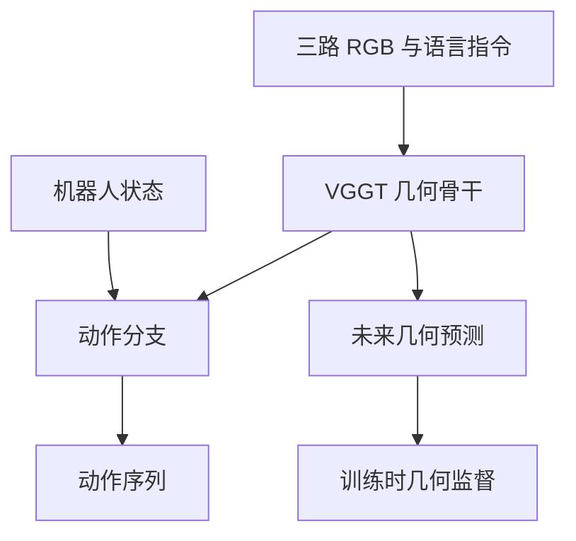
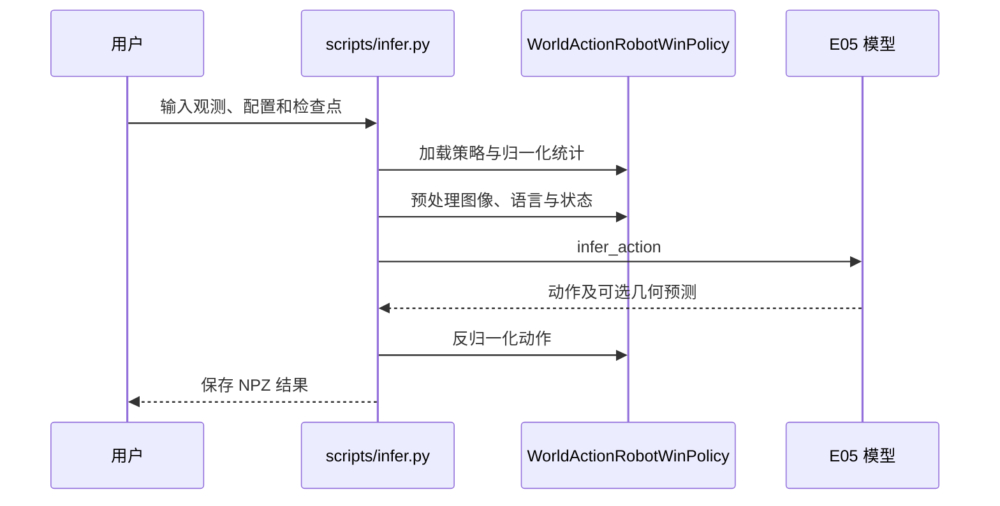

# E0.5：几何原生世界动作模型

## 一句话定义

E0.5 以三维基础模型为主干，联合预测未来三维状态与机器人动作。

## 英文缩写速查

| 缩写 | 英文全称 | 简要说明 |
|------|----------|----------|
| WAM | World-Action Model | 联合建模世界变化和动作 |
| VLM | Vision-Language Model | 视觉语言模型 |
| 3D | Three-Dimensional | 三维几何表征 |

## 为什么重要

几何直接参与世界状态与动作预测，有别于把三维特征仅作为视频模型或 VLM 的辅助输入。

## 核心机制

3D 基础模型同时承担未来几何与动作预测；在机器人轨迹上联合预训练，使表征学习交互中的几何变化。它与 [ThinkWorld](./paper-thinkworld.md) 的未来视觉特征一致性奖励不同。

## 流程总览

以下根据官方 README 的发布实现整理：

## 源码运行时序图

对应独立推理入口；RoboTwin 评测从 `scripts/evaluate.sh` 启动。

## 实验与评测

- RoboTwin 2.0 中未做具身数据预训练时，clean / randomized 成功率分别为 **89.90% / 50.09%**。
- 基于 AgiBotWorld-Beta 超过 16 万条轨迹预训练后，AgileX Piper 和 Zerith H1 真机平均成功率分别提升约 **15 和 7 个百分点**；这是预训练带来的提升，并非绝对成功率。

## 结论

几何预测和动作学习可共享三维基础模型，但结果依赖训练数据与实验设置。

1. 对比时区分 clean 与 randomized 场景。
2. 预训练增益须与相应平台的未预训练模型比较。
3. 实际部署前核实传感器、计算和任务条件。

## 与其他工作对比

[Rollback](./paper-rollback-world-model.md) 以世界模型反事实分支改进策略，E0.5 则关注未来几何和动作的联合预测；两者评测协议不同，不能直接比较数字。

## 工程实践与局限

截至 2026-10-29，官方仓库提供训练、推理和 RoboTwin 评测代码，并列出策略权重、具身预训练 VGGT 和处理后数据的下载地址；下载未实测。代码为 MIT，第三方模型、数据与资产有各自条款，VGGT-Omega 含非商业研究条款。

默认 RoboTwin 输入为三路 RGB、语言和 14 维状态，输出 32 × 14 动作块；未来几何监督只在训练时需要。独立推理使用单 GPU，README 默认训练配置为 8 GPU。预测深度是场景归一化尺度，不能直接视为米制深度。真机适配需自行准备任务配置与数据，具身预训练 VGGT 不是完整真机策略。

论文指标来自摘要，全文本次未能获取。发布的 109k 中间检查点模型卡报告 clean 89.48%（5000 次）与 random 49.431867%（4961 次），应与论文摘要结果分别记录。

## 关联页面

- [世界动作模型](../concepts/world-action-models.md)
- [操作任务](../tasks/manipulation.md)

## 参考来源

- [E0.5 论文摘录](../../sources/papers/e05_arxiv_2610_36011.md)
- [官方仓库记录](../../sources/repos/e05.md)
- [项目主页记录](../../sources/sites/e05_project.md)

## 推荐继续阅读

- [E0.5 论文](https://arxiv.org/abs/2610.36011)
- [官方代码与 README](https://github.com/X-EraAI/e05)
- [项目主页](https://www.x-era.ai/e05/index.html)
