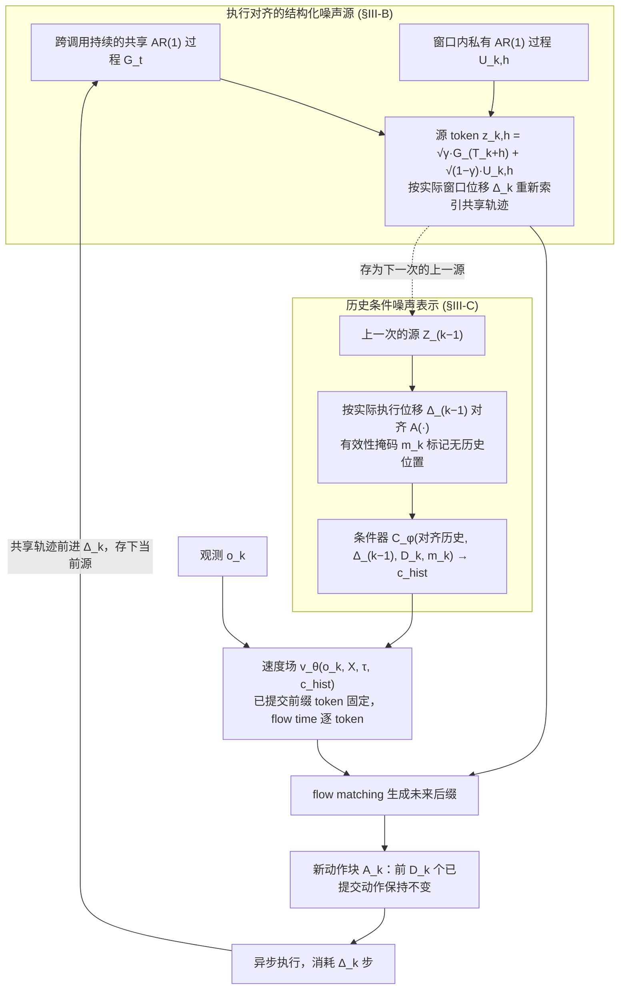

# EAPN（arXiv:2610.06090）

**EAPN**（*Execution-Aligned Progressive Noise for Consistent Asynchronous Replanning in Generative Robot Policies*，[arXiv:2610.06090](https://arxiv.org/abs/2610.06090)，[项目页](https://embodied.magiclab.top/works/eapn/index.html)）来自 [具身智能小站 2026-10-13 盘点](../../sources/blogs/wechat_embodied_station_34_papers_mulligan_2026-10-13.md)，属「VLA 与动作生成」组。

## 一句话定义

**按实际执行位移对齐跨动作块噪声并建模块内时间相关性，使异步重规划延续同一条随机轨迹。**

## 英文缩写速查

| 缩写 | 英文全称 | 简要说明 |
|------|----------|----------|
| EAPN | Execution-Aligned Progressive Noise | 本文方法 |
| DP | Diffusion Policy | 扩散策略 |
| RTC | Real-Time Chunking | 实时动作块执行 |

## 为什么重要

- 异步重规划若噪声不一致会导致行为跳变。
- 开源结论：**项目页未列 GitHub**（步骤 2.5，2026-10-14）。项目页入库日未列 GitHub。
- 同期同组工作见 [失败导向采集与可组合世界动作模型：具身智能小站 10-13 期 34 篇阅读坐标](../overview/embodied-station-2026-10-13-34-papers-technology-map.md)。

## 流程总览

图依据：论文 §III-B/C/D / Fig.2

## 核心机制

| 项 | 内容 |
|----|------|
| **arXiv** | [2610.06090](https://arxiv.org/abs/2610.06090) |
| **开源** | **项目页未列 GitHub** |
| **要点** | 高低延迟实验采用各自训练协议。 |
| **文内指标** | 以原文为准。 |

## 源码运行时序图

**不适用（项目页未列 GitHub）** — 项目页入库日未列 GitHub。 不编造运行脚本；代码公开后再补。

## 实验与评测

- 以原文为准。
- **读法：** 本页为索引级摘要，依据公众号转述的官方摘要与仓库信息整理；逐项数字与 baseline 以原文 PDF 为准。

## 与其他工作对比

- 横向索引见 [失败导向采集与可组合世界动作模型：具身智能小站 10-13 期 34 篇阅读坐标](../overview/embodied-station-2026-10-13-34-papers-technology-map.md)；同 arXiv 不重复造页。

## 结论

**噪声对齐是异步重规划连续性的另一条路线，可与 FreeBar 的引导约束对照。**

1. 开源边界：**项目页未列 GitHub** — 项目页入库日未列 GitHub。
2. 核心机制：高低延迟实验采用各自训练协议。
3. 复现与选型前核对任务协议、硬件与基准口径，勿直接横比公众号摘录数字。

## 关联页面

- [action-chunking](../methods/action-chunking.md)
- [diffusion-policy](../methods/diffusion-policy.md)
- [paper-freebar-barrier-guidance-async-vla](./paper-freebar-barrier-guidance-async-vla.md)
- [paper-streamingwam](./paper-streamingwam.md)
- [embodied-station-2026-10-13-34-papers-technology-map](../overview/embodied-station-2026-10-13-34-papers-technology-map.md)

## 参考来源

- [eapn_execution_aligned_progressive_noise_arxiv_2610_06090.md](../../sources/papers/eapn_execution_aligned_progressive_noise_arxiv_2610_06090.md)
- [wechat_embodied_station_34_papers_mulligan_2026-10-13.md](../../sources/blogs/wechat_embodied_station_34_papers_mulligan_2026-10-13.md)
- [arXiv:2610.06090](https://arxiv.org/abs/2610.06090)
- [arXiv PDF](https://arxiv.org/pdf/2610.06090)：已通读方法部分（实验与附录以略读为准）：§I 引言、§III 方法（§III-A 至 §III-D）

## 推荐继续阅读

- [arXiv PDF](https://arxiv.org/pdf/2610.06090)
- [项目页](https://embodied.magiclab.top/works/eapn/index.html)
