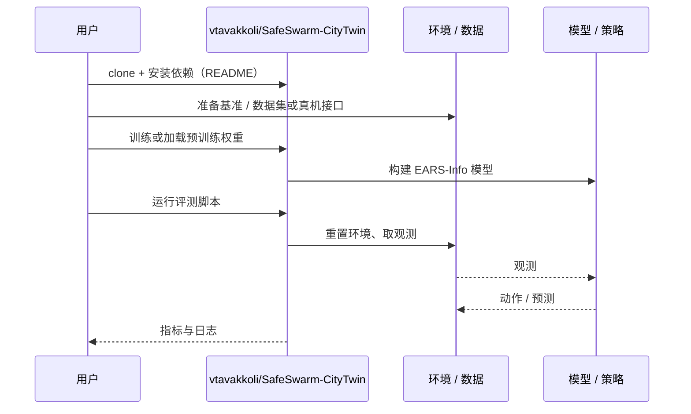

# EARS-Info（arXiv:2610.38040）

**EARS-Info**（*EARS-Info: Information-Aware Event-Driven Reallocation for Multi-Robot Exploration*，[arXiv:2610.38040](https://arxiv.org/abs/2610.38040)，[代码](https://github.com/vtavakkoli/SafeSwarm-CityTwin)）来自 [具身智能小站 2026-10-30 盘点](../../sources/blogs/wechat_embodied_station_28_papers_event2reward_progress_rewards_2026-10-30.md)，属「多机器人协作与人机交互」组。

## 一句话定义

**EARS-Info 在城市地图栅格上结合边际感知收益、可行迁移和返程约束。**

## 英文缩写速查

| 缩写 | 英文全称 | 简要说明 |
|------|----------|----------|
| EARS-Info | EARS-Info: Information-Aware Event-Driven Reallocation for Multi-Robot Exploration | 本文方法 / 基准的简称 |

## 为什么重要

- 按信息收益重分配多机器人探索任务。大规模仿真比较有参考价值，但开发中使用过评测城市，不能据此宣称未知城市泛化。
- 开源结论：**已开源**（步骤 2.5，2026-10-30）。仓库可达（git ls-remote）。
- 同期同组工作见 [进度奖励、接触监督与规划验证：具身智能小站 10-30 期 28 篇阅读坐标](../overview/embodied-station-2026-10-30-28-papers-technology-map.md)。

## 核心机制

| 项 | 内容 |
|----|------|
| **arXiv** | [2610.38040](https://arxiv.org/abs/2610.38040) |
| **开源** | **已开源** |
| **要点** | EARS-Info 在城市地图栅格上结合边际感知收益、可行迁移和返程约束。 |
| **文内指标** | 公众号转述：大规模仿真比较有参考价值，但开发中使用过评测城市，不能据此宣称未知城市泛化。 |

## 源码运行时序图

以下为按仓库入口（`vtavakkoli/SafeSwarm-CityTwin`）推断的通用运行链路；入库日仅核实仓库可达，未逐文件阅读，具体脚本名以 README 为准。

## 实验与评测

- 公众号转述：大规模仿真比较有参考价值，但开发中使用过评测城市，不能据此宣称未知城市泛化。
- **读法：** 本页为索引级摘要，依据公众号转述的官方摘要与仓库信息整理；逐项数字与 baseline 以原文 PDF 为准。

## 与其他工作对比

- 横向索引见 [进度奖励、接触监督与规划验证：具身智能小站 10-30 期 28 篇阅读坐标](../overview/embodied-station-2026-10-30-28-papers-technology-map.md)；同 arXiv 不重复造页。

## 结论

**按信息收益重分配多机器人探索任务：大规模仿真比较有参考价值，但开发中使用过评测城市，不能据此宣称未知城市泛化。**

1. 开源边界：**已开源** — 仓库可达（git ls-remote）。
2. 核心机制：EARS-Info 在城市地图栅格上结合边际感知收益、可行迁移和返程约束。
3. 复现与选型前核对任务协议、硬件与基准口径，勿直接横比公众号摘录数字。

## 关联页面

- [locomotion](../tasks/locomotion.md)
- [vision-language-navigation](../tasks/vision-language-navigation.md)
- [llm-robotics-control-interfaces](../concepts/llm-robotics-control-interfaces.md)
- [embodied-station-2026-10-30-28-papers-technology-map](../overview/embodied-station-2026-10-30-28-papers-technology-map.md)

## 参考来源

- [ears_info_arxiv_2610_38040.md](../../sources/papers/ears_info_arxiv_2610_38040.md)
- [wechat_embodied_station_28_papers_event2reward_progress_rewards_2026-10-30.md](../../sources/blogs/wechat_embodied_station_28_papers_event2reward_progress_rewards_2026-10-30.md)
- [arXiv:2610.38040](https://arxiv.org/abs/2610.38040)

## 推荐继续阅读

- [arXiv PDF](https://arxiv.org/pdf/2610.38040)
- [https://github.com/vtavakkoli/SafeSwarm-CityTwin](https://github.com/vtavakkoli/SafeSwarm-CityTwin)
