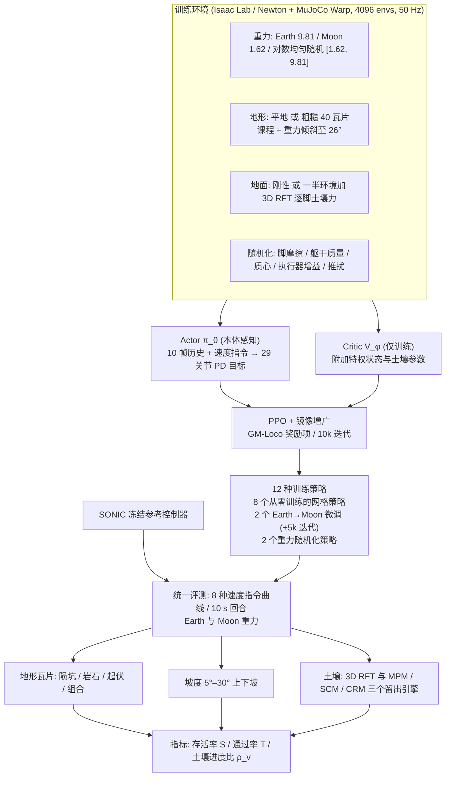

# Moon Walk Transfer：在地球训练的人形控制器能在月球行走吗？重力、地形与土壤迁移研究

**Moon Walk Transfer**（*Do Earth-Trained Humanoid Controllers Walk on the Moon? Gravity, Terrain, and Soil Transfer*，[arXiv:2610.30080](https://arxiv.org/abs/2610.30080)）收录于 senlanke「具身运控lab」10-19–10-23 前沿论文动态（人形/四足）。本页依据**周报条目 + arXiv 摘要页**整理，流程图依据论文方法部分（见参考来源），未逐页核对实验数字；指标与结论以论文为准。

## 一句话定义

**Moon Walk Transfer：在地球训练的人形控制器能在月球行走吗？重力、地形与土壤迁移研究——在刚性地面和三维阻力理论土壤上系统比较地球训练、月球训练、微调及重力随机化策略；发现重力迁移高度不对称，而粗糙月壤加重力随机化具有最佳跨环境鲁棒性。**

## 英文缩写速查

| 缩写 | 英文全称 | 简要说明 |
|------|----------|----------|
| RL | Reinforcement Learning | 强化学习 |
| WBC | Whole-Body Control | 全身控制 |

## 为什么重要

- 周报所述待解决的问题：现有研究很少同时考虑月球低重力、粗糙地形和可变形月壤，也不清楚地球策略向月球迁移是否对称。

## 流程总览

图依据：论文 §III-A–C、§IV-A–C / Fig.2（本文为系统性对比研究，图为其训练—评测流程，非新算法）

## 核心机制

| 项 | 内容 |
|----|------|
| **arXiv** | [2610.30080](https://arxiv.org/abs/2610.30080) · [PDF](https://arxiv.org/pdf/2610.30080) |
| **作者（arXiv）** | Guillem Casadesus Vila, Sri Aditya Deevi, Grace X. Gao |
| **机构（周报所述，未逐条核实）** | 斯坦福大学 |
| **arXiv 评论栏** | 11 pages, 4 figures, 5 tables. Supplementary material (13 pages) included as an ancillary file |
| **开源** | arXiv 摘要页与评论未见代码或项目页链接（仅核对 arXiv 摘要页，不代表未发布）（2026-10-26） |
| **周报所述创新点** | 在刚性地面和三维阻力理论土壤上系统比较地球训练、月球训练、微调及重力随机化策略；发现重力迁移高度不对称，而粗糙月壤加重力随机化具有最佳跨环境鲁棒性。 |

### arXiv 摘要节选（英文原文）

> The Moon changes gravity, terrain, and soil at once. Learned locomotion has studied reduced gravity on rigid ground and granular terrain mostly at Earth gravity, but not humanoids under both, generalist-controller transfer, or the Earth cost of lunar adaptation.

## 源码运行时序图

**不适用**：arXiv 摘要页与评论未见代码或项目页链接（仅核对 arXiv 摘要页，不代表未发布），无可对齐的官方代码流程。

## 实验与评测

- 周报与摘要给出的数字/场景已写入上表「创新点」与摘要节选；其余实验细节、基线与成功率定义请回到论文正文。
- 读法：先对齐任务设定、传感器与成功定义（仿真/真机），再解读 headline 数字，勿跨论文直接比较。

## 与其他工作对比

| 维度 | 读法 |
|------|------|
| **同周对照** | 见 [人形/四足周报技术地图](../overview/senlanke-weekly-2026-10-19-23-humanoid-quadruped-technology-map.md)，按方向浏览同期论文 |
| **开源状态** | arXiv 摘要页与评论未见代码或项目页链接（仅核对 arXiv 摘要页，不代表未发布） |

## 结论

**Moon Walk Transfer：在地球训练的人形控制器能在月球行走吗？重力、地形与土壤迁移研究。**

1. 本页是入库级摘要，复现前请核对论文正文、附录与代码仓库。
2. 指标须连同实验条件解读。
3. 关注 arXiv 版本更新与代码发布。

## 关联页面

- [senlanke-weekly-2026-10-19-23-humanoid-quadruped-technology-map](../overview/senlanke-weekly-2026-10-19-23-humanoid-quadruped-technology-map.md)
- [humanoid-locomotion](../tasks/humanoid-locomotion.md)
- [reinforcement-learning](../methods/reinforcement-learning.md)

## 参考来源

- [earth-trained-humanoid-controllers-moon-transfer_arxiv_2610_30080.md](../../sources/papers/earth-trained-humanoid-controllers-moon-transfer_arxiv_2610_30080.md)
- [wechat_senlanke_weekly_humanoid_quadruped_2026-10-19_23.md](../../sources/blogs/wechat_senlanke_weekly_humanoid_quadruped_2026-10-19_23.md)
- [arXiv:2610.30080](https://arxiv.org/abs/2610.30080)
- [arXiv PDF](https://arxiv.org/pdf/2610.30080)：已通读方法部分（实验与附录以略读为准）：摘要、§I–II、§III 训练设定 / 策略与预算 / 重力相关设计、§IV 实验设定（地形、土壤模型、评测协议）、§V 部分结果表

## 推荐继续阅读

- [arXiv PDF](https://arxiv.org/pdf/2610.30080)
