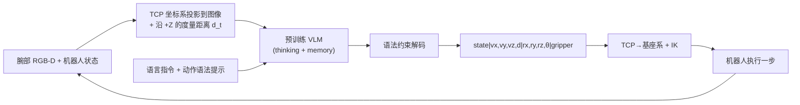

# EASG：把动作坐标系画进图像，让 VLM 直接当动作模型

**EASG**（*Explicit Action-Space Grounding*；论文 *VLMs are Native Action Models*，[arXiv:2610.12832](https://arxiv.org/abs/2610.12832)，[项目页](https://general-robo.github.io/EASG/)）由浙江大学、上海人工智能实验室、清华大学的作者提出：不给 VLM 加动作头，也不做机器人动作预训练，而是把以 TCP 为原点的动作坐标系和到表面的度量距离直接投影进腕部相机图像，让 VLM 用文本写出下一步的方向、距离、旋转与夹爪状态。

## 一句话定义

**通过“看得见的动作空间”（图上画出 TCP 坐标轴 + 深度给出的米制尺度）加“可解析的文本动作语法”，把预训练 VLM 变成闭环连续控制策略，并沿用同一接口做微调。**

## 英文缩写速查

| 缩写 | 英文全称 | 简要说明 |
|------|----------|----------|
| EASG | Explicit Action-Space Grounding | 本文方法：把动作空间显式落到图像上 |
| VLM | Vision-Language Model | 预训练视觉语言模型，本文不加动作头 |
| TCP | Tool Center Point | 工具中心点，动作坐标系原点 |
| GCD | Grammar-Constrained Decoding | 语法约束解码，只约束动作文本格式 |
| IK | Inverse Kinematics | 将目标位姿转成关节指令的确定性模块 |
| LoRA | Low-Rank Adaptation | 真机微调使用的参数高效适配 |

## 为什么重要

- **接口视角：** 此前 VLM 到动作要么加可学习动作头（VLA），要么走外部规划管线；EASG 说明接口设计本身可决定 VLM 能否直接控制。
- **零样本基线值得记：** 6 个真机任务平均 79.4%，相对每任务 30 条示范微调的 π0.5（76.1）同量级。
- **消融尖锐：** 去掉动作坐标系或度量深度，零样本平均都是 0.0；去掉 thinking 降到 11.7。

## 流程总览

## 方法

- **动作坐标系：** 原点在当前 TCP，轴由标定的腕部相机内外参投影到图像；提示词写明 X 红色横跨手指、+Z 蓝色指向指尖、右手系。
- **度量尺度：** 对齐深度估计沿 +Z 到最近可见表面的距离 d_t；该深度的估计方法原文未说明。
- **文本动作：** `state | vx,vy,vz,d | rx,ry,rz,θ | gripper`，方向为单位向量，距离单位 cm，旋转为单位轴加角度，数字有显式符号与两位小数，生成后向量投影回单位球。
- **执行：** 动作从 TCP 系旋转到基座系，叠加到当前位姿，再由 IK 转关节；VLM 不负责本体运动学。
- **GCD：** 把语法编译成有限状态机，非法 token 的 logits 置 -∞；无额外参数。
- **模型与微调：** 零样本与真机微调使用论文所称 “Qwen-3.8-27B”（原文内命名不一致，照录），真机用 LoRA、每任务 30 条示范；LIBERO 用 Qwen3.5-0.8B，不用深度。
- **硬件：** UR3 + Robotiq 2F-85，腕部 Orbbec Gemini 305，外部 RealSense D435i；跨本体换 Flexiv 7-DoF。

## 源码运行时序图

**不适用。** 论文与项目页链到的 [General-Robo/EASG](https://github.com/General-Robo/EASG) 在 2026-10-12 无法访问（GitHub 403、WebFetch 404），无法对齐真实目录或脚本，也不能确认存在可运行实现；待仓库公开后再补。

## 实验与评测

**零样本真机（每任务 3 轮×10 次）：** 平均 79.4%：抓黄瓜 93.3、拿积木 90.0、香蕉放盘 66.7、合笔记本 100、推抽屉 93.3、折毛巾 33.3。

**与微调 VLA 对比（每任务示范数 10 / 30 / 50，平均 %）：**

| 方法 | 10 | 30 | 50 |
|------|----|----|----|
| π0.5 | 43.9 | 76.1 | 96.7 |
| π0-FAST | 30.6 | 56.7 | 85.6 |
| GR00T N1.6 | 38.9 | 67.8 | 95.6 |
| OpenVLA-OFT | 41.1 | 66.1 | 88.9 |

EASG 零样本为 79.4。30 条示范时仅 π0.5 接近。随机化物体位姿/颜色后，EASG 77.3±5.9，而 50 条示范的 π0.5 降到 40.2±8.7。

**微调与仿真：** 更难真机任务（折 T 恤、开笔记本、套环、挂杯、抽屉等）微调后平均 75.5，π0-FAST 77.8、Octo 69.7、OpenVLA 67.8。LIBERO 0.8B 平均 83.3，对比 π0-FAST 85.5、OpenVLA 76.5、Octo 75.1。

**跨本体：** UR3 平均 63.9，Flexiv 62.2。

**消融：** 动作坐标系或度量深度缺一，零样本平均 0.0；GCD 在 LIBERO 上 72.7→83.3；Thinking+Memory 79.4、Thinking 无 Memory 64.4、无 Thinking 有 Memory 11.7、两者皆无 8.9。

## 结论

**把动作空间画进图像并配上度量尺度，足以让大型预训练 VLM 零样本做简单到中等的桌面操作，但依赖深度、推理开销和较大的模型；微调后优势转为“同接口、少架构改动”而非绝对精度领先。**

1. 动作坐标系与度量深度是核心：缺一零样本即归零。
2. 要让 VLM 先“思考”：关闭 thinking 平均 8.9–11.7。
3. 语法约束解码对小模型很关键：LIBERO 平均 +10.6 个百分点（72.7→83.3）。
4. 微调相对 π0-FAST 并无优势（真机 75.5 vs 77.8），不要把“native action model”理解成精度超越。
5. 跨本体验证仅一台 Flexiv 且不用外部相机，别外推到其他夹爪/相机配置。
6. 零样本折毛巾仅 33.3，形变长程任务仍是短板。

## 局限与风险

- **开源状态：待核实。** 项目页（[easg-project.md](../../sources/sites/easg-project.md)）与论文都链到 GitHub 仓库，2026-10-12 实测无法访问；页面未说明数据/检查点发布。项目页零样本视频区仍是占位。
- 依赖腕部 RGB-D；零样本强依赖推理，推理成本与延迟原文未报告。
- 论文模型命名在正文与图注间不一致（Qwen-3.8-27B / Qwen3.5 / Qwen3.8-next），复现前需核对。
- 附录中的真机训练超参（学习率、轮数、GPU）与规模前沿图数值未读到。
- 论文未设独立局限节，上述局限为依据实验的推断（推测）。

## 与其他工作对比

| 对照 | 差异读法 |
|------|----------|
| [OpenVLA](./paper-openvla.md) | 需要机器人数据训练动作 token；EASG 零样本无动作预训练 |
| [π0.5](./paper-pi05-open-world-vla.md) | 微调 VLA 基线，50 条示范时更高（96.7）但抗随机化弱（40.2） |
| [LIBERO 基准](./libero-benchmark.md) | 仿真验证场，0.8B 平均 83.3 |
| [3D 空间 VQA](../concepts/3d-spatial-vqa.md) | 同属让 VLM 利用空间信息，EASG 面向连续控制 |

## 工程实践

| 项 | 建议 |
|----|------|
| 接口设计 | 动作坐标轴要画在相机里，并给 cm 级尺度 |
| 解码 | 任何文本动作接口都应加语法约束 |
| 相机/深度 | 需要标定的腕部相机与对齐深度 |
| 复现前 | 先确认官方仓库是否公开 |

## 关联页面

- [34 篇空间落地论文技术地图](../overview/embodied-station-34-papers-spatial-grounding-technology-map.md) — 本文所在盘点
- [VLA 方法](../methods/vla.md)
- [操作任务](../tasks/manipulation.md)
- [LIBERO 基准](./libero-benchmark.md)
- [OpenVLA](./paper-openvla.md)

## 参考来源

- [微信盘点：具身智能小站 34 篇（2026-10-12）](../../sources/blogs/wechat_embodied_station_34_papers_spatial_grounding_2026-10-12.md)
- [easg_arxiv_2610_12832.md](../../sources/papers/easg_arxiv_2610_12832.md) — 论文摘录
- [easg-project.md](../../sources/sites/easg-project.md) — 项目页核查
- [arXiv:2610.12832](https://arxiv.org/abs/2610.12832)

## 推荐继续阅读

- [EASG 项目页](https://general-robo.github.io/EASG/)
- [arXiv HTML 全文](https://arxiv.org/html/2610.12832v1)
