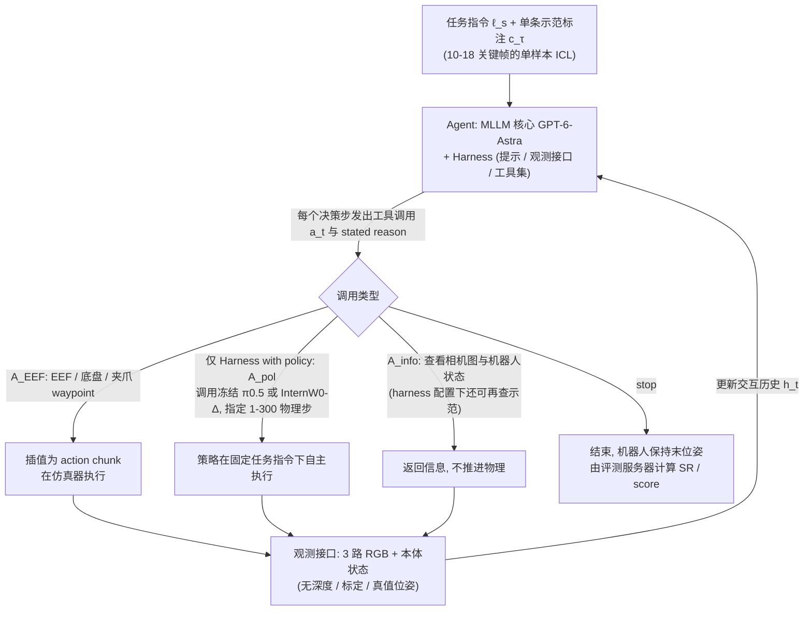

# EBench Frontier Agent Profiling（arXiv:2610.35832）

**EBench Frontier Agent Profiling**（*Profiling a Frontier Agent with EBench: From Direct Control to Harness with Policy*，[arXiv:2610.35832](https://arxiv.org/abs/2610.35832)，[项目页](https://internrobotics.github.io/EBench-Astra-Tech-Report/)）来自 [具身智能小站 2026-10-28 盘点](../../sources/blogs/wechat_embodied_station_59_papers_human_video_to_robot_experience_2026-10-28.md)，属「评测与基准」组。

## 一句话定义

**在统一视觉和本体观测协议下，比较直接控制与调用专用策略两种配置。**

## 英文缩写速查

| 缩写 | 英文全称 | 简要说明 |
|------|----------|----------|
| EBench Frontier Agent Profiling | Profiling a Frontier Agent with EBench: From Direct Control to Harness with Policy | 本文方法 / 基准的简称 |

## 为什么重要

- 看清通用智能体与专用策略的分工。混合执行能互补，但调用时机、子目标缺失和重新接管造成的抓握破坏仍限制整体表现。
- 开源结论：**已开源**（步骤 2.5，2026-10-28）。公众号未给代码链接；项目页链接的 InternRobotics/EBench 经 git ls-remote 可达。
- 同期同组工作见 [潜在动作、免渲染事件仿真与机器人评测：具身智能小站 10-28 期 59 篇阅读坐标](../overview/embodied-station-2026-10-28-59-papers-technology-map.md)。

## 流程总览

图依据：论文 §3.1-3.2 / §4.2-4.3 / §6.1（Agent 与 Harness 配置；Fig.1 仅据正文描述）

## 核心机制

| 项 | 内容 |
|----|------|
| **arXiv** | [2610.35832](https://arxiv.org/abs/2610.35832) |
| **开源** | **已开源** |
| **要点** | 在统一视觉和本体观测协议下，比较直接控制与调用专用策略两种配置。 |
| **文内指标** | 公众号转述：混合执行能互补，但调用时机、子目标缺失和重新接管造成的抓握破坏仍限制整体表现。 |

## 源码运行时序图

**不适用（已开源）** — 公众号未给代码链接；项目页链接的 InternRobotics/EBench 经 git ls-remote 可达。 不编造运行脚本；代码公开后再补。

## 实验与评测

- 公众号转述：混合执行能互补，但调用时机、子目标缺失和重新接管造成的抓握破坏仍限制整体表现。
- **读法：** 本页为索引级摘要，依据公众号转述的官方摘要与仓库信息整理；逐项数字与 baseline 以原文 PDF 为准。

## 与其他工作对比

- 横向索引见 [潜在动作、免渲染事件仿真与机器人评测：具身智能小站 10-28 期 59 篇阅读坐标](../overview/embodied-station-2026-10-28-59-papers-technology-map.md)；同 arXiv 不重复造页。

## 结论

**看清通用智能体与专用策略的分工：混合执行能互补，但调用时机、子目标缺失和重新接管造成的抓握破坏仍限制整体表现。**

1. 开源边界：**已开源** — 公众号未给代码链接；项目页链接的 InternRobotics/EBench 经 git ls-remote 可达。
2. 核心机制：在统一视觉和本体观测协议下，比较直接控制与调用专用策略两种配置。
3. 复现与选型前核对任务协议、硬件与基准口径，勿直接横比公众号摘录数字。

## 关联页面

- [具身大模型评测基准选型闭环](../queries/embodied-eval-benchmark-selection-loop.md) — 本页可归入其 ① 具身大脑/MLLM 认知评测层：前沿智能体直接控制 vs 调用专用策略的配置对照
- [simulation-evaluation-infrastructure](../concepts/simulation-evaluation-infrastructure.md)
- [vla](../methods/vla.md)
- [manipulation](../tasks/manipulation.md)
- [embodied-station-2026-10-28-59-papers-technology-map](../overview/embodied-station-2026-10-28-59-papers-technology-map.md)

## 参考来源

- [ebench_frontier_agent_profiling_arxiv_2610_35832.md](../../sources/papers/ebench_frontier_agent_profiling_arxiv_2610_35832.md)
- [wechat_embodied_station_59_papers_human_video_to_robot_experience_2026-10-28.md](../../sources/blogs/wechat_embodied_station_59_papers_human_video_to_robot_experience_2026-10-28.md)
- [arXiv:2610.35832](https://arxiv.org/abs/2610.35832)
- [arXiv PDF](https://arxiv.org/pdf/2610.35832)：已通读方法部分（实验与附录以略读为准）：摘要、§1、§3、§4.1-4.4、§6.1；§5 与 §6.2 起的结果与失败分析、附录以略读为准

## 推荐继续阅读

- [arXiv PDF](https://arxiv.org/pdf/2610.35832)
- [项目页](https://internrobotics.github.io/EBench-Astra-Tech-Report/)
