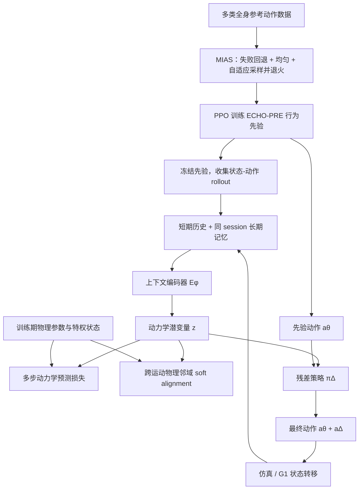

# ECHO：用于人形全身控制的上下文行为基础模型 / In-Context Behavior Foundation Model for Humanoid Whole-Body Control

## 一句话定义

**ECHO**（arXiv:2611.25778v1，2026-11-19）先用 **MIAS** 训练广覆盖的人形全身动作跟踪先验 **ECHO-PRE**，再以 **CRA** 从本体状态—动作历史学习动力学上下文，对冻结先验的动作施加残差修正，**部署不需在线梯度更新**。

## 英文缩写速查

| 缩写 | 英文全称 | 简要说明 |
|------|----------|----------|
| ECHO | In-Context Behavior Foundation Model for Humanoid Whole-Body Control | 人形全身控制的上下文行为基础模型 |
| BFM | Behavior Foundation Model | 通用动作/技能先验 |
| MIAS | Mixed and Annealed Sampling | 失败回退、均匀/难例抽样并退火 |
| CRA | Context Representation and Residual Adaptation | 动力学上下文表征与动作残差适配 |
| NDR / HDR | Necessary / Heavy Domain Randomization | 基础与强域随机化设置 |
| PPO | Proximal Policy Optimization | 训练跟踪先验与残差策略的强化学习优化器 |
| MPJPE | Mean Per Joint Position Error | 全身轨迹跟踪误差 |

## 核心信息

| 字段 | 内容 |
|------|------|
| 论文 | [ECHO（arXiv:2611.25778v1）](https://arxiv.org/abs/2611.25778) |
| 机构 | 浙江大学、中国电信人工智能研究院（TeleAI）、上海科技大学、上海交通大学、Gamma Robotics |
| 作者 | Xingyi Wang、Bin Li、Jiyuan Shi、Chenyun Zhang、Weiji Xie、Xiangyu Miao、Junsong Wu、Wei Song、Shiqiang Zhu、Chenjia Bai |
| 平台 | Unitree G1，mjlab / PPO 训练，MuJoCo CPU 仿真评测 |
| 动作数据 | 220,560 序列 / 222.46M 帧 / 1,235.88 h（50 Hz，过滤后） |
| 项目主页 | [ECHO 官方页](https://mwondering.github.io/echo-bfm/) |
| 公开状态 | 2026-11-23 未找到官方算法训练、推理、部署代码与权重；[链接的 GitHub](https://github.com/mwondering/echo-bfm)仅为展示网站源码 |

## 为什么重要

大规模行为基础模型可以「会很多动作」，但在不同负载、摩擦、质量分布与执行器参数下，准确执行同一动作的控制响应不同。ECHO 将「能力覆盖」与「物性适配」分开：**行为先验负责做什么，历史编码与残差负责当前动力学下怎么做**。它属于 [BFM](../concepts/behavior-foundation-model.md) 与 [Whole-Body Control](../concepts/whole-body-control.md) 的交叉，也将动力学交互历史作为 [ICL](../../roadmap/depth-icl.md) 的一种上下文，而不是语言提示或人类示范的 in-context 任务学习。

## 流程总览

下图依据论文 Fig. 2、§3 绘制，是**论文方法数据流**，非官方代码调用时序。



## 核心机制（论文 §3 与附录 §6）

### MIAS：单阶段学高动态与日常动作

把每条参考运动分成时间 bin，失败率作为难度。失败后将 rewind、uniform、adaptive 三路各赋 1/3；正常结束后 uniform / adaptive 各 1/2。自适应采样提高失败片段被练习的概率，同时通过温度增长、采样概率上限逐步收紧保持动作覆盖率。原文用于单一 ECHO-PRE，覆盖日常运动、极限特技、地面接触与地形动作。

### CRA：从交互历史中读取物理环境

- 历史 `H_t` 由已执行的本体状态与动作构成；短期历史含最近响应，长期记忆保存同物理 session 下的较早片段；换动作/episode 清短期，换物理 session 清全部。
- 上下文编码 `z_t = Eφ(H_t)`。使用**多步未来状态、接触与力预测**的 `L_pred` 加上**跨动作物理邻域 soft alignment** 的 `L_soft` 训练编码器。对齐依据训练期的物理配置真值；部署时不会直接读取隐藏的摩擦或负载。
- 预测器只在编码器训练阶段使用，不是部署时显式的世界模型。

### 残差执行：冻结行为能力

冻结先验与上下文编码器，训练残差 actor。论文 Eq. (13)：

```text
a_prior = πθ(本体与参考运动输入)
z       = Eφ(有效状态-动作历史)
a_final = a_prior + πΔ(本体, 参考运动, z, a_prior)
```

上述为原文接口意译，**非官方源码 API**。ECHO-PRE 仅在 NDR 预训练；CRA 可用 NDR 得到 ECHO-N，或用额外四肢负载的 HDR 得到 ECHO-H。HDR 负载每只手 0–2.5 kg、每小腿 0–4 kg，理论上界合计 13 kg。

## 实验与评测

以下数据来自论文表 2、3、4、8、9，未做独立复现。

| 场景 | 结果 | 边界 |
|------|------|------|
| AMASS-2000-Random（训练未见） | ECHO-PRE SR 0.9832；ECHO-N 0.9827 | CRA 改善跟踪误差，但非所有 SR 都提升 |
| BONES-SEED-100-HighDynamic（训练分布内） | 去 MIAS 0.4500 → ECHO-PRE 0.7200 → ECHO-N 0.7633（SR） | 验证采样配方对困难动作的影响，不是 OOD 测试 |
| HDR 随机物性 | ECHO-H SR 0.8922；RMA-Teacher 0.8827；RMA-Student 0.8700 | ECHO-H 领先 5 项指标中的 4 项 |
| LAFAN-40 物性表征 | 环境分类 97.478%、跨动作检索 mAP 93.872% | 表征能跨运动组织物性信息 |
| 50→450 步上下文 | 分类准确率 91.967%→98.403%，mAP 75.778%→96.165% | 更长历史提升环境可辨识度 |
| Unitree G1 真机 | 四种参考动作，每 checkpoint 每动作 10 次；负载组 ECHO-H 四项 MPJPE-L 均优于 Vanilla/RMA-Student | 负载组是每小腿 2 kg，不等于其他演示配置 |

官方还展示 G1 的后空翻、贴地动作、楼梯与坡道遥操作、四肢合计 10 kg 负载动作；**演示能力不能直接替代开放场景定量成功率**。

## 与其他工作对比

| 路线 | 重点 | 与 ECHO 的区别 |
|------|------|----------------|
| [SONIC](./nvidia-sonic.md) | 大规模多动作跟踪与 scaling | ECHO 进一步显式学交互物性上下文并做动作残差修正 |
| [HEFT](./paper-heft.md) | 噪声 VR + 窗化负载课程 | ECHO 更聚焦跨环境物性适配，而非窗口化负载数据监督 |
| [BFM-Zero](./paper-bfm-zero.md) | FB 表征与多任务 latent prompt | 「目标条件行为」不同于「环境动力学条件动作修正」 |
| RMA / Any2Track（作者实验基线） | 历史编码或特权参数适配 | ECHO 以预测损失 + 物理邻域对齐训练更可用的物理潜空间 |

## 结论

**核心不是只扩大动作库，而是以冻结通用行为先验 + 动力学上下文残差，让同一参考动作适应不同环境。**

1. **MIAS 的价值可通过难例消融直接观察**：高动态 SR 从去 MIAS 0.4500 提升至 ECHO-PRE 0.7200。
2. **物理潜变量不等于任意历史编码**：多步预测让质量、摩擦可读；跨动作 soft alignment 让环境表示一致。
3. **无测试时更新不等于没有记忆维护**：session 内长期历史、物理参数突变与缓存失效是实机设计边界。
4. **分开看泛化维度**：AMASS OOD 运动、BONES-SEED 训练分布内技能、HDR 物性变化与真机四动作是不同协议。
5. **当前复现边界**：论文与官网公开，网站 GitHub 不含训练/部署代码；不能把报告效果当作已可直接复现。

## 工程实践

| 项目 | 复现与部署检查 |
|------|----------------|
| 数据/仿真 | 作者使用 1,235.88 h 过滤后 MotionDecode/BONES-SEED/100STYLE/LAFAN1；PPO + mjlab |
| 观测 | actor 用本体历史、关键刚体、参考状态/误差；critic 可见训练特权；详见表 6 |
| 控制 | 论文奖励步长 `Δt=0.02 s`（50 Hz 控制）；比较 SR、global/root-relative MPJPE 和接触相关误差 |
| 域随机化 | 区分 NDR 和 HDR；记录四肢负载、CoM 与惯量变化 |
| 开放程度 | **未发现官方模型源码或权重**；项目站 GitHub 主要为 HTML / templates / 页面 build 工具 |
| 源码运行时序图 | **不适用**（2026-11-23 项目站没有可核对的训练、推理或部署入口；故不能编造模型运行时序） |

## 局限与风险

- 物理上下文训练依赖仿真 rollout 与特权参数，随机化范围以外物性尚需更多实测。
- 长期记忆假设 session 内物理参数不变；中途突变会让已有上下文过时。
- 真机仅 Unitree G1 参考条件控制，跨机体与自主任务规划未验证。
- 公开展示站≠可复现算法源码；其 `scripts/build.py` 仅用于网页构建。

## 关联页面

- [BFM 概念](../concepts/behavior-foundation-model.md)
- [Whole-Body Control](../concepts/whole-body-control.md)
- [Unitree G1](./unitree-g1.md)
- [SONIC](./nvidia-sonic.md)、[HEFT](./paper-heft.md)
- [BFM 纵深](../../roadmap/depth-bfm.md) Stage 4
- [ICL 纵深](../../roadmap/depth-icl.md) 与示范上下文的区别
- [遥操作](../tasks/teleoperation.md)
- [Locomotion](../tasks/locomotion.md) — 动作跟踪中的全身移动与支撑技能
- [强化学习](../methods/reinforcement-learning.md) — ECHO-PRE 与残差策略的 PPO 训练基础

## 参考来源

- [arXiv v1 原文核对归档](../../sources/papers/echo_bfm_arxiv_2611_25778.md)
- [项目页核查](../../sources/sites/echo-bfm-project.md)
- [展示仓库说明](../../sources/repos/echo-bfm-website.md)
- [ECHO HTML 全文](https://arxiv.org/html/2611.25778v1)

## 推荐继续阅读

- [ECHO 官方项目页与演示](https://mwondering.github.io/echo-bfm/)
- [ECHO v1 PDF](https://arxiv.org/pdf/2611.25778)
- [BFM-Zero（不同目标条件化路线）](https://arxiv.org/abs/2511.04131)
