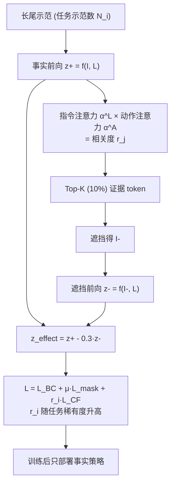

# ECL：证据引导的反事实学习，缓解 VLA 长尾任务被头部动作压制

**ECL**（*Evidence-Guided Counterfactual Learning*，[arXiv:2610.12861](https://arxiv.org/abs/2610.12861)，[项目页](https://krlozhilderman287-creator.github.io/EVIDENCE-GUIDED-COUNTERFACTUAL-LEARNING-FOR-LONG-TAILED-ROBOTIC-POLICIES/)）来自河海大学：示范数据在任务间不均衡时，尾部任务缺视觉证据，策略会退回头部任务的动作模式。ECL 找出支撑决策的视觉证据，遮挡后构造反事实监督，并按任务示范数加权，训练时多一次前向，部署时不增加计算。

## 一句话定义

**用“指令相关 × 动作相关”的注意力定位证据 token，遮掉它们得到反事实预测，与事实预测做对比监督，并让稀有任务的反事实项权重更大。**

## 英文缩写速查

| 缩写 | 英文全称 | 简要说明 |
|------|----------|----------|
| ECL | Evidence-Guided Counterfactual Learning | 本文方法 |
| VLA | Vision-Language-Action | 被改进训练的策略类型 |
| HPS | Head-Prior Score | 头部先验分数，衡量尾部指令下偏向头部动作的程度 |
| LT | Long-Tailed | 人为构造的长尾示范分布（LIBERO-Core-LT） |
| APA | （原文基线，未在可读文本中展开全称） | 用 YOLOv8 与图像修复构造物体替换示范的数据增强基线 |
| BC | Behavior Cloning | 基础模仿损失 L_BC |

## 为什么重要

- **长尾是真实数据分布：** 机器人示范天然不均衡，头部任务的动作先验会污染尾部。
- **训练侧方案：** 不要额外数据、无区域标注、不增加部署开销，可套到不同 VLA。
- **诊断量化：** HPS 与 Head-Action Rate 给出“偏向头部动作”的可测指标。

## 流程总览

## 方法

- **证据定位：** r_j=α_j^L·α_j^A，取前 10% token（16×16 网格）。论文自述注意力不是可靠的因果解释。
- **反事实：** 遮挡后保持指令不变得 z⁻；z_effect=z⁺−λ·z⁻，λ=0.3。
- **损失：** L_BC、L_mask、L_CF 均以专家动作 a* 为目标；总目标 L_i=L_BC+μ·L_mask+r_i·L_CF，r_i=(N_max−N_i)/(N_max−N_min)。μ 默认值可见文本中未给。
- **骨干：** MiniVLA、π0.5（OpenPI LIBERO 配置：动作视野 10、batch 256、学习率 5e-5、3 万步、EMA 0.999）。
- **数据：** LIBERO-Core 10 任务，FULL 435 条示范，LT 154 条（任务 0–9：46/28/19/15/11/9/8/7/6/5）；真机 6 任务，LT 共 157 条。

## 源码运行时序图

**不适用。** 官方链接是双盲评审用匿名镜像，2026-10-12 无法读取文件树，不能确认训练/评测入口，故不画与真实目录对齐的时序图。

## 实验与评测

**LIBERO-Core 平均成功率（%）：**

| 骨干 | FULL | LT | APA | ECL |
|------|------|----|-----|-----|
| MiniVLA | 57.2 | 40.8 | 44.8 | 53.0 |
| π0.5 | 55.3（表头标 synthetic，原文未解释） | 40.3 | 41.7 | 47.2 |

相对 LT：MiniVLA +12.2 点（约 29.9%），π0.5 +6.9 点（约 17.1%）。尾部任务 7–9：MiniVLA APA 11.3→ECL 23.5，π0.5 19.0→21.6（由表计算）。个别任务如 MiniVLA 任务 1，FULL 78.2 高于 ECL 68.9。

**真机（每任务每策略 50 次，LT 分布 50/46/29/13/10/9）：**

| 平台 | MiniVLA APA→ECL | π0.5 APA→ECL |
|------|-----------------|--------------|
| AgileX PIPER | 17.3→25.7 | 21.0→27.3 |
| xArm6 | 19.3→26.0 | 24.0→30.7 |

论文称尾部任务相对 APA 提升 PIPER 9.0%、xArm6 4.3%，但均值口径未给，未能复现。

**消融（MiniVLA）：** λ=0.3 最优；token 选择以“物体–动作联合”最佳（53.0%）；遮挡比例 10% 最优；μ=0 时接近 LT 基线。**上下文级长尾（LTC）：** 仿真 34.7→37.6，真机 28.5→34.3。

## 结论

**当长尾导致策略借用头部动作时，用注意力定位证据再做遮挡对比，是一种不增加推理开销的训练侧修正；收益主要来自尾部任务，但对头部任务的“保持”不是处处成立。**

1. 长尾分布下先量化头部偏置（HPS、Head-Action Rate），再决定是否上方法。
2. 证据选择用指令×动作联合注意力，单独用物体或动作都更差。
3. 遮挡比例约 10%、对比系数 λ=0.3 是论文最优点，换骨干需重调。
4. 稀有度加权让反事实项偏向尾部；μ=0 时收益基本消失。
5. 训练多一次前向，固定算力预算下可能挤占头部优化（作者自述）。
6. 跨骨干与真机一致提升，但真机尾部指标口径不明，别直接引用 9.0% / 4.3%。

## 局限与风险

- **开源状态：待核实。** 仅有匿名 4open.science 镜像，内容无法读取；项目页署名 Anonymous（[ecl-project.md](../../sources/sites/ecl-project.md)）。
- 训练开销增加（反事实样本构造与额外前向）；频次只是每任务监督量的代理；注意力并非因果解释。
- 原文存在命名与标注不一致（“FACS”、“FT-RCD”、比例笔误、π0.5 FULL 列标 synthetic）。
- 附录 E（训练开销）与 μ 默认值未读到；实验仅 MiniVLA 与 π0.5 两种骨干。

## 与其他工作对比

| 对照 | 差异读法 |
|------|----------|
| APA（原文基线） | 用检测+修复造替换示范；ECL 不用额外示范 |
| [π0.5](./paper-pi05-open-world-vla.md) | 本文的骨干之一 |
| [模仿学习](../methods/imitation-learning.md) | ECL 修改的是 BC 的监督构造而非架构 |
| [LIBERO 基准](./libero-benchmark.md) | 仿真长尾划分的数据来源 |

## 工程实践

| 项 | 建议 |
|----|------|
| 先诊断 | 统计任务示范数，计算尾部指令下的头部动作率 |
| 超参起点 | λ=0.3、遮挡 10%，μ 需自行扫描 |
| 部署 | 只导出事实策略，无需改推理管线 |
| 复现 | 官方仓库不可核实，需自行实现注意力提取 |

## 关联页面

- [34 篇空间落地论文技术地图](../overview/embodied-station-34-papers-spatial-grounding-technology-map.md) — 本文所在盘点
- [VLA 方法](../methods/vla.md)
- [操作任务](../tasks/manipulation.md)
- [LIBERO 基准](./libero-benchmark.md)
- [π0.5](./paper-pi05-open-world-vla.md)

## 参考来源

- [微信盘点：具身智能小站 34 篇（2026-10-12）](../../sources/blogs/wechat_embodied_station_34_papers_spatial_grounding_2026-10-12.md)
- [ecl_arxiv_2610_12861.md](../../sources/papers/ecl_arxiv_2610_12861.md) — 论文摘录
- [ecl-project.md](../../sources/sites/ecl-project.md) — 项目页与匿名仓库核查
- [arXiv:2610.12861](https://arxiv.org/abs/2610.12861)

## 推荐继续阅读

- [ECL 项目页](https://krlozhilderman287-creator.github.io/EVIDENCE-GUIDED-COUNTERFACTUAL-LEARNING-FOR-LONG-TAILED-ROBOTIC-POLICIES/)
- [arXiv HTML 全文](https://arxiv.org/html/2610.12861v1)
