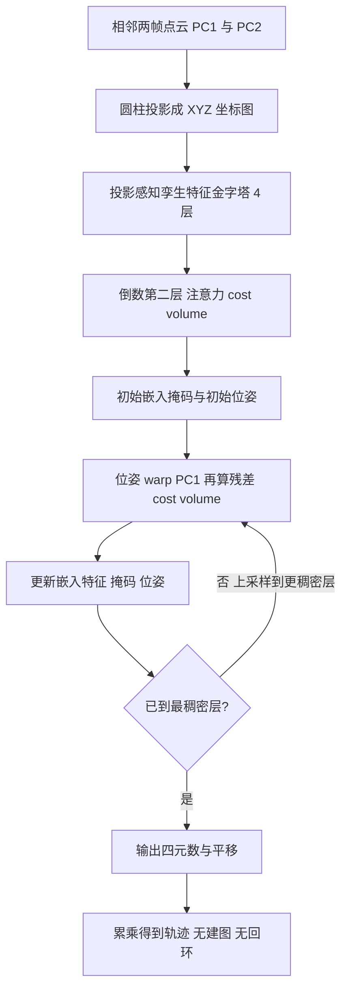

# EfficientLO-Net：Efficient 3D Deep LiDAR Odometry（arXiv:2111.02135）

**EfficientLO-Net**（*Efficient 3D Deep LiDAR Odometry*，[arXiv:2111.02135](https://arxiv.org/abs/2111.02135)，上海交通大学 Hesheng Wang 课题组，IEEE TPAMI）。注意：arXiv v1 里同一网络叫 **PWCLO-Net**；会议前身 *PWCLO-Net*（CVPR 2021）是 8192 点输入、不含投影加速的版本，v2 表 2 把它作为单独一行（KITTI 07-10 均值 trel 1.085）。它也不是 LO-Net（Li 等，CVPR 2019）。

## 一句话定义

**把 LiDAR 点云按圆柱投影排成有序的 H×W×3 XYZ 坐标图，只用来加速采样与分组，特征仍在原始 3D 坐标上学习；用金字塔 + 位姿 warp + 注意力 cost volume（PWC）和可训练嵌入掩码，从粗到细端到端回归两帧间 6-DoF 位姿的监督式激光里程计。**

## 英文缩写速查

| 缩写 | 英文全称 | 简要说明 |
|------|----------|----------|
| LO | LiDAR Odometry | 激光里程计，估计相邻两帧间相对位姿 |
| PWC | Pyramid, Warping, Cost volume | 特征金字塔 + 位姿 warp + cost volume 的由粗到细结构（借自光流 / 场景流网络） |
| SBS | Stride Based Sampling | 步长采样：按固定步长在 XYZ 图上直接取下标，替代 FPS |
| FPS | Farthest Point Sampling | 最远点采样（PointNet++），论文视为低效 |
| KNN | K Nearest Neighbors | K 近邻分组 |
| KITTI | KITTI odometry benchmark | 车载 Velodyne 64 线里程计数据集，序列 00-10 有真值 |
| trel / rrel | relative translational / rotational error | KITTI 平均相对平移误差（%）与旋转误差（°/100 m） |
| ATE / RPE | Absolute Trajectory Error / Relative Pose Error | 轨迹误差指标，用于 M2DGR 与 Argoverse |
| LOAM | LiDAR Odometry and Mapping | 基于线、面特征的经典几何激光 SLAM |

## 为什么重要

- 它是「用原始 3D 点而非 2D 投影图做深度激光里程计」的代表工作之一，并给出让大规模点云可实时处理的投影先验加速（作者自述，§1、§3.2）。
- 在 KITTI 07-10 上与带建图的 LOAM 同量级，是学习式里程计与几何方法对标的常被引用的证据（数值与限定条件见下方「实验与评测」「局限」）。
- 综述文章的两句话（「第一个完全端到端的高效 3D 激光雷达里程计」「优于 LOAM」）的原始依据都在这篇论文里，且措辞比转述窄得多，见「与综述说法的核对」。

## 核心机制

作者提出的机制（均出自论文，章节号为 v2 与 v1 共通编号）：

1. **投影感知表示（§3.1）：** 圆柱投影 `u = ⌊arctan2(y,x)/Δθ⌋`、`v = ⌊arcsin(z/r)/Δφ⌋`，格子里填原始 XYZ，而非深度 / 反射率 / 法向；H=64、W=1800（§4.2）。
2. **投影感知 set conv（§3.2）：** 步长采样 → 在投影平面固定核内分组 → 3D 距离过滤 → 随机选 K 点 → MLP + max pooling。孪生金字塔共 4 层（表 1）。
3. **投影感知注意力 cost volume（§3.3）：** 两次分组与注意力加权，得到 PC1 上每个点的运动嵌入；不显式估计对应点，直接回归位姿（§1）。
4. **层次嵌入掩码（§3.4）：** 对嵌入特征做共享 MLP 与沿点维 softmax，得到逐点权重，加权后经 FC 输出四元数与平移；掩码随层级细化。
5. **迭代位姿 warp-refinement（§3.5）：** 用上一层位姿 warp PC1，重算 cost volume，估计残差位姿，共 3 次。
6. **损失（§3.6）：** 每层有可学习权重 sx、sq 的 L1 平移 + 四元数损失，多尺度加权（α=1.6、0.8、0.4）。

注：最后一步「累乘得到轨迹」是里程计的通用做法，论文评测按子序列相对误差，未对全局一致性做后端优化（推测其含义，非论文专门章节）。

## 实验与评测

以下均出自论文 v2（最终版），KITTI 表 2 的设置为 00-06 训练、07-10 测试。

| 比较 | 结果（trel % / rrel °/100m 或 ATE m） | 出处 |
|------|----------------------------------------|------|
| KITTI 07-10 均值：本方法 | 0.795 / 0.395 | 表 2 |
| Full LOAM（带建图） | 0.828 / 0.498 | 表 2 |
| Full A-LOAM（带建图，作者自跑） | 0.810 / 0.323 | 表 2 |
| LO-Net / DMLO / 会议版 PWCLO-Net | 1.748 / 0.793、1.008 / 0.538、1.085 / 0.490 | 表 2 |
| A-LOAM 无建图 | 3.894 / 1.641 | 表 2 |
| KITTI 11-21 官方测试序列（均为无建图对照） | 本方法 1.92 / 0.52；pyLiDAR 2.91 / 0.80；SuMa 4.91 / 1.53；A-LOAM 9.37 / 1.92；LeGO-LOAM 19.57 / 4.93 | 表 7，§5.1（先 00-06 训练再用 07-10 微调） |
| M2DGR 均值 ATE | 本方法 1.405；pyLiDAR 1.335（更好）；A-LOAM 2.682；LeGO-LOAM 3.176；SuMa 5.940 | 表 11，§5.5 |
| Argoverse 均值 ATE / RPE | 本方法 0.751 / 0.018；pyLiDAR 6.900 / 0.109；SuMa 3.663 / 0.039 | 表 12，§5.5 |
| 运行时间（KITTI 00，Titan RTX） | 总 45.3 ms（数据准备 8.3 + 推理 37.0）；LO-Net+mapping 80.1 ms；Full LOAM 69.0 ms | 表 8(a)，§1 称 20 Hz |

逐序列对 Full LOAM（表 2，trel，Full LOAM / 本方法）：07 为 0.63 / 0.46，08 为 1.12 / 1.14，09 为 0.77 / 0.78，10 为 0.79 / 0.80（本页据表计算）。

消融（表 9）：去掉嵌入掩码均值 trel 1.218，去掉 cost volume 11.790，去掉 pose warp-refinement 3.76；投影感知分组使总耗时从 120.1 ms 降到 45.3 ms（表 8(b)）。

## 与综述说法的核对

| 综述说法（《激光雷达 SLAM 算法最新综述》） | 核对结果 |
|------|------|
| 第一个完全端到端的高效 3D 激光雷达里程计框架 | 部分成立，措辞放大。论文结论原话是 “To the best of our knowledge, our method is the first efficient 3D deep LiDAR odometry”（§6，带「据我们所知」）；贡献 1 自称 “totally end-to-end efficient framework”（v2）。「第一个」限定在「高效 + 直接学习 3D 点」，论文并不否认 LO-Net 等基于投影的网络也是端到端训练的（它们的差别是在 2D 投影图上做卷积）。另外，论文自己的会议版 PWCLO-Net（CVPR 2021）已提出同一思路，TPAMI 版是其扩展（§5.2）。 |
| 提出了基于投影感知的三维点云表示方法和特征学习方法 | 成立（§3.1、§3.2）。 |
| 性能优于近期所有基于学习的激光雷达里程计 | 论文摘要原话 “outperforms all recent learning-based methods”，但比较对象仅是表 2 / 4 / 5 / 6 中的 Velas、LO-Net、DMLO、LodoNet、DeepPCO、Cho 等，且 KITTI 各表使用不同的训练 / 测试划分，由作者重新训练；LO-Net 与 DMLO 无公开代码，数值取自其论文（表 2 注）。「所有」应理解为「作者当时对比的那些」。 |
| 甚至优于基于几何方法的 LOAM | 勉强成立且限定很多：摘要原话是 “even … LOAM with mapping optimization, on most sequences of KITTI odometry dataset”。数据集仅 KITTI；v2 表 2 的 07-10 均值 trel 0.795 对 Full LOAM 0.828，领先只来自序列 07，08-10 本方法均略差（差 0.01-0.02）；对 Full A-LOAM，trel 0.795 对 0.810 略好，但 rrel 0.395 对 0.323 反而更差。在 M2DGR（表 11）上均值输给 pyLiDAR，且比较的几何方法均为「无建图」版本，不是带建图的 LOAM。v1 表 2 的 LOAM 数值（均值 1.145，取自 LO-Net 论文）与 v2 表 2（0.828）不同，且 v2 表 8 仍沿用 1.145，论文自身前后不一致。 |

## 与其他工作对比

| 工作 | 关注点 | 与本文的区别 |
|------|--------|--------------|
| [LOAM](./paper-loam-lidar-odometry-and-mapping.md) | 线 / 面特征 + 高频里程计 + 低频建图的几何激光 SLAM | 本文是监督式学习、只做里程计；KITTI 07-10 均值 trel 0.795 对 Full LOAM 0.828，但 08-10 逐序列略差（表 2） |
| [A-LOAM](./paper-a-loam.md) | LOAM 的 Ceres 精简复现 | 带建图的 Full A-LOAM trel 0.810 略逊、rrel 0.323 反而更好；无建图 A-LOAM 明显更差（3.894，表 2） |
| [LeGO-LOAM](./lego-loam.md) | 地面分割 + 轻量几何激光里程计 | 论文仅以「无建图」设置在 KITTI 11-21、M2DGR、Argoverse 上对照（表 7、表 11、表 12） |
| [FAST-LIO](./fast-lio.md) | IMU 紧耦合的迭代 EKF 激光惯性里程计 | 本文不用 IMU、无后端，不在论文对比范围内，两者不是同一层级系统 |

## 结论

**EfficientLO-Net 说明「投影只用于加速索引、特征仍在原始 3D 点上学」能让监督式激光里程计在 KITTI 上与带建图的 LOAM 同量级，并以约 20 Hz 运行。**

1. 圆柱投影 XYZ 图 + 投影感知分组把总耗时从 120.1 ms 压到 45.3 ms（表 8）。
2. PWC 由粗到细 + 可训练嵌入掩码是精度关键：去掉 cost volume 或 warp-refinement 误差大幅上升（表 9）。
3. 跨数据集上 Argoverse 表现好，但 M2DGR 均值输给 pyLiDAR（表 11、表 12）。
4. 局限：只做里程计、需位姿真值监督、对 LOAM 的领先幅度小且集中在序列 07，动态物体多的场景会出错（§5.4、§6）。

## 工程实践

- 官方实现：TensorFlow（README 列出 Python 3.6.8、CUDA 9.0、TensorFlow 1.12.0），需要先编译自定义 TF 算子（`tf_ops`）；README 注明 PyTorch 版在 `pytorch` 分支。以上仅静态读 README 前部，未运行，未读源码。
- 训练：单张 Titan RTX，batch 8，Adam，初始学习率 0.001（§4.2）；仅用点坐标，车周 30×30 m² 外的点被滤除，并做以 yaw / 平移为主的高斯数据增强（§4.1）。
- 输入形状假定 Velodyne 64 线 × 1800（§4.2）；论文在 Argoverse 上用 VLP-32 双雷达做了迁移测试（§5.5），但具体适配细节未在已读部分展开。
- 评测协议：KITTI 误差为 100-800 m 子序列的相对误差，不含全局一致性、回环或建图指标。

## 局限

论文自己承认的：

- 只做里程计，没有与建图优化结合，作者列为未来方向（§6）。
- 在大量动态物体而静态刚体很少的场景出现误差（图 13(d)，§5.4）。
- 官方测试序列 11-21 上所有方法都变差（§5.1），本方法需先微调。

读者可见的未验证之处（本页判断，非作者原话）：

- 优于 LOAM 的结论只建立在 KITTI 07-10 四条序列的均值上，领先幅度小且依赖序列 07；缺少方差、多次训练或显著性检验。
- 对照几何方法在 KITTI 11-21、M2DGR、Argoverse 上都是「无建图」版本，不能由此推出优于带建图的整套 SLAM 系统。
- 运行时间对比中，LO-Net 与 LOAM 的耗时取自各自论文（表 8 注为 “published their efficiencies”），硬件不同，是否公平可比未说明（推测）。
- 监督式训练需要位姿真值，跨传感器、跨场景泛化主要由 M2DGR 与 Argoverse 的定性结论支撑，没有更多数据集验证。
- 论文是学术里程计评测，不含 IMU 紧耦合、回环或长时漂移校正，与 [LIO-SAM](./lio-sam.md)、[FAST-LIO](./fast-lio.md) 这类完整系统不是同一层级的比较。

## 关联页面

- [LeGO-LOAM](./lego-loam.md)：论文在 M2DGR 与 Argoverse 中对照的几何方法之一（无建图设置）
- [LIO-SAM](./lio-sam.md)
- [LVI-SAM](./paper-lvi-sam.md)
- [FAST-LIO](./fast-lio.md)
- [Point-LIO（UniLiDAR 相关）](./point-lio-unilidar.md)
- [Cartographer](./cartographer.md)
- [激光-惯性里程计融合](../methods/lidar-odometry-fusion.md)
- [状态估计](../concepts/state-estimation.md)
- [LiDAR 感知](../concepts/lidar-sensing.md)

## 参考来源

- [efficientlo-net_arxiv_2111_02135.md](../../sources/papers/efficientlo-net_arxiv_2111_02135.md)（本页所依据的原文归档，含版本差异与逐项核对）
- [arXiv:2111.02135](https://arxiv.org/abs/2111.02135)（v1 与 v2 均已读）
- 官方仓库 <https://github.com/IRMVLab/EfficientLO-Net>（仅读 README 前部）

## 继续阅读

- [arXiv PDF（最新版）](https://arxiv.org/pdf/2111.02135)
- 会议前身：Wang 等，PWCLO-Net，CVPR 2021（论文参考文献 [39]，仓库 <https://github.com/IRMVLab/PWCLONet>）
- [激光-惯性里程计融合](../methods/lidar-odometry-fusion.md)
