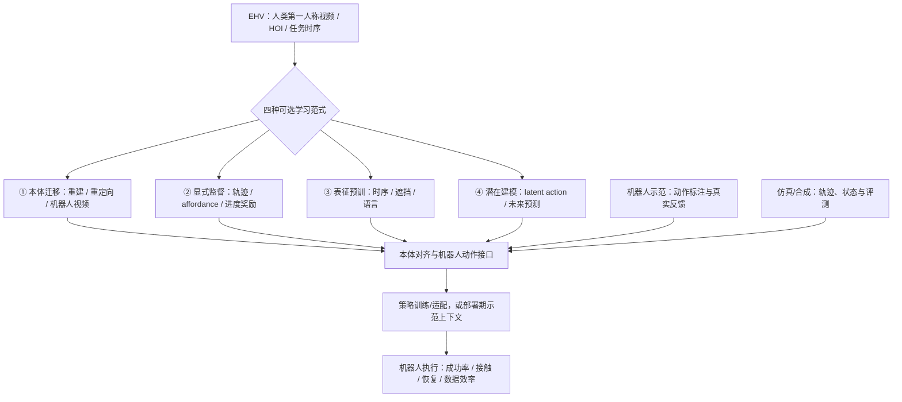

# From Egocentric Human Video to Robot Manipulation in the Era of Embodied Intelligence｜具身智能时代：从第一人称人类视频到机器人操作

## 一句话定义

**Ego2Robot Learning 综述**（[arXiv:2611.13610v1](https://arxiv.org/abs/2611.13610v1)，2026-11-10，香港理工大学与 NVIDIA Cosmos Lab）解释如何把**没有机器人动作标签的第一人称人类视频（EHV）**变成可用于机器人操作的训练监督、视觉表示、潜在动作预测或部署期上下文；不是发布单一新策略的实验论文。

## 英文缩写速查

| 缩写 | 英文全称 | 简要说明 |
|---|---|---|
| EHV | Egocentric Human Video | 第一人称人类操作视频，通常缺机器人动作标签 |
| HOI | Hand-Object Interaction | 手与物体的运动、接触和任务状态关系 |
| VLA | Vision-Language-Action | 将视觉、语言与机器人动作对齐的策略范式 |
| BC | Behavior Cloning | 用机器人观察—动作示范监督策略训练 |
| WAM | World-Action Model | 学习动作条件下未来观测或状态的预测模型 |

## 为什么重要

机器人演示需要实体平台、遥操作和重复场景设置；EHV 可以补充任务覆盖，但**人眼看到动作不等于机器人能执行**。该综述将约束拆为：视频保留什么交互信息、如何供策略学习或部署、还需要哪些机器人数据/物理反馈。应用到 [机器人操作](../tasks/manipulation.md) 和 [VLA](../methods/vla.md) 数据配方时，可以据此检查实际收益与隐含成本。

## 核心信息

| 项 | 论文 v1 情况 |
|---|---|
| 标题与身份 | 综述；[arXiv:2611.13610v1](https://arxiv.org/html/2611.13610v1)（2026-11-10） |
| 作者 | Yi Wang、Jingqiu Wu、Lei Yao、Zhaoshuo Li、Haoyu Zhu、Yirui Zhou、Huaiyuan Xu、Ying Zheng、Chuang Yang、Lap-Pui Chau |
| 机构 | 香港理工大学 Department of EEE；NVIDIA Cosmos Lab |
| 规模 | 39 页、10 图；项目页提供 215 条文献地图入口 |
| 项目 | [Ego2Robot Learning](https://mikewu597.github.io/Ego2Robot_Learning/) |
| 开放状态 | 论文与项目页可读；项目页 GitHub 链接核查返回 404（2026-11-12），不能认定本综述有可运行模型源码 |

## 核心原理：四类学习范式（原文 §2）

| 范式 | 提取与策略接口 | 关键缺口 |
|---|---|---|
| **① 显式本体迁移** Explicit embodiment transfer | 手姿态/HOI 重建 → 运动重定向 → 机器人视角视频转换，得到本体可用的示范 | 遮挡/深度误差、接触几何、物理可行性、合成画面与动作一致性 |
| **② 显式动作与任务监督** Explicit action and task supervision | 轨迹与关键点、affordance、任务进度/奖励/价值信号 | 人类交互目标需转成机器人可实现运动，进度估计可能奖励投机 |
| **③ 视频表征预训练** Egocentric video representation pretraining | 时序对比、遮挡重建、语言对齐训练编码器，向机器人策略提供特征 | 下游往往仍需 BC/机器人示范；好重建未必意味着接触理解正确 |
| **④ 潜在动作与动力学建模** Latent action and dynamics modeling | 学习无标签视频转移的潜在动作、未来状态/视频预测，再映射机器人动作或支持规划 | 相机运动和真正可控动作需分离；预测合理不代表可控 |

### 方法分类总览（按论文 Fig. 1 与 §2，非单一串行模型）

四个分支是论文的**分类轴**，可单独使用或结合，不能把图理解成论文作者实现了一套端到端系统。机器人示范和仿真数据为多个分支补充对齐与验证，而不是四条路线都强制使用相同数据。

## 三类数据资源（论文 §3）

- **EHV：** EPIC-KITCHENS、Ego4D、EgoDex、HD-EPIC、Ego-Exo4D 等主要提供观察、手物几何、语言或时序结构；通常没有机器人执行命令。
- **Robot demos：** DROID、RH20T、Open X-Embodiment、RoboMIND 2.0 等提供本体动作、传感器状态或真实任务反馈，支持适配和评测。
- **Synthetic/sim：** MimicGen、RoboTwin、EgoSim 等扩充任务和状态标签，但接触物理、素材和 sim-to-real 差异限制真实性。

作者项目页按类别展示 22 / 17 / 16 个资源；**不同资源的小时、帧、多视角重复与数据重叠不能直接汇总成一个训练总量**。

## 实验与评测：本文给出的比较准则

**综述不提供统一训练好的 Ego2Robot 新模型，也没有一个可归属于本综述的平均操作成功率。** §2 引用的是被综述方法各自的结果；§4 建议的有效比较是：固定策略与训练预算、对照等量非第一人称视频、量化减少的机器人示范、测试未见物体和环境、记录真实机器人接触和恢复。

还须分开记录手物重建失败、运动重定向失败和实际执行失败；若使用视觉奖励，检查任务真正完成而非仅视频相似。对 [WAM](../concepts/world-action-models.md) 则验证预测随候选动作改变，并报告在线重规划延迟。

## 结论

**是否值得扩大人视频数据，不取决于视频规模本身，而取决于保留下来的交互信号能否以可解释、物理可行的方式对齐机器人控制。**

1. **先选监督接口**：机器人动作轨迹、affordance/奖励、视觉特征、潜在动作/未来预测是不同数据配方，勿混报结果。
2. **区分训练与部署**：表征/动作预训练和推理期示范上下文是不同机制，要记录额外机器人数据与提示预算。
3. **检验可执行接触**：普通 RGB 视频通常不能确定接触力、摩擦和遮挡处状态；需要机器人数据或在线反馈。
4. **做归因消融**：与同规模非 ego 视频和相同训练预算比较，才能隔离 EHV 对泛化的增益。
5. **闭环优于视觉合理性**：评估扰动、失手恢复与动作干预响应，不把视频预测质量直接当成机器人成功率。

## 与其他工作对比

| 工作 | 性质 | 与本文关系 |
|---|---|---|
| [Ego2Robot 数据合成方法（2608.02580）](./paper-ego2robot.md) | 单项动作重定向/视觉合成与共训方法，有其自身指标 | 是本综述分类①可对照的具体路径；**并非同一论文** |
| [WiLoR](../methods/wilor.md) | 手部三维重建方法 | 是分类①前端感知模块的代表工具，不直接提供机器人动作闭环 |
| [VLA](../methods/vla.md) | 机器人视觉—语言—动作策略 | 本综述研究 EHV 怎样提供 VLA 上游数据或辅助监督 |
| [WAM](../concepts/world-action-models.md) | 动作条件世界预测 | 对应分类④，但离线预测与在线可控性需要分开评估 |

## 工程实践

| 检查项 | 实践建议 |
|---|---|
| EHV 视频输入 | 先核对视角、手/物可见性、标注粒度和多视角时长统计 |
| 迁移监督 | 报告重建/重定向/合成阶段通过率，检查目标机器人关节、工作空间和接触可行性 |
| 训练对照 | 固定参数量、训练预算和机器人示范规模；分开列 context / 机器人后训练预算 |
| 真机闭环 | 记录任务完成、滑移、超力、接触失败恢复与控制时延 |

## 源码运行时序图

**不适用。** 本文是综述而非统一可执行算法；项目页 GitHub 链接在 2026-11-12 访问为 404，未取得本综述自己的可运行训练、推理或部署入口，不能借其他论文的源码伪造调用时序。

## 局限与风险

- 论文主要归纳已发表/预印本方法：不能将其中某个子方法的成功率概括为整个领域统一指标。
- 视觉轨迹和潜在动作可能混入相机运动、外观变化；缺接触/摩擦观测的系统无法仅靠人类视频保证真实可执行。
- 混合训练若同时改变模型、附加损失、机器人示范和训练算力，无法单独归因 EHV；部署时上下文、传感器与交互预算也要报告。
- 本次只完成论文 v1 与项目页静态核对，未逐篇复现 215 条参考文献中各论文，也未运行机器人实验。

## 关联页面

- [Ego2Robot 数据合成方法（arXiv:2608.02580）](./paper-ego2robot.md) — 需要与本篇综述分开
- [机器人操作 Manipulation](../tasks/manipulation.md) — 下游任务与闭环约束
- [VLA](../methods/vla.md) — 机器人动作策略和混合训练
- [WiLoR](../methods/wilor.md) — 第一人称手重建工具
- [World-Action Models](../concepts/world-action-models.md) — 潜在动作与预测控制

## 参考来源

- [arXiv 2611.13610v1 原文通读与技术核对](../../sources/papers/ego2robot_learning_survey_arxiv_2611_13610.md)
- [官方项目主页和开源边界核查](../../sources/sites/ego2robot-learning-survey.md)

## 推荐继续阅读

- [论文 HTML 全文](https://arxiv.org/html/2611.13610v1)
- [作者项目页与研究分类图](https://mikewu597.github.io/Ego2Robot_Learning/)
