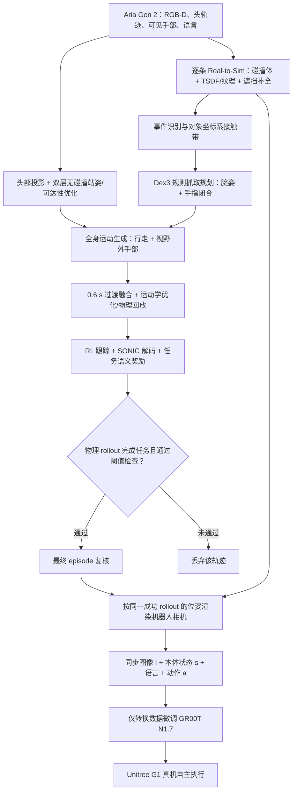

# Ego2Sim2Humanoid（E2S2H）：从第一视角演示到物理验证的人形 VLA 数据 / Agentic Real-to-Sim for Learning Loco-Manipulation VLAs without Robot Demonstrations

## 一句话定义

**E2S2H** 将 Aria Gen 2 眼镜的人类第一视角 RGB-D、头轨迹与视野内手部关键点转成**逐条重建、可碰撞、能完成任务的全身机器人动作轨迹**，并沿同一条合格物理 rollout 渲染机器人视角图像，形成同步视觉、本体状态与动作标签，训练人形移动操作 VLA（[arXiv:2611.19196v1](https://arxiv.org/html/2611.19196v1)，2026-11-14）。

## 英文缩写速查

| 缩写 | 英文全称 | 简要说明 |
|---|---|---|
| E2S2H | Ego2Sim2Humanoid | 本文从人类第一视角经物理仿真转换到人形数据的方法 |
| VLA | Vision-Language-Action | 下游用图像、状态和语言预测全身动作的策略 |
| RGB-D | Red Green Blue + Depth | Aria Gen 2 的校准图像与深度输入 |
| TSDF | Truncated Signed Distance Field | 在物体局部坐标中融合深度，建立视觉网格 |
| RL | Reinforcement Learning | 用物理接触与任务奖励修正运动并筛选 rollout |
| SONIC | Supersizing Motion Tracking for Natural Humanoid Whole-Body Control | 冻结的全身动作潜变量解码器（论文引用） |

## 为什么重要

- **不靠目标任务的机器人遥操作演示采集**：戴眼镜的人类记录中缺少完整腿部状态，E2S2H 把未观测的行走与手部段补齐成机器人的动作标签。
- **不把人手姿态误当机器手抓取真值**：三指 Dex3 与五指人手形态不同，直接复制掌心会出现薄帽沿穿透；对象局部接触带约束抓取可行性。
- **数据的动作、视觉必须指向同一物理事实**：生成的图像不是直接修改眼镜视频，而是在仿真中按**已通过筛选的动作**和真实物体仿真姿态重新渲染，减少图像—动作错位。

## 核心信息

| 字段 | 一手论文核对 |
|---|---|
| 题目与作者 | *Ego2Sim2Humanoid: Agentic Real-to-Sim for Learning Loco-Manipulation VLAs without Robot Demonstrations*；Chen Liu、Nikolaus Correll |
| 机构 | 美国圣母大学（University of Notre Dame） |
| 版本 | arXiv:2611.19196v1，2026-11-14 预印本 |
| 采集 | Project Aria Gen 2 眼镜，标定 RGB-D、6-DoF 头轨迹、视野内 3D 人手关键点；无躯干、腿部真值 |
| 机器人 | Unitree G1（29-DoF）+ 双手 Dex3 + 头部相机 |
| 策略 | GR00T N1.7（3B），输出 64-D SONIC 全身 token + 14-D 双手 Dex3 指令 |
| 项目与源码 | [论文引用的官方主页](https://robonana.github.io/ego2sim2humanoid/)；本轮主页访问失败，**源码/数据开放状态待核实**，不作为已开源项目宣传 |
| 原文范围 | 官方 HTML §I–VI、附录 A–D、Fig.1–6、Table I–II；未独立复现 |

## 核心原理

**输入**：每条眼镜录制的 `RGB-D + T_head(6DoF) + 可见手与指关节 + 任务语言 ℓ`。**输出**：按机器人时间步产生 `(I_i, s_i, ℓ, a_i)`，其中 `s_i` 为 43 个关节角及本体坐标系重力，`a_i=(z_i, q_i^dex)` 为 64-D 全身潜动作 token + 14-D 双手 Dex3 指令。

1. **Agentic Real-to-Sim（§III-A、附录 A）**：逐 episode 拟合地面/支撑面、物体碰撞代理与局部坐标系，深度经 TSDF 融合、纹理烘焙，并对未观察表面做有界补全。识别 reach/touch/grasp/lift/release，预测物体上的**接触带**，而非假定每个指尖在人/机之间同位。
2. **形态与站姿适配（§III-B、附录 B）**：头部轨迹投影为根路径；接触期用 `T_object × T_grasp` 代替人掌目标，规划 Dex3 指腹在接触带内对向夹持；双层 SE(2) 站姿与腰/臂优化解决避障和可达性；不可见手部段由全身运动生成器补齐，路径按速度上限重新定时。
3. **运动学修正（§III-C、附录 C）**：手进出视野时 0.6 s fade 混合生成动作与观测手目标，联合优化平衡/足滑/碰撞/关节平滑；物理回放会淘汰帽沿接触不稳定的轨迹，**不为了留数据而篡改成成功动作**。
4. **动力学修正与物理筛选（§III-D、附录 C/D）**：RL 跟踪参考，冻结 SONIC decoder 驱动本体，agent 由事件与语义构造奖励，视野外戴帽阶段奖励定义为帽子相对头部的目标关系。只接受任务完成、头追踪误差与关节运动满足界限的 rollout。
5. **机器人相机渲染（§III-E、附录 D）**：以**同一条已接受的物理 rollout** 中的机器人位姿、物体位姿渲染图像 `I_i`，与本体状态 `s_i`、执行动作 `a_i` 逐帧同步，再用于 GR00T N1.7 微调。

## 流程总览

该图按论文 Fig.1–2 与 §III-A–E 归纳，表示**论文算法数据流**，不是已核验源码的运行调用图。

## 源码运行时序图

**不适用（截至 2026-11-23，本次核查限制）**：作者论文给出项目主页，但本环境访问项目页与 `index.html` 未成功，尚未取得可确认的 E2S2H 官方可运行代码、README 入口和关键模块。不能凭算法框图臆造 `train.py`、`render.py` 或执行时序；后续核实代码发布后再补真实 `sequenceDiagram`。[开放状态记录](../../sources/sites/ego2sim2humanoid.md)。

## 工程实践

| 工程问题 | 从论文可落实的检查 |
|---|---|
| 场景几何 | 静态支撑面与可移动物体应分开网格，纹理/碰撞绑定同一物体局部坐标，避免移动后留下残影 |
| 接触质量 | 检查接触带、指腹对向接触、帽沿薄壁穿透、闭合到抬离之间的抓取持续性，而非只看腕误差 |
| 视野缺失 | 只跟踪可见手会在再次进入视野时产生跳变，需时序淡入与 out-of-view 全身生成 |
| 仿真质检 | 运动学回放和 RL 动力学 rollout 双筛，并核查任务目标、关节动态、足滑与重心 |
| 对齐标签 | 图像 `I_i`、状态 `s_i` 与动作 `a_i` 必须来自同一被接受物理轨迹；不能把原始眼镜帧直接和仿真指令拼接 |
| 复现范围 | 作者系统及真机结果有原文，**代码、数据、权重下载未独立核实**；本轮没有真实跑通/复测 |

## 实验与评测（作者报告，§IV、Tables I–II）

| 实验 | E2S2H 结果 | 比较/含义 |
|---|---:|---|
| 举瓶人类录像筛选 | **189 / 219** | 进入 VLA 训练集，并非真机成功率 |
| 戴帽人类录像筛选 | **59 / 154** | 薄壁帽沿抓取会丢失接触，筛掉大量轨迹 |
| 戴帽手部最大穿透中位数 | **0.8 cm** | 直接复制人掌姿态为 **1.8 cm**；n=71 |
| 戴帽手内位移/旋转中位数 | **3.7 cm / 22.9°** | 人掌复制为 **6.6 cm / 33.0°**（Table I） |
| 戴帽可行帽沿抓取 | **57 / 71** | EgoHumanoid / V2 对照为 0；但 V2 full 样本仅 n=6（Table II） |
| 规划抓手 rollout 成功 | **56 / 71** | 复制人掌为 **53 / 71**，改善重点是接触质量，不夸称成功率暴涨 |
| G1 举瓶真机 | **9 / 20 = 45%** | 自动举起瓶子，无目标任务机器人示教 |
| G1 戴帽真机 | **5 / 20 = 25%** | 自动戴上帽子；抓取与头部接触仍有失败 |

真机失败拆解：举瓶 20 次中 3 次未到桌前、6 次撞倒瓶、2 次空抓、9 次完成；戴帽 20 次均到桌前，12 次抓取失败，8 次抓到帽后 3 次在视野外放帽撞头、5 次完成。

## 与其他工作对比

- [Ego2Robot](./paper-ego2robot.md) 主要做第一视角人视频到机器人图像与相机系末端动作的大规模合成预训练；**E2S2H** 则重建可接触场景、规划完整人形全身动作并对物体交互进行物理验证；两者训练规模和任务不应直接比较。
- [KODA](./paper-koda-egocentric-vla.md) 进行人类第一视角到人形的运动/观测对齐；论文 §II 指出 KODA 的视图重投影不等同于对自由物体的物理交互仿真验证。
- EgoHumanoid / EgoHumanoid-V2 使用人体参考运动移植，论文 Table II 对同一戴帽数据评估了移动路径、接触距离和帽沿可行抓取：E2S2H 的可行抓取来自**重建接触几何和形态感知规划**，而非只修行走路径。

## 结论

**E2S2H 的核心是「真实录像 → 物理可执行的机器人轨迹 → 同一 rollout 的视觉与动作监督」闭环，而不是仅靠人手姿态映射或图像合成。**

1. 抓帽沿等接触丰富任务，应先在对象坐标系找**接触带**，再规划不同形态手指的腕姿、指腹位置与闭合。
2. 第一视角缺少腿/遮挡段动作，必须显式补齐 **站姿可达、无碰撞的全身运动与速度重定时**。
3. 训练数据需要双阶段质检：运动学回放检查抓取，物理 rollout 判断能否平衡并真正完成任务。
4. 用同一合格 rollout 生成图像、状态和动作标签，避免机器人视角/物理时间线与 human video 的监督错位。
5. 真机验证是 **45% 举瓶、25% 戴帽**，证明可行性但距离稳定部署和广泛任务泛化仍远。
6. 源码开放状态尚未独立核实，不把论文方法图解释成实际已公开的仓库运行入口。

## 局限与风险

- **物理参数依赖先验**：视频估计质量、惯量、摩擦，重负载和非均匀载荷仍可能有 sim-to-real gap（§V）。
- **刚体代理适用范围**：衣物折叠、切面拓扑变化等可形变任务未解决；未见复杂多任务、大规模 G1 真机泛化实验。
- **视野外戴帽仍容易撞头**：即使用语义奖励补视野外动作，20 次戴帽真机中仍有 3 次抓到帽后触头失败。
- **论文级 vs 复现级证据**：数值来自作者预印本，未独立复测；项目页当前读取失败，源码/权重/数据开放结论待核实。

## 关联页面

- [Ego2Robot：第一视角合成机器人预训练数据](./paper-ego2robot.md) — 未物理验证接触的预训练数据合成，与本文互补
- [KODA：人类第一视角运动/观测对齐](./paper-koda-egocentric-vla.md)
- [VLA 方法](../methods/vla.md)
- [模仿学习](../methods/imitation-learning.md)
- [Real2Sim 纵深路线 Stage 4](../../roadmap/depth-real2sim.md)

## 参考来源

- [E2S2H 一手论文逐节核读归档](../../sources/papers/ego2sim2humanoid_arxiv_2611_19196.md)
- [E2S2H 项目页与代码开放核查记录](../../sources/sites/ego2sim2humanoid.md)
- [arXiv 官方 HTML v1（§I–VI、附录 A–D）](https://arxiv.org/html/2611.19196v1)

## 推荐继续阅读

- [论文原始 PDF（含 Fig.1–6、Table I–II）](https://arxiv.org/pdf/2611.19196)
- [作者列出的项目主页](https://robonana.github.io/ego2sim2humanoid/)
