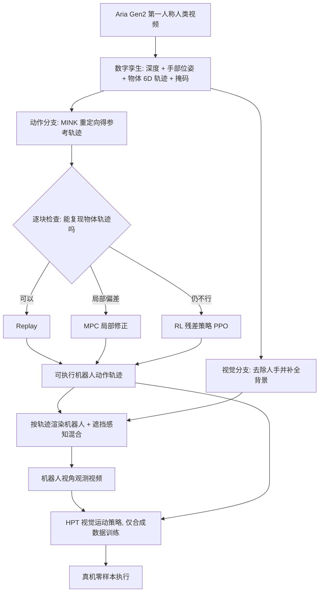

# EgoEngine（arXiv:2606.12604）

*EgoEngine: From Egocentric Human Videos to High-Fidelity Dexterous Robot Demonstrations*（[arXiv:2606.12604](https://arxiv.org/abs/2606.12604)，项目页 <https://egoengine.github.io>）。本页依据 arXiv v1 全文与附录写成，逐项出处见 [来源归档](../../sources/papers/egoengine_arxiv_2606_12604.md)。作者自述与本页判断分开标注。

## 一句话定义

**一个「人类第一人称视频 → 机器人示教数据」的数据引擎：重建数字孪生后分两路，一路把画面里的人换成渲染的机器人手臂，一路在仿真里把重定向轨迹精修成能复现物体运动的可执行动作，最后用合成数据训练视觉运动策略（摘要与 §1）。**

## 英文缩写速查

| 缩写 | 英文全称 | 简要说明 |
|------|----------|----------|
| MCTS | Monte Carlo Tree Search | 蒙特卡洛树搜索；论文声明这里只是「MCTS 式」的启发式逐级升级，不是完整 MCTS（§3.2、附录 C.1） |
| MPC | Model Predictive Control | 模型预测控制；这里指围绕参考轨迹采样短时域动作做局部修正 |
| RL | Reinforcement Learning | 强化学习；这里训练手部残差策略，用 PPO |
| PPO | Proximal Policy Optimization | 近端策略优化 |
| IK | Inverse Kinematics | 逆运动学；重定向用 MINK 求解（式 1） |
| HPT | Heterogeneous Pre-trained Transformers | 论文借用的策略架构（§3.4、附录 D），本文仅用其结构，在合成数据上从头训练 |
| SR | Success Rate | 成功率；仿真中指整条参考轨迹未触发提前终止（附录 C.3） |
| FD | Fréchet Distance | 弗雷歇距离；比较合成观测与真机观测的特征分布（Tab. 1） |
| SPARC | Spectral Arc Length | 频谱弧长，轨迹平滑度指标（附录 E.2） |

## 为什么重要

- 灵巧手示教靠遥操作很贵；第一人称人类视频便宜且含大量接触丰富的操作（§1）。难点是视觉差距（人手 vs 机器人）与动作差距（人体运动在机器人上不可执行）。
- 作者主张已有工作多用人类视频做预训练或联合训练、仍依赖真机示教；EgoEngine 的卖点是不用任何真机示教（作者自述「据我们所知首个」，§摘要、§2）。
- 对本库的读法（判断）：它把「重定向」之后加了一层「以物体轨迹为目标的仿真精修」，与 [Spider](../methods/spider-physics-informed-dexterous-retargeting.md) 这类物理感知重定向、[残差策略](../methods/residual-policy-learning.md) 属同一脉络；论文的消融（Tab. 4）也说明这一层才是性能主因。

## 核心原理与流程总览

要点（均为论文 §3 自述）：

1. **数字孪生（§3.1）：** FoundationStereo 估深度，SAM2 取掩码，FoundationPose 加物体网格估 6D 物体轨迹。注意需要物体网格（附录 A.3 写「ground-truth object mesh」），Aria 数据用桌面 AprilTag 对齐仿真与机器人坐标（附录 A.1），TACO 数据则用固定偏移启发式估机器人基座（0.6 m 偏移，桌高 0.72 m）。
2. **动作精修（§3.2）：** 目标是仿真中物体位姿跟踪误差（式 2），误差超阈值即提前终止，奖励为 C 减误差；另有接触、平滑、类人正则等辅助项（附录 C.2）。每 20 步一块，按 Replay、MPC、RL 逐级升级，并用两块窗口避免局部极小。
3. **视觉合成（§3.3）：** 去人后用两遍差分渲染求机器人可见掩码，再像素级混合（式 3、4）。这是渲染加混合，不是学习式视频生成（作者在 §6 也承认）。
4. **蒸馏（§3.4、附录 D）：** HPT 结构，ResNet-18 视觉干，流匹配动作头，推理 10 步；只用合成数据。

## 工程实践

- **平台：** 仿真为双臂 RB-Y1 + 双 XHand（12 自由度），真机为单臂 RB-Y1 + 一只 XHand；机器人头部同样装一副 Aria 眼镜以缩小视觉差距（附录 A）。
- **数据：** TACO 2,500 段（仿真评测用 16 对）；自采 Aria 200 段、4 任务；对照用 200 条真机遥操作示教（SEW 做手臂、Open-TeleVision 做手，附录 A.2）。
- **真机任务（附录 D.3）：** Mustard 抓放（初始位置 10 cm x 10 cm、朝向 ±30 度随机）、Drawer 开抽屉放方块、Hammer 拿锤敲钉（钉位 5 cm 内随机）、Flower 抓水瓶对准花盆。
- **真机迁移的特殊设置（附录 C.2）：** Aria 真机任务用更松的可行阈值（物体位置 0.08 m、旋转 2.5 rad）、8 条随机化 rollout、域随机化（物体质量比例 0.8 到 1.2 等），TACO 仿真评测不用域随机化，也关掉了类人约束和平滑奖励。
- **复现成本：** 作者说在单张 RTX 4090、不并行时 Aria 约 2.88 条成功演示每小时（§4.3）。未见代码仓库地址，项目页仅在论文摘要给出。

## 评测证据与清单说法的对比核对

清单（Glen Berseth 的 CoRL 2026 阅读清单第 020 项，P0，Learning from Human Video 组；摘要由 LLM 据论文摘要起草）的一句话：「Converts egocentric human videos into robot observation videos and executable dexterous action trajectories for policy training.」

| 清单措辞 | 论文核对 | 结论 |
|----------|----------|------|
| egocentric human videos | 是，Aria Gen2 第一人称视频；但评测主要是作者自采的 200 段 4 任务视频和 TACO（TACO 的视角设置见 §4.1，论文未专门说明其是否第一人称），EgoDex / EgoVerse 只做了数字孪生重建的定性展示（附录 A.4） | 基本属实，但「泛化到大规模外部视频」只有重建层面的定性证据 |
| robot observation videos | 是，但本质是去人加渲染机器人加混合（§3.3），非生成模型；Tab. 1 视觉指标上与 Phantom 几乎持平（DINOv2 上略逊：473.1 对 470.6） | 属实，「高保真」靠定性图和 FD，与 Phantom 的差距很小 |
| executable dexterous action trajectories | 是，仿真中经 Replay / MPC / RL 精修，仿真成功率 TACO 0.83、Aria 0.90（Tab. 2）；但「可执行」是在仿真里的物体跟踪意义下定义的，真机是否执行成功要看策略结果 | 属实，限定词是「仿真内、以物体轨迹复现为准」 |
| for policy training | 是，HPT 策略真机零样本：Mustard 0.40、Drawer 0.35、Flower 0.70、Hammer 0.60，平均 0.51（Tab. 3、4） | 属实；清单未提「仅 4 个任务、单臂单手、成功率 0.35 到 0.70」，也未提这是摘要里的「首个零样本」自称 |

清单摘要未涉及但读者应知的事：(1) 方法依赖物体网格与标定（AprilTag），不是纯 RGB 视频输入；(2) 动作分支比视觉分支重要得多（Tab. 4：0.43 对 0.05 相对人类视频 0.03）；(3) 真机示教在 Mustard、Drawer 上明显更强（0.80 对 0.40 与 0.35）。

## 结论

EgoEngine 支持通过数字孪生把人类视频编译为机器人训练资料，但目前真机增益主要来自动作分支。

- 先确认资产与接触重建质量，再比较动作精修和视觉合成各自的增益。
- 将仿真可执行轨迹与真机策略成功率分开统计，前者不能保证后者。
- 扩展到野外视频前量化资产制作、遮挡估计及仿真优化成本，并补做新物体和新场景真机验证。

## 局限

**论文自述（§6）：** 视觉分支是混合合成而非学习式逼真；动作仍受接触建模误差与 sim-to-real 差距影响；数字孪生（物体资产、遮挡下状态估计、可变形物体）是扩展瓶颈；大规模下仿真优化仍慢。附录 E.2 还承认精细捏取（pinch grasp）是主要失败模式，附录 E.1 承认大数据量下真机示教更强。

**本页观察到的未验证之处（判断，非论文自述）：**
- 真机每任务的试验次数正文与附录均未给出，仅能从 0.05、0.25 等取值推测为 20 次（推测），小样本下 0.35 与 0.40 这类差距不宜过度解读。
- 「首个零样本」是作者「据我们所知」的自称，本页未独立核实。
- 真机只有 4 个任务、单臂单手，且人类视频、机器人与对照示教都是同一团队同一场景采集，物体网格也是已知的；对野外视频、新物体的泛化没有真机证据。
- 附录 E.2 的 TACO 切割示例只是仿真精修后回放，加了安全偏置，不是学习到的策略。
- 视觉消融中「仅视觉分支」几乎无增益（0.05），说明当前真机效果主要由动作数据决定；视觉分支在更强视觉编码器下的作用论文未检验。
- 未见代码仓库，复现性待观察。

## 关联页面

- [EgoMimic](../entities/paper-ego-03-egomimic.md)：论文对比的视觉基线（掩码法）与联合训练路线
- [EgoVerse](../entities/paper-egoverse.md)：附录 A.4 用其视频展示数字孪生重建
- [EgoDex](../entities/paper-notebook-egodex-learning-dexterous-manipulation-from-larg.md)：同上，大规模第一人称灵巧操作数据集
- [模仿学习](../methods/imitation-learning.md)
- [PPO](../methods/ppo.md)：RL 残差策略的优化算法
- [残差策略学习](../methods/residual-policy-learning.md)：RL 模式的结构
- [Spider 物理感知灵巧重定向](../methods/spider-physics-informed-dexterous-retargeting.md)：论文中的 MPC 基线 Spider 所属脉络
- [运动重定向](../concepts/motion-retargeting.md)
- [Sim2Real](../concepts/sim2real.md)

## 参考来源

- [来源归档：egoengine_arxiv_2606_12604](../../sources/papers/egoengine_arxiv_2606_12604.md)
- [arXiv:2606.12604](https://arxiv.org/abs/2606.12604)
- 项目页：<https://egoengine.github.io>

## 继续阅读

- [arXiv PDF](https://arxiv.org/pdf/2606.12604v1)
- [EgoMimic 页](../entities/paper-ego-03-egomimic.md)
- [模仿学习](../methods/imitation-learning.md)
