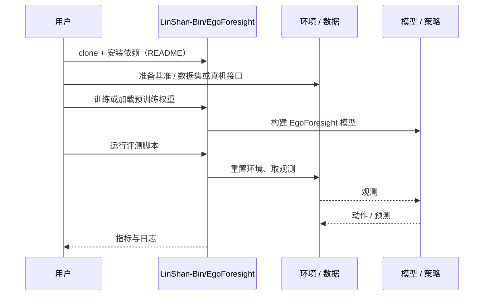

# EgoForesight（arXiv:2610.31845）

**EgoForesight**（*EgoForesight: Effectively Scaling Policy Learning with Noisy Egocentric Actions*，[arXiv:2610.31845](https://arxiv.org/abs/2610.31845)，[项目页](https://lin-shan.com/EgoForesight)，[代码](https://github.com/LinShan-Bin/EgoForesight)）来自 [具身智能小站 2026-10-29 盘点](../../sources/blogs/wechat_embodied_station_58_papers_diverse_demonstrations_2026-10-29.md)，属「示范数据与数据引擎」组。

## 一句话定义

**EgoForesight按数据源可靠性分配动作噪声与损失权重，并用真实未来蒸馏表征；扩展实验支持收益，但源级加权仍不能消除系统性重定向偏差。**

## 英文缩写速查

| 缩写 | 英文全称 | 简要说明 |
|------|----------|----------|
| EgoForesight | EgoForesight: Effectively Scaling Policy Learning with Noisy Egocentric Actions | 本文方法 / 基准的简称 |

## 为什么重要

- 从带噪的人类动作中学习可靠监督。
- 开源结论：**已开源**（步骤 2.5，2026-10-29）。仓库可达（git ls-remote）。项目页 HTTP 200。
- 同期同组工作见 [多样成功示范、触觉工具链与预见式感知：具身智能小站 10-29 期 58 篇阅读坐标](../overview/embodied-station-2026-10-29-58-papers-technology-map.md)。

## 核心机制

| 项 | 内容 |
|----|------|
| **arXiv** | [2610.31845](https://arxiv.org/abs/2610.31845) |
| **开源** | **已开源** |
| **要点** | EgoForesight按数据源可靠性分配动作噪声与损失权重，并用真实未来蒸馏表征；扩展实验支持收益，但源级加权仍不能消除系统性重定向偏差。 |
| **文内指标** | 公众号未给具体数字，本页不引用。 |

## 源码运行时序图

以下为按仓库入口（`LinShan-Bin/EgoForesight`）推断的通用运行链路；入库日仅核实仓库可达，未逐文件阅读，具体脚本名以 README 为准。

## 实验与评测

- 公众号未给具体数字，本页不引用。
- **读法：** 本页为索引级摘要，依据公众号转述的官方摘要与仓库信息整理；逐项数字与 baseline 以原文 PDF 为准。

## 与其他工作对比

- 横向索引见 [多样成功示范、触觉工具链与预见式感知：具身智能小站 10-29 期 58 篇阅读坐标](../overview/embodied-station-2026-10-29-58-papers-technology-map.md)；同 arXiv 不重复造页。

## 结论

**从带噪的人类动作中学习可靠监督：EgoForesight按数据源可靠性分配动作噪声与损失权重，并用真实未来蒸馏表征；扩展实验支持收益，但源级加权仍不能消除系统性重定向偏差。**

1. 开源边界：**已开源** — 仓库可达（git ls-remote）。项目页 HTTP 200。
2. 核心机制：EgoForesight按数据源可靠性分配动作噪声与损失权重，并用真实未来蒸馏表征；扩展实验支持收益，但源级加权仍不能消除系统性重定向偏差。
3. 复现与选型前核对任务协议、硬件与基准口径，勿直接横比公众号摘录数字。

## 关联页面

- [embodied-data-collection-four-layers-taxonomy](../concepts/embodied-data-collection-four-layers-taxonomy.md)
- [imitation-learning](../methods/imitation-learning.md)
- [teleoperation](../tasks/teleoperation.md)
- [embodied-station-2026-10-29-58-papers-technology-map](../overview/embodied-station-2026-10-29-58-papers-technology-map.md)

## 参考来源

- [egoforesight_arxiv_2610_31845.md](../../sources/papers/egoforesight_arxiv_2610_31845.md)
- [wechat_embodied_station_58_papers_diverse_demonstrations_2026-10-29.md](../../sources/blogs/wechat_embodied_station_58_papers_diverse_demonstrations_2026-10-29.md)
- [arXiv:2610.31845](https://arxiv.org/abs/2610.31845)

## 推荐继续阅读

- [arXiv PDF](https://arxiv.org/pdf/2610.31845)
- [项目页](https://lin-shan.com/EgoForesight)
- [https://github.com/LinShan-Bin/EgoForesight](https://github.com/LinShan-Bin/EgoForesight)
