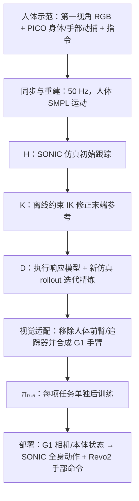
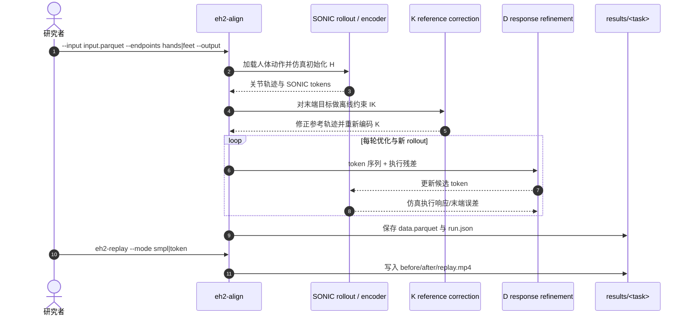

# EgoHumanoid-V2：从第一视角人体示范迁移协调全身移动操作

**EgoHumanoid-V2: Human-to-Humanoid Transfer of Coordinated Whole-Body Skills for Loco-Manipulation**（arXiv:2609.37181，2026-09-29 v1）研究如何将无需机器人遥操作采集的人类移动操作技能，转化为人形机器人可执行的全身动作监督。论文作者来自香港大学 OpenDriveLab、阿里巴巴、上海创智学院、复旦大学、北京航空航天大学、四川大学及 Archon Robotics；当前收录版本为 arXiv 预印本。它扩展了原版 EgoHumanoid 的解耦式移动操作，重点处理臂、躯干与腿共同参与时的协调与接触精度。

## 一句话定义

EgoHumanoid-V2 是一条以人体第一视角视频和全身动捕为输入、以 SONIC 运动跟踪器适配动作、再用 π₀.₅ VLA 学习任务策略的人到人形全身技能迁移流程；核心新意在离线的粗到细动作对齐及视觉具身适配。

## 英文缩写速查

| 缩写 | 英文全称 | 简要说明 |
|------|----------|----------|
| VLA | Vision-Language-Action | 联合图像、语言指令与动作的策略模型 |
| WBC | Whole-Body Control | 同时协调躯干、手臂、腿和接触的全身控制 |
| IK | Inverse Kinematics | 由末端目标求满足约束的关节姿态 |
| DoF | Degrees of Freedom | 关节或动作接口的自由度 |
| SMPL | Skinned Multi-Person Linear Model | 论文人体姿态与形状表示 |
| MLP | Multilayer Perceptron | 动力学精炼中预测执行响应的前馈网络 |

## 为什么重要

第一视角人体示范便于跨场景采集，但动作和图像都处在人的具身形态下。直接让人形跟踪人体动作，常会出现手掌/脚端偏差；在线 IK 若只覆写控制器的部分关节命令，又可能破坏全身策略原本的平衡协调。V2 把问题改成**离线修正训练动作标签**：先利用机器人执行响应来校正参考动作，再训练 VLA，部署时保持原有全身控制器接口。

这与同系列原版 [EgoHumanoid](./paper-loco-manip-161-060-egohumanoid.md) 的范围不同：V1 主要在解耦控制下迁移第一视角移动操作；V2 把目标推进到手臂、躯干和腿共同参与的协调全身技能。

## 方法栈与流程总览

### 输入、动作接口与执行器

人体采集设备为颈挂 GoPro 与 PICO 全身/手部追踪系统，视频和动捕同步为 50 Hz。训练时把每帧的人体示范转为机器人图像、机器人状态和动作 token。论文接口为：

| 量 | 定义 | 作用 |
|----|------|------|
| 观测 `oₜ` | 适配图像 `Ĩₜ`、43 维 G1 状态 `qₜ`、语言指令 `ℓ` | VLA 的输入；训练使用合成适配图像，部署使用机器人相机图像 |
| 动作 `aₜ` | 64 维 SONIC 动作 token `zₜ`、左右手各 6 维命令 | SONIC 解码全身运动，Revo2 驱动器执行手部动作 |
| 机器人 | Unitree G1、BrainCo Revo2、SONIC 全身控制器 | 论文的真实机器人平台与动作执行栈 |

同一 SONIC checkpoint 用于四项任务的动作对齐和部署。策略则按任务分别后训练，不是一个策略对四类技能统一泛化。

### 粗到细动作对齐：`H → K → D`

1. **`H`，motion initialization：** 把人体全身运动输入 SONIC，在仿真中得到机器人初始关节轨迹与动作 token。它提供协调运动的初始参考，不等同于准确的接触轨迹。
2. **`K`，kinematic reference correction：** 对整段轨迹离线做受约束 IK，减小手掌或足端的位姿误差，同时限制动作相对原轨迹的变化并维持时间连续性。修正后的机器人参考经 SONIC 的机器人运动编码器重新编码为 token。
3. **`D`，dynamics-aware refinement：** 先用配对 rollout 学习机器人执行响应的 MLP，再在执行反馈中迭代调整 token。每轮都重新仿真获得实际残差；梯度经过固定响应模型和动作解码器，不穿过物理仿真器。算法从历史候选中挑选经过验证的序列供策略训练，因此 `Dₛ` 可能选择较早轮次，甚至回退到 `H` 或 `H+K`。

三个目标在以骨盆为中心的坐标系中表达：垂直轴保持竖直，水平轴随骨盆朝向；人体手掌构造手部目标，机器人初始 rollout 中人机骨盆高度差用于修正目标高度。足端目标用于关抽屉任务。

### 视觉适配

论文通过匹配的人手/机器人手臂颜色和渲染减小外观差异：SAM2 分割人体前臂及腕部 PICO 追踪器，DiffuEraser 补背景，再依据对齐关节位置渲染 G1 手臂并拟合人类手腕/前臂的位置、朝向与尺度。训练时另加入随机裁剪、小角度旋转和光度扰动；部署时使用真实机器人相机画面。

## 实验与评测

### 四项真机任务

论文在 Unitree G1 上测试「关笔记本电脑」「开冰箱」「拉窗帘」「关抽屉」。前三项是手部接触交互，最后一项让右脚抬起并用脚尖推关抽屉。每项任务有独立 VLA 策略。每个条件尝试 20 次，每次由三个顺序子任务打分；首次失败后后续子任务计零。因此表中 task score 是部分完成度平均分，不是二元的整任务成功率，也不是跨任务单策略泛化。

### 主要结果

| 实验 | 结果 | 解读 |
|------|------|------|
| 人体示范规模 | 每项任务 25 条时四任务均分 38.33%；200 条时 51.67% | 数据量增加与本设置中的迁移分数提升相关 |
| 粗到细动作对齐 | `H` → `H+K` → `H+K+Dₛ` 的均值末端位置误差为 11.21 → 4.45 → 3.41 cm；手部朝向误差为 21.22° → 13.77° → 6.71° | K 消除大部分初始几何误差，D 进一步改善实际执行后的误差，尤其是方向 |
| 对齐对真机策略 | 同为每项 200 条示范时，均分从 H 的 21.25% 经 H+K 的 47.08% 提升至 H+K+Dₛ 的 51.67% | 全流程相比 H+K 在四项任务上均提升 |
| 人类 vs 遥操作数据 | 人类采集单条平均 33.30 人秒，机器人遥操作 140.85 人秒，报告平均节省 76.36% 劳动时间 | 成本含采集、设置、校准、故障处理和场景复位；机器人采集由两人执行 |
| 视觉适配消融 | 三项手部任务均值：仅基础图像预处理 33.33%，仅机器人手臂渲染 38.89%，仅图像增强 42.78%，渲染+增强 48.33% | 两模块整体互补但任务间效果不一；关笔记本上单独增强优于组合 |

数据成本比较只覆盖关笔记本与拉窗帘：200 条人类示范分别得 53.33% 和 53.33%；50 条机器人示范分别得 63.33% 和 56.67%。若考虑成本，关笔记本用 100 条人类示范达到 48.33%，报告比 50 条遥操作示范少 31.41% 劳动时间；拉窗帘用 200 条人类示范得到 53.33%，报告少 26.63%。这体现成本—分数折衷，不能概括为人类示范在任务分数上全面优于遥操作。

线上 IK 对照的三种实现在四项任务里都会产生不稳定 SONIC rollout（包括摔倒），所以作者没有用它们进行策略评测。这是选择离线动作修正的重要工程动机。

## 源码运行时序图

官方仓库已提供 `data_alignment/action_alignment` 和 `eh2-align` 命令，可运行对齐与仿真回放；下图只画已公开的离线动作对齐路径，不代表完整的 VLA 训练和真机部署代码已经发布。

按仓库 README，复现入口是先安装 `data_alignment/action_alignment` 环境，再运行 `eh2-align`，随后用 `eh2-replay` 对照 SMPL 原动作与 token 对齐动作。README 当前的 release checklist 仍将策略训练流水线、策略部署、视觉对齐代码标为待发布。

## 工程实践与开放状态

截至 2026-10-12，项目页提供官方代码链接；代码仓库公开且采用 Apache-2.0。开放是**部分实现**：

| 组件 | 当前状态 | 复现影响 |
|------|----------|----------|
| 人体数据采集 | 提供 PICO、GoPro 配置及 `eh2-collect-human` / `eh2-sync-human` 使用流程 | 可照硬件说明采集自有数据；论文训练数据集未作为完整公开下载集列出 |
| 动作对齐 | `data_alignment/action_alignment`、四个任务示例、`eh2-align` 与 `eh2-replay` 可用 | 可复核离线动作适配，但需满足 SONIC 与仿真环境依赖 |
| 视觉对齐 | 项目仓 README 标记为 Coming soon | 论文用的 SAM2 分割、DiffuEraser 修补、机器人手臂合成流水线尚非仓库现成入口 |
| VLA 训练 | README 标记 Training pipeline 待发布；提供 OpenPI 环境安装说明 | 无法仅凭公开 repo 完整重建论文中每任务 π₀.₅ 策略训练结果 |
| 真机部署 | README 标记 Deployment pipeline 待发布 | 暂无可核验的端到端部署命令；硬件说明不等于部署软件已齐备 |
| 数据与权重 | 当前 README 展示少量对齐示例；未列出论文全部人类示范或策略权重下载 | 复现实验需自行采数、补齐尚未发布部分并准备机器人/控制器 |

项目主页和 README 会变化；本页开源状态按核查日期记录。应先核实最新 release checklist、硬件/依赖版本、SONIC checkpoint 获取方式及机器人接口，再规划复现。

## 结论

**一句话总判：** EgoHumanoid-V2 用“执行器感知的离线动作标签修正 + 视觉域适配”把人类全身示范转成 G1 任务策略监督，在四项真机任务上展示了有潜力的零目标任务遥操作迁移，但当前论文结果的可完整复现程度受训练、视觉与部署代码未齐影响。

1. **先把对齐作为独立模块验收。** 以 H、H+K、H+K+D 的末端误差和整段运动稳定性分层检查，不只看 token 是否生成。
2. **动作标签应匹配真实执行器。** K 负责几何目标，D 利用 SONIC 的执行反馈补偿动力学误差；单纯在线覆写 IK 指令可能破坏平衡。
3. **视觉改造需按任务消融。** 增强和手臂渲染是互补方案，但表中关笔记本任务并非简单叠加就更优。
4. **把 task score 当分级完成度阅读。** 每次试验会累加三个子任务的部分分数，均分 51.67% 不代表 51.67% 的整任务成功率。
5. **成本优势有具体比较边界。** 76.36% 是每条数据的平均劳动秒数差，且遥操作需要两人；分数—数据量对照只覆盖两项任务。
6. **开源可用部分目前是数据采集与动作对齐。** 需等待或自行实现视觉处理、VLA 训练和部署剩余链路后，才能尝试复现完整论文策略。

## 局限与风险

- 真实机器人只评四项操作场景，且每个任务用单独训练策略；起始姿态/物体变化考察的是任务内执行，不是未见任务上的统一策略泛化。
- 评估为每个条件 20 次，论文未报告误差条；task score 是三阶段子任务平均值，读数不能替代完整成功率。
- 动作对齐仍有不稳定轨迹；反复仿真 rollout 与 IK 限制处理吞吐量。作者把稳定性约束与加速列为后续方向。
- 论文报告的人类数据劳动成本低于遥操作，但具体数值依赖人员配置与场景复位口径；人类策略在两个成本对照任务上并未达到最高分。
- Apache-2.0 适用于仓库中公开代码；它不自动授权论文未发布数据、预训练权重、第三方控制器、设备 SDK 或演示媒体。

## 与相关工作对比

| 工作 | 示范/控制入口 | 全身协调与贡献范围 | 证据边界 |
|------|----------------|--------------------|----------|
| [EgoHumanoid（V1）](./paper-loco-manip-161-060-egohumanoid.md) | 第一视角人体示范 | 原版重点是解耦控制下的野外移动操作迁移 | V2 明确把问题推进到协调全身控制 |
| **EgoHumanoid-V2** | 第一视角 RGB + PICO 动捕；H/K/D 对齐，π₀.₅ 按任务后训练 | 手臂、躯干、腿共同参与，涵盖手脚接触 | 四项 G1 任务；策略训练/部署代码部分待发布 |
| [λ₀ / OpenLambda](./paper-lambda0-egocentric-human-pretraining.md) | HumanVerse-500 全身人体数据；机器人对齐后分三阶段训练 | 以人体全身数据扩展 G1 移动操作策略，并通过机器人数据后训练 | Stage II 权重可用；全量数据与完整 Stage III 流程未开放 |
| [HALOMI](./paper-halomi-humanoid-loco-manipulation.md) | UMI 双夹爪 + 头戴相机/动捕 | 以稀疏头手目标、主动凝视和全身控制处理人类示范迁移 | 任务接口、传感器和低层控制组合不同；不把两者分数直接横比 |
| [BifrostUMI](./paper-bifrost-umi.md) | Pico + UMI 夹爪 | 人体全身采集并用稀疏关键参考衔接策略与 WBC | 关注数据采集和接口桥接，与 V2 的执行器感知离线精炼侧重点不同 |

## 关联页面

- [Locomotion](../tasks/locomotion.md) 与 [Loco-manipulation](../tasks/loco-manipulation.md)
- [EgoHumanoid（V1）](./paper-loco-manip-161-060-egohumanoid.md)：同系列前作
- [HALOMI](./paper-halomi-humanoid-loco-manipulation.md) · [BifrostUMI](./paper-bifrost-umi.md)：人类示范与全身控制接口对照
- [Archon 全身智能](./archon-whole-body-intelligence.md)：作者机构之一的研究路线
- [论文来源档案](../../sources/papers/egohumanoid_v2_arxiv_2609_37181.md) · [项目页核查](../../sources/sites/egohumanoid-v2-opendrivelab.md) · [源码仓库核查](../../sources/repos/egohumanoid-v2.md)

## 参考来源

- [arXiv:2609.37181 正文与附录](../../sources/papers/egohumanoid_v2_arxiv_2609_37181.md)
- [OpenDriveLab 项目页核查](../../sources/sites/egohumanoid-v2-opendrivelab.md)
- [OpenDriveLab/EgoHumanoid-V2 仓库核查](../../sources/repos/egohumanoid-v2.md)

## 推荐继续阅读

- [论文全文 HTML](https://arxiv.org/html/2609.37181v1)
- [官方项目主页](https://opendrivelab.com/EgoHumanoid-V2/)
- [官方源码](https://github.com/OpenDriveLab/EgoHumanoid-V2)
