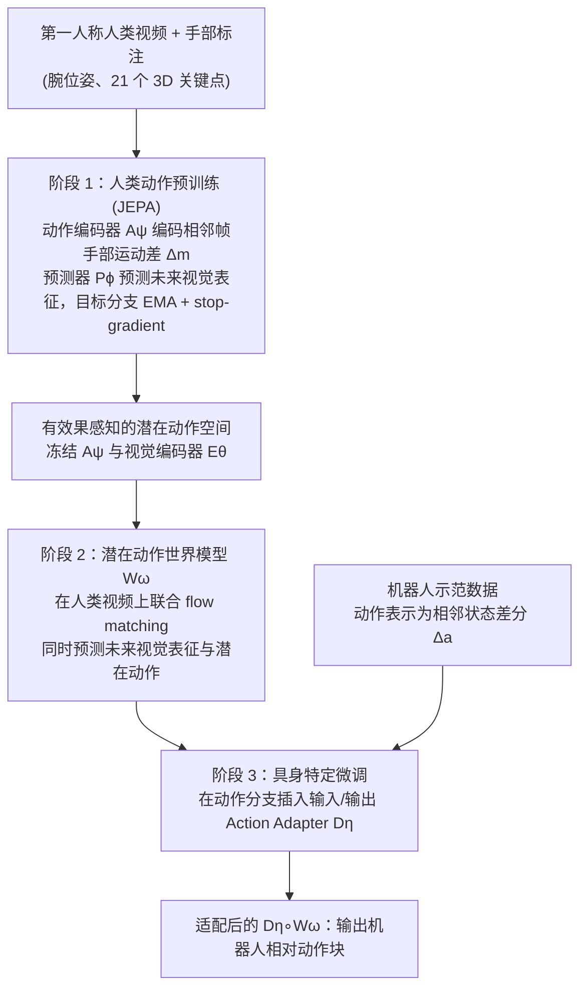

# EgoJEPA：超越重定向的第一视角视频灵巧操作学习

**EgoJEPA 绕开手工设计的人手到机器人重定向：先从人类视频学习效果相关的潜在动作，再用轻量适配器接到不同机器人。**

## 英文缩写速查

| 缩写 | 英文全称 | 简要说明 |
|------|----------|----------|
| JEPA | Joint-Embedding Predictive Architecture | 在潜在空间预测未来表征的架构 |
| OOD | Out-of-Distribution | 分布外，指训练未覆盖的场景或本体 |
| IL | Imitation Learning | 模仿学习 |

## 为什么重要

摘要指出，基于重定向的方法需要为每种本体重新标定映射，并会把手部跟踪误差传递到控制策略中。

## 流程总览

图依据：论文 Fig. 2 与 Stage 1–3 方法节。

## 核心信息

| 项目 | 内容 |
|------|------|
| arXiv | [2610.20904](https://arxiv.org/abs/2610.20904) |
| 作者 | Meng Cao, Can Zhao, Jinjie Wei, Haonan Zhao, Yulong Zhang, Duo Han, Xiaofan Li, Ziwu Song（arXiv 作者列表） |
| 机构 | 未核实（公众号标注"待核实"） |
| 开源状态 | **未核查代码**（摘要页未列代码链接） |

## 核心原理

1. **人类动作预训练：** JEPA 式视觉预测，以手部运动差异为条件，学习与动作效果相关的潜在动作。
2. **潜在动作条件世界模型：** 联合预测未来视觉变化与潜在动作。
3. **轻量 Action Adapter：** 把预训练表示适配到不同机器人。

## 工程实践

- 未发现官方代码入口；源码运行时序图：**不适用**。

## 评测与结果

据 arXiv 摘要（2026-10-22 核对）：

| 设置 | 结果 |
|------|------|
| 真机任务 | 5 个真实操作任务，3 种机器人本体 |
| 分布外（OOD）评测平均成功率 | **EgoJEPA 74%**，重定向基线 65% |
| 跨本体累计墙钟成本 | 从 743.2 小时降至 392.7 小时（-47.2%） |

摘要未列出各任务、各本体的分项成功率与试验次数，需回原文表格核对。

## 与其他工作对比

| 路线 | 人类先验如何进入机器人控制 | 与 EgoJEPA 的差异 |
|------|----------------------------|-------------------|
| 重定向基线（论文对照，OOD 65%） | 手腕/手指位姿经手工几何映射转为本体动作 | 每换本体需重新标定，手部跟踪误差直接传入控制；EgoJEPA 用潜在动作替代该映射 |
| [EgoMimic](./paper-ego-03-egomimic.md) | 第一视角人类 3D 手部轨迹与机器人遥操数据共训 | 仍在显式手部轨迹空间对齐人机；EgoJEPA 在潜在动作空间预训练，再用适配器接本体 |
| [LAC-WM](./paper-lac-wm-cross-embodiment-latent-action-world-model.md) | 在冻结 V-JEPA 2 特征上学跨本体共享潜在动作 | 同属"潜在动作 + 世界模型"跨本体路线；EgoJEPA 以手部运动差异为条件预训练，并强调轻量 Action Adapter |

第一行来自论文同一评测口径；后两行为路线层面的定性对比，没有共享评测设置，数值不可直接比较。

## 结论

**一句话总判：用潜在动作替代手工重定向，可以减少跨本体标定成本，但效果需要按本体与任务分别核对。**

1. **绕开重定向是主要卖点** — 摘要以避免手工映射与误差传递为动机。
2. **适配器是跨本体的关键部件** — 摘要称主体表示与机器人之间只需轻量适配。
3. **数字已对上 arXiv 摘要** — 74% 对 65% 的 OOD 成功率与 47.2% 的跨本体墙钟成本下降均见于摘要，分项结果仍需看原文表格。

## 局限与风险

- 人类视频与机器人本体之间的动力学差异，仍需适配器弥补（推测）。
- 数字已与 arXiv 摘要核对，但未经原文表格逐项核对。

## 关联页面

- [模仿学习](../methods/imitation-learning.md)
- [灵巧运动学](../concepts/dexterous-kinematics.md)
- [动作重定向](../concepts/motion-retargeting.md)

## 参考来源

- [论文归档](../../sources/papers/egojepa_arxiv_2610_20904.md)
- [公众号综述摘录（33 篇 Manipulation）](../../sources/raw/wechat_senlanke_manipulation_33_papers_2026-10-12_16.md)
- [arXiv PDF](https://arxiv.org/pdf/2610.20904)：已通读方法部分（实验与附录以略读为准）：Stage 1 人类动作预训练、Stage 2 潜在动作世界模型、Stage 3 具身特定微调；实验设定略读

## 推荐继续阅读

- [arXiv:2610.20904](https://arxiv.org/abs/2610.20904)
