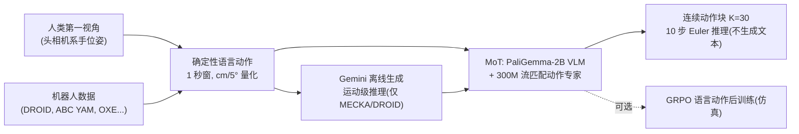

# EgoLAP：用语言动作推理从第一视角人类数据学机器人

**EgoLAP**（[arXiv:2610.08726](https://arxiv.org/abs/2610.08726)，[项目页](https://ego-lap.github.io/)）认为人与机器人不必共享低层动作，只需共享**运动意图**：把一秒内手/末端的运动写成量化的语言动作，再配一段解释“为什么这个运动适合当前物理状态”的运动级推理，二者构成 action chain-of-thought，用于联合预训练 VLA。

## 一句话定义

**以确定性生成的语言动作（厘米/5°量化）为人类与机器人共用的动作表示，加上运动级推理，在 PaliGemma-2B + 300M 流匹配动作专家上联合训练，使人类第一视角数据真正提升机器人表现。**

## 英文缩写速查

| 缩写 | 英文全称 | 简要说明 |
|------|----------|----------|
| EgoLAP | Egocentric Language-Action Pre-training（以原文为准） | 本文方法 |
| VLA | Vision-Language-Action | 视觉语言动作模型 |
| CoT | Chain-of-Thought | 这里是 action CoT：语言动作 + 推理 |
| GRPO | Group Relative Policy Optimization | 对语言动作的 RL 后训练 |
| OXE | Open X-Embodiment | 仅提供动作的机器人数据来源 |
| MECKA / DROID | 数据集名 | 带推理标注的人类 / 机器人子集 |

## 为什么重要

- 第一视角人类数据无关节动作标签，且人手与机器人形态不同；直接回归手部运动是差目标。
- 该文给出一个可诊断的实证：人类数据本身（仿真无推理）只把 7.2% 提到 16.4%，加运动级推理后到 38.3%，说明**推理才是迁移的关键**。
- 对 EgoFAST（FAST 动作 token）加推理反而变差（真机 35.2%→26.1%），提示表示与推理要匹配。

## 方法栈总览

## 方法

- **语言动作：** 平移取整数 cm、旋转取 5° 倍数，零分量省略，如“move forward 5 cm, …, close gripper”，双臂分 Left/Right 子句；由位姿规则生成，无需人工或 VLM 标注。
- **规范化：** 人与机器人运动统一到以相机为中心的坐标系。
- **推理标签：** Gemini（MECKA 用 gemini-3.7-flash，DROID 用 gemini-3.5-flash）离线、温度 0 生成；人类推理仅 EgoVerse 的 MECKA 子集，其余子集（Scale、Aria）只含语言与连续动作。
- **模型：** Mixture-of-Transformers；PaliGemma-2B 主干 + 从零训练约 300M 流匹配动作专家；最多三路 RGB、指令与 256 档离散状态；知识隔离使 VLM 只学文本目标；动作视野 K=30，λ_text=0.8。
- **数据：** 带推理标注的 DROID + MECKA 占每 batch 约 32%；ABC YAM、其他双臂集与其余 OXE 仅提供动作；总规模正文未给（未核实）。
- **推理时**不生成文本，直接 10 步 Euler 输出动作。

## 实验与评测

| 设置 | EgoLAP | 无推理 | EgoFAST | EgoOAT |
|---|---|---|---|---|
| 真机平均任务进度（5 任务） | **80.1%** | 44.5% | 35.2% | 18.0% |
| 仿真成功率（14 任务） | **38.3%** | 16.4% | 1.6% | 2.7% |

- **真机：** 定制双臂 YAM，零样本（臂间距与相机配置不同于所有训练本体）；Pick Place (Simple)、Fold Pants、Handover & Place、Wipe Object、Pick Place (Complex)；每任务 10 次（Complex 12 次）。
- **对 ABC-VLA（仿真）：** 高 16.9 个点。
- **运动级 vs 组合式推理（仿真）：** 运动级相对纯语言动作 +21.9、相对 ECoT 式组合 +9.1、相对 FAST +7.1；组合式（子任务+物体框+视觉轨迹）单独仅 5.3%，先接组合式再接运动级为 14.4% 对 38.3%。
- **跨本体检索：** 推理使机器人→人 R@1 51%→76%，人→机器人 42%→63%。
- **GRPO：** 仅采样语言动作 +19.4%；RL 中也生成推理 +12.7%（推理偏离分布）。
- 论文文内不一致：引言写“44.9 点 / 44.7 点”，结果段为 35.6 点 / 9.3 点；本页采用结果段。

## 源码运行时序图

不适用：项目页标注代码与检查点 “Coming soon”，截至 2026-10-12 无可核对的仓库（见 [项目页归档](../../sources/sites/ego_lap_github_io.md)）。

## 工程实践

- 构造语言动作：按一秒窗口计算相机系位姿增量，量化后拼接，这一步可用规则代码复现。
- 推理标注：仅对一部分数据（约 32% batch）生成，其余仅动作，成本可控。
- 推理时关闭文本生成，延迟与普通流匹配 VLA 相当。
- 开源状态：代码/检查点/新数据均未发布。

## 结论

**统一的、可解释的语言动作加运动级推理，使人类第一视角数据对零样本双臂真机有明显贡献；但表示和推理格式必须匹配。**

1. 人类数据没有推理时收益有限（仿真 7.2%→16.4%）。
2. 运动级推理比 ECoT 式组合推理更适合这个问题。
3. 语言动作可由位姿规则生成，不依赖 VLM 标注。
4. 推理时不生成文本，部署不增加解码成本。
5. RL 阶段不要生成推理，否则偏离分布。
6. 结论基于 5 个真机任务与 14 个仿真任务，需谨慎外推。

## 局限与风险

- 固定一秒窗口与量化可能漏掉快速、接触丰富的动态。
- 仅评测双臂桌面任务；RL 仅在仿真且优化运动匹配代理。
- 推理标签依赖 Gemini，真机每任务仅 10 次。
- 手部跟踪方法与总数据规模正文未核实。
- 开源：截至 2026-10-12 未发布。

## 与其他工作对比

| 对照 | 差异读法 |
|---|---|
| [EgoVerse](./paper-egoverse.md) | 数据来源之一；EgoLAP 关注如何把这类数据转成可迁移目标 |
| [EgoWAM 联合训练](./paper-egowam-egocentric-human-wam-co-training.md) | 用世界动作模型；EgoLAP 用语言动作 + 推理 |
| [Lambda0](./paper-lambda0-egocentric-human-pretraining.md) | 同为第一视角人类预训练，表示不同 |
| [DROID](./droid-policy-learning.md) | 提供带推理标注的机器人数据 |

## 关联页面

- [Manipulation 前沿周报 2026-10-05~10-09](../overview/frontier-manipulation-2026-10-05-10-09.md) — 本文所在汇总页
- [操作任务页](../tasks/manipulation.md) / [双臂操作](../tasks/bimanual-manipulation.md)
- [VLA](../methods/vla.md)
- [EgoVerse](./paper-egoverse.md)

## 参考来源

- [egolap_arxiv_2610_08726.md](../../sources/papers/egolap_arxiv_2610_08726.md) — 论文摘录
- [ego_lap_github_io.md](../../sources/sites/ego_lap_github_io.md) — 项目页核查
- [周报来源归档](../../sources/blogs/frontier_manipulation_2026_10_05_10_09.md)
- [arXiv:2610.08726](https://arxiv.org/abs/2610.08726)

## 推荐继续阅读

- [项目页](https://ego-lap.github.io/)
- [arXiv HTML 全文](https://arxiv.org/html/2610.08726v1)
- [前作 LAP 项目页](https://lap-vla.github.io)
