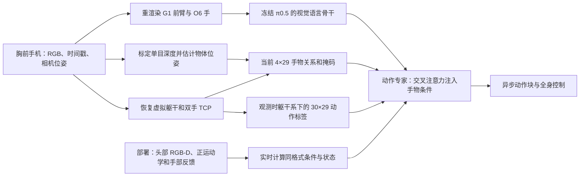

# EgoLoAF：从第一人称示范与手物可供性学习人形移动操作 / Learning Humanoid Loco-Manipulation from Egocentric Demonstrations with Hand-Object Affordances

## 一句话定义

用胸前手机记录人体示范，离线构建可供人形学习的观察和未来动作，再把当前手相对物体的位置与朝向直接传给动作专家。

## 英文缩写速查

| 缩写 | 英文全称 | 含义 |
|---|---|---|
| VLA | Vision-Language-Action | 用视觉、指令和状态输出动作 |
| VLM | Vision-Language Model | π0.5 中保持冻结的视觉语言骨干 |
| HOA | Hand–Object Affordance | 描述当前双手与实体的相对位姿及有效性 |
| TCP | Tool Center Point | 将人手、机器人手统一到同一工具点坐标约定 |
| RTC | Real-Time Chunking | 用已承诺的动作前缀约束异步生成的下一段 |
| TPS | Task Progress Score | 预先分配的子任务积分，满分 100 |

## 为什么重要

从人体视频恢复未来轨迹只能回答「示范者动了哪里」。对准盒口或双手拾物时，机器人还要知道「我的手现在离目标多远」。EgoLoAF 将未来动作监督和当前手物关系明确分开，使两种信号能够单独对照。

## 核心原理与方法

1. **动作监督：** 从手机记录的相机轨迹和标定外参得到虚拟躯干；HaWoR 重建双手，在拇指和食指指尖中点定义 TCP。以观测时刻躯干为固定坐标系，构造 30 步动作块；每步为躯干和双手的三组九维位姿与左右开合。它不是 29 个关节角。
2. **几何条件：** 用可见手表面标定单目深度尺度，再由 F2G-Pose 估计物体位姿。当前两个手、至多两个物体一共四槽，每槽 29 维，包含类型、实体位姿、两手相对该实体的位姿和开合字段；无效实体或特征用掩码处理。
3. **观测对齐与训练：** 合成 G1 前臂和 O6 手的外观并保留物体遮挡；所有运动与几何标注用原始录像计算，不用修补后的图像。冻结 π0.5 视觉语言骨干，训练动作专家、动作投影和可供性模块；附录在每第三个专家块前用残差交叉注意力注入当前条件，以带掩码的流匹配监督未来动作。
4. **真机：** 双手信息来自正运动学和手部反馈，物体来自头部 RGB-D 和在线位姿估计；填入同样四槽。异步执行器拼接新动作块，冻结的 ScaleBFM Torso-UMI-3 跟踪躯干和腕，开合独立控制。

## 评测与局限

| 真机对照，四任务平均 | 无 HOA | 有 HOA |
|---|---:|---:|
| 第一人称人体数据 | 53.2 | **73.1** |
| 遥操作机器人数据 | 74.4 | **86.3** |

四任务为纸巾入盒、纸巾入矮桶、双手转身放玩具、步行放纸巾并关柜门。每项单独后训练一套策略，人体侧每项 150 条示范（100 条论文数据集加 50 条另采），每批每项 20 次试验。TPS 是各阶段积分，73.1 不是完成率；73.1 对 74.4 比较的是不同数据源和不同条件输入的完整方案。相同数据源的消融才用于判断 HOA 的贡献。

论文报告同训练帧预算下的采集人时平均改善 4.03 倍（四项倍率等权，柜门任务 8.00 倍）。统计包含准备、采集、失败与复位，未计自动处理及采后标注/审核；不能当完整端到端成本。一千小时是论文描述的语料规模，不是四项策略全量联合训练的预算。数据集的 1,284 是任务配置，含 600 项原地、400 项姿态协同和 284 项需行走的操作。

## 与其他工作对比

- [KODA](paper-koda-egocentric-vla.md) 同样采用无穿戴跟踪器的采集及机器人视野渲染，论文比较指出它在策略学习中混合真机演示；EgoLoAF 的目标任务后训练只输入转出的示范，并在执行时显式构造手物关系。两者不是同一受控基准；本文还复用 KODA 的全身控制器。
- [EgoHumanoid-V2](paper-egohumanoid-v2.md) 也展示以人体数据训练目标技能，但使用穿戴式跟踪和人形动作优化；EgoLoAF 用手机相机轨迹及手重建生成紧凑目标，并依赖部署时的物体位姿链路。

## 结论

目前证据支持「少昂贵遥操作 + 显式手物条件」在四项 G1 任务上的组合价值，不能据此推断通用跨任务零样本能力。

- 做对照时保留四格表：两种数据源分别开关可供性，避免用 73.1 对 74.4 归因给数据来源。
- 将采集人时、自动处理、人力审核和真机验证单独计量。
- 复现时先核对工具点约定、有效性掩码、对象位姿和执行时躯干偏差。

## 工程实践与开放状态

附录报告在线物体感知约 75.0 ms、带 RTC 的策略推理约 251.8 ms、名义重规划间隔 0.4 s；全身控制 50 Hz，不等于 VLA 推理 50 Hz。空间反馈把腕目标按实时躯干位姿重表达，仅校正 14 个臂关节目标，不改双腿、腰部或模型权重。

**源码运行时序图：不适用。** 截至 2026-11-28，官方仓库仅 README，项目页代码和数据均标「Coming soon」，未见权重。上图以论文图 2、§3 与附录为依据，不代表已运行官方代码。

## 关联页面

- [移动操作任务](../tasks/loco-manipulation.md)
- [VLA](../methods/vla.md)
- [动作分块](../methods/action-chunking.md)
- [移动操作纵深路线 Stage 2](../../roadmap/depth-loco-manipulation.md)

## 参考来源

- [论文全文归档](../../sources/papers/egoloaf_arxiv_2611_32260.md)
- [官方项目归档与开放状态](../../sources/sites/egoloaf.md)

## 推荐继续阅读

- [官方项目页与真机演示](https://egoloaf.github.io/)
- [官方代码发布占位](https://github.com/EgoLoAF/EgoLoAF-Official)
