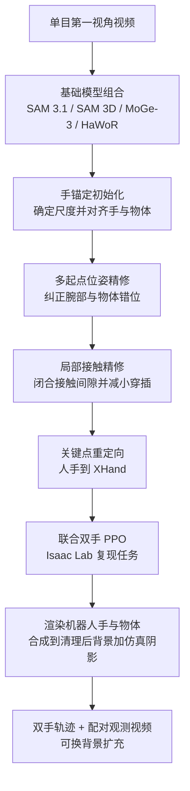

# EgoMatrix：从第一视角人类视频生成物理可信的灵巧机器人示范

**EgoMatrix 是一个数据引擎：把单目第一视角人类视频重建为手物交互，再用关键点重定向与强化学习在仿真中复现任务，最后渲染机器人手与物体并合成到真实或替换背景，得到成对的双手灵巧轨迹与机器人观测视频。**

论文 *EgoMatrix: Physically Faithful Dexterous Robot Demonstrations from Egocentric Human Videos*（[arXiv:2610.18822](https://arxiv.org/abs/2610.18822)，[项目页](https://spikew726.github.io/EgoMatrix/)）。

## 英文缩写速查

| 缩写 | 英文全称 | 简要说明 |
|------|----------|----------|
| HOI | Hand-Object Interaction | 手物交互重建，关注相对几何与接触而非精确度量场景 |
| MANO | Hand Model with Articulated and Non-rigid defOrmations | 手参数化模型，HaWoR 输出手轨迹的表示 |
| MPJPERA | Mean Per-Joint Position Error（root-aligned，据缩写推断） | 重建指标之一，单位 mm；全称为推测，未核实 |
| ATE / RTE | Absolute / Relative Trajectory Error | 手腕轨迹绝对 / 相对误差 |
| FD | Fréchet Distance | 在 ResNet18、VGG16、DINOv2、DreamSim 特征空间衡量渲染帧与真实机器人观测的接近度 |

## 为什么重要

- 机器人灵巧数据采集昂贵；人类第一视角视频量大但无法直接回放到机器人上。本文目标是产出「物理上可回放」的轨迹，而不是只做视觉对齐。
- 重建只追求相对几何与接触，再靠 RL 在仿真里闭合动力学，降低对精确单目度量恢复的依赖。
- 同一条轨迹可渲染到多种任务相容背景，用于扩充训练视觉分布。

## 核心信息

| 项 | 内容 |
|----|------|
| **机构** | 上海交通大学、香港大学、浙江大学、上海人工智能实验室（Shanghai AI Laboratory）；Yao Mu 为通讯作者（项目页与论文 HTML；作者到机构的对应未核实） |
| **作者** | Ziheng Wang、Yanming Shao、Ting Mao、Kaihan Chen、Yiqun Wang、Xuanye Wu、Yao Mu（arXiv 页） |
| **数据** | TACO、OakInk2 与自采集集（11 个任务、每个 1 条示范） |
| **仿真 / 机器人** | Isaac Lab；双 UR5e 臂 + XHand 灵巧手 |
| **开源** | **未列代码**（2026-10-17 核查）：项目页仅有 arXiv 链接与视频，无 GitHub / 数据集 / coming soon；论文无代码发布声明 |

## 核心原理

### 流程总览

- **工具链：** SAM 3.1（掩码）、SAM 3D（物体网格）、MoGe-3（深度与内参）、HaWoR（MANO 手轨迹）、FoundationPose 与 SpatialTracker（物体位姿）、HACO（接触概率）、SVOR（视频修补去背景）。
- **RL 取舍：** 不使用 ManipTrans 的预训练模仿器，直接训练联合双手 PPO 策略（论文 HTML）。

## 源码运行时序图

**不适用**：2026-10-17 项目页与论文均未提供官方代码或数据链接，无可对齐的运行入口。

## 与其他工作对比

| 维度 | EgoMatrix（本文） | [Do as I Do](./paper-do-as-i-do.md) | [DexMV](./paper-dexmv.md) | [TopoRetarget](../methods/toporetarget-interaction-preserving-dexterous-retargeting.md) |
|------|------|------|------|------|
| 输入 | 单目第一视角人类视频 | 单目 RGB 人类视频（第一 / 第三人称、野外、生成） | 人类操作视频 | 人手–物体演示关键点 |
| 重建 / 映射 | 手锚定初始化 + 多起点位姿精修 + 局部接触精修，关键点重定向 | HaWoR + SAM 3D 引导扩散跟踪，MuJoCo Warp 采样式重定向 | 估计人手与物体姿态后转成灵巧手轨迹 | 共享拓扑 interaction mesh + Laplacian 优化 |
| 物理闭合 | Isaac Lab 联合双手 PPO | 采样式动力学优化（MPPI 式） | 以模仿学习辅助仿真操作 | 轻量 PPO 残差跟踪 + DR |
| 额外产物 | 配对机器人观测视频，可换背景 | 灵巧手 / 臂可执行轨迹 | 机器人示范轨迹 | 接触保真参考，零样本部署 Wuji Hand |

- **相对 Do as I Do：** 同为单目视频到灵巧手数据的管线，本文在其 62 条演示设置下端到端成功率 54.84% 对 14.52%，区别在于本文显式做接触精修并额外渲染机器人观测视频。
- **相对 DexMV：** DexMV 是"视频估位姿 → 轨迹 → 模仿学习"的早期路线，EgoMatrix 用 RL 在仿真闭合动力学并面向双手。
- **相对 TopoRetarget：** TopoRetarget 专注重定向环节的接触拓扑保真，EgoMatrix 的重定向是关键点式，接触保真主要靠前端重建精修实现。
- 各文任务集、机器人手与成功判定不同；54.84% 对 14.52% 仅在本文 62 条设置内可比，Do as I Do 自报的 25%→71% 为其自身数据集口径。

## 工程实践

| 项 | 说明 |
|----|------|
| 源码运行时序图 | **不适用**（无官方代码） |
| 复现门槛 | 需串联上述 10 余个外部模型与 Isaac Lab 重定向 / RL；论文自述多阶段管线带来逐条示范的计算开销 |
| 输入条件 | 单目 RGB；深度歧义与遮挡为主要误差源，作者建议关键帧加真值深度或多视角 |
| 下游使用 | 论文未验证用这些合成示范训练下游操作策略 |
| 开源状态 | 无代码（2026-10-17） |

## 实验与评测

- **端到端仿真成功（62 条演示）：** EgoMatrix 54.84%（34/62），Do As I Do 14.52%（9/62），DexImit 12.90%（8/62，半成功记 0.5）；项目页称差距 3.78 倍。
- **自采集子集：** EgoMatrix 72.73%，Do As I Do 27.27%，DexImit 45.45%。TACO 与 OakInk2 各任务组 EgoMatrix 成功率 33.33%–71.43%。
- **重建消融（TACO 成功率）：** 手锚定初始化 5.41% → 加多起点精修 27.03% → 加局部接触精修 48.65%；自采集 18.18% → 36.36% → 72.73%。TACO 的 MPJPERA 由 21.97 略升至 23.07 mm，作者视为取舍。
- **重建指标：** TACO 物体 CD 0.56 cm（Do As I Do 0.61）；F@5 86.27%/87.75%（TACO/OakInk2）。TACO 上 Do As I Do 的 MPJPERA 更优（22.16 mm）；DexImit 穿插最小（0.35/0.18 mm）。项目页称 TACO 10 项中 8 项最优、OakInk2 中 6 项最优。
- **视觉保真（5,252 帧 Fréchet 距离，越低越好）：** ResNet18 100.23（人类 273.10，GPT-6 Astra 119.81）；VGG16 414.66；DreamSim 0.4975；DINOv2 上 GPT-6 Astra 更好（240.54 对 253.15）。
- **真机：** 双 UR5e + XHand 回放六个代表任务，仅定性，无成功率。

## 结论

**EgoMatrix 的证据重心是「仿真里能复现多少人类演示」，而非「用它训练的策略在真机上表现如何」；接触精修是成功率的主要来源。**

1. **接触精修贡献最大** — TACO 成功率由 27.03% 升到 48.65%，自采集由 36.36% 升到 72.73%。
2. **基线差距要看口径** — 54.84% 对 14.52% 的 62 条演示，样本小，且 DexImit 用半成功记分。
3. **重建指标并非全面领先** — 个别指标（TACO 的 MPJPERA、两集的穿插）被基线占优，选型需按下游关心的指标。
4. **视觉对齐非全面最优** — DINOv2 空间被 GPT-6 Astra 超过，其余三个特征空间更接近真机观测。
5. **下游价值未证** — 没有训练策略的实验，真机仅定性回放，引用时不宜写成「提升策略成功率」。

## 局限与风险

- **管线开销：** 多阶段、逐条示范计算成本较高（论文所述）。
- **单目歧义：** 深度与遮挡残留误差。
- **评测规模：** 端到端仅 62 条，自采集 11 条。
- **未验证下游训练**（论文所述）。
- **无代码：** 外部模型众多，复现难度高（推测）。

## 关联页面

- [双臂操作](../tasks/bimanual-manipulation.md) — 本文输出的任务形态
- [运动重定向](../concepts/motion-retargeting.md) — 人手到机器人手的映射背景
- [人类视频语料对比](../comparisons/humannet-table1-human-video-corpora.md) — 第一视角 / 人类视频数据源的选型
- [TopoRetarget](../methods/toporetarget-interaction-preserving-dexterous-retargeting.md) — 保留交互的灵巧重定向对照
- [PPO](../methods/ppo.md) — 双手 RL 所用算法

## 参考来源

- [egomatrix_arxiv_2610_18822.md](../../sources/papers/egomatrix_arxiv_2610_18822.md) — 论文摘录与开源核查
- [egomatrix-project.md](../../sources/sites/egomatrix-project.md) — 项目页归档
- [arXiv:2610.18822](https://arxiv.org/abs/2610.18822) — 原文

## 推荐继续阅读

- [EgoMatrix 项目页](https://spikew726.github.io/EgoMatrix/)
- [EgoMatrix 论文 HTML](https://arxiv.org/html/2610.18822v1)
