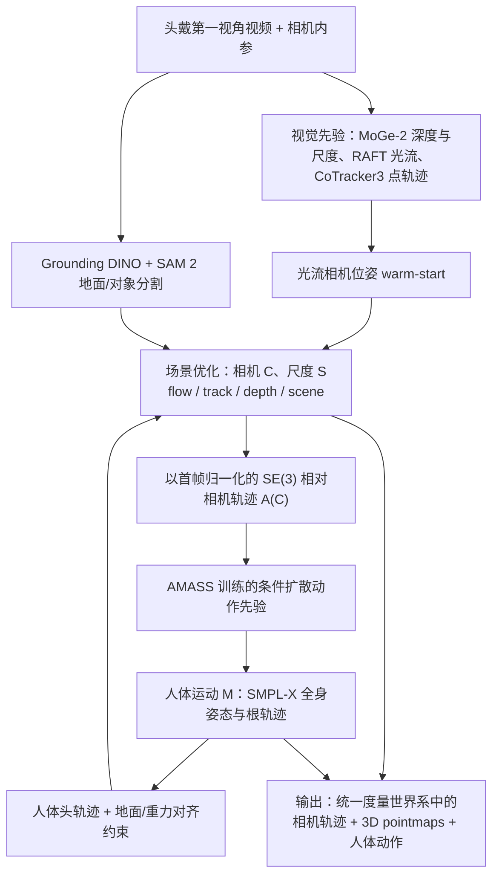

# EgoMo3R：第一人称人体运动与三维场景联合重建（Joint Egocentric Motion and Scene Reconstruction）

## 一句话定义

**EgoMo3R**（NeurIPS 2026；[arXiv:2611.01627](https://arxiv.org/abs/2611.01627)）是由**斯坦福大学（Stanford University）与松下（Panasonic）**共同提出的单目第一人称视频联合重建方法：将 **视觉几何的相机/场景估计**与**扩散人体运动先验**交替优化，恢复同一个**度量尺度、重力对齐**世界坐标系中的相机轨迹、三维点图与 SMPL-X 人体动作。

## 英文缩写速查

| 缩写 | 英文全称 | 简要说明 |
|------|----------|----------|
| Ego | Egocentric | 头戴第一人称 RGB 视角，人体往往不可见 |
| SMPL-X | Skinned Multi-Person Linear Model eXpressive | 用根位姿、躯干关节等表示重建人体动作 |
| SLAM | Simultaneous Localization and Mapping | 同时定位与地图重建；此处是重要对照技术路线 |
| SE(3) | Special Euclidean Group in 3D | 三维刚体旋转和平移，相机位姿的数学表示 |
| RAFT | Recurrent All-Pairs Field Transforms | 相邻帧前后向光流预测器 |
| ATE | Absolute Trajectory Error | 对齐后测量全局相机轨迹误差，越小越好 |
| MPJPE | Mean Per Joint Position Error | 全局人体关节位置误差，越小越好 |
| MAD | Median Absolute Deviation | 排除光流和点轨迹错误对应的稳健过滤方法 |

## 为什么重要

- **打破循环依赖：** 一般第一视角全身动作恢复预设精确的米制、重力对齐头部相机轨迹，而普通 RGB 视频恰好缺这个条件。EgoMo3R 把「由相机猜全身」与「由人体约束相机」纳入闭环。
- **减少专用传感器前提：** 以单目深度、光流、长程点跟踪及人体动作先验互补，而非要求输入外部高精度惯性 SLAM 轨迹；这并不意味着任意相机原始视频都无需标定。
- **机器人数据意义：** 可研究将人类 Ego 视频离线转为时空统一的人体运动+环境几何，再接 [动作重定向](../concepts/motion-retargeting.md) 或示范数据审查；**论文没有报告机器人策略训练或真机操作收益**。

## 核心信息

| 项 | 内容 |
|----|------|
| **论文** | Chaitanya Patel 等，*EgoMo3R: Joint Egocentric Motion and Scene Reconstruction*，NeurIPS 2026，arXiv v1（2026-11-01） |
| **机构** | 斯坦福大学（Stanford University）；松下美国研发公司（Panasonic R&D Company of America）；松下控股株式会社（Panasonic Holdings Corporation） |
| **输入** | 已去畸变的单目 egocentric 视频与相机内参；官方演示依赖 Project Aria RGB 相机规格 |
| **优化量** | 相机到世界变换 C、逐帧深度尺度 S、SMPL-X 人体运动 M；由深度+相机形成世界 pointmaps |
| **视觉模块** | MoGe-2 相对深度与尺度、RAFT 双向光流、CoTracker3 长时点跟踪、Grounding DINO / SAM 2 分割 |
| **动作模块** | [motion_diffusion](https://github.com/chaitanya100100/motion_diffusion) 的 AMASS 训练条件扩散 1D UNet |
| **输出** | 相机轨迹、度量三维点图、SMPL-X 姿态；相互共享重力方向和地面坐标 |
| **开源状态** | **已开源研究代码和示例序列**（[主仓库](https://github.com/chaitanya100100/EgoMo3R)、[动作先验仓库](https://github.com/chaitanya100100/motion_diffusion)、[预训练权重](https://huggingface.co/chaitanya100100/egomo3r-motion-prior)） |

## 核心原理

### 视觉先验与相机优化

相机位姿 C、深度尺度 S 和人体运动 M 是相互关联的未知量。单目模型给出相对深度 Dr，按每帧 S 得到尺度化深度；用相机内参反投影成局部点图，再以 C 变换进世界坐标。**不是**在逐个优化每个三维点：核心是对相机及逐帧尺度施加一阶优化。

主要约束包含：

1. **L_flow：** RAFT 光流预测与相机重投影的一致性（短程）。
2. **L_track：** CoTracker3 长程点轨迹跨帧一致性，减轻相机漂移。
3. **L_depth：** 深度尺度正则，抑制单目尺度退化。
4. **L_scene：** 分割出的地面点与人体运动定义的地面平面对齐。
5. **L_egocam：** 相机轨迹与 SMPL-X 推导的头部轨迹一致。
6. **L_motion：** 条件扩散运动先验，使人体姿态保持合理运动分布。

光流先给相机轨迹 warm-start；MAD 过滤错误对应。仅靠视觉只能估计空间几何，重力方向和人体地面约束还需运动先验。

### SE(3) 不变条件和交替优化

常见人体动作先验需要已经对齐重力/米制的相机轨迹。EgoMo3R 则用相对首帧的 **A(C)_i = C_0⁻¹ C_i** 作条件：在全局位姿尚不精确时，仍能从相机相对运动推断合理的身体动作。

论文采用两类迭代子问题：

- **Scene Refinement：** 固定动作 M；更新相机 C、尺度 S，使用 flow/track/depth/scene loss。人体姿态贡献地面和尺度锚点。
- **Motion Alignment：** 固定 C、S；通过扩散先验与头部轨迹对齐更新 M。新动作再约束下一轮场景。

直接对所有未知量同时梯度下降不够稳定；作者消融显示交替策略改善全局人体和几何误差。公开运行脚本把这两轮细化为四个 stage，见下方。

## 流程总览



这张图描述论文的**交替反馈**，不是把动作先验说成视觉几何网络的直接预测头。

## 源码运行时序图

按官方 [README](https://github.com/chaitanya100100/EgoMo3R#quick-start)、[run/run_all_stages.sh](https://github.com/chaitanya100100/EgoMo3R/blob/main/run/run_all_stages.sh)、[run/optimize.py](https://github.com/chaitanya100100/EgoMo3R/blob/main/run/optimize.py)、[model/motion_prior.py](https://github.com/chaitanya100100/EgoMo3R/blob/main/model/motion_prior.py) 与 stage YAML **静态核对**；不是猜测的通用训练模板。

```mermaid
sequenceDiagram
  autonumber
  actor User as 使用者
  participant Runner as run/run_all_stages.sh
  participant Opt as run/optimize.py
  participant Geo as depth/flow/track/segmentor
  participant Scene as scene_reconstruction_optim
  participant Prior as MotionPrior / modiff
  participant Vis as run/visualize.py
  participant Disk as outputs 缓存与结果
  User->>Runner: bash run/run_all_stages.sh
  loop stage1, stage2, stage3, stage4
    Runner->>Opt: python run/optimize.py config/stageN.yaml
    Opt->>Geo: prepare_batch + compute_flows/depths/tracks/segmentation
    Geo-->>Opt: 缓存的视觉先验 + masks
    Opt->>Disk: stage > 1 时 load_results(stage - 1)
    alt stage1：场景初始化
      Opt->>Scene: 只优化相机位姿，flow/track，1000 iter
      Scene-->>Opt: aria_traj_T + log_depth_scales
    else stage2：人体动作初始恢复
      Opt->>Prior: sample_motion_2(aria_traj_T)
      Prior-->>Opt: smpl_params + 对齐后的头部轨迹
    else stage3：场景再优化
      Opt->>Scene: 相机 + 深度尺度 + floor loss，1000 iter
      Scene-->>Opt: 更新轨迹 + 尺度
    else stage4：人体动作引导恢复
      Opt->>Prior: canonicalize_aria_traj_T_v1 + sample_motion_with_guide
      Prior-->>Opt: SMPL-X 参数 + 轨迹
    end
    Opt->>Disk: save_results(stageN)
  end
  User->>Vis: python run/visualize.py config/stage4.yaml
  Vis->>Disk: 读取最终重建结果
  Disk-->>Vis: 相机轨迹 / 深度尺度 / SMPL-X 参数
  Vis-->>User: 展示交互式 3D 结果
```

**源码入口边界：** 主仓四阶段脚本是 **离线重建/推理**，非运动先验训练脚本。要重训先验需进入独立仓库 `motion_diffusion`； stage2 使用 `sample_motion_2`，stage4 使用含 trajectory/sliding guidance 的 `sample_motion_with_guide`。参见 [源码归档](../../sources/repos/egomo3r_chaitanya100100.md)。

## 工程实践

| 环节 | 复现/审查要点 |
|------|---------------|
| 准备人体先验 | 先按 `motion_diffusion` README 配置 `modiff`、SMPL-X、AMASS motion 先验 checkpoint 与统计文件；运行示例 sanity check |
| 安装主仓 | 在同一 Python 环境安装主仓依赖；下载 SAM 2 checkpoint，指定 `motion_prior_path` |
| 最小测试 | 仓库自带两个示例片段；执行 `bash run/run_all_stages.sh`，之后用 `run/visualize.py` 检查空间对齐 |
| 相机要求 | `model/inputs.py` 的 `load_aria_intrinsics` 硬编码 **512×512 / f=150 px 的 Aria RGB 内参**；替换相机须改标定和去畸变 |
| 时间要求 | 运动先验按 **10 FPS、80 帧/8 秒窗口**训练；长序列用滑动窗口；其他 FPS 不在当前约定输入内 |
| 输出文件 | 每阶段相机轨迹、对数深度尺度、SMPL-X 参数，外加深度、光流、跟踪、分割的预计算缓存 |
| 机器人下游 | 可作离线人体动作/场景候选标签，仍需要动作重定向、接触合理性与机器人动作执行验证 |

## 实验与评测

论文主结果使用 EgoExo4D（718 段）和 Nymeria（828 段）8 秒片段；同一去畸变 Project Aria RGB 输入。数字均为**论文作者报告、非本次复现**。

| 指标（越低越好） | EgoExo4D | Nymeria | 关键读法 |
|-----------------|----------|---------|----------|
| 3D scene metric Acc mean（单位 m） | **0.357**（CUT3R 0.433） | **0.247**（CUT3R 0.346） | Table 1，场景点到真值几何距离 |
| Camera metric ATE（单位 m） | **0.226**（CUT3R 0.415；ViPE 0.426） | **0.325**（ViPE **0.276**） | Table 2，Nymeria 的 ViPE 相机 ATE 更好 |
| Global human MPJPE（单位 m） | **0.271** | **0.319** | Table 3，在非 oracle 对照中优秀；不等于局部姿态指标均第一 |

- **消融（EgoExo4D locomotion 子集）：** 只有光流时 ATE 0.604；加长程 tracks 变 0.361；把 motion 直接联合优化的 MPJPE 0.456，经交替优化变 0.320（Tables 4–5）。
- **数据真值说明：** Nymeria 有动作标注；EgoExo4D 采用 UniEgoMotion motion fits 作动作对照，不应等同直接光学人体 MoCap ground truth。
- **计算成本：** 论文 Appendix B 报告单张 NVIDIA L40S 处理 8 秒视频**约 8 分钟**（含视觉先验），不能当作实时人体动作跟踪方法。

## 结论

**重要突破是把人体动作作为相机/场景的几何约束，同时让几何反过来约束动作，而非把两个独立模型的输出简单拼接。**

1. **长程点轨迹非常关键。** 光流提供短时初始化，CoTracker3 跨帧对应显著降低漂移；低纹理环境中它也可能成为失败源。
2. **人体先验是世界系锚点。** 头部运动与地面/重力先验联合改善三维场景对齐；不能拿一般相机平滑正则直接等价替代。
3. **交替优于不加区分的联合更新。** 论文消融显示运动误差与相机误差均受益，尤其是弱对应/早期相机初始化阶段。
4. **读指标不能只看 SOTA 标题。** EgoExo4D metric ATE 很有优势，但 Nymeria 的 ViPE metric ATE 更低；局部姿态与脚接触也并非各维度均第一。
5. **适合离线示范资产生产探索。** 输入标定、时间窗口、GPU 算力与后续机器人重定向是额外代价，论文未验证真机端到端收益。

## 与其他工作对比

| 方法 | 差异 |
|------|------|
| **EgoEgo** | 由光流特征估计 Ego 头部轨迹，之后生成人体动作；EgoMo3R 直接把相机/场景与人体交替联立 |
| **UniEgoMotion / EgoAllo** | 常依赖已有度量、重力对齐相机轨迹，或把不稳定预测轨迹送给运动先验；EgoMo3R 以 SE(3) 不变轨迹为条件并闭环修正 |
| **CUT3R / VGGT / EgoMono4D** | 前向直接三维重建；EgoMo3R 以几何先验+优化换更高的离线场景精度 |
| **ViPE** | 经典几何优化的高质量 SLAM 基线，Nymeria metric ATE 优于 EgoMo3R；但论文报告 ViPE 在场景完整度与精度上较弱 |

## 局限与风险

- **高计算时延。** L40S 约 8 分钟/8 秒片段；这更接近离线伪标签生成而不是在线机器人观测器。
- **视觉先验可能失效。** 低纹理、持物/动态物体、严重模糊会污染 tracks/depth；地面分割缺失也削弱物理锚定。
- **手部动作覆盖不足。** 论文明确主要研究 locomotion：头部轨迹对下肢/躯干约束较强，但**不能仅凭头轨迹恢复准确的手腕/手物操作**。
- **相机与数据域限制。** 公开代码默认 Project Aria 内参和 10 FPS；改成普通手机/其他眼镜需重新校准、检查运动先验分布并验证结果。
- **未完成机器人控制验证。** 论文没有报告机器人行为克隆、重定向成功率或真机部署，不应直接推断对下游策略的提升。

## 关联页面

- [Ego-Exo4D 数据集](./dataset-ego-exo4d.md) — EgoMo3R 的评测数据之一。
- [Awesome Egocentric Vision](./awesome-egocentric-vision.md) — 将本方法放回 Ego 3D/4D 感知谱系。
- [AMASS](./amass.md) — 人体扩散先验的训练数据来源。
- [GVHMR](./gvhmr.md) — 另一种视频人体运动重建路线，适合区分第一人称/第三人称可见性。
- [Motion Retargeting](../concepts/motion-retargeting.md) — 从人体 SMPL-X 动作到机器人可执行轨迹仍需的下一步。
- [动作重定向纵深 Stage 2](../../roadmap/depth-motion-retargeting.md) — 视频估计类参考动作上游。

## 参考来源

- [EgoMo3R 原论文全文阅读归档](../../sources/papers/egomo3r_arxiv_2611_01627.md)
- [EgoMo3R 官方项目主页核查](../../sources/sites/egomo3r_project.md)
- [EgoMo3R 官方源码入口与运行时序](../../sources/repos/egomo3r_chaitanya100100.md)
- [论文 HTML 原文（arXiv v1，含附录）](https://arxiv.org/html/2611.01627)
- [EgoMo3R 官方代码](https://github.com/chaitanya100100/EgoMo3R)

## 推荐继续阅读

- [项目主页、可视化与交互结果](https://chaitanya100100.github.io/EgoMo3R/)
- [motion_diffusion：条件人体扩散模型及预训练权重使用说明](https://github.com/chaitanya100100/motion_diffusion)
- [官方代码 README：四阶段离线重建示例](https://github.com/chaitanya100100/EgoMo3R#quick-start)
