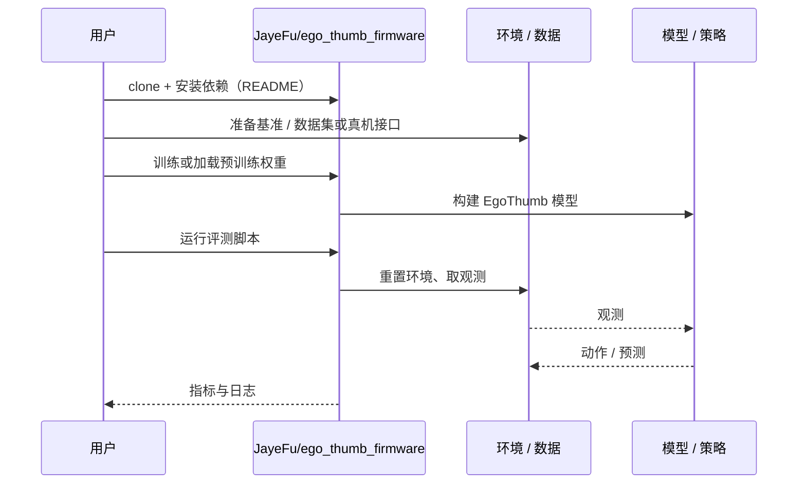

# EgoThumb（arXiv:2610.37582）

**EgoThumb**（*EgoThumb: A Vision-Driven Supernumerary Robotic Thumb for Autonomous Grasp and Holding Assistance*，[arXiv:2610.37582](https://arxiv.org/abs/2610.37582)，[项目页](https://ego-thumb.github.io/)，[代码](https://github.com/JayeFu/ego_thumb_firmware)）来自 [具身智能小站 2026-10-28 盘点](../../sources/blogs/wechat_embodied_station_59_papers_human_video_to_robot_experience_2026-10-28.md)，属「灵巧与接触操作」组。

## 一句话定义

**用掌心相机驱动额外机械拇指，把手与物体的视觉线索映射到关节位置。**

## 英文缩写速查

| 缩写 | 英文全称 | 简要说明 |
|------|----------|----------|
| EgoThumb | EgoThumb: A Vision-Driven Supernumerary Robotic Thumb for Autonomous Grasp and Holding Assistance | 本文方法 / 基准的简称 |

## 为什么重要

- 多一根拇指，辅助单手操作。前臂驱动减轻末端负担，提供抓握、保持与释放的辅助思路，复现仍需配套硬件与训练。
- 开源结论：**已开源**（步骤 2.5，2026-10-28）。仓库可达（git ls-remote）。项目页 HTTP 200。
- 同期同组工作见 [潜在动作、免渲染事件仿真与机器人评测：具身智能小站 10-28 期 59 篇阅读坐标](../overview/embodied-station-2026-10-28-59-papers-technology-map.md)。

## 核心机制

| 项 | 内容 |
|----|------|
| **arXiv** | [2610.37582](https://arxiv.org/abs/2610.37582) |
| **开源** | **已开源** |
| **要点** | 用掌心相机驱动额外机械拇指，把手与物体的视觉线索映射到关节位置。 |
| **文内指标** | 公众号转述：前臂驱动减轻末端负担，提供抓握、保持与释放的辅助思路，复现仍需配套硬件与训练。 |

## 源码运行时序图

以下为按仓库入口（`JayeFu/ego_thumb_firmware`）推断的通用运行链路；入库日仅核实仓库可达，未逐文件阅读，具体脚本名以 README 为准。

## 实验与评测

- 公众号转述：前臂驱动减轻末端负担，提供抓握、保持与释放的辅助思路，复现仍需配套硬件与训练。
- **读法：** 本页为索引级摘要，依据公众号转述的官方摘要与仓库信息整理；逐项数字与 baseline 以原文 PDF 为准。

## 与其他工作对比

- 横向索引见 [潜在动作、免渲染事件仿真与机器人评测：具身智能小站 10-28 期 59 篇阅读坐标](../overview/embodied-station-2026-10-28-59-papers-technology-map.md)；同 arXiv 不重复造页。

## 结论

**多一根拇指，辅助单手操作：前臂驱动减轻末端负担，提供抓握、保持与释放的辅助思路，复现仍需配套硬件与训练。**

1. 开源边界：**已开源** — 仓库可达（git ls-remote）。项目页 HTTP 200。
2. 核心机制：用掌心相机驱动额外机械拇指，把手与物体的视觉线索映射到关节位置。
3. 复现与选型前核对任务协议、硬件与基准口径，勿直接横比公众号摘录数字。

## 关联页面

- [manipulation](../tasks/manipulation.md)
- [contact-rich-manipulation](../concepts/contact-rich-manipulation.md)
- [dexterous-kinematics](../concepts/dexterous-kinematics.md)
- [tactile-sensing](../concepts/tactile-sensing.md)
- [embodied-station-2026-10-28-59-papers-technology-map](../overview/embodied-station-2026-10-28-59-papers-technology-map.md)

## 参考来源

- [egothumb_arxiv_2610_37582.md](../../sources/papers/egothumb_arxiv_2610_37582.md)
- [wechat_embodied_station_59_papers_human_video_to_robot_experience_2026-10-28.md](../../sources/blogs/wechat_embodied_station_59_papers_human_video_to_robot_experience_2026-10-28.md)
- [arXiv:2610.37582](https://arxiv.org/abs/2610.37582)

## 推荐继续阅读

- [arXiv PDF](https://arxiv.org/pdf/2610.37582)
- [项目页](https://ego-thumb.github.io/)
- [https://github.com/JayeFu/ego_thumb_firmware](https://github.com/JayeFu/ego_thumb_firmware)
