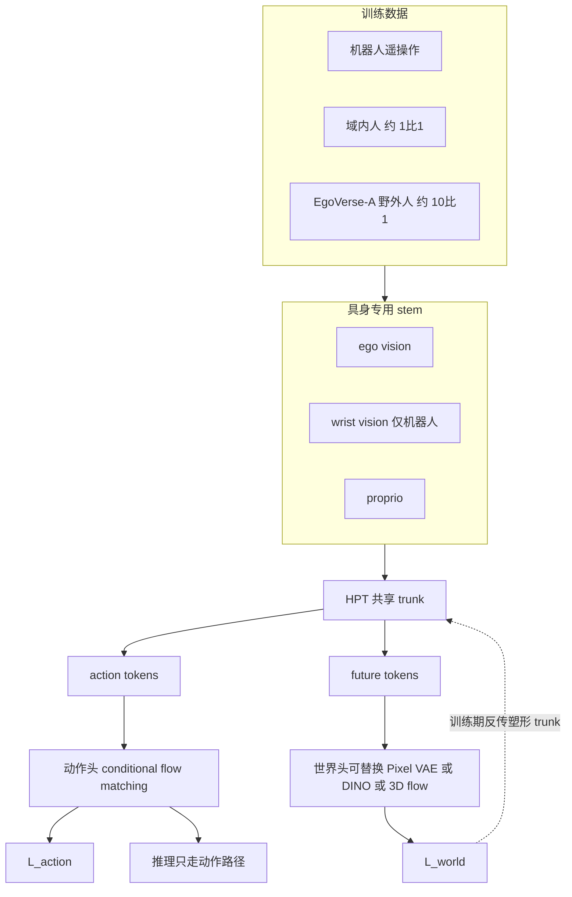

# EgoWAM（野外 Egocentric 人数据 · World Action Model 协同训练）

**EgoWAM**（*World Action Models Beyond Pixels with In-the-Wild Egocentric Human Data*，[arXiv:2607.08436](https://arxiv.org/abs/2607.08436)，[项目页](https://gatech-rl2.github.io/egowam.github.io/)，佐治亚理工学院 RL² · Danfei Xu 组）研究：自我中心人数据丰富，但 BC 人–机共训会把可迁移内容与不可迁移的人体态纠缠；在固定策略骨干与数据配方下，只换世界预测分支的目标表征，看哪种目标最能让人数据变成机器人策略的增益。全文通读归档见 [来源归档](../../sources/papers/egowam_arxiv_2607_08436.md)。

## 一句话定义

**在 HPT 骨干上给 flow-matching 动作头并联一个可替换的世界预测头（Pixel VAE / DINO / 3D flow），联合训练人与机器人数据、推理时丢弃世界头，以此受控比较哪种世界目标最利于野外 egocentric 人数据向机器人迁移。**（摘要与 §4、§4.3）

## 英文缩写速查

| 缩写 | 英文全称 | 简要说明 |
|------|----------|----------|
| WAM | World Action Model | 动作之外还预测场景未来的策略；本文把未来预测当训练期的第二条监督通道 |
| BC | Behavior Cloning | 仅监督动作的模仿学习；本文的对照基线 |
| HPT | Heterogeneous Pretrained Transformer | 具身专用 stem 加共享 trunk 的骨干（§4.1，引用 [16]） |
| OOD | Out-of-Distribution | 本文指未见物体或新场景（§5.1） |
| RAE | Representation Autoencoder | DINO 世界头所用的表征自编码器框架及其宽 DDT 头（§4.2，引用 [13]） |
| VAE | Variational Autoencoder | Pixel 目标所用的预训练视频 VAE 潜空间（Wan，§4.2） |
| DINO | self-DIstillation with NO labels | 本文用冻结 DINOv2-B 的 patch 特征作目标（附录 B.2） |
| VIO | Visual-Inertial Odometry | Aria 眼镜给出的头部位姿，用于稳定 3D flow（§4.2） |
| ID | In-Distribution | 本文指见过的物体与场景（§5.1） |

## 为什么重要

- **把「世界表征」从「堆更多小时」里单独拎出来：** 论文固定骨干、动作头与数据混合，只改世界目标（§1 贡献一），这是它相对许多整体系统论文的受控之处。
- **作者的发现（自述）：** WAM 共训比 BC 共训更能随野外人数据扩展；Pixel 迁移弱，DINO 与 3D flow 明显更好且各有所长（摘要与 §1）。
- **部署成本不变：** 推理丢弃世界头，延迟与同尺寸 BC 策略相当（30 Hz，RTX 4090，附录 B.3）。

## 核心原理与流程总览

**有效世界目标的三条假设（§4）：** D1 抽象外观；D2 跨具身一致（表示效应而非执行者）；D3 分离 ego-motion 与环境变化。作者称 Pixel 违反三条，DINO 满足 D1/D2、对 D3 仅部分缓解，3D flow 按构造满足三条（§4.2）。

**动作通道对齐（§3.1）：** 统一为 14 维末端空间；人手姿态重新表达到时刻 t 设备系以消除头动；人窗口 1 s、机器人窗口 1.5 s；1%/99% 分位数归一化。

**三种世界目标（§4.2、附录 B.2）：**

| 目标 | 内容 | 头部 |
|------|------|------|
| Pixel / Pixel-PT | 未来 ego 帧（128×128）的 Wan 视频 VAE 潜码（16×16×16） | 6 块 DiT 从零训练 / 预训练 VACE-1.3B 初始化 |
| DINO | 未来 ego 帧的冻结 DINOv2-B patch 特征（16×16×768，去 CLS 与 register） | RAE 的 DiTDH 宽头 |
| 3D flow | Track4World 追踪 + Aria VIO 位姿稳定到时刻 t 相机系的稠密 3D 位移，1120 个锚点，100 步 | 4 块 flow-matching 解码器，以锚点位置作条件 |

**联合训练（§4.3）：** L = L_action(机器人 + 人) + λ(L_world(机器人) + L_world(人))，λ=1；每步 32 条机器人 + 32 条人样本。

## 工程实践

- **平台（§5.1，附录 C.1）：** 两条直立 ARX5 6-DoF 臂，Aria 眼镜头戴，两个腕部 RealSense D405，Quest 3 遥操作，Mink IK 执行。
- **数据（表 3）：** 机器人示教 300/360/300 条（cup-on-saucer / fold-clothes / bag-grocery，2.5/3.0/2.5 h）；域内人各 2 h；EgoVerse-A 人数据 20.5/21/7 h。
- **训练（附录 B.3）：** 单张 L40S，每任务每方法约两天（Pixel-PT 用两张）；AdamW lr 1e-4。
- **评测（§5.1）：** 每方法 ID 20 次 + OOD 20 次，全文共 1800 次真机 rollout；一任务一策略。
- **主要结果（§5.2，图 3 读数，作者以柱状图给出）：** DINO 的 OOD 成功率增益最大（cup +43、bag +40、fold OOD 场景 +70 个百分点）；3D flow 在域内空间泛化最强（图 6），整体分数最高；fold-clothes 域内除 BC 外已饱和到 100%。
- **未对齐人数据（§5.2 Q3，图 8，bag-grocery）：** BC 机器人单独 40%、域内共训 45%、未对齐共训 20%；3D flow 机器人单独 60%、域内 80%、未对齐 75%。
- **对齐人数据（附录 A.1，图 9，cup-on-saucer）：** 演示者刻意对齐后，Pixel 35%→65%，DINO 50%→70%，3D flow 两种情形均 85%。
- **人数据模态（附录 A.2，图 11，表 1）：** 仅 3D flow 监督优于仅动作监督（OOD Scene 0% 对 10%），动作加 flow 在每个切分最好。
- **仿真复核（附录 D，表 4）：** RoboTwin 2.0 上跨具身共训优于单具身；pick-diverse-bottles 跨具身 BC 6、Pixel 11、DINO 28、3D flow 16；hanging-mug 全部不超过 1%。

## 评测证据与清单说法的对比核对

清单（Glen Berseth 的 CoRL 2026 阅读清单，P2，作者称摘要由 LLM 据摘要起草）一句话：「Controlled study of which world-prediction target makes world action models best at transferring in-the-wild egocentric human data.」

| 清单措辞 | 论文核对 |
|----------|----------|
| Controlled study | 成立：固定骨干、动作头与数据混合，只换世界目标（§1、§4.1）。但对照臂是 BC 与 Pixel/Pixel-PT/DINO/3D flow 共五种，且每任务一个策略、每格 20 次 rollout（§5.1）。 |
| which target makes WAMs best | 论文没有给出唯一的「最佳」：DINO 的 OOD 最强，3D flow 的域内空间最强且整体分数最高（§1、§5.2 Q2）；作者在 §6 明确说「最佳」世界表征仍是开放问题。 |
| in-the-wild egocentric human data | 成立：EgoVerse-A 野外人数据（约 10:1）；但另有域内人数据与刻意对齐/未对齐的自采数据（附录 C.2）。 |
| 仿真还是真机 | 主结果为三项真实双臂任务；仿真（RoboTwin）只是附录 D 的机器人到机器人复核，不涉及人数据。 |
| 清单未提及 | 推理时丢弃世界头、BC 在人数据上可低于 robot-only、以及作者自述增益只在语境层面。 |

## 结论

EgoWAM 说明世界预测目标会改变人类视频共训练的收益，现有证据更支持语境迁移而非获得新运动技能。

- 保持策略骨干、动作头和混合比例一致，再对比 Pixel VAE、DINO 与 3D flow。
- 把域内空间泛化与域外语境泛化分别验收，不能用一个平均分选定所有任务的表征。
- 加入未对齐人类数据的消融，检查 BC 退化是否被世界目标缓解，并扩大三项真机任务的重复验证。

## 局限

**论文自己承认（§6）：** 增益停留在语境层面，无法从人数据学到新的运动技能；每任务一个策略，未做多任务共训；「最佳」世界表征未定。

**读论文时看到的未验证之处（我的判断）：**
- 只有三项任务、每格 20 次 rollout，图 3 的置信区间较宽，部分差异应谨慎读；fold-clothes 域内已饱和，信息量小。
- 摘要中的「最高 4×」「20–30%」未在正文给出明确的计算口径（比率还是点数、哪个任务），本页对此未能复核。
- 未对齐消融（图 8）只在 bag-grocery 做、只比 BC 与 3D flow；对齐消融（图 9）只在 cup-on-saucer 做，未对每个世界目标做完整对称消融。
- RoboTwin 的 stack 任务评测物体外观被意外改变（作者标 †），数字不宜当标准基准成绩。
- 论文未给出代码仓库地址；本页不写 `code:`。

## 关联页面

- [World Action Models（WAM）](../concepts/world-action-models.md)
- [Imitation Learning](../methods/imitation-learning.md)
- [Manipulation](../tasks/manipulation.md)
- [EgoScale](../methods/egoscale.md) — 显式人动作标签的人视频缩放对照
- [EgoVerse](./paper-egoverse.md) — 本文的野外人数据来源
- [EgoSteer](./paper-egosteer.md) — 训练期 DINOv3 世界专家加显式腕–指动作
- [LD4WAM](./paper-ld4wam.md)
- [MotionWAM](./paper-motionwam-humanoid-loco-manipulation-wam.md)
- [DiT4DiT](./paper-dit4dit-video-action-model.md)
- [WAM-TTT](./paper-wam-ttt-human-video-test-time-steering.md)
- [JoyAI-RA 0.5](./paper-joyai-ra-05.md)
- [HumanNet 人视频语料对比](../comparisons/humannet-table1-human-video-corpora.md)
- [HumanNet](./humannet.md)
- [VLA](../methods/vla.md)
- [生成式世界模型](../methods/generative-world-models.md)
- [Model-Based RL](../methods/model-based-rl.md)
- [Locomotion](../tasks/locomotion.md)
- [Awesome World Models](./awesome-world-models.md)
- [Awesome World Models 技术地图](../overview/sun-awesome-wm-technology-map.md)

## 参考来源

- [EgoWAM 论文通读归档（arXiv:2607.08436）](../../sources/papers/egowam_arxiv_2607_08436.md)
- [EgoWAM 项目页摘录](../../sources/papers/egowam.md)
- [EgoSteer 论文摘录（对照）](../../sources/papers/egosteer_arxiv_2607_09701.md)
- [EgoVerse 论文摘录](../../sources/papers/egoverse_arxiv_2604_07607.md)
- [`sources/papers/sun_awesome_wm_2607_08436_egowam-world-action-models-beyond-pixels.md`](../../sources/papers/sun_awesome_wm_2607_08436_egowam-world-action-models-beyond-pixels.md) — 策展摘录
- [`sources/papers/sun_awesome_wm_catalog.md`](../../sources/papers/sun_awesome_wm_catalog.md) — 列表总表
- [`sources/repos/awesome-world-models.md`](../../sources/repos/awesome-world-models.md)
- 论文：<https://arxiv.org/abs/2607.08436>

## 继续阅读

- [EgoWAM 项目页](https://gatech-rl2.github.io/egowam.github.io/)
- [EgoWAM arXiv PDF](https://arxiv.org/pdf/2607.08436)
- [EgoVerse 论文实体](./paper-egoverse.md)
- [World Action Models 概念页](../concepts/world-action-models.md)
- [EgoScale 方法页](../methods/egoscale.md)
- [Awesome World Models 仓库](https://github.com/sun254667/awesome-world-models)
